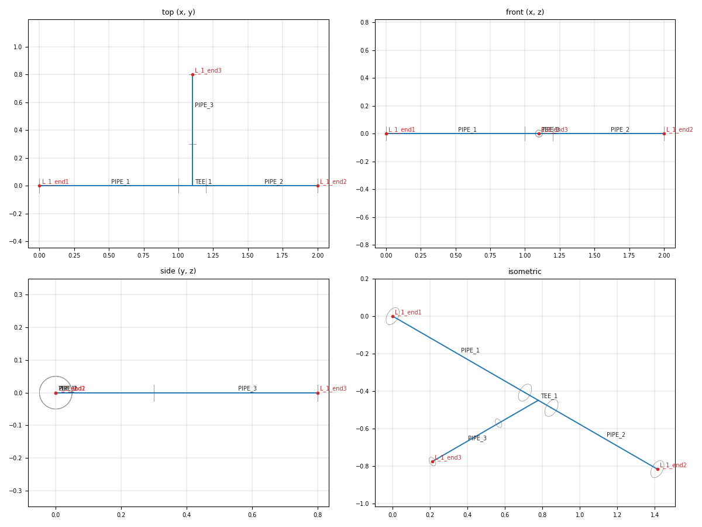

# hexmesh API reference

Everything below is importable from the package root (`from hexmesh import …`)
unless a module is named. Lengths are in metres and angles in degrees, unless
stated otherwise.

---

## Session

### `Session(name="hexmesh", verbose=False)`

Context manager around the GMSH lifetime. On enter it calls
`gmsh.initialize()` and adds a model named *name*; on exit it calls
`gmsh.finalize()`, also when an exception is raised. `verbose=False` limits
GMSH output to errors.

- `Session.show()` opens the GMSH GUI on the current model and blocks until
  it is closed.

`Assembly` builds into whatever GMSH model is current. You can manage
`gmsh.initialize()` yourself instead of using `Session`.

---

## Assembly

### `Assembly(spec, position=None, direction=None, up=None, lc=None, inlet_name="inlet", axial_cell=None)`

An interface-first pipe network ([DESIGN.md](DESIGN.md) §5).

| Parameter | Meaning |
|---|---|
| `spec` | `PipeSpec` of the inlet interface |
| `position`, `direction`, `up` | inlet pose; defaults are the origin, +x and +z. `up` fixes the roll of the cross-section and is made orthogonal to `direction` |
| `lc` | GMSH characteristic length; defaults to outer radius / 4 (it doesn't affect the structured mesh) |
| `inlet_name` | patch name of the inlet |
| `axial_cell` | target axial cell length. A sweep fitting added with `n_layers=None` (`Straight`, `Bend`, `Elbow`, `MiterBend`, `Reducer`, `Transition`, `SplinePipe`, `Closure`, `Switch`) gets `ceil(L / axial_cell)` layers, `L` its centreline length (for `MiterBend`, one end leg, since `n_layers` counts those), or the fewest above that which pass its own checks: a bend's turn below 180° per layer, a spline's or closure's 30° per layer, a profiled reducer's `chord_tol`. Resolved in `add()` (in `close()` for `Closure`) and stored in the fitting, so `to_dict()`, `cell_count()` and `refined(k)` see an ordinary count. `n_layers=None` without `axial_cell` is an `AssemblyError` naming the fitting, and so are `stack_changes` with `n_layers=None` (their indices need the count). Saved in the file; `refined(k)` divides it by k |

**Building the graph (pure Python, no GMSH)**

| Method | Does |
|---|---|
| `add(fitting, names=None, label=None, origin=None)` | Attach *fitting* to the tail and move the tail to its first outlet (a tee's `main`, a wye's `left`). Returns the outlet `Interface`, or a list in port order for multi-outlet fittings. *names* names the outlet interfaces; *label* names the fitting (letters, digits, `_`; unique) |
| `add(interface, fitting, names=None, label=None, origin=None)` | Attach *fitting* to *interface*; the tail does not move. Use the returned outlet to continue that line |
| `close(source, target, fitting, label=None, origin=None)` | Join two existing open interfaces. *source* must be an outlet and *target* an inlet, so flow runs source → target. Use `Closure` for any gap, or a `Straight` / `Bend` that fits exactly |
| `prepend(straight, label=None, origin=None)` | Place a `Straight` upstream of the inlet and make its start the new `inlet`; the inlet name moves with it. Returns the new inlet |
| `extend_open_ends(upstream=5.0, downstream=10.0, cells_per_diameter=4.0)` | Straight runs before the inlet and after every open outlet, in diameters of each end's core (hydraulic diameters for a duct); 0 skips a side. Each run gets `round(diameters × cells_per_diameter)` axial cells. Patch names are unchanged. Ends marked `equipment` are skipped. Call before building |
| `interfaces`, `edges` | All interfaces and fitting edges, in creation order |
| `inlet` | The inlet interface |
| `open_interfaces()` | Interfaces touched by one fitting only: the network boundary |

`names` is a list with one name per outlet, in port order, or a dict keyed
by port name, which may name only some: `names={"branch": "tap1"}`. Port
names are `fitting.port_names`: `Tee` `main`, `branch`; `Wye` `left`,
`right`; every one-outlet fitting `outlet`. An unknown key is an
`AssemblyError` listing the valid ones. A named open end becomes the patch
`<layer>_<name>`.

*origin* is where an importer read the fitting from: a JSON-safe mapping
such as `{"file": "plant.pcf", "line": 7, "record": "ELBOW", "record_id":
"1"}` (task 0096).  It is diagnostic only.  Every error and warning the
assembly raises about that fitting carries it in `where["source"]`.  So
does an error the fitting raises itself while meshing.  Each message
names `<file name>:<line>`
(`fitting #1 Bend(…), plant.pcf:7: path bends with radius 0.05, …`).
It is never saved (`to_dict`, the `.msh` recipe), so a reloaded assembly
has none.  The network builder sets it from each part's provenance.

`add()` also resolves input-only fields from the inlet frame: `toward=`
becomes `roll`, and only `roll` is stored and saved. A bend angle below
2π° (6.28°) gives a `UserWarning` ("looks like radians?"): every angle is
in degrees. The thresholds are data, in `hexmesh.assembly.limits`.

**Validation and size (pure Python)**

| Method | Does |
|---|---|
| `validate(max_cells=None)` | Check every interface and fitting; raise `AssemblyError` naming the offender. With `max_cells`, also reject an assembly over budget |
| `cell_count()` | Exact hex count of the whole assembly |
| `cell_counts()` | Exact hex count per fitting (edge index → count) |

**Realisation (GMSH)**

| Method | Does |
|---|---|
| `mesh(dim=3, *, order=1, incomplete=False, walls_by_fitting=False)` | Build faces, fill all fittings, write physical groups, and mesh. Between the surface and volume mesh, junction wall nodes are projected onto their analytic walls (decision 0029); `projection_report` holds each fitting's largest move, absolute and in local wall radii, and its cells' min corner scaled Jacobian. A move beyond `limits.WALL_PROJECTION_WARN_MOVE` (1) wall radii warns; a folded cell (corner SJ ≤ 0) in a projected fitting or its neighbours raises `AssemblyError`, naming the fitting. An OCC or GMSH error inside a fitting's fill also becomes an `AssemblyError` naming the fitting and quoting the original message. Projected nodes keep stale parametric coordinates, so leave GMSH's mesh optimisers off. Walls are `{layer}_wall`, after the layer outermost where they are, plus `{layer}_end` for the end faces of a terminated layer. With `walls_by_fitting`, each is split per fitting, `{group}_{name}`; *name* is the fitting's label or `<Type><index>` (`Bend3`). *order* 2 (task 0076) raises the checked linear mesh to second order: Hex27, or Hex20 with *incomplete*.  High-order nodes on projected walls are projected too, and a bend's high-order nodes between stations are placed exactly on its arcs (gmsh leaves interior axial edges straight, which folds thin shells in tight bends).  gmsh's high-order optimisers are never run.  A hex whose Jacobian determinant is ≤ 0 at one of its nodes or Gauss4 points raises `AssemblyError` (`second_order_inverted`), naming the fitting.  A `Wye` is rejected before meshing (`second_order_unsupported`): its hexes at the creases invert.  `mesh_order` records the order; `cell_count()` is unchanged (cells, not nodes) |
| `write(path, dim=3, *, order=1, incomplete=False, walls_by_fitting=False, provenance=True)` | `mesh()`, then `gmsh.write(path)`; the format follows the extension.  A `.msh` carries the recipe block (see below) unless `provenance=False`, which writes exactly gmsh's file.  *order*, *incomplete*: as for `mesh()`; `.msh` 2.2 and 4.1 both carry Hex27 and the physical groups, and the recipe block's write line adds `order=2 incomplete=…` |
| `write_openfoam(path, *, interfaces=False, walls_by_fitting=False, provenance=True, order=1)` | `mesh()`, then write a `.msh` for `gmshToFoam`: MSH 2.2 ASCII, without the material-interface groups unless `interfaces=True` (the split rebuilds them as `mappedWall`; kept, they become faceZones); the GMSH options and groups are restored afterwards.  Also writes the role manifest `<stem>.roles.json`.  The recipe block as for `write`; `gmshToFoam` skips it.  *order* other than 1 raises `AssemblyError` (`openfoam_needs_order_1`): `gmshToFoam` reads first-order elements only |
| `group_roles()` | Physical-group name → role (`volume`, `open_end`, `wall`, `interface`), from the graph, as last written by `mesh()` |
| `check_quality(quality_name="minSICN", threshold=None, by="material")` | `QualityReport` per material, or per fitting with `by="fitting"` (see Quality) |
| `fitting_volumes()` | Volume tags per fitting (edge index → tags) |
| `build_faces()`, `fill(order=None)` | The individual steps; `fill` takes any order of edge indices (rule A6) |
| `patch_name(interface)` | Patch name of an open interface |

**Saving and loading (no GMSH)**

| Method | Does |
|---|---|
| `to_dict()` / `Assembly.from_dict(d)` | The network description as plain JSON-serialisable data, and back |
| `save(path)` / `Assembly.load(path)` | The same, as a JSON file (indented, sorted keys) |
| `Assembly.from_msh(path)` | The assembly a `.msh` was written from, by its recipe block: `from_dict(read_recipe(path))`.  `ValueError` when the file has no recipe |
| `refined(k)` | A new assembly at k× the resolution (integer k ≥ 1), built from `to_dict()`: `nang`, every `nrad`, every `n_layers`, a tee's `n_run` / `n_branch` / `n_turn` and a wye's `n_run` / `n_branch` × k (a wye's `n_split` × k up to `WYE_N_SPLIT_MAX` = 6, never below its own value: more turning layers fold the wye, task 0056), the axial cell index of each `stack_changes` entry × k, and `mprg` and `axial_grading` → their k-th root.  Geometry, topology and `mbmp` stay; `first_cell` specs keep their resolved `mprg` (an H core: `wall_bump`), so the levels nest.  **k³× the cells.** |

The file records how the network was built, not its geometry:
- the pose and spec of the first interface;
- every `add`, `close` and `prepend` in order, each with its fitting's
  type and fields, and the index of the interface it starts from
  (`source`) or joins (`close: [source, target]`), or `prepend: true`;
- the interface names, the tail, `lc` and `axial_cell`.

Replaying it recreates the interfaces in the same order, so interface
indices are stable, and editing a fitting in the file moves everything
downstream of it.  An outlet frame set by hand after `add()` is the one
exception; it is stored as an override under `frames`.

**Units.** Lengths are in your unit, stored unconverted; angles in
degrees, as in the fitting.

**Versions.** The format is version 2: `PipeSpec.rot` in degrees.
Version-1 files stored it in radians; `from_dict` and `load` convert them.

The fitting types are a fixed registry, `hexmesh.assembly.intent.FITTING_TYPES`.
An unknown type or field raises `ValueError`.

### `AssemblyError`

A subclass of `ValueError`, raised by validation and graph operations. The
message names the fitting (`fitting #3 Bend(...)`) or interface.

### `Interface`

A node of the graph: `frame` (a `Frame`), `spec` (a `PipeSpec`), `name`,
`index`, `is_open`, `equipment`. Its `face` is set once the assembly is built.
`equipment` marks an end attached to equipment (`from_nozzle`'s inlet, a PCF
equipment connection): nothing is prepended to it and `extend_open_ends`
skips it.  Saved files list the marked interfaces under `"equipment"`.

### `Frame(position, normal, up)`

The absolute pose of an interface. `normal` points downstream, `up` fixes the
roll, and `right = normal × up`. `Frame.from_vectors(position, normal, up)`
normalises the vectors and makes `up` orthogonal to `normal`.

---

## Equipment (`hexmesh.assembly.equipment`)

Pure Python: a drum gives nozzle poses and builds no geometry
(decision 0002).

### `Drum(name, diameter, length, position=(0,0,0), axis=(1,0,0), up=(0,0,1), head="ellipsoidal_2_1", crown_radius=None, knuckle_radius=None, nozzles=())`

- **Dimensions:**
  - `diameter` is the inside diameter;
  - `length` is tangent line to tangent line;
  - `position` is the centre of the first tangent plane;
  - `axis` runs from the first tangent plane to the second.  A vertical
    drum is just `axis=(0, 0, 1)`.
- **Head:**
  - `"ellipsoidal_2_1"` (depth D/4);
  - `"hemispherical"` (depth D/2);
  - `"torispherical"`, which needs both `crown_radius` and
    `knuckle_radius`.  There is no default, because the proportions
    depend on the design code.
- **Angles** are in degrees about `axis` from `up`, right-handed.
- `frame(name) -> Frame`: the nozzle face.  `normal` points away from
  the drum; `up` is the drum axis for a shell nozzle, and the head's
  radial direction for a head nozzle (the drum `up` when centred).
- `validate()` raises `EquipmentError` naming the drum and nozzle when:
  - a face lies inside the shell or head over the nozzle footprint;
  - a nozzle is too large for the drum;
  - a footprint crosses a tangent line or leaves the head (the crown
    region, for a torispherical head);
  - two footprints overlap.
- `head_height(rho)`: the head profile.  `to_dict()` / `Drum.from_dict(d)`
  serialise the drum.

### `Nozzle(name, spec, location)`

`location` is one of:
- `OnShell(axial, angle, projection)`: a radial nozzle on the shell.
  `projection` is measured from the drum axis to the face.
- `OnHead(head, offset, angle, projection)`: on the `"first"` or
  `"second"` head, parallel to the axis.  `projection` is measured from
  the tangent plane to the face.

### `Assembly.from_nozzle(drum, nozzle, lc=None)`

Starts a network at the nozzle face.  The drum is validated first, and
the inlet is named `"{drum.name}_{nozzle}"` (patch `fluid_D101_N1`).
The inlet is marked `equipment`: nothing can be prepended upstream of
it, and `extend_open_ends` skips it.  Saved files keep the drum, which sets the pose on load.

A network cannot yet *end* at a nozzle: `close()` needs the target to be
the inlet of a fitting (task 0010, question for design).

## Cross-section specification

### `PipeSpec(nang=None, nang_w=None, nang_h=None, mbmp=1.0, rot=0.0, n_outer=4)`

A builder for a concentric layer stack.

| Parameter | Meaning |
|---|---|
| `nang` | cells per 90° arc, shared by all layers (circular cores) |
| `nang_w`, `nang_h` | cells along the width and the height of a rectangular core |
| `mbmp` | angular bump factor (1 = uniform) |
| `rot` | rotation of the O-H corners, in degrees; for a rectangle, of the whole rectangle |
| `n_outer` | structural corners; the assembly supports 4 |

#### `.core(name, radius=..., nrad=..., mprg=1.0, first_cell=None)`

The circular core. A `CircleShape(radius, nang)` can be passed as the second
argument instead of `radius=`. `nrad` is the cells from the inner square to
the circle, and `mprg` the radial progression (above 1 refines toward the
inner side).

`first_cell` replaces `mprg` with the largest radial height of a cell at
the circle, the pipe wall. The core ring is thickest at mid-arc, 0.491 R
from the inner arc to the circle
(`hexmesh.core.shape.core_wall_span`), and the progression is solved
there. So no wall cell is larger than `first_cell`, and the cells at the
corners (span 0.4 R) are about 0.81× it. It needs `n_outer = 4`. It raises
`ValueError` if no progression fits (for example `first_cell` ≥ the span),
and `TypeError` together with `mprg`.

**`first_cell` under refinement** (O-H and H alike): `first_cell` is exact
at the level where it is given.  It is resolved there, to `mprg` on an O-H
layer and to `wall_bump` on an H core, and the spec stores the resolved
grading.  `refined(k)` and `refine_spec_dict` keep it nested: an O-H
`mprg` → `mprg ** (1/k)`, which splits each one-sided cell into k of the
same growth, and an H core's `wall_bump` as stored.  The refined levels'
wall cell is the nested first cell, not `first_cell / k`.  Pass
`first_cell=` again on a refined spec to pin the wall cell at that level
instead.

#### `.shell(name, dR=None, nrad, mprg=1.0, *, outer=None, first_cell=None)`

A layer on top of the previous one, from that layer's outline to its own
(decision 0026). Give exactly one of:

- `dR`: the previous outline grown by `dR` (a circle's radius + `dR`; a
  rectangle's `half_w` and `half_h` + `dR`, sharp corners kept);
- `outer`: a new outline, `CircleShape(radius, nang)` or
  `RectShape(half_w, half_h, nang_w, nang_h)`.

So a circle can sit in a rectangle, a rectangle in a circle, and a
rectangle in a rectangle, in any order and number of layers:

```python
from hexmesh.core.shape import CircleShape, RectShape

# cable in a square filler in a round sheath
(PipeSpec(nang=4).core("copper", radius=0.01, nrad=3)
 .shell("filler", outer=RectShape(0.016, 0.016, 4, 4), nrad=2)
 .shell("sheath", outer=CircleShape(0.028, 4), nrad=2))

# a duct with a wall and lagging (an H core, walls graded)
(PipeSpec(nang=4).core("air", RectShape(0.1, 0.05, 4, 4), mprg=1.2)
 .shell("wall", dR=0.002, nrad=2).shell("lagging", dR=0.03, nrad=3))
```

- **Ring.** Each shell is four blocks, one per side. Its corner lines
  leave the previous layer's corners away from the centre and end at the
  new outline: radially on a circle, at the corner in that quadrant on a
  rectangle. A circle in a flat rectangle has skewed corner lines; a
  rectangle in a circle splits it into unequal arcs.
- **Counts.** In a stack of rectangles every outline takes the core's
  `(nang_w, nang_h)`, which may differ: a 2:1 duct with lagging can be
  8 × 4 throughout (decision 0041). Once a circle is in the stack, every
  outline has the same count on every side (`nang = nang_w = nang_h`),
  since a circle carries one count. Any stack with a rectangle has
  `n_outer = 4`. `ValueError` (`rect_stack_counts_unequal`) names the
  layer.
- **Containment.** Each outline lies inside the next all round, by at
  least `limits.OUTLINE_MIN_GAP` (10⁻³) of the outer one's largest
  extent. `validate()` names the layer, the gap and its direction.
- **Symmetry period.** That of the least symmetric outline: a circle in a
  2:1 rectangle has period 180°.
- **`first_cell`** sets the radial height of the cell at the layer's outer
  boundary in place of `mprg`. For a circle grown by `dR` it is exact all
  round. Otherwise it is solved on the ring's longest radial, so no wall
  cell is larger: the corner lines (`√2·dR` for a rectangle grown by `dR`),
  or, for a shell that changes shape, the longest line between
  corresponding points of the two outlines
  (`hexmesh.core.shape.longest_radial`). The solver is
  `hexmesh.core.grading.progression_for_first_cell(thickness, n_cells, h)`.

`.square_shell()` is gone: use `.shell(name, outer=RectShape(...))`.
Spec files that contain one still load, as that ring.

#### `.core(name, half_w=..., half_h=..., first_cell=None, mprg=None)` — rectangular duct

A rectangular core of width `2·half_w` along the frame's `right` and height
`2·half_h` along `up` (needs `PipeSpec(nang_w=…, nang_h=…)`, or a
`RectShape`). **Since 0.4.0 it is an H face by default:** one Cartesian
patch with graded walls (below; decision 0036, task 0087). On the O-H
face the friction factor doesn't converge with refinement, and a
Cartesian grid of the same cells converges at second order
([RESEARCH §7.11](docs/RESEARCH.md)). `layout="oh"` with `nrad=` keeps the
five-patch O-H face; `nrad=` alone is a `ValueError` naming both fixes.
Circles stay O-H.

- **Symmetry period** (DESIGN §6.1, `spec.period`): 90° for a square
  (`half_w == half_h` and `nang_w == nang_h`), 180° for any other
  rectangle. Corners match, and loop twist is absorbed, modulo that
  period; a mismatch of exactly half of it is ambiguous and rejected.
- **"Easy way" and "hard way" bends.** `up` sets which side is the
  height; a bend's `roll` sets its plane. `roll=0` bends toward `up`,
  across the height: the easy way for a wide, flat duct. `roll=90` bends
  across the width: the hard way. The centreline radius must exceed the
  duct's half-extent in the bend plane (`half_h` for roll 0, `half_w` for
  roll 90). Splines and closures, whose bend plane varies, are checked
  against the half-diagonal.
- **Fittings.** `Straight`, `Bend`, `MiterBend`, `SplinePipe`,
  `Closure`, `Reducer` (to another size), `Transition` (to a circle,
  or to another rectangle) and `Tee` as a duct tap (a rectangular or
  round branch, or a full-width tap; tasks 0057, 0070, under `Tee`).
  `Elbow` (ASME pipe schedules) and `Wye` reject ducts.
- **Diameters.** `extend_open_ends` measures a duct in hydraulic
  diameters, 4A / P_w = `4·half_w·half_h / (half_w + half_h)`.
- **Cells.** H: `nang_w·nang_h` per section. O-H:
  `nang_w·nang_h + 2·(nang_w + nang_h)·nrad`.

#### `.core(name, half_w=..., half_h=..., nrad=..., mprg=1.0, layout="oh")` — O-H duct

The rectangle with the circle's five-patch O-H layout: a centre
rectangle and a ring of uniform thickness, `0.4·min(half_w, half_h)`, so
every corner radial runs at 45° to the walls. `nrad` is the cells across
the ring. `first_cell` is not supported (`TypeError`). The default
before 0.4.0; it stays for comparison and for saved descriptions.

#### `.core(name, half_w=..., half_h=..., layout="h", first_cell=None, mprg=None, wall_bump=None)` — H duct

The rectangle as one Cartesian patch of `nang_w × nang_h` cells
(decision 0036; tasks 0084, 0087): the default, so `layout="h"` is
optional. An H core has no ring, so no `nrad` (`ValueError` naming both
fixes). Its sides are graded toward both walls by a two-sided `Bump`,
given by one of (none: uniform):

- `first_cell`: the end cell on every side, at all four walls;
- `mprg`: the wall growth ratio, the second cell from a wall over the
  first, on every side;
- `wall_bump=(c_w, c_h)`: the coefficients themselves, for the `nang_w`
  and `nang_h` sides (< 1 refines toward the walls).

`first_cell` and `mprg` resolve to `wall_bump` when the spec is built,
one coefficient per side, and `to_dict` stores that, so a refined series
nests.

An H port joins an O-H port only through a `Switch` (or a `Transition`
with an H end, which embeds one; task 0085).  Joined directly, the
assembly rejects the pair before GMSH as switch class 1, a pillow, and
names `Switch`.

**Shells** (task 0086). `.shell()` works on an H core as on a rectangular
O-H one, with any outline (decision 0026). The first shell's ring starts
at the core's four corners, so its corner lines lie in the shell and the
core stays one Cartesian patch (decision 0036, option B). Every ring's
sides take the core's wall grading, so the lines across a thin wall stay
straight. In a shell that changes shape (a rectangle in a circle) the
copied grading raises the ring's non-orthogonality: with a 4:1 core
graded to a first cell of h/200 inside a circle, the predicted 84° is
rejected before GMSH (the 0047 tiers).

**Fittings on an H core.** Every fitting that takes a rectangular port
takes an H one: the sweeps, `Switch`, `Transition` (one H end; a
rectangle to a rectangle with H at both ends is a `Reducer`, which
changes `half_w` and `half_h` on H faces) and `Tee` as a duct tap
(below). `Wye` takes circles only.

Cells: `nang_w·nang_h + 2·(nang_w + nang_h)·Σ nrad` over the shells, per
section.

`spec.to_dict()` / `PipeSpec.from_dict(d)` serialise a spec.  `mprg` is
stored as resolved, so a spec built with `first_cell=` reloads with the
same grading.  The core's `layout` is written; a description without it
(written before 0.4.0) loads as `"oh"` and reproduces its mesh.

`spec.with_radii(radii, mprgs=None)` gives the same circular stack
with core radius `radii[0]` and shell thicknesses `radii[1:]` (and,
if given, radial gradings `mprgs`, core first).  Every count, name and
the topology stay.  Stacks of `dR` shells only; extra shells beyond
`radii` are dropped.

The assembly supports any stack of circle and rectangle outlines through
the sweep fittings (`Straight`, `Bend`, `MiterBend`, `SplinePipe`,
`Closure`, `Reducer`); bend radii are checked against the outermost
outline. `Elbow`, `Tee`, `Wye` and drum nozzles need every outline
circular.

---

## Fittings

**Axial grading.** `Straight`, `Bend`, `Elbow`, `Reducer`, `SplinePipe` and
`Closure` take `axial_grading=1.0`: the ratio of consecutive axial cell
lengths, inlet → outlet (GMSH's "Progression" law). Above 1 refines toward
the inlet, below 1 toward the outlet. `Straight` grades its axial curves.
The other fittings place one station per layer, so they space their
stations by the same law (for `SplinePipe` and `Closure`, in arc length
plus turning angle). The cell count is unchanged. `MiterBend`, `Tee` and
`Wye` are not graded; `Transition` spaces its stations like `Reducer`.

Every fitting has three parts:
- `ports(inlet, spec)`: where its outlets go;
- `validate(frames, spec)`: geometry checks;
- `cell_count(frames, spec)`.

All three are pure Python. Fittings never build their own interface faces;
they only fill between the faces the assembly built.

**Layer termination (decision 0006).**  `Straight` and `Bend` take
`stack_changes=((i, spec), …)`: from axial cell `i` on (`0 < i <
n_layers`), the stack is `spec`.  Each change adds or removes whole
outermost layers; the remaining layers must keep their names, radii,
`nrad` and grading.  `validate()` checks this before GMSH and names the
fitting and the layer.
- The station face at a change is built with the fuller stack.  The
  ending layer's annulus there becomes `{layer}_end`.
- `ports()` returns the last stack for the outlet.
- `cell_count()` counts each layer only in the cells where it is present.
- In a `Straight`, a change adds an internal station.  The axial
  progression continues across it, so the nodes are those of the unsplit
  run.

**Switch classes (`hexmesh.assembly.signature`, DESIGN A4).**  Each
fitting declares `strategies`: the switch classes it can bridge between
its inlet and each outlet.  `Straight` and `Bend` declare `{0, 1}`
(layer termination), `Reducer` declares `{0, 2}` (grading-only, below),
and the other fittings declare `{0}`.  A
frozenset applies to every port pair; a tuple gives one per outlet.

- `signature(spec)` is the hashable connectivity signature:
  - per layer: name, layout (`oh_core`, `h_core` or `annulus`), `nrad` and `mprg`;
  - per section: `n_outer`, the symmetry period, `nang` and `mbmp`.

  Radii and `rot` are geometry, not connectivity, so they are left out.
- `classify(a, b)` sorts a pair into a class and lists what differs:

  | Class | Meaning | Bridged by |
  |---|---|---|
  | 0 | equal | any fitting |
  | 1 | whole outermost layers on one side only | layer termination (task 0018) |
  | 2 | same layers, different counts or grading | grading only: a sweep that interpolates grading per station (`Reducer`); counts: a density switch (decision 0003) |
  | 3 | anything else | a topology switch (decision 0003) |

  A class-2 pair whose only differences are per-layer radial `mprg` is
  marked `grading_only` (decision 0016), as class 1 is marked
  `ends="wall"`.  Declaring class 2 bridges those pairs only; a count or
  `mbmp` difference is still rejected:

  > Reducer: outlet spec differs from the inlet in core nrad (3 vs 5); core
  > mprg (1.0 vs 1.2). That is switch class 2 beyond radial grading (counts
  > or mbmp), which needs a density switch (decision 0003); Reducer bridges
  > grading-only class-2 pairs (radial mprg) only

`Assembly.validate` rejects an undeclared class before GMSH, naming the
fitting, the field and the class, for example:

> Reducer: outlet spec differs from the inlet in nang (4 vs 8). That is
> switch class 2 beyond radial grading (counts or mbmp), which needs a
> density switch (decision 0003); Reducer bridges grading-only class-2
> pairs (radial mprg) only

### `Straight(length, n_layers=None, axial_grading=1.0)`

A straight run with `n_layers` axial cells.

### `Bend(radius, angle, n_layers=None, roll=0.0, axial_grading=1.0, toward=None)`

A circular-arc bend with centreline `radius` and `angle` in (0°, 360°). It
places one station per axial layer, joined by exact arcs. `roll` rotates the
bend plane about the pipe axis: 0 bends toward `up`, 90 toward `right`.
`radius` must exceed the outer radius (for a duct, its half-extent in the
bend plane).

`toward=(x, y, z)` is an absolute direction to turn toward, instead of
`roll`, which is relative to an `up` that changes after every fitting.
`add()` turns its component across the inlet into `roll`. It must be at
least 1° from the inlet axis (`limits.TOWARD_MIN_ANGLE`), and needs a
positive `angle`; giving both `roll` and `toward` is an error. The same
holds for `Elbow` and `MiterBend`.

### `Elbow(angle=90.0, schedule="long", n_layers=8, roll=0.0, axial_grading=1.0, toward=None)`

A `Bend` whose radius follows the pipe: 1.5 D for `"long"` and 1 D for
`"short"` (ASME B16.9), where D is the outer diameter of the inlet spec.

### `MiterBend(radius, angle, n_cuts=1, n_layers=2, roll=0.0, toward=None)`

A segmented bend: straight pieces joined at `n_cuts` planar cuts.

- **Shape.** The centreline is the tangent polygon of `Bend(radius, angle,
  roll=roll)`, so the ports are identical. The end legs are
  `radius·tan(cut/2)` long.
- **Layers.** `n_layers` axial cells per end leg, and `2·n_layers` per inner
  segment.
- **Cuts.** Each cut is the exact ellipse where the two pipes meet, and each
  cut turns `angle / n_cuts`, which must lie in [1°, 90°].
- **Measured quality.** min SICN equals the straight-pipe value up to a 60°
  cut, and is about 0.18 at a single 90° cut.

### `Reducer(outlet, length, n_layers=None, axial_grading=1.0, profile=None, chord_tol=1e-3)`

A concentric cone from the inlet spec to `outlet`; a larger outlet makes it an
expander. **It may change sizes and radial grading** (radii, half-widths,
`dR`, and `mprg` per layer). The outlet must equal the inlet in everything
else: the layer names and order, each layer's outline shape (a circle stays
a circle; use `Transition` to change shape), `nrad`, counts, `mbmp`,
`n_outer` and `rot`. Validation names the fields that differ. Wall nodes
lie exactly on the cone, or on the planes of a rectangle's sides.

Stations interpolate the sizes linearly and each layer's `mprg`
geometrically, `mprg_in^(1−u) · mprg_out^u`, at the same fractions. So a
wall-resolved pipe can change diameter: give both sides the same absolute
`first_cell`, and the solved `mprg` differs (decision 0016):

```python
pipe = lambda r: PipeSpec(nang=8).core("fluid", radius=r, nrad=8, first_cell=1e-3)
asm = Assembly(pipe(0.1))
asm.add(Reducer(pipe(0.06), length=0.2, n_layers=6))
```

**Profiles** (decision 0008).  `profile` replaces the cone by a radius
ratio `r(s) = R(s)/R_in` along the axis, `s` from 0 to 1.  Every radius of
the stack scales by `r(s)`, so `outlet` must be the inlet scaled by `r(1)`.
All forms are plain tuples, so they save and load:

| `profile` | shape |
|---|---|
| `("cosine", s0)` | smooth constriction (`s0 > 0`) or bulge (`s0 < 0`): `1 − s0·(1 + cos 2π(s − ½))`, `1 − 2·s0` at the middle, back to the inlet radius (RESEARCH §7.3).  `limits.COSINE_S0_MIN ≤ s0 < limits.COSINE_S0_MAX`, i.e. −1 (a bulge to 3 R) up to 0.5 (a closed throat); `s0 = 0` is a plain pipe |
| `("venturi", beta, divergent)` | classical venturi (ISO 5167-4): 21° convergent to `beta·D`, throat of length `d`, `divergent` 7°–15° back to `D`, then straight.  Lengths follow from `D`; too short a `length` is rejected with the length needed.  Corners are sharp and always land on stations |
| `((0, 1), (s, r), …, (1, r_out))` | a table, interpolated by a monotone cubic (PCHIP): no overshoot |

There is one station per axial layer, and every wall node at a station is
exactly on R(s).  Between stations the wall is a straight chord.
`validate()` rejects a chord further than `chord_tol · R_in` from the
profile, before GMSH, and names the `n_layers` needed:

```python
pipe = PipeSpec(nang=6).core("fluid", radius=0.05, nrad=3)
asm = Assembly(pipe)
asm.add(Reducer(pipe, length=0.2, n_layers=40, profile=("cosine", 0.25)))
```

A cosine constriction with `s0 = 0.25` needs 36 layers at the default
tolerance.  Each layer adds a full cross-section of cells, so a fine
profile is cheap compared with refining `nang` (doubling `nang` and `nrad`
quadruples the cells per layer).

### `Transition(outlet, length, n_layers=None, axial_grading=1.0)`

A straight transition that changes outline shapes: a circle to a
rectangle (either way), or a rectangle to one of another size or aspect
(decision 0009, task 0029), in every layer of a stack at once (decision
0026, task 0046): an insulated round pipe into an insulated duct, say.
`outlet` is the outlet spec.

- **Specs.** Equal in everything but each layer's outline: the same
  layers (names, order, `nrad`, `mprg`), the same counts per side in
  every layer (a circle's `nang` equals a rectangle's `nang_w` and
  `nang_h`), `mbmp` and `rot`. Then the two faces have the same mesh
  connectivity (switch class 0). A layer can't start or end in one (use
  `stack_changes`). Circles at both ends in every layer is a `Reducer`:
  **`Reducer` changes sizes, `Transition` shapes.**
- **Stations.** One per axial layer, spaced by `axial_grading` as for
  `Straight`. Each layer's station outline is the point-by-point blend of
  its two end outlines at equal arc-length fractions; a shell's corner
  lines blend with them. So wall and interface nodes lie on the station
  curves, and the end faces are the exact end outlines.
- **Nesting.** Each station's outlines must nest with the containment gap
  of `.shell()`, checked before GMSH at every station and 33 fractions
  between; the error names the station and the layer. (Measured: when the
  ends nest, the blend has kept every station nested.)
- **Corners.** Corner k meets corner k: a circle's corners at 45° + k·90°
  go to the rectangle's corners, with no twist.
- **An H end** (tasks 0085, 0086). One end may be an H duct
  (`layout="h"`) with the other end's counts per side, with or without
  shells. The transition blends to the O-H face of that rectangle (the
  other end's `nrad` and `mprg`, the H end's shells) and embeds a
  `Switch` in the slabs at the H end: the fewest of the `n_layers` that
  give it the switch's shortest length (`Switch`, `length`), at equal
  shares of the length. At least one layer stays for the blend, else a
  `ValueError` names the `n_layers` needed. The same rectangle at both
  ends is a `Switch`; H at both ends is a `Reducer`.

### `Switch(length, n_layers=None, outlet=None)`

Changes a rectangular duct between the O-H and H sections (decision
0036, task 0085): switch class 1, a pillow (DESIGN A4), in either
direction. The rectangle, counts, `mbmp`, `rot` and name stay.

- **`outlet`.** The outlet spec. From an O-H inlet it defaults to the
  ungraded H face; give it to grade the H walls (`first_cell=`,
  `wall_bump=`). From an H inlet it is required (it carries `nrad` and
  the ring's `mprg`).
- **Blocks.** Six (the capped construction): the ring sheets close as a
  cup across the duct, open toward the O-H port. A core block runs from
  the O-H face's centre rectangle to a level one ring thickness t before
  the H face, a frustum cap joins it to the whole H face, and four side
  blocks fill the ring. The H grading starts at that level.
- **`length`.** Checked before GMSH: at least
  `max(1.25 t, Δ/0.4, t + Δ/1.0)` (`limits.SWITCH_MIN_LENGTH`,
  `SWITCH_MAX_SHEAR`, `SWITCH_MAX_CORE_SHEAR`; task 0086).  Δ is the
  largest shift of a wall node between the O-H face's sides and the H
  face's graded ones, 0 on an ungraded H face, so there the rule is
  1.25 t.  On a graded face the side blocks' cells shear by about Δ/L
  and the core block's by Δ/(L − t).  The error gives Δ, the limits and
  the shortest length. `n_layers` counts the core's cells (and the
  wall's); `None` resolves from `axial_cell` over `length − t`.
- **Quality.** On an ungraded H face, min scaled Jacobian 1/√3 = 0.577 at
  any aspect ratio, `nrad` and length, non-orthogonality up to about 54°.
  On a graded one, `validate()` predicts the empirical bound at the
  switch's shear Δ/L (`limits.SWITCH_SHEAR_SJ`, measured over 450
  switches: 0.577 up to 0.1, 0.550 to 0.2, 0.548 to 0.3, 0.546 to 0.35,
  0.501 to 0.4), and `mesh()` applies the SJ tiers to the meshed cells
  too, naming the switch. **Steep wall gradings push the switch's
  non-orthogonality towards 70–80°** (first cell h/100 to h/200, a/b 4),
  and it rises with the length and the ring's `nrad` (74° at the
  shortest length with nrad 6, 79.5° at 20 t). So `mesh()` also checks
  the meshed non-orthogonality on the outline tiers: a warning above
  `OUTLINE_NONORTH_WARN` (70°), an `AssemblyError` above
  `OUTLINE_NONORTH_MAX` (80°). The same checks run on a `Transition`'s
  embedded switch and on a graded H main's switch legs.
- **Shells.** The shells run through unchanged: both faces' first shell
  starts at the rectangle's corners. The outlet's shells must be the
  inlet's; the default H outlet copies them.
- **Cells.** `nang_w·nang_h·(n_layers + nrad) + 2·(nang_w + nang_h)·nrad·n_layers`,
  and per shell `2·(nang_w + nang_h)·nrad_shell·n_layers`.

### `SplinePipe(points, n_layers=None, end_tangent=None, axial_grading=1.0)`

A pipe along a cubic spline through `points`, parametrised by chord length.

- **Start.** `points[0]` must be the inlet position; the spline leaves along
  the inlet direction.
- **End.** It ends along `end_tangent` if given, otherwise with zero
  curvature.
- **Stations.** One station per axial layer, spread by arc length plus
  turning angle, with rotation-minimising (Bishop) frames. The outlet roll
  follows from the curve.
- **Validation.** It rejects curvature tighter than the outer radius, and
  more than 30° of turn per layer.

### `Tee(run_length=None, branch_length, branch_radius, n_run=3, n_branch=3, n_turn=2, roll=0.0, toward=None, angle=90.0, branch=None, face=None, margin=None, dome=None, sheet=None, n_wall=None)`

A centred side-branch tee, perpendicular or a lateral (`angle`), built as
a block layout.

- **Ports.** `port_names = ("main", "branch")`; it returns `[main, branch]`.
  The main outlet is `2·run_length` downstream of the inlet and keeps the
  inlet's `up`. The branch leaves along the inlet's `up` rolled by `roll`
  about the main axis (0: `up`; 90: `right`) and ends `branch_length` from
  the main axis, measured along the branch axis.
- **Orientation.** `roll` must be a multiple of the section's period (90°
  for a circle), so the junction's corners land on the inlet face's: 45° is
  rejected, naming 90°. `toward=(x, y, z)` gives the branch direction
  instead; `add()` picks the nearest allowed roll and rejects a direction
  more than 1° off it (`limits.JUNCTION_TOWARD_TOL`), naming the angle.
  Its component across the run sets the roll, and `angle` the lean.
  Other rolls need a twisting fitting (decision 0024).
- **Laterals** (decision 0031, task 0060). `angle` is the angle in degrees
  from the run's downstream direction to the branch axis, in (0, 90]: 90 is
  a tee, 45 a 45° lateral leaning downstream. The axis passes through the
  T-point; the branch port's `up` is the axis's normal in the branch plane.
  The saddle is the exact cylinder–cylinder intersection (RESEARCH §3.1),
  so the hole reaches farther downstream (the acute side) than upstream,
  and the room checks below are measured there. The worst cell sits at the
  acute crotch, and quality falls with the angle. The smallest r/R that
  passes `PREDICTED_SJ_MIN` at a long run is 0.20 at 90°, 0.29 at 60°,
  0.50 at 45° and 0.875 at 35°; reaching `PREDICTED_SJ_WARN` needs 0.57 at
  90°, 0.88 at 60°, and no ratio below about 57°, so **those laterals
  always warn**. **30° laterals are rejected at every ratio** (0.074 at
  r/R 0.9). The meshed SJ equals the prediction at these edges (to 1e-3).
  A lateral's rejection or warning names the smallest r/R that reaches
  the tier at its angle (`Tee.smallest_ratio`). A branch leaning upstream is the same lateral
  with the run reversed. Duct taps reject `angle` (`angle_on_duct_tap`;
  shoe taps are task 0063).
- **Run length.** `run_length=None` (or omitted) is resolved by `add()` to
  `branch_radius + T + R/2` (T the total shell thickness), or the shortest
  run whose predicted quality reaches the warning tier below, whichever is
  longer (for a lateral, the hole's downstream reach + R/2; where no run
  reaches the warning tier, the shortest that passes the minimum); the
  number is stored, so `to_dict()` stays explicit.
  `branch_length` and `branch_radius` are required.
- **Layers.** `n_run`, `n_branch` and `n_turn` are the axial layers of the
  runs, the branch, and the turning blocks.
- **Shells.** Any stack of circular shells runs through the junction
  (decision 0028). The branch copies the main's shells: same names,
  thicknesses, `nrad` and `mprg`. Each interface group (`interface_fluid_steel`
  …) and the outer wall continue from the main through the junction into
  the branch. Wall and shell-boundary nodes lie on their offset cylinders
  to rounding: the faces are plates through cylinder points (3e-4 of the
  radius), and `mesh()` projects the nodes the rest of the way (decision
  0029, task 0051).
- **Limits.** Circular layers, `rot = 0`, and a branch ratio r/R of at
  most `limits.TEE_MAX_RATIO` (0.95): above it the saddle's curved sides
  pull the meshed quality below the prediction (0.30 against 0.57 at
  0.99). It is rejected with the hint "an equal tee, or a branch radius
  ≤ 0.95 R"; r = R is `equal_tee_unsupported` (planned through the
  wye-family layout). With T the total shell thickness, `run_length` must
  exceed `branch_radius + T` (for a lateral, the outer hole's reach
  downstream), and `branch_length` the turning station's height,
  `R + T + (branch_radius + T)/2` (for a lateral, its distance along the
  branch axis that clears the main by that much on the acute side). Both
  are checked before GMSH.
- **Predicted quality.** `validate()` computes the layout's min corner
  scaled Jacobian before GMSH (`Tee.predicted_sj`). Below
  `limits.PREDICTED_SJ_MIN` (0.1) it raises; below
  `limits.PREDICTED_SJ_WARN` (0.3) it warns and records the warning in
  `Assembly.warnings`. Both messages give the shortest `run_length` that
  reaches the tier (`Tee.shortest_run`), or say that none does: the
  junction core's quality is set by the branch ratio, about 0.26 at
  r/R 0.5 at any run. **Tees with r/R below about 0.57 always warn** (task
  0052).
- **Duct taps** (decision 0033, task 0070). On a rectangular main the tee
  is a duct tap: `branch=RectShape(half_w, half_h, nang_w, nang_h)` or
  `branch=CircleShape(radius, nang)` (`branch_radius` is the pipe
  shorthand; on a pipe, `branch=CircleShape` is the same as it).
  - **Face and side.** `face="wide"` (default) or `"narrow"`; `roll` 0 puts
    the tap on the +`up` face (wide face of a duct wider than deep) or the
    +`right` face (narrow), 180 on the opposite one. `toward` is rejected.
  - **Branch frame.** The branch keeps the main's counts per side (a
    class-0 port), so its section must have the main's `(nang_w,
    nang_h)`, or for a round tap the main must have equal counts and
    `nang` match them. On an up/down face the branch's `up` is the main's
    axis, so its `half_w`/`nang_w` run across (along the main's `right`)
    and `half_h` along the main; on a right/left face its `up` is the
    main's `up`, so `half_w` runs along the main and `half_h` across.
  - **Size.** A tap inside the face (pillowed) reaches at most
    `limits.DUCT_TAP_MAX_RATIO` (0.93) of the face's half-width across. A
    rectangular tap exactly as wide as the face is a **full-width tap**
    (below). In between is rejected with the largest tap that fits.
  - **Full-width taps** (task 0057). The pipe tee's layout with straight
    edges: the hole's corners lie on the duct's creases and every wall is
    a plane. No tunables (`margin` … `n_wall` are rejected); `n_turn` is
    the turning blocks' layers. `run_length=None` resolves to the tap's
    half-length along the main plus half the duct's smaller half-extent.
    The predicted SJ (meshed = predicted) depends only on the tap's length
    along the main, p, relative to the duct's ring thickness t =
    (1 − OH_RATIO)·min(half_w, half_h): 0.12 at p = 0.5 t, 0.20 at
    0.75 t, 0.40 at 1.5 t, 0.55 at 2.25 t, 0.58 (1/√3) at 3.75 t and beyond. Neither `run_length`, `nang`
    nor the aspect changes it, so its tier messages suggest a longer tap.
    `branch_length` must exceed the turning station, the face plus half
    the branch's smaller half-extent.
  - **Tunables.** `margin`, `dome`, `sheet` (layout shape) and `n_wall`
    (cells from a station to the hole) are resolved by `add()` to the best
    predicted quality and stored, so `to_dict()` stays explicit; give them
    to override. `run_length=None` resolves to the tap's reach along the
    main plus 4 ring thicknesses.
  - **Quality.** The predicted-SJ tiers as above. A round tap's prediction
    can overestimate by up to 0.13, so for round taps the prediction only
    rejects (below 0.1) and `mesh()` applies both tiers to the meshed
    cells, naming the fitting: one warning, not two. A narrow-face tap on a duct of
    aspect ≥ `limits.DUCT_TAP_NARROW_ASPECT_WARN` (3) warns and suggests
    the wide face (min SJ about 0.13, non-orthogonality up to 82°).
  - **On an H main** (task 0086). The junction's blocks stay O-H: the
    main's rectangle pillowed into an O-H face with a ring of `nrad`
    cells, and a `Switch` leg at each H port, the main's two and a
    rectangular branch's (a round branch stays O-H). Each leg is the
    switch's shortest (`Switch`, `length`), with `n_run` layers (`n_branch`
    for the branch), and comes out of `run_length` and `branch_length`:
    a room error from the junction inside names the legs. The ring is
    derived from the H face: `nrad` is the number of H cells whose
    midpoint lies within a ring thickness of the wall on the smaller side
    (at least 1), and `mprg` puts the ring's wall cell at the H face's.
    Override with `Tee(nrad=, mprg=)`, on an H main only. Both are stored
    resolved, so `to_dict()` is explicit and `refined(k)` gives `nrad·k`,
    `mprg^(1/k)`. A quality warning names the ring. On a graded H main,
    `mesh()` checks the switch legs' meshed SJ and non-orthogonality
    (`Switch`, quality); a round tap's SJ check takes the whole tee.
  - **Limits.** Single-layer ducts, `rot = 0`, `n_outer = 4`;
    `branch_length` beyond the face.

### `Wye(angle, run_length, branch_length, n_run=None, n_branch=None, n_split=None, roll=0.0, toward=None)`

A symmetric Y-junction, built as a block layout around a hub (prototype,
decision 0017).

- **Ports.** `port_names = ("left", "right")`; it returns `[left, right]`,
  both with the inlet's spec. The daughters leave the bifurcation point,
  `run_length` downstream of the inlet, at ±`angle`/2 in the inlet's
  (normal, `right`) plane rolled by `roll`; `right` turns toward the
  rolled `right`. Each outlet is `branch_length` from the bifurcation
  point and keeps the rolled `up`.
- **Orientation.** `roll` is a multiple of the period, as for `Tee`;
  `toward` is the direction the `right` daughter turns toward, snapped the
  same way.
- **Layers.** `n_run` and `n_branch` are the axial layers of the straight
  runs (inlet, each daughter); `n_split` those of each daughter's turning
  block.  A count left `None` is resolved in `add()`: the fewest layers
  that keep every edge it divides, the hub cap's arcs included, no longer
  than the angular cell at the wall, (π/2)·R / `nang` (or `axial_cell` if
  shorter).  A resolved `n_split` is capped at `limits.WYE_N_SPLIT_MAX`
  (6), because more turning layers degrade the turning blocks and fold
  120° wyes; so the knee arcs stay coarser than the angular cell, about
  2–3× at `nang` 8.  An explicit count above the cap is allowed, and a
  fold is caught by `mesh()`'s inversion check, which names the wye.
  `refined(k)` holds `n_split` at the cap too (task 0056).
- **Limits of the cap.**  Default wyes are reliable to about `nrad` 6;
  at 120° with `nrad` 12 only `n_split` 3 is safe (4 folds).  So
  `refined(k)` of a wye may fold beyond k = 2; `mesh()` raises
  `AssemblyError` naming the wye.  The wall error at the knee, 3–6 % of R
  away from the creases, doesn't fall with `nang` (the knee arcs stay at
  6 layers), so grid studies over wyes stop at k = 2.
- **Limits.** Circular core and shells, `rot = 0`, `n_outer = 4`, and
  `angle` from 30° to 120°. `run_length` must exceed R·(tan(angle/2) + 0.1)
  and `branch_length` R·(cot(angle/2) + 1); the messages give the numbers.
- **Shells** (task 0053).  Each shell boundary is the wall's level set at
  R + T_l, built and projected like the wall.  Checked before gmsh:
  - `angle` ≥ 40° (`limits.WYE_SHELL_MIN_ANGLE`; the shell cells' min
    corner SJ is 0.11–0.13 at 40°, 0.04 at 30°);
  - total shell thickness T ≤ R · min(0.65 tan(angle/2), 0.55)
    (`WYE_SHELL_TAN_FACTOR`, `WYE_SHELL_MAX`): 0.27 / 0.38 / 0.55 R at
    45° / 60° / 90°–120°.  The measured limits are 0.28 / 0.40 / 0.59 /
    0.84 R at 45° / 60° / 90° / 120°; past them the daughters' shells fold.
  A pipe wall (T ≈ 0.04 R) is well inside.
- **Quality warning.** `validate()` warns when the layout's predicted min
  corner SJ is below `PREDICTED_SJ_MIN` (0.1): single-layer wyes at 30°
  and 35°.  There is no reject tier for the wye until its layout redesign.
- **Wall.** The union of the inlet and daughter tubes, with a sharp crotch
  crease. `mesh()` projects the junction's wall nodes onto it (decision
  0029), so they lie on it to rounding; the faces between them are
  chords. At the crease the chord error is about 3 %, 1 % and 0.3 % of R at
  `nang` 4, 8 and 16 (task 0051). The hub's spherical cap is resolved by
  `n_run`, not `nang`: chords there stay about 10 % of R.
- **Quality.** Measured, not gated (decision 0017). The worst cells, min
  scaled Jacobian 0.06–0.16 depending on the angle, sit next to the hub's
  back corners. The numbers are in task 0030; projection leaves them
  within 0.04 (task 0051).

### `Closure(n_layers=None, tension=1.0, axial_grading=1.0)`

For `close()` only. It runs a cubic Hermite centreline between two existing
interfaces, leaving and arriving along their normals. The roll mismatch is
taken modulo the cross-section's symmetry period (90° for a circle or a
square, 180° for a rectangle) and spread along the run; exactly half the
period is ambiguous and rejected.
`tension` scales the end tangents. It is rejected if the curve is tighter
than the outer radius, or turns more than 30° per layer.

---

## Quality

### `Assembly.check_quality(quality_name="minSICN", threshold=None, by="material")`

**Metric.** `quality_name` is either a GMSH element quality (`"minSICN"`,
`"minSIGE"`, `"gamma"`, …) or a hex metric from `hexmesh.quality_hex.METRICS`:

| Metric | Ideal | Better | Default bad limit |
|---|---|---|---|
| `scaled_jacobian` | 1 | higher | ≤ 0 (folded corner) |
| `nes` | 0 | lower | ≥ 1 (degenerate angle) |
| `mean_ratio_min`, `shape_regularity_knupp`, … | 1 | higher | ≤ 0 |
| `skewness` | 0 | lower | ≥ 1 |

- **`scaled_jacobian`** is the minimum over the 8 corners of
  det(J)/(|e1||e2||e3|) (Knupp).  Verdict also counts a ninth Jacobian
  at the element centre.
- **`nes`** is the normalized equiangle skewness,
  max((θmax − 90°)/90°, (90° − θmin)/90°) over the 24 face angles
  (GAMBIT/Fluent EquiAngle skewness).

Both are the metrics of RESEARCH §4.2, which suggests targets of
scaled Jacobian > 0.6 and NES < 0.5.  Pass those as `threshold` to
enforce them.

**Grouping.** `by="fitting"` gives one row per fitting, named
`"#<index> <Type>"` (for example `#1 Tee`), so a failure names the
fitting.

**Note.** SICN is aspect-sensitive: it rates long, thin cells as poor.
The two shape metrics are not, because a stretched box scores ideal.

### `QualityReport`

Returned by `check_quality`. It holds one `RegionQuality` per group, under
`regions` (each has `name`, `fitting`, `worst`, `best`, `mean_quality`,
`n_bad`), and these attributes:
- `ok`: no bad element;
- `worst`, and `worst_region`, the row holding it;
- `min_quality`, `total_elements`, `total_bad`;
- `quality_name`, `threshold`, `higher_is_better`.

`print(report)` gives a table.

### `HexVolumeQuality`, `hex_all_metrics`

Element-level hex metrics (warping, skewness, scaled Jacobian, …) from
`hexmesh.quality_hex`.

---

## The `.msh` recipe block (`hexmesh.io.writers.msh_comments`)

Every `.msh` that `write` or `write_openfoam` produces carries a
`$Comments` block right after `$EndMeshFormat` (decision 0038), so the
mesh says how to rebuild itself:

```text
$Comments
<the hexmesh logo>
generated by hexmesh 0.4.0 (gmsh 4.12.1, MSH 4.1 ASCII)
write: write dim=3 walls_by_fitting=False
hexmesh-recipe-begin
{"format":"hexmesh.assembly","version":2,...}      (to_dict(), compact JSON, 200 characters a line)
hexmesh-recipe-end
$EndComments
```

- No timestamp, host, user or path, so the same assembly and options
  give the same bytes: write → `Assembly.from_msh` → write is
  byte-identical.
- An assembly `to_dict` can't describe (a fitting type it doesn't know)
  writes `recipe: not serialisable (<reason>)` instead, with no warning.
- gmsh and `gmshToFoam` skip the block.  gmsh keeps it on re-save, but
  moves it and breaks long lines; `read_recipe` reads it either way.
- Readers ignore lines they don't know, so later lines can be added.

| Function | Does |
|---|---|
| `read_recipe(path) -> dict \| None` (also `hexmesh.io.read_recipe`) | The recipe: the lines between the markers, joined and parsed as JSON.  `None` when there is no block or no recipe.  Reads the file in binary, only up to the block's end |
| `block(...)`, `insert(path, lines)`, `msh_format(path)` | Writer helpers used by `Assembly` |

---

## OpenFOAM boundary roles (`hexmesh.io.writers.openfoam_boundary`)

The manifest, `<stem>.roles.json`, looks like this:

```json
{"format": 1,
 "groups": {"fluid": "volume", "fluid_inlet": "open_end", "fluid_wall": "wall",
            "interface_fluid_steel": "interface"},
 "not_written": ["interface_fluid_steel"]}
```

- **`groups`** gives each physical group's role, taken from the network
  graph, never from the name.
- **`not_written`** lists groups in the manifest that `write_openfoam`
  left out of the `.msh`.

| Function | Does |
|---|---|
| `apply_boundary_roles(case_dir, roles, region=None)` | Retype `constant[/<region>]/polyMesh/boundary` in place (plain Python, atomic write). `wall` patches get `type wall;` and `inGroups 1(wall);`; `open_end` patches stay `patch`; `mappedWall` patches are untouched. Patches missing from the manifest are left alone, with one warning naming them. *roles* is the manifest dict or its path. Returns the retyped patch names |
| `apply_boundary_roles_to_regions(case_dir, roles)` | The same for every `constant/<region>` after `splitMeshRegions`, or for `constant/polyMesh` if there are no regions. Returns region → retyped names |
| `retype_boundary_text(text, groups)` | The text transformation: `(new_text, retyped, unknown)` |
| `roles_path(msh)`, `write_roles(path, groups, not_written)`, `read_roles(path_or_dict)` | Manifest helpers |

## Readers (`hexmesh.interchange.importers`)

The importers live in `hexmesh.interchange.importers` (task 0066), and
`hexmesh.interchange` exports `read_pcf` and `read_bathymetry`.
`hexmesh.io.readers` (and `hexmesh.io.readers.pcf`, `.bathymetry`)
still re-export them, unchanged.

### `pcf.read_pcf(path, unit_scale=None, ignore_types=None, joint_max=1.6e-3) -> NetworkSpec`

Parses an Isogen PCF file, following the *PCF Reference Guide*
(`docs/integrations/pcf.md`).  `path` may be a list of files, read into
one network: components in list order, each file with its own units.

- **Header and units.**  Header keywords go to `NetworkSpec.header`.
  - Coordinates scale from `UNITS-CO-ORDS` (`MM`, `MM-HUNDREDTHS`, `INCH`).
  - Bore scales from `UNITS-BORE` (`MM`, `INCH`, `INCH-SIXTEENTH`),
    independently of the coordinates.
  - `unit_scale` (metres per coordinate unit) overrides the header, with a
    warning if they disagree.
  - A file without `UNITS-CO-ORDS` is read as mm, with one warning.
- **Bore is the nominal size in metres** (4" → 0.1016), not an inside
  diameter.  Map it to a cross-section with `to_assembly(lambda bore: …)`.
- **Sections.**  `PIPELINE-REFERENCE` attributes go to
  `NetworkSpec.pipelines`; each component records its `pipeline`.
  `END-CONNECTION-*` and `EQUIPMENT-REFERENCE` blocks go to
  `NetworkSpec.connections`.  `MATERIALS` (the last section) is skipped.
- **Joints.**  `GAP`, and `WELD`, `COUPLING` or `GASKET` no longer than
  `joint_max` (just above the 1/16" weld gap), become `kind="joint"`.
  Longer ones are fittings.
- **Insulation and equipment.**  `INSULATION` and keypoint
  `INSULATION-*` words are read per component (`insulation`,
  `end_insulation`, `branch_insulation`); `INSULATION-THICKNESS` per
  pipeline, in metres, goes to `NetworkSpec.insulation_thickness`.
  `EQUIPMENT-REFERENCE` blocks (also before the first pipeline) keep their
  repeated `NOZZLE` entries as a list under `"NOZZLES"`.
- **Junctions.**  `TEE` (`kind="tee"`; the branch may also be a third
  `END-POINT`), `TEE-SET-ON` / `TEE-STUB` / `OLET` (`"seton"`) and
  `Y-PIECE-FABRICATED` (`"ypiece"`) are read with `branch`, `branch2`,
  their bores and `skey`.  Crosses and `Y-PIECE-FITTING` are read as
  `"junction?"` and rejected by `to_assembly`.
- **Annotations.**  The guide's information items (`MESSAGE`,
  `MESSAGE-SQUARE` and the other boxes, `TEXT`, `REFERENCE-DIMENSION`,
  `TML`, `FLOW-ARROW`, `ISO-SPLIT-POINT`, `LOCATION-POINT`, `PIPE-BREAK`,
  `SPOOL-IDENTIFIER`, `SYSTEM-SPLIT`, the `END-POSITION-*` records, …;
  `pcf.ANNOTATION_TYPES`), a `WELD` given only by `CO-ORDS`, and the
  `ignore_types` (supports, bolts) have no geometry.  They are ignored
  without a warning and counted by type in `NetworkSpec.report["ignored"]`.
- **Unknown inline components** (a type the reader doesn't know, with two
  `END-POINT`s, e.g. `UNION`, `MISC-COMPONENT`): a straight fitting, or a
  reducer if the two sizes differ, with one warning per type.  If its legs
  turn at `CENTRE-POINT` by more than `pcf.INLINE_ANGLE_TOL` (1°), e.g.
  `VALVE-ANGLE`, it is read as `kind="angled"` and rejected by
  `to_assembly`, naming it and the angle.
- Other unsupported types are listed in `NetworkSpec.skipped`, with one
  warning each.

### `NetworkSpec.to_model() -> interchange.NetworkModel`

The file as a network model (see [Network interchange](#network-interchange-hexmeshinterchange)):
one part per component (part id = component index; `Straight`,
`InlineEquipment`, `Bend` with `ANGLE` / `BEND-RADIUS` as stated values,
`Reducer`, `Joint`, `Junction` "tee" / "tap" / "wye" / "cross"), one
`Terminal` per equipment connection, pipelines as `Network`s
(`kind="pipeline"`, with their insulation thickness), `FLOW` as port flow,
keypoint insulation on the ports, and `END-CONNECTION-PIPELINE` points as
declared connections.  Messages name parts as `component <n> (<TYPE>
<label>[, SKEY …] at <point>)`.  A fresh model per call.

### `NetworkSpec.to_assembly(spec, *, axial_cell=None, kinks="error", tol=None, lc=None, inlet=None, insulation=False, insulation_nrad=2) -> Assembly`

`interchange.build(self.to_model(), spec, …)`; kept so no caller breaks.

**Mapping**

| PCF component | Fitting |
|---|---|
| pipe, flange, valve, cap | `Straight`, from the placed outlet to the component's end point |
| elbow, bend | `Bend`.  `CENTRE-POINT` is the corner where the tangent legs meet: θ = 180° − ∠(start − C, end − C), R = \|start − C\| / tan(θ/2).  Checked against `ANGLE` (hundredths of a degree) and `BEND-RADIUS` (`nD` × nominal size, or absolute) when present |
| concentric reducer | `Reducer` |
| eccentric reducer | rejected |
| `TEE` | `Tee`: run from the two `END-POINT`s, branch `CENTRE-POINT` → `BRANCH1-POINT`, its radius from the branch bore (`spec(bore)`, or the main radius × bore ratio) |
| `TEE-SET-ON`, `TEE-STUB`, `OLET` | the host `PIPE` through `CENTRE-POINT` is split: straight + `Tee` + straight.  The tee's run on each side of `CENTRE-POINT` is the `Tee`'s own default (`run_length=None`: r + T + R/2, or longer to reach `PREDICTED_SJ_WARN`; task 0054), from the spec's radii and shells; a host too short for it is rejected, naming the length needed |
| `Y-PIECE-FABRICATED` | its stem `PIPE` (ending at `CENTRE-POINT`) is cut back by the `Wye`'s inlet run, r·(tan h + 0.6) with r the nominal radius, h half the angle; then `Wye`, `BRANCH1-POINT` as the right daughter |
| rejected, naming the component and the limit | crosses, `Y-PIECE-FITTING`, tangential / offset set-ons (`TTSO`, `TTRF`, `TOSO`, `TORF`), equal tees, branches not perpendicular, asymmetric or non-coplanar Y pieces, daughters of another size, and the junctions' own limits (a wye's shell thickness and angle, a tee's predicted quality) |
| joint | absorbed: the preceding straight run is extended over it, or else the following one starts at it; dropped at an open end next to a non-straight fitting; rejected between two non-straight fittings |

**Parameters**

| Parameter | Meaning |
|---|---|
| `spec` | a `PipeSpec`, or a callable `bore → PipeSpec` (nominal size in metres). With a single spec, a reducer outlet scales the core radius by the bore ratio |
| `axial_cell` | target axial cell length; defaults to the outer radius. Passed to the `Assembly` (`Assembly(axial_cell=…)`), which sets every component's `n_layers` from it |
| `kinks` | `"error"` raises on pipes that change direction without a fitting; `"spline"` joins such runs into one `SplinePipe` (bathymetry routes) |
| `tol` | position tolerance in metres.  Default: 1e-4 × the model diagonal, at least 0.11" (2.79 mm), just above the weld gap |
| `inlet` | the root: an open end's name or a point (metres).  Default below |
| `insulation` | add a shell named `insulation` to insulated components (below).  Off: the spec alone decides the layers |
| `insulation_nrad` | radial cells across that shell |

**Insulation** (`insulation=True`)

A component is insulated when it says `INSULATION ON` (absent counts as
off); an `INSULATION-ON` / `-SINGLE` / `-OFF` word on an `END-POINT` or
branch point overrides that end.  The shell is the pipeline's
`INSULATION-THICKNESS` (coordinate units).  Where the insulation starts or
stops, the change sits one cell inside the straight component next to it,
the bare one when both are straight: a bare valve between insulated pipes
gets insulation one cell in at each side.  A straight whose two ends
differ switches at its middle.  Each switch is an `insulation_end` wall.

A junction with any insulated leg is insulated throughout: the `Tee` or
`Wye` carries the shell (task 0054), and a bare leg ends it one cell into
its first straight.  The runs into the junction get the shell before it.
Rejected, naming the component or pipeline: a junction whose legs have
two insulation thicknesses, a switch with no straight neighbour, a
thickness change between two insulated components, an insulated pipeline
without `INSULATION-THICKNESS`, and a spec that already has an
`insulation` shell.

**Equipment**

An open end at an `END-CONNECTION-EQUIPMENT` (or column-1 `NOZZLE`)
record is named `<equipment>_<nozzle>` and marked `equipment`.  The
`CONNECTION-REFERENCE` is a nozzle `REFERENCE` from an
`EQUIPMENT-REFERENCE` block, whose `CO-ORDS` must agree with the
connection, or `<equipment>/<nozzle>`.  A connection with no open end
within `tol` raises `AssemblyError`.  No equipment geometry is built.

**Graph, root and names**

Components join where their end points meet within `tol`, across
pipelines and files (`END-CONNECTION-PIPELINE` is informational).  The
network must be one tree: three components at one point, a loop or a
disconnected part raises `AssemblyError` naming a component.  For a
disconnected file the error also lists its pieces (pipelines and
component ranges) and points to `to_assemblies`.  Joints are
absorbed on the run they sit on.

Every junction must be entered through its inlet (a tee's run end, a Y
piece's stem).  The default root is the first open end in file order from
which that holds, trying first the ends a `FLOW` attribute marks as
upstream; if none qualifies, the error names a junction.  The root's `up`
is rolled so the first junction's branch lands on a multiple of 90°.

Fittings are labelled `<TYPE>_<n>` (`n` counts that PCF type in file
order, e.g. `TEE_SET_ON_1`), or `<TYPE>_<COMPONENT-IDENTIFIER>`.  A split
host keeps its label with `_1` / `_2`.  Open ends are named
`<pipeline>_end<k>` (`k` in file order).  The same files give the same
`to_dict()`.

Every component is checked against its PCF end points (and branch points), and a mismatch raises
`AssemblyError` naming the component.  Lateral offsets within `tol` are
accepted, a documented deviation: exporters offset components by up to the
weld gap.  `NetworkSpec.report` records the tolerance, the joints absorbed or
dropped, and the largest lateral offset absorbed.

### `NetworkSpec.to_assemblies(spec, *, axial_cell=None, kinks="error", tol=None, lc=None, insulation=False, insulation_nrad=2) -> dict[str, Assembly]`

One `Assembly` per connected piece, for a file holding pipelines that
don't connect.  The result is `{name: Assembly}` in file order, named
after each piece's first `PIPELINE-REFERENCE` (`piece<k>` without one).
Each piece is built as `to_assembly` builds a file, with its own root;
fittings keep their whole-file labels, and an equipment connection goes
to the piece it sits at.  `report["pieces"]` holds each piece's report.
Unsupported components anywhere in the file (crosses, angled inline
components) raise before any piece is built.

### `bathymetry.read_bathymetry(surface_path, route, burial_depth=0.0, surface_format="xyz", route_format=None, unit_scale=1.0, max_segment_length=None) -> interchange.NetworkModel`

Projects a 2-D route onto a seabed surface (XYZ, GeoTIFF or NetCDF): a
model holding one `Polyline` (`PIPE`; segments `PIPE_1`, `PIPE_2`, …)
with no sizes. Build it with `to_assembly(spec, kinks="spline")`. GeoTIFF and NetCDF surfaces
and shapefile / GeoPackage routes need the `bathymetry` extra
(`pip install -e ".[bathymetry]"`: rasterio, xarray, fiona, shapely).

---

## Network interchange (`hexmesh.interchange`)

Decision 0032: importers → a format-neutral **network model** → one
builder.  The builder never looks at the source format; what a format
says reaches it as model content (stated bend angles, `reject` reasons,
flow directions, equipment tags) and through the importer's message
formatter.  `read_pcf(...).to_model()` and `read_bathymetry(...)` give
models; a model can also be written by hand.

The part classes share names with the assembly's fittings
(`interchange.Straight` is a part, `assembly.Straight` a fitting): use
them through the module, `from hexmesh import interchange as ix`.

```python
from hexmesh import interchange as ix

m = ix.NetworkModel()
m.networks["L-1"] = ix.Network("L-1")
a = m.add_part(ix.Straight, [(0, 0, 0), (1, 0, 0)], system="L-1")
m.ports[a.ports[0]].section = ix.Section(nominal=0.1)
m.add_part(ix.Bend, [(1, 0, 0), (1.3, 0.3, 0)], corner=(1.3, 0, 0), system="L-1")
m.add_part(ix.Straight, [(1.3, 0.3, 0), (1.3, 1, 0)], system="L-1")
asm = ix.build(m, pipe)            # or m.to_assembly(pipe)
```

### The model (`hexmesh.interchange.model`)

| Class | Fields |
|---|---|
| `NetworkModel` | `ports` (id → `Port`), `parts` (id → `Part`, in order), `connections`, `networks` (name → `Network`), `report`, `cuts`, `log`; `add_port(position, **kw)`, `add_part(cls, positions_or_ports, **kw)`, `to_assembly`, `to_assemblies`; the operations below |
| `Port` | `id`, `position`, `direction`, `flow` ("in" / "out" / None), `section`, `insulation` ("on" / "off" / None: the part's), `equipment` (`{"tag", "nozzle"}`), `provenance`, `tag` (the open end's name at a cut or a selection's boundary) |
| `Part` | `id`, `ports` (ids, in order), `name` (the fitting's label; default `<TYPE>_<id>`), `type`, `system` (its network), `insulation`, `attributes`, `provenance`, `reject` (why it can't be built) |
| `Straight`, `InlineEquipment` | two ports; meshed as a straight |
| `Bend` | two ports; `corner` (where the tangent legs meet), `stated_angle` (°), `stated_radius` (m), `stated_names` (how messages name them) |
| `Reducer` (`eccentric`), `Transition` | two ports, sizes from their sections |
| `Junction` | `form`: "tee" (run in, run out, branch), "tap" (point on the host straight, branch), "wye" (stem, right daughter, left daughter), "cross" (rejected); `centre`; `offset` (a tangential or off-centre tap: rejected) |
| `Joint` | two ports; absorbed into the adjacent straight run |
| `Terminal` | one port: names the open end there and marks it as equipment; `check_point` must agree with it |
| `Polyline` | ports in order: straights, or a spline with `kinks="spline"` |
| `Connection` | `a`, `b` (port ids), `origin` ("declared" / "inferred"), `distance`, `provenance` (the declaring record).  Recorded; the builder still joins parts by position within the tolerance |
| `Cut` | `a`, `b` (port ids): ports that meet but are not connected |
| `Selection` | a `frozenset` of part ids, with `how` (the arguments that made it) |
| `Network` | `name`, `parts`, `kind` ("pipeline", "system": for messages), `insulation_thickness`, `attributes` |
| `Section` | `shape` ("circle" / "rect"), `nominal`, `diameter`, `width`, `height`; `bore` = `nominal` |
| `Provenance` | `source`, `format`, `record`, `record_id`, `line`, `guid`, `attributes` |

`register_formatter(format, fn)`: messages name a part whose provenance
has that format as `fn(part, at, name)`; `describe(part, at=None,
name=None)` applies it (default `part <id> (<TYPE> <name> at <point>)`).
The PCF reader's formatter adds the file name and the line of the
record's keyword: `component 1 (ELBOW ELBOW_1 at [1. 0. 0.], plant.pcf:7)`
(task 0096).

### Operations: select, cut, join, merge (task 0066)

Networks can be broken and rebuilt without re-importing.  Ports
*connect* where they meet within the builder's tolerance (as `build`
joins them), unless a `Cut` separates them.

| Method | Does | Logged |
|---|---|---|
| `select(parts=None, *, network=None, from_port=None, up_to=())` | one of: part ids; a network's parts; or the parts reachable from a port (its own part first, never back through it).  `up_to`: ports not crossed, and parts included but not crossed.  Terminals at the parts come along.  Returns a `Selection` for `build` | no |
| `cut(connection)` | disconnect two connected ports (a `Connection`, or a pair of ids); returns the `Cut` | yes |
| `cut_at(port, names=None)` | disconnect *port* from every port it meets; `names`: tags for (*port*, the other), with one other only | yes |
| `join(port_a, port_b, *, tol=None)` | connect two open ports: within *tol* (default the builder's), facing each other within `JOIN_ANGLE_TOL` (1°), same section; undoes a cut between them; returns the declared `Connection` | yes |
| `NetworkModel.merge(a, b, *, prefix=None, infer=False, tol=None)` | a new model, *a* ∪ *b*; shared ids are an error unless `prefix` renames *b*'s; networks of one name unite; `infer`: an inferred `Connection` between each pair of *a*'s and *b*'s open ports that meet | yes (*a*'s log, then a `merge` entry holding *b*'s) |
| `replay(source)` | apply the log (after its import entry) to *source*, a fresh import, in place; a `merge` re-reads its other model through `IMPORTERS` | — |
| `undo()` | revert the last logged operation (replays the rest on the state before the first) | — |

```python
m = ix.read_pcf("line.pcf").to_model()
m.cut_at("p14", names=("valve_out", "pump_feed"))
a = ix.build(m, pipe, m.select(from_port="p0"))
b = ix.build(m, pipe, m.select(from_port="p15"))
m.join("p14", "p15")                 # ix.build(m, pipe) is the original line again
```

- **The log.**  `model.log` is a list of `{op, args, time, version}`.
  `args` names ports and parts by id.  The importer writes the first
  entry: `{"op": "import", "args": {"importer": "pcf", "source": [...],
  "options": {...}}}`.  `read_bathymetry` writes one too, but registers
  no re-reader.
- **Names.**  At a cut, or where a part outside the selection meets the
  ones built, an open end is named by its port's `tag`, or
  `<network>_<port id>`.  It isn't counted in the `<network>_end<k>`
  numbering.
- **Errors** (`AssemblyError`) carry the ids and, for `join`, the
  numbers: `join_gap` (the distance), `join_direction` (the angle),
  `join_section`, `join_port_not_open`.  A cut that other ports at the
  same point bypass (a zero-length weld) is `model_cut_bypassed` at
  build; `cut_at` separates them all.

### `build(model, spec, selection=None, *, axial_cell=None, kinks="error", tol=None, lc=None, inlet=None, insulation=False, insulation_nrad=2) -> Assembly`

What `NetworkSpec.to_assembly` documents above, for any model: the parts
are joined into a graph where their ports meet within `tol`, which must be
one tree; the root is the first open end (ports with `flow="in"` first)
that enters every junction through its inlet; each part is placed from
the previous outlet and checked against its ports.  Open ends are named
`<network>_end<k>`, or by a `Terminal`.  Insulation comes from the parts'
and ports' status and the network's thickness.

- `spec`: a `PipeSpec`, or a callable.  A callable whose first parameter
  is named `section` or annotated `Section` gets the port's `Section`;
  any other gets its nominal size in metres (`spec(bore)`, 0 if unknown).
- `selection`: the part ids to build (default all), e.g. a `Selection`.
- `model.report`: the tolerance, the joints absorbed or dropped, the
  largest lateral offset, and `selection` (the parts built, and how they
  were chosen).  The `Assembly` itself doesn't record them, so a
  selected build's `to_dict()` is unchanged by how it was chosen.

### `build_pieces(model, spec, *, …) -> dict[str, Assembly]`

`build` per connected piece, named after its first network (`piece<k>`
without one), as `NetworkSpec.to_assemblies` above.

---

## Study runner (`hexmesh.study`)

One study file gives many variants (decision 0025).  Usage is in
[the guide](docs/GUIDE.md#running-studies).

**Study file** (JSON; paths relative to it; every key but `template` is
optional):

| key | value |
|---|---|
| `template` | `{"python": "module:function"}`: `function(params: dict) -> Assembly`, imported from the study file's directory; or `{"json": "path"}`: a `to_dict()` description with `"$name"` placeholders |
| `parameters` | fixed values, in every variant |
| `sampling` | one of `{"table": {"rows": [...]}}`, `{"table": {"csv": "path"}}`, `{"grid": {name: [values]}}` (Cartesian product, first name slowest), `{"lhs": {"ranges": {name: [lo, hi]}, "n": N, "seed": S}}` (Latin hypercube) |
| `budget` | `max_cells_variant` (each variant's `validate(max_cells=…)`), `max_cells_total` |
| `output` | output directory (default `study`) |
| `jobs` | mesh processes at once (default 1; `--jobs` overrides) |
| `format` | `"msh"` (`Assembly.write`) or `"openfoam"` (`write_openfoam`, with its `.roles.json`) |
| `walls_by_fitting` | passed to the mesh writer |
| `case` | `{"template": "dir", "split_regions": false}`: an OpenFOAM case without a mesh, copied per variant (needs `"format": "openfoam"`) |
| `run` | `{"command": "./Allrun", "cores_per_job": 1, "post": "module:function", "timeout": 3600}` (needs `case`) |

- A variant's parameters are `parameters` updated by one sample.  Its
  directory is `output/variants/<hash>/`, where the hash is taken over
  the canonical parameters (sorted keys; `90.0` and `90` are the same).
- **JSON placeholders** replace the whole value; there are no expressions,
  and `"$$x"` is the literal `"$x"`.  A placeholder with no parameter, or
  a parameter that no placeholder uses, is a `StudyError`.

**Stages.**
- **preflight**: in-process, no GMSH.  For every variant: build,
  `validate()`, `cell_count()`, the topology key, and quality warnings
  (`Assembly.warnings`).  Then the total budget.
- **mesh**: one subprocess per variant, at most `jobs` at once.
  - Writes `mesh.msh`, `network.json`, `params.json` and `result.json`.
  - `result.json` holds: cells predicted and meshed, `all_hex`, min SICN,
    min scaled Jacobian and its fitting, mesh time, group roles.
  - Skips a variant whose mesh and result exist and whose
    `network.json` is unchanged.
  - A crash is recorded as `mesh_failed`, with the error.

- **case**: for every meshed variant, `variants/<hash>/case`.
  - A copy of the template, with its `$name` tokens replaced by the
    variant's parameters.
  - The mesh converted (`gmshToFoam`, then `splitMeshRegions -cellZones`
    with `split_regions`) and its patches retyped from the role manifest.
  - Whole tokens only: `$D` is a placeholder, `$Dmax` another name, and
    `$$` a literal `$`.
  - OpenFOAM's own references are left alone: a keyword defined on
    another line of the same file (`$internalField`), or `$FOAM_…` /
    `$WM_…`.
  - Any other unknown `$name` fails the case with an error naming the
    file.
  - Redone when the network, the template's files or the parameters
    change.
- **run**: `command` runs in each ready case with the OpenFOAM
  environment, at most `jobs` at once.
  - `jobs × cores_per_job` must not exceed the machine's cores.
  - Output goes to `case/log.run`.
  - Then `post(case_path, params) -> dict` gives the variant's `result`;
    in `study.csv` its keys become `result.<key>` columns.
  - A non-zero exit, a timeout or a failing `post` is recorded as
    `run_failed`, not raised.
  - Redone only when the case or the command changes.
  - It refuses while another session's pytest, `*Foam` or `mpirun`
    processes run (`hexmesh.study.other_runs`), unless `--force`.

**Statuses:**
- `checked`: preflight passed, not meshed.
- `preflight_failed`, `meshed`, `mesh_failed`.
- `case_ready`, `case_failed`.
- `done`, `run_failed`.

**OpenFOAM helpers** (`hexmesh.study.openfoam`, shared with the
validation scripts):
- `header`, `foam(cmd, case, log)`, `convert(case, msh, split_regions,
  keep_orientation)` and `check_mesh`.  `keep_orientation=True` runs
  `gmshToFoam -keepOrientation`.  gmshToFoam's own orientation test
  flips valid, strongly warped hexes inside out (wye junctions, task
  0074), so pass it when the worst scaled Jacobian is positive;
- readers: `read_points`, `read_faces`, `read_labels`, `read_zone`,
  `read_internal`, `read_patch_faces`, `read_patch_values`;
- `latest_time`, `face_geometry` / `cell_geometry` (OpenFOAM's own
  constructions) and `substitute_case`.

Post-processing works from ASCII case files.  Function objects abort on
v1912 here (`docs/integrations/openfoam.md`).

**Topology key**: a hash, in creation order, over:
- every interface's connectivity: its port signature without the grading
  floats `mprg` and `mbmp`;
- every fitting's type, ports and integer counts, as resolved
  (`n_layers`, `n_cuts`, a tee's `n_run`…), with its stack changes.

Equal keys mean node-aligned meshes: the same node tags and hex
connectivity.  `export` checks this when it reads the meshes back.

**Manifest**:
- `output/study.csv`: hash, status, parameters, cells, `cells_meshed`,
  `min_sicn`, `min_sj`, `min_sj_fitting`, times, topology, warnings,
  error.
- `output/study.json`: the same rows, the study file, and the versions
  of hexmesh, gmsh and Python.

**Aligned export** (`export`): `output/aligned/<key>.npz` holds
- `coords` (variants × nodes × 3, in node-tag order);
- `hexes` (node indices);
- `node_tags`;
- `variants` (hashes).

**Python:**

```python
from hexmesh.study import load_study, run, status, export
study = load_study("study.json")
rows = run(study, jobs=2)        # stages up to the study's last; PreflightFailed on failures
```

---

## Errors (`hexmesh.errors`)

Every error a user's input can cause (decision 0040; task 0094) is a
`HexmeshError`, a `ValueError` with structured fields:

| field | content |
|-------|---------|
| `code` | the rule that failed: a stable `snake_case` key of `hexmesh.errors.CODES`. A code never changes once released; a new rule gets a new code. |
| `where` | where: any of `fitting` (index), `label`, `interface` (index), `field`, `part` (a network-model part id, a drum's name), `source` (provenance: `file`, `format`, `record`, `record_id`, `line`, `guid`) |
| `value`, `limit` | the offending value and the bound it broke: a number, a range such as `{"min_exclusive": 0}`, a list of allowed values, or the name of a `hexmesh.assembly.limits` constant |
| `hint` | a fix, when there is one |

`str(err)` is the message alone, unchanged from before the fields existed,
and `err.to_dict()` gives every field as JSON data (`type`, `code`,
`message`, `where`, `value`, `limit`, `hint`). The fields survive
pickling, so a study worker's error arrives whole.

```python
try:
    asm.validate()
except hexmesh.HexmeshError as e:
    e.code        # "angle_out_of_range"
    e.where       # {"field": "angle", "fitting": 1, "label": "wide"}
    e.to_dict()   # JSON data for an agent or a log
```

Each layer raises its own subclass:

| class | raised by | also a |
|-------|-----------|--------|
| `SpecError` | `core`, `sections`: specs and shapes | |
| `SpecTypeError` | a wrong combination of spec arguments | `TypeError` |
| `SpecUsageError` | `PipeSpec` methods out of order (`core()` twice, `shell()` first, no core) | `RuntimeError` |
| `AssemblyError` | `assembly`, the network builder (`hexmesh.interchange`) | |
| `AssemblyTypeError` | a wrong argument type to the assembly | `TypeError` |
| `EquipmentError` | drums and nozzles | |
| `LayoutError` | block layouts (`assembly.blocks`) | |
| `ReaderError` | `interchange.importers`, and the files `io.writers` read back | |
| `ReaderFileNotFound` | a reader's input file that does not exist | `FileNotFoundError` |
| `StudyError`, `PreflightFailed` | `hexmesh.study` | |
| `StudyTypeError` | a study's post-processing result | `TypeError` |
| `FoamCommandFailed` | an OpenFOAM command that exits with an error (`hexmesh.study.openfoam`) | `RuntimeError` |

A failed internal check, a bug in hexmesh rather than in the input, is an
`InternalError` with code `internal_invariant` (task 0106). It shares the
fields, but it is a `RuntimeError`, not a `HexmeshError`, so `except
HexmeshError` doesn't hide it. Its message asks for a report, with the
input that caused it, at <https://github.com/sigveka/hexmesh/issues>.

When the assembly re-raises a fitting's error with its location, it keeps
the fitting's `code`, `value`, `limit` and `hint` and adds `fitting` and
`label` to `where` (`HexmeshError.wrap`). Builder errors on an imported
network carry the part's provenance in `where["source"]`.

Warnings are `HexmeshWarning` (a `UserWarning`) with the same fields:
`warnings.catch_warnings(record=True)` gives them, and `w.message.code`
names the rule.

Checks of hexmesh's own invariants, which no input should reach, stay plain
`ValueError`s without a code.

| code | rule | class |
|------|------|-------|
| `advice_budget_unreachable` | a cell budget advise can't meet; value is the closest result | `AdviceError` |
| `advice_calibration_scope` | advice is calibrated on developed flow in straight runs (advice note) | advice note |
| `advice_eight_x` | doubling every count gives 8× the cells (advice note) | advice note |
| `advice_fluid_unknown` | a fluid name advise has no properties for | `AdviceError` |
| `advice_input_invalid` | advise inputs that are missing or malformed | `AdviceError` |
| `advice_layout_unsupported` | advise on a rectangle in the O-H layout (calibrated for H only) | `AdviceError` |
| `advice_length_unit_suspect` | a geometry that looks like millimetres read as metres (advice note) | advice note |
| `advice_not_validated` | advice that rests on no validated case (advice note) | advice note |
| `advice_regime_transitional` | a section in transitional flow, graded as turbulent (advice note) | advice note |
| `advice_wall_function_unsupported` | wall functions asked of advise (they wait for task 0049) | `AdviceError` |
| `agent_input_type` | an agent function given something other than an Assembly or its description | `AssemblyTypeError` |
| `angle_looks_like_radians` | a fitting angle so small it was probably given in radians (warning) | `HexmeshWarning` |
| `angle_on_duct_tap` | a Tee angle other than 90 on a duct tap | `AssemblyError` |
| `angle_out_of_range` | a bend or wye angle outside its open range | `AssemblyError` |
| `argument_missing` | a required fitting argument is missing | `AssemblyTypeError` |
| `assembly_already_built` | fittings added or changed after the assembly was built | `AssemblyError` |
| `assembly_empty` | an assembly with no fittings | `AssemblyError` |
| `bend_geometry_invalid` | a bend's ports and corner point give no valid bend | `AssemblyError` |
| `bend_leg_not_along_pipe` | a bend's incoming leg does not continue the incoming pipe | `AssemblyError` |
| `bend_radius_below_outer_radius` | a path bends tighter than the section's outer radius | `AssemblyError` |
| `block_division_conflict` | parallel edges of a block layout need different cell counts | `LayoutError` |
| `block_division_missing` | a block-layout edge reaches no fixed cell count | `LayoutError` |
| `block_face_shared` | a block-layout face is shared by more than two blocks | `LayoutError` |
| `block_grading_conflict` | parallel edges of a block layout are graded differently | `LayoutError` |
| `block_h_core_in_ring` | an H core bound inside a ring of a block layout | `LayoutError` |
| `block_inverted` | a block of a layout is inverted or degenerate at a corner | `LayoutError` |
| `block_layout_empty` | a block layout with no blocks | `LayoutError` |
| `block_layout_invalid` | a fitting's block layout fails its checks | `AssemblyError` |
| `block_port_face_interior` | a block-layout port face is interior to the layout | `LayoutError` |
| `block_port_face_unused` | a block-layout port face is used by no block | `LayoutError` |
| `block_port_faces_unbound` | block-layout port faces not bound before realising | `LayoutError` |
| `block_vertex_unplaced` | a block-layout vertex has no coordinates | `LayoutError` |
| `block_vertices_not_distinct` | a block without 8 distinct vertices | `LayoutError` |
| `branch_args_conflict` | a tee given both branch_radius and branch | `AssemblyTypeError` |
| `branch_length_too_short` | a tee branch does not reach past the main's wall | `AssemblyError` |
| `branch_radius_out_of_range` | a pipe-tee branch radius not in (0, main radius) | `AssemblyError` |
| `bundle_pipe_has_no_shells` | a bundle pipe with no shell layers | `SpecError` |
| `bundle_pipe_outer_not_rectangle` | a bundle pipe whose outermost shell is not rectangular | `SpecTypeError` |
| `case_placeholder_unknown` | an OpenFOAM case template uses a placeholder with no parameter | `StudyError` |
| `case_template_not_directory` | a study's case template is not a directory | `StudyError` |
| `cell_budget_exceeded` | more cells than the budget (max_cells) | `AssemblyError`, `StudyError` |
| `chain_gap` | a network component does not start at the previous outlet | `AssemblyError` |
| `chord_turn_above_maximum` | a sweep slab turns more than straight axial edges allow | `AssemblyError` |
| `cli_input_unreadable` | a hexmesh CLI input file or argument that is missing or unreadable | `HexmeshError` |
| `cli_spec_size_missing` | a CLI --spec list without an entry for a PCF nominal size | `HexmeshError` |
| `close_onto_itself` | an interface closed onto itself | `AssemblyError` |
| `close_source_not_outlet` | close() from an interface that is not an outlet | `AssemblyError` |
| `close_target_not_inlet` | close() onto an interface that is not an inlet | `AssemblyError` |
| `closure_ends_coincide` | a closure's source and target interfaces coincide | `AssemblyError` |
| `closure_needs_close` | a Closure added directly instead of through Assembly.close() | `AssemblyTypeError` |
| `cores_exceeded` | more parallel ranks or jobs than the machine has cores | `StudyError` |
| `corner_correspondence_ambiguous` | a slab twists by half the section's symmetry angle | `AssemblyError` |
| `count_below_minimum` | a count (cells, layers, jobs) below its minimum or not an integer | `AssemblyError`, `SpecError`, `StudyError` |
| `counts_mismatch` | cell counts that must match between two sections or sides do not | `AssemblyError` |
| `cross_unsupported` | a network cross (four-way junction) | `AssemblyError` |
| `curve_constraint_conflict` | a curve given two different transfinite constraints | `AssemblyError` |
| `cut_names_ambiguous` | cut_at(names=…) on a port that meets more than one port | `AssemblyError` |
| `description_format_invalid` | an assembly description in another format | `AssemblyError` |
| `description_version_unsupported` | an assembly description of an unsupported version | `AssemblyError` |
| `drum_axis_zero` | a drum with a zero axis | `EquipmentError` |
| `drum_head_args_invalid` | a drum head's arguments do not fit its head type | `EquipmentError` |
| `drum_name_invalid` | a drum name not made of letters, digits and _ | `EquipmentError` |
| `drum_up_parallel` | a drum whose up vector is parallel to its axis | `EquipmentError` |
| `duct_tap_args_on_pipe` | duct-tap arguments given for a tee on a circular main | `AssemblyError` |
| `duct_tap_needs_branch_shape` | a duct tap without a branch shape | `AssemblyError` |
| `duct_tap_roll_invalid` | a duct tap's roll other than 0 or 180 | `AssemblyError` |
| `duct_tap_too_wide` | a duct tap too wide for the face it sits on | `AssemblyError` |
| `elbow_needs_circle` | an ASME Elbow on a non-circular section | `AssemblyError` |
| `equal_tee_unsupported` | an equal tee (branch as large as the main) | `AssemblyError` |
| `extend_args_invalid` | negative extension lengths or cells_per_diameter | `AssemblyError` |
| `faces_antiparallel` | two faces are antiparallel, so their corners can't be matched | `AssemblyError` |
| `fill_failed` | a fitting failed while filling its volume | `AssemblyError` |
| `fill_order_invalid` | a fill order that is not a permutation of the fittings | `AssemblyError` |
| `first_cell_out_of_range` | a first cell not in (0, layer thickness] | `SpecError` |
| `first_cell_unsupported` | first_cell= on a core that does not support it | `SpecTypeError` |
| `fitting_declares_no_strategies` | a fitting class without strategies (DESIGN A4) | `AssemblyTypeError` |
| `fitting_fields_unknown` | unknown fields in a fitting's description | `AssemblyError` |
| `fitting_invalid` | a fitting fails its checks when added | `AssemblyError` |
| `fitting_names_not_unique` | fitting names that are not unique | `AssemblyError` |
| `fitting_not_resolved` | a fitting used before Assembly.add() resolved it | `AssemblyError` |
| `fitting_not_serialisable` | a fitting type that can't be written to a description | `AssemblyTypeError` |
| `fitting_quality_warning` | a fitting's predicted quality is low (warning) | `HexmeshWarning` |
| `fitting_type_unknown` | an unknown fitting type in a description | `AssemblyError` |
| `full_width_tap_tunables` | pillowed-tap tunables given to a full-width duct tap | `AssemblyError` |
| `grading_args_conflict` | both mprg= and first_cell= given | `SpecTypeError` |
| `grading_unreachable` | no grading coefficient reaches the target with the cell count | `SpecError` |
| `h_layout_needs_n_outer_4` | layout='h' with n_outer other than 4 | `SpecError` |
| `h_layout_needs_rectangle` | layout='h' on a non-rectangular core | `SpecError` |
| `inlet_enters_junction_wrongly` | from the chosen inlet a junction is entered by a branch | `AssemblyError` |
| `inlet_not_open_end` | the chosen inlet is not an open end of the network | `AssemblyError` |
| `insulation_change_in_spline` | insulation starts or stops inside a spline run | `AssemblyError` |
| `insulation_change_inside` | insulation thickness changes inside one component | `AssemblyError` |
| `insulation_change_not_straight` | insulation changes where no straight component can hold it | `AssemblyError` |
| `insulation_shell_exists` | insulation=True with a spec that already has an insulation shell | `AssemblyError` |
| `insulation_thickness_change` | insulation changes between two non-zero thicknesses | `AssemblyError` |
| `insulation_thickness_missing` | an insulated part in a network with no insulation thickness | `AssemblyError` |
| `interface_degree` | an interface already used as the inlet or outlet of another fitting | `AssemblyError` |
| `interface_not_in_assembly` | an interface from another assembly | `AssemblyError` |
| `interface_not_open` | an interface that is not an open end | `AssemblyError` |
| `internal_invariant` | an internal check that failed: a bug in hexmesh, to report | `InternalError` |
| `join_direction` | join: two ports that don't face each other | `AssemblyError` |
| `join_gap` | join: two ports farther apart than the tolerance | `AssemblyError` |
| `join_port_not_open` | join: a port already connected to another | `AssemblyError` |
| `join_section` | join: two ports with different sections | `AssemblyError` |
| `joint_between_fittings` | a joint between two non-straight fittings, with no run to absorb it | `AssemblyError` |
| `junction_degree` | more than two components meet at a point that is not a junction part | `AssemblyError` |
| `junction_insulation_differs` | a junction's legs carry different insulation thicknesses | `AssemblyError` |
| `junction_needs_rot_0_n_outer_4` | a junction on a section with rot != 0 or n_outer != 4 | `AssemblyError` |
| `junction_points_missing` | a network junction without its centre or branch points | `AssemblyError` |
| `junction_roll_invalid` | a junction roll not a multiple of the section's period | `AssemblyError` |
| `junction_run_not_along_pipe` | a junction's inlet run does not continue the incoming pipe | `AssemblyError` |
| `junction_shells_not_circular` | non-circular shells through a junction | `AssemblyError` |
| `junction_shells_unsupported` | shells on a junction that does not support them | `AssemblyError` |
| `junction_size_missing` | a network junction without sizes on its ports | `AssemblyError` |
| `kink_without_fitting` | a network changes direction without a fitting | `AssemblyError` |
| `label_duplicate` | a fitting label already used | `AssemblyError` |
| `label_invalid` | a fitting label not made of letters, digits and _ | `AssemblyError` |
| `layer_name_invalid` | a layer name not made of letters, digits and _ | `SpecError` |
| `layer_termination_not_outermost` | a layer that is not outermost stops or starts | `AssemblyError` |
| `layer_termination_not_same_stack` | a stack change that is not the same stack with outer layers removed or added | `AssemblyError` |
| `layer_termination_remaining_differ` | the layers that remain across a stack change differ | `AssemblyError` |
| `layout_corners_invalid` | a face whose corners are not one per quadrant | `LayoutError` |
| `layout_not_supported` | a section layout that this fitting does not support yet | `LayoutNotSupported` |
| `layout_unknown` | an unknown section layout | `SpecError` |
| `merge_id_clash` | merge: a port or part id in both models, without prefix= | `AssemblyError` |
| `mesh_not_all_hex` | a mesh with elements other than hexahedra | `StudyError` |
| `mesh_order_invalid` | a mesh order other than 1 or 2 | `AssemblyError` |
| `mesh_order_needs_volume` | order=2 asked of a surface or line mesh | `AssemblyError` |
| `meshed_nonorth_above_maximum` | meshed non-orthogonality above OUTLINE_NONORTH_MAX | `AssemblyError` |
| `meshed_nonorth_high` | meshed non-orthogonality high but allowed (warning) | `HexmeshWarning` |
| `meshed_sj_below_minimum` | meshed corner scaled Jacobian below PREDICTED_SJ_MIN | `AssemblyError` |
| `meshed_sj_low` | meshed corner scaled Jacobian low but allowed (warning) | `HexmeshWarning` |
| `miter_cut_above_maximum` | each miter cut turns more than MAX_MITER_CUT | `AssemblyError` |
| `miter_cut_below_minimum` | each miter cut turns less than MIN_MITER_CUT | `AssemblyError` |
| `model_cut_bypassed` | a cut whose ports other ports still join | `AssemblyError` |
| `model_id_duplicate` | a network-model port or part id already used | `AssemblyError` |
| `model_id_unknown` | a port, part or network id not in the network model | `AssemblyError` |
| `model_part_type_unknown` | a class that is not a network-model part type | `AssemblyTypeError` |
| `model_port_already_open` | cut_at on a port that meets no other port | `AssemblyError` |
| `model_ports_not_met` | cut: two ports that aren't connected | `AssemblyError` |
| `model_replay_needs_source` | replay: a log entry no registered importer can re-read | `AssemblyError` |
| `model_undo_empty` | undo with no logged operation | `AssemblyError` |
| `msh_format_invalid` | a file that is not a valid .msh file | `ReaderError` |
| `msh_has_no_recipe` | a .msh file without a hexmesh recipe | `AssemblyError` |
| `n_layers_unresolvable` | no axial layer count up to the maximum passes the checks | `AssemblyError` |
| `n_layers_unresolved` | n_layers used before Assembly.add() resolved it | `AssemblyError` |
| `n_outer_invalid` | n_outer not a positive multiple of 4 | `SpecError` |
| `nang_missing` | a core given by size on a spec without nang | `SpecTypeError` |
| `nang_not_divisible` | nang not divisible by n_outer // 4 | `SpecError` |
| `network_disconnected` | a network that is not one connected piece | `AssemblyError` |
| `network_empty` | a network model with no parts | `AssemblyError` |
| `network_loop` | a network with a loop | `AssemblyError` |
| `network_no_open_end` | a network with no open end | `AssemblyError` |
| `network_no_valid_inlet` | no open end enters every junction through its inlet | `AssemblyError` |
| `network_only_joints` | a network model with only joints | `AssemblyError` |
| `network_piece_invalid` | one piece of a multi-piece network fails to build | `AssemblyError` |
| `no_gmsh_session` | a call that needs a GMSH session outside one | `AssemblyError` |
| `no_mesh_yet` | a call that needs the mesh before mesh() | `AssemblyError` |
| `nozzle_footprint_outside` | a nozzle footprint crosses a drum tangent line | `EquipmentError` |
| `nozzle_footprints_overlap` | two nozzle footprints overlap | `EquipmentError` |
| `nozzle_location_unknown` | an unknown nozzle location | `EquipmentError` |
| `nozzle_name_duplicate` | duplicate nozzle names on a drum | `EquipmentError` |
| `nozzle_name_invalid` | a nozzle name not made of letters, digits and _ | `EquipmentError` |
| `nozzle_not_circular` | a drum nozzle with a non-circular layer | `EquipmentError` |
| `nozzle_projection_too_short` | a nozzle projection that does not leave the drum shell | `EquipmentError` |
| `nozzle_too_large` | a nozzle as large as the drum | `EquipmentError` |
| `nozzle_unknown` | a drum has no nozzle of that name | `EquipmentError` |
| `nrad_on_h_core` | nrad= on an H core, which has no ring | `SpecError` |
| `openfoam_boundary_unparsable` | an OpenFOAM boundary file that can't be parsed | `ReaderError` |
| `openfoam_command_failed` | an OpenFOAM command that exited with an error | `FoamCommandFailed` |
| `openfoam_needs_order_1` | write_openfoam asked for a second-order mesh | `AssemblyError` |
| `openfoam_patches_unmapped` | OpenFOAM patches not in the role manifest (warning) | `HexmeshWarning` |
| `openfoam_value_uniform` | an OpenFOAM field read as a list holds a uniform value | `StudyError` |
| `option_invalid` | an option outside its allowed values | `AssemblyError`, `EquipmentError`, `HexmeshError`, `ReaderError`, `StudyError` |
| `other_runs_active` | other pytest or OpenFOAM runs are active on the machine | `StudyError` |
| `other_runs_unchecked` | other runs on the machine can't be checked (warning) | `HexmeshWarning` |
| `outlet_frame_mismatch` | an outlet interface that does not match the fitting's geometry | `AssemblyError` |
| `outline_gap_too_small` | a layer outline too close to the outline inside it | `AssemblyError` |
| `parameter_not_finite` | a study parameter value that is not finite | `StudyError` |
| `parameter_not_json` | a study parameter value that is not JSON data | `StudyError` |
| `part_kind_unsupported` | a network part of a kind the builder can't place | `AssemblyError` |
| `part_rejected` | a network part the importer marked unbuildable | `AssemblyError` |
| `pcf_component_incomplete` | a PCF component with fewer than two end points, skipped (warning) | `HexmeshWarning` |
| `pcf_component_unsupported` | a PCF component type hexmesh does not read, skipped (warning) | `HexmeshWarning` |
| `pcf_file_not_found` | a PCF path that does not exist | `ReaderFileNotFound` |
| `pcf_no_files` | read_pcf given an empty list of files | `ReaderError` |
| `pcf_type_inferred` | an unknown PCF type read as an inline straight or reducer (warning) | `HexmeshWarning` |
| `pcf_unit_scale_override` | unit_scale overrides the PCF's units header (warning) | `HexmeshWarning` |
| `pcf_unit_unknown` | a PCF units header that is not recognised | `ReaderError` |
| `pcf_units_missing` | a PCF without a units header, read as millimetres (warning) | `HexmeshWarning` |
| `pipe_tee_needs_circle` | a pipe tee on a non-circular main | `AssemblyError` |
| `port_name_unknown` | an unknown port name for a fitting | `AssemblyError` |
| `port_names_count` | a number of port names that does not match the fitting's outlets | `AssemblyError` |
| `port_placement_mismatch` | a placed port misses the network's port position | `AssemblyError` |
| `port_roll_not_a_period` | port frames that differ by a roll that is not a period | `LayoutError` |
| `port_type_mismatch` | an interface's port type differs from the one the fitting declares | `AssemblyError` |
| `post_result_not_dict` | a study's post-processing returns something other than a dict | `StudyTypeError` |
| `predicted_sj_below_minimum` | a fitting's predicted scaled Jacobian below PREDICTED_SJ_MIN | `AssemblyError` |
| `preflight_failed` | study preflight found failing variants | `PreflightFailed` |
| `prepend_at_equipment_end` | prepend at an equipment end | `AssemblyError` |
| `prepend_needs_straight` | prepend of a fitting other than a Straight | `AssemblyTypeError` |
| `profile_chords_too_coarse` | a profiled reducer's wall chords too far from its profile | `AssemblyError` |
| `profile_parameter_out_of_range` | a profile parameter outside its range | `AssemblyError` |
| `profile_radii_mismatch` | a profile's end radii differ from the inlet's or outlet's | `AssemblyError` |
| `profile_stations_too_few` | too few stations to resolve a profile's corners | `AssemblyError` |
| `profile_table_invalid` | a profile table that is not a valid list of (s, r) pairs | `AssemblyError` |
| `profile_too_short` | a profiled reducer too short for its profile | `AssemblyError` |
| `profile_unknown` | an unknown profile | `AssemblyError` |
| `quality_mode_unknown` | an unknown aggregation mode for a hex quality metric | `HexmeshError` |
| `reader_format_invalid` | a file whose contents a reader can't use | `ReaderError` |
| `rect_stack_counts_unequal` | a rectangle stack whose outline counts differ from the core's, or unequal per side with a circle | `SpecError` |
| `rect_stack_needs_n_outer_4` | a stack with a rectangle and n_outer other than 4 | `SpecError` |
| `reducer_axis_not_along_pipe` | a network reducer's axis does not continue the incoming pipe | `AssemblyError` |
| `reducer_eccentric` | an eccentric network reducer | `AssemblyError` |
| `reducer_grading_one_end` | a Reducer that grades only one end of an H duct | `AssemblyError` |
| `reducer_layout_change` | a Reducer between different section layouts | `AssemblyError` |
| `reducer_shape_change` | a Reducer between different outline shapes | `AssemblyError` |
| `reducer_sizes_missing` | a network reducer without both sizes | `AssemblyError` |
| `refine_factor_invalid` | a refinement factor that is not an integer >= 1 | `AssemblyError` |
| `role_manifest_format_unsupported` | a role manifest in an unsupported format | `ReaderError` |
| `roll_and_toward_conflict` | both roll and toward given | `AssemblyError` |
| `roll_mismatch_ambiguous` | a roll mismatch of half the section's symmetry period | `AssemblyError` |
| `rot_mismatch` | outlet and inlet sections differ in rot | `AssemblyError` |
| `run_length_too_short` | a junction's run too short for its branch | `AssemblyError` |
| `sampling_invalid` | a study's sampling block that is not valid | `StudyError` |
| `second_order_inverted` | second-order hexes with a Jacobian determinant <= 0 | `AssemblyError` |
| `second_order_unsupported` | order=2 on a fitting that can't be raised to second order (the wye) | `AssemblyError` |
| `section_nonorth_above_maximum` | a section's predicted non-orthogonality above OUTLINE_NONORTH_MAX | `AssemblyError` |
| `section_not_supported` | a section (layout, n_outer) the assembly does not support | `AssemblyError` |
| `section_predicted_sj_below_minimum` | a section's predicted scaled Jacobian below PREDICTED_SJ_MIN | `AssemblyError` |
| `section_quality_reject` | a section rejected by its quality check | `AssemblyError` |
| `section_quality_warning` | a section's predicted quality is low (warning) | `HexmeshWarning` |
| `selection_invalid` | select() without exactly one of parts, network and from_port | `AssemblyError` |
| `seton_host_missing` | a set-on with no straight pipe through its centre | `AssemblyError` |
| `seton_host_too_short` | a set-on's host pipe too short around the branch | `AssemblyError` |
| `seton_offset_unsupported` | a tangential or offset set-on | `AssemblyError` |
| `shape_args_conflict` | both shape= and geometry keywords given | `SpecTypeError` |
| `shape_args_missing` | neither shape= nor geometry keywords given | `SpecTypeError` |
| `shape_counts_mismatch` | a shape's cell counts differ from the spec's | `SpecError` |
| `shape_not_serialisable` | a core shape that can't be written to a description | `SpecTypeError` |
| `shape_type_unknown` | an unknown shape type in a description | `SpecError` |
| `shell_nrad_missing` | a shell without nrad | `SpecTypeError` |
| `shell_outline_args` | a shell given both or neither of dR and outer | `SpecError` |
| `shell_type_unknown` | an unknown shell type in a description | `SpecError` |
| `size_not_positive` | a size or length that must be positive is not | `AssemblyError`, `EquipmentError`, `SpecError` |
| `source_not_interface` | a source that is not an Interface | `AssemblyTypeError` |
| `spec_core_twice` | PipeSpec.core() called a second time | `SpecUsageError` |
| `spec_no_core` | a PipeSpec used before core() defined its core | `SpecUsageError` |
| `spec_shell_before_core` | PipeSpec.shell() called before core() | `SpecUsageError` |
| `spline_points_coincide` | consecutive spline points coincide | `AssemblyError` |
| `spline_points_invalid` | spline points that are not at least two 3-vectors | `AssemblyError` |
| `spline_start_mismatch` | a spline that does not start at the inlet | `AssemblyError` |
| `spline_tangent_zero` | a zero spline end tangent | `AssemblyError` |
| `stack_change_inside_slab` | a stack change inside a sweep slab | `AssemblyError` |
| `stack_change_keeps_layers` | a stack change that ends or starts no layer | `AssemblyError` |
| `stack_changes_invalid` | stack_changes not at increasing interior cell boundaries | `AssemblyError` |
| `stack_changes_need_n_layers` | stack_changes without an explicit n_layers | `AssemblyError` |
| `stated_angle_disagrees` | a bend's stated angle disagrees with its geometry | `AssemblyError` |
| `stated_radius_disagrees` | a bend's stated radius disagrees with its geometry | `AssemblyError` |
| `study_block_invalid` | a study block that is not an object with its required key | `StudyError` |
| `study_case_needs_openfoam` | a case stage without format openfoam | `StudyError` |
| `study_function_invalid` | a study function not given as module:function | `StudyError` |
| `study_function_not_found` | a study function that can't be imported | `StudyError` |
| `study_key_unknown` | unknown keys in a study file | `StudyError` |
| `study_not_json` | a study file that is not JSON | `StudyError` |
| `study_not_object` | a study file that is not a JSON object | `StudyError` |
| `study_not_run` | a study read before it was run | `StudyError` |
| `study_placeholders_mismatch` | study placeholders and parameters that do not match | `StudyError` |
| `study_run_needs_case` | a run stage without a case stage | `StudyError` |
| `study_stage_missing` | a study run to a stage its file has no block for | `StudyError` |
| `study_template_invalid` | a study template that is neither python nor json | `StudyError` |
| `switch_changes_rectangle` | a Switch whose outlet rectangle differs from its inlet's | `AssemblyError` |
| `switch_changes_shells` | a Switch whose outlet shells differ from its inlet's | `AssemblyError` |
| `switch_class_not_bridged` | a spec change of a switch class without its bridge | `AssemblyError` |
| `switch_class_not_declared` | a fitting that does not declare the switch class it needs | `AssemblyError` |
| `switch_needed` | a spec change that needs a Switch | `AssemblyError` |
| `switch_needs_oh_and_h` | a Switch that does not join an O-H and an H face | `AssemblyError` |
| `switch_needs_outlet` | a Switch from an H inlet without outlet= | `AssemblyError` |
| `switch_needs_rectangle` | a Switch on a non-rectangular core | `AssemblyError` |
| `switch_too_short` | a switch shorter than its length rule | `AssemblyError` |
| `tail_closed` | add() after the tail was closed, with no interface given | `AssemblyError` |
| `tap_does_not_fit` | a duct tap that does not fit its main | `AssemblyError`, `LayoutError` |
| `tap_ring_override_on_oh_main` | duct-tap ring overrides on an O-H main | `AssemblyError` |
| `tee_angle_out_of_range` | a Tee's angle outside (0, 90] degrees | `AssemblyError` |
| `tee_branch_angled` | a network tee whose branch is not perpendicular | `AssemblyError` |
| `tee_ratio_above_max` | a pipe Tee's branch ratio above TEE_MAX_RATIO | `AssemblyError` |
| `tee_run_asymmetric` | a network tee whose run ports are not symmetric | `AssemblyError` |
| `terminal_end_taken` | an open end attached to two terminals | `AssemblyError` |
| `terminal_name_duplicate` | two network ends with the same name | `AssemblyError` |
| `terminal_no_open_end` | a terminal with no open pipe end at its position | `AssemblyError` |
| `terminal_points_disagree` | a terminal's two positions disagree | `AssemblyError` |
| `terminal_position_missing` | a terminal without a position | `AssemblyError` |
| `topology_key_mismatch` | variants with one topology key but different connectivity | `StudyError` |
| `toward_along_axis` | toward too close to the inlet axis | `AssemblyError` |
| `toward_invalid` | toward that is not a nonzero 3-vector | `AssemblyError` |
| `toward_needs_positive_angle` | toward with a negative angle | `AssemblyError` |
| `toward_off_allowed` | toward not on an allowed direction of the section | `AssemblyError` |
| `toward_on_duct_tap` | toward= on a duct tap | `AssemblyError` |
| `transition_both_h` | a Transition with H layouts at both ends | `AssemblyError` |
| `transition_layers_cross` | a Transition whose layer outlines cross | `AssemblyError` |
| `transition_needs_shape_change` | a Transition between circles only | `AssemblyError` |
| `transition_same_rectangle` | a Transition with the same rectangle at both ends | `AssemblyError` |
| `transition_shape_unsupported` | a Transition layer that is neither circle nor rectangle | `AssemblyError` |
| `value_not_positive` | a coefficient or ratio that must be positive is not | `AssemblyError`, `SpecError` |
| `variants_duplicate` | two study variants with the same parameters | `StudyError` |
| `wall_bump_invalid` | wall_bump that is not two positive coefficients | `SpecError` |
| `wall_bump_needs_h_layout` | wall_bump= on a core that is not H | `SpecTypeError` |
| `wall_projection_folded` | wall projection folded cells | `AssemblyError` |
| `wall_projection_moves_node` | wall projection moves a node far (warning) | `HexmeshWarning` |
| `with_radii_needs_dr_shells` | with_radii on a spec whose shells are not dR shells | `SpecError` |
| `write_openfoam_needs_msh` | write_openfoam given a path that is not .msh | `AssemblyError` |
| `wye_needs_circle` | a Wye on a non-circular core | `AssemblyError` |
| `wye_shell_angle_below_minimum` | a shelled Wye below WYE_SHELL_MIN_ANGLE | `AssemblyError` |
| `wye_shells_too_thick` | a Wye's shells thicker than its angle allows | `AssemblyError` |
| `ypiece_asymmetric` | a network Y piece that is not symmetric and coplanar | `AssemblyError` |
| `ypiece_daughter_size` | a network Y piece whose daughters differ in size from the stem | `AssemblyError` |
| `ypiece_stem_missing` | a network Y piece without a stem pipe or branch points | `AssemblyError` |
| `ypiece_stem_too_short` | a network Y piece's stem too short for the Wye's inlet run | `AssemblyError` |

---

## Schema and limits (`hexmesh.agent`, `hexmesh.assembly.limits`)

`hexmesh.agent.schema()` returns a JSON Schema (draft 2020-12) of the
saved description, `Assembly.to_dict()` (task 0095).
`python3 -m hexmesh.agent.schema` prints it, and `hexmesh.agent.dumps()`
returns that text.  It is generated at call time from the registries,
never hand-edited, and deterministic (sorted keys):
- `$defs` has one entry per fitting type (`intent.FITTING_TYPES`), plus
  `PipeSpec`, `Core`, `Shell`, the shapes, `Drum`, `Nozzle`, the nozzle
  locations, `Edge` and `Assembly`;
- each field has its JSON type, `x-unit`, `description`, range
  (`minimum`, `exclusiveMinimum`, …, `enum`) and default;
- a field checked against a limit below names it in `x-limit`, and
  `x-limits` holds the whole table;
- `x-version` is the description's `intent.VERSION`.  Validate an older
  description after `intent.upgrade()`.

The schema checks shape and ranges only.  Rules across fields, such as a
bend's radius exceeding the pipe's outer radius, are in the descriptions.
`Assembly.validate()` is still the check that the assembly builds.

Units (`hexmesh.core.params.UNITS`):
- `length`: the user's unit; hexmesh never converts;
- `deg`;
- `1`: a ratio or factor;
- `cells`: a cell or layer count;
- `direction`: a 3-vector that hexmesh normalises, so only its direction
  counts (`toward`, `end_tangent`, `Drum.axis`, `Drum.up`);
- `-`: not a quantity (a name, a choice, a spec, a shape).

Every range in the schema is one that the constructors or `validate()`
enforce.

Fields carry this metadata themselves: `dataclasses.field(metadata=…)`
through `hexmesh.core.params.param`, and the tables `PipeSpec.PARAMS`,
`CORE_PARAMS` and `SHELL_PARAMS` for the spec's methods.  These are
public, as is the registry the schema reads:
- `hexmesh.core.params`: `UNITS`, `RANGES`, `param()`, `describe()`;
- `hexmesh.core.shape.SHAPES`: the `to_dict()` type tag (`"circle"`,
  `"rect"`) → outline class.  `limits` adds
`t` (ring thicknesses), `R` (radii) and `layers`.

`limits.LIMITS` maps each name to `Limit(value, unit, kind, doc)`; every
name is also a module constant.  Errors name these entries in `limit`.
Kinds:
- `error`: past it, the input is rejected;
- `warn`: past it, `validate()` warns;
- `info`: a cap or a table hexmesh applies itself, rejecting nothing.

| name | value | unit | kind | doc |
|------|-------|------|------|-----|
| `RADIANS_WARNING_BELOW` | 6.28319 | `deg` | warn | a bend, elbow or wye angle below this is probably in radians |
| `TOWARD_MIN_ANGLE` | 1 | `deg` | error | smallest angle between toward= and the inlet axis |
| `JUNCTION_TOWARD_TOL` | 1 | `deg` | error | largest miss of a junction's toward= from its nearest allowed direction |
| `OUTLINE_MIN_GAP` | 0.001 | `1` | error | smallest gap between consecutive layer outlines, over the outer one's extent |
| `OUTLINE_NONORTH_WARN` | 70 | `deg` | warn | predicted or meshed non-orthogonality above this warns |
| `OUTLINE_NONORTH_MAX` | 80 | `deg` | error | predicted or meshed non-orthogonality above this is rejected |
| `PREDICTED_SJ_WARN` | 0.3 | `1` | warn | predicted or meshed min corner scaled Jacobian below this warns |
| `PREDICTED_SJ_MIN` | 0.1 | `1` | error | predicted or meshed min corner scaled Jacobian below this is rejected |
| `TEE_MAX_RATIO` | 0.95 | `1` | error | largest branch radius of a pipe tee, over the main radius |
| `DUCT_TAP_MAX_RATIO` | 0.93 | `1` | error | largest reach across of a duct tap, over the face's half-width |
| `DUCT_TAP_NARROW_ASPECT_WARN` | 3 | `1` | warn | a tap on the narrow face of a duct this deep (depth / width) or deeper warns |
| `SWITCH_MIN_LENGTH` | 1.25 | `t` | error | shortest Switch, in ring thicknesses |
| `SWITCH_MAX_SHEAR` | 0.4 | `1` | error | largest side-block shear of a switch to a graded H face (wall shift / length) |
| `SWITCH_MAX_CORE_SHEAR` | 1 | `1` | error | largest core-block shear of a switch to a graded H face (wall shift / core length) |
| `SWITCH_SHEAR_SJ` | `((0.1, 0.577), (0.2, 0.55), (0.3, 0.548), (0.35, 0.546), (0.4, 0.501))` | `1` | info | (wall shear, smallest meshed min corner SJ) of measured switches, for reports |
| `COSINE_S0_MIN` | -1 | `1` | error | smallest cosine-profile s0 (inclusive): a bulge to 3 R |
| `COSINE_S0_MAX` | 0.5 | `1` | error | largest cosine-profile s0 (exclusive): a throat of zero radius |
| `WYE_N_SPLIT_MAX` | 6 | `layers` | info | largest Wye.n_split that resolution or refined(k) chooses |
| `WYE_SHELL_TAN_FACTOR` | 0.65 | `1` | error | a wye's total shell thickness is at most this × R × tan(angle / 2) |
| `WYE_SHELL_MAX` | 0.55 | `R` | error | a wye's total shell thickness is at most this many core radii |
| `WYE_SHELL_MIN_ANGLE` | 40 | `deg` | error | narrowest wye with shells |
| `WALL_PROJECTION_WARN_MOVE` | 1 | `R` | warn | a wall projection moving a node further than this many local wall radii warns |
| `MIN_MITER_CUT` | 1 | `deg` | error | smallest turn of each MiterBend cut |
| `MAX_MITER_CUT` | 90 | `deg` | error | largest turn of each MiterBend cut |
| `MAX_CHORD_TURN` | 30 | `deg` | error | largest turn of one axial layer with straight axial edges (splines, closures) |
| `MAX_SLAB_TURN` | 180 | `deg` | error | a bend's axial layer turns less than this (exclusive) |
| `MAX_RESOLVED_LAYERS` | 100000 | `layers` | error | largest axial layer count n_layers=None resolution tries |
| `WYE_ANGLE_MIN` | 30 | `deg` | error | narrowest Wye |
| `WYE_ANGLE_MAX` | 120 | `deg` | error | widest Wye |
| `VENTURI_DIVERGENT_MIN` | 7 | `deg` | error | narrowest venturi divergent (ISO 5167-4) |
| `VENTURI_DIVERGENT_MAX` | 15 | `deg` | error | widest venturi divergent (ISO 5167-4) |
| `MAX_WALL_GROWTH` | 1.2 | `1` | info | largest growth ratio between neighbouring cells from the wall cell inward that the advisor plans [casey_and_wintergerste_2000] |
| `MAX_AXIAL_ASPECT_STRAIGHT` | 6 | `1` | info | the advisor's axial cell over core cell in straights: the calibrated runs had 5–7.5 (validation/poiseuille, rect_duct) |
| `MAX_AXIAL_ASPECT_FITTING` | 2 | `1` | info | the advisor's axial cell over core cell in bends, junctions and other fittings, where the flow develops (judgement; no validated case) |
| `MAX_AXIAL_ASPECT_BUDGET` | 12 | `1` | info | the straights' axial aspect the advisor relaxes to first when over the budget |

## Describe and preview (`hexmesh.agent`)

What a network is, before meshing and without a GMSH session (task
0097).  Both functions take an `Assembly`, its `to_dict()` description
(any version `intent.upgrade` reads), or a
`hexmesh.interchange.NetworkModel`.

`describe(x)` returns JSON-safe data, deterministic to the byte.  Floats
are rounded to 12 significant digits.

- **Assemblies** (`"kind": "assembly"`):
  - `fittings`: per fitting:
    - index, label, name and type, and how it was added (`kind`);
    - `inlet` and `outlets`: interface, position and direction;
    - `centreline_length`;
    - `section`: layout, and every layer's name and outline;
    - the exact `cells`.
  - `open_ends`: the patch name the build gives each end, its position,
    its `outward` direction, whether equipment ends it, and its section.
  - `junctions`: the centre, each branch's direction and `deflection`
    from the inlet direction, and the `angles` between the branches.
  - `totals`: the bounding box of the centrelines, the centreline length
    per section, and the total cells.  The total equals
    `Assembly.cell_count()`.
  - `warnings` (code and message) and `error` (`HexmeshError.to_dict()`)
    from `validate()`.  A failing assembly is described, not raised.
  - `units`: `{"length": "as given", "angle": "deg"}`.  An assembly's
    lengths are in its own unit, since hexmesh never converts.
- **Network models** (`"kind": "network_model"`): `parts`, `ports`,
  `connections` (`inferred` or declared), `networks`, and `rejected`.
  `rejected` lists the parts the builder refuses: `Part.reject`, with the
  record and source line.  Lengths are in metres.

```python
>>> from hexmesh.agent import describe
>>> d = describe(wye_example)            # hexmesh/examples/fittings/wye.py
>>> d["junctions"][0]["angles"]
[{'ports': [1, 2], 'angle': 60.0}]
>>> d["totals"]
{'bounding_box': {'min': [0.0, -0.45, 0.0], 'max': [1.47942286341, 0.45, 0.0]},
 'centreline_length': [{'section': 'fluid circle r=0.1', 'length': 2.5}],
 'cells': 5724, 'fittings': 4, 'open_ends': 3}
>>> d["open_ends"][0]["name"], d["open_ends"][0]["outward"]
('inlet', [-1.0, 0.0, 0.0])
```

`preview(x, path)` writes a PNG and returns its path.  It shows:
- the centrelines;
- each interface's outer outline;
- labels at the fittings and at the open ends, which are red and named
  by their patch;
- four views: top (x, y), front (x, z), side (y, z) and isometric.

It needs matplotlib, from the `preview` extra (`pip install
'hexmesh[preview]'`).  The figure size and DPI are fixed, and the PNG
has no timestamp or software tag, so the same input gives the same
bytes.  The examples each take under 1 s.



More references: `docs/agent/preview_hvac_branched.png` and
`docs/agent/preview_bifurcation_tree.png`.

## Resolution advice (`hexmesh.agent.advise`, `apply`) and the `hexmesh` CLI

Task 0098, decision 0040.  `advise(x, inputs)` chooses the counts:
- `nang`, `nrad`, or `nang_w` / `nang_h`;
- the wall grading;
- every fitting's axial counts.

It takes an `Assembly` or its `to_dict()`, and returns a JSON-safe
report.  `apply(description, table)` writes the report's `table` into
the description; build it with `Assembly.from_dict`.  No GMSH is needed.

```python
>>> from hexmesh.agent import advise, apply
>>> r = advise(asm, {"fluid": "water", "flow": {"velocity": 0.005}})   # a 20 mm pipe
>>> r["density"]
{'nang': 12, 'nrad': 6, 'nang_w': None, 'nang_h': None, 'mprg': 1.0, 'wall_bump': None}
>>> built = Assembly.from_dict(apply(asm.to_dict(), r["table"]))
>>> built.cell_count() == r["totals"]["cells"]
True
```

**Inputs** (SI units, except lengths):

| key | value | default |
|-----|-------|---------|
| `length_unit` | the geometry's unit, `"m"` or `"mm"`.  hexmesh doesn't convert, and Re and y⁺ need metres; a diameter above 5 read as metres is noted (`advice_length_unit_suspect`) | `"m"` |
| `fluid` | `"water"` or `"air"` at 20 °C [white_2011], or `{"density": kg/m³, "viscosity": Pa·s}` (dynamic) | required |
| `flow` | `{"velocity": m/s}` or `{"flow_rate": m³/s}` at the inlet.  At a junction it splits in proportion to the open area downstream of each outlet | required |
| `wall` | `"wall-resolved"`, or `{"treatment": "wall-resolved", "y_plus": 1}`.  `"wall-function"` is `advice_wall_function_unsupported` until task 0049 | `"wall-resolved"`, y⁺ 1 |
| `accuracy` | `"coarse"`, `"medium"` or `"fine"`: ≤ 1 %, 0.3 % or 0.1 % in the validation cases' gated quantities | `"medium"` |
| `budget` | the maximum cells | none |

**The rules**, each recorded in the report's `reasons`:
- **Re and regime.**  Re = U D_h / ν.  Laminar below 2300; transitional
  up to 4000, which is noted and graded as turbulent; turbulent above.
- **Core counts** come from `hexmesh/agent/calibration.json`.  It holds
  the cells across D (circles, `nang + 2 nrad`) or D_h (H rectangles,
  square cells) at which each class's error was measured:
  - poiseuille for circles;
  - rect_duct's uniform H series at a/b 1, 2 and 4 for rectangles.
    Between those ratios, the worse neighbour is used.
  - Classes between measured levels are interpolated.  Past the finest
    level, a class is extrapolated (at most 2× in k) and marked
    `"validated": false`, with its `basis`.
  - `python3 -m hexmesh.agent._calibrate` regenerates the file from
    `validation/*/results.json`; `--check` reports whether it is stale.
- **Shared counts.**  Density is shared by every section of an
  assembly, so the largest count any section needs wins.
  - A circle's `nang` is even, so a node sits mid-arc.
  - A circle meeting a rectangle ties `nang = nang_w = nang_h`: a
    circle → rectangle Transition, a round tap on a duct, or a layer
    stack with both.  The reason names the fitting or layer.  A stack of
    rectangles isn't tied.
  - A rectangle in the O-H layout is `advice_layout_unsupported`: only
    H is calibrated.
- **Wall.**
  - Laminar: the calibrated runs' uniform grading.
  - Turbulent: the first cell for the y⁺ target, y = y⁺ ν / u_τ with
    u_τ = U √(f/8).  f is Blasius below Re 10⁵ [blasius_1913] and
    Haaland (smooth) above [haaland_1983].
  - Circles get `mprg`, with `nrad` raised until the growth is within
    `MAX_WALL_GROWTH`; H rectangles get `wall_bump`.
  - No validated case covers turbulent flow, so the report says
    `advice_not_validated`.
- **Axial counts.**
  - The core cell × `MAX_AXIAL_ASPECT_STRAIGHT` in straights, and
    `MAX_AXIAL_ASPECT_FITTING` elsewhere, never below the fitting's
    minimum (`layers_ok`).
  - A tee's `n_run` and `n_branch` are set; its `n_turn` is kept.
  - A wye and a switch keep their own rules.
- **Budget.**  Over it, the resolution is lowered in this order:
  1. the straights' aspect, to `MAX_AXIAL_ASPECT_BUDGET`;
  2. the accuracy class, one step at a time;
  3. the fittings' axial counts, to their minima.

  A turbulent first cell never moves.  Each step's cells are in
  `budget_steps`.  If the budget is still missed, the closest result
  comes back with `ok: false` and the `advice_budget_unreachable` error,
  whose `value` is the cells and `limit` the budget.

**The report:**
- `sections`: per fitting inlet, and per outlet with another section:
  - Re, regime, flow rate, velocity and `first_cell`;
  - `y_plus` when turbulent;
  - the class and its expected errors;
  - `reasons`.
- `density` and `density_reasons`.
- `fittings`: counts and reasons.
- `totals`: `cells`, exact (`cell_count()`), against the budget.
- `budget_steps`.
- `calibration`: the class, case, `validated` and `basis` used.
- `table`.
- `notes`: coded; every report has `advice_calibration_scope` and
  `advice_eight_x`.
- `validation`: `validate()` on the result, run once.

**The scope:** calibrated on developed laminar flow in straight runs.
Bends, junctions and switches may be less accurate at the same counts.

**`hexmesh`**, the console script (`hexmesh.agent.cli:main`;
`hexmesh-study` is unchanged).  `pip install` (`pip install -e .` from a
checkout) creates it.  Without an install, run `python3 -m
hexmesh.agent.cli COMMAND …` from the repository root, which is the same
command:

| command | output (`result`) |
|---------|-------------------|
| `hexmesh manifest` | the manifest (below): read it first |
| `hexmesh schema` | the JSON Schema |
| `hexmesh validate NET` | `{ok, errors, warnings, complete}`; `complete` is false when validation stopped at its first error |
| `hexmesh estimate NET` | `{cells, exact, per_fitting}` |
| `hexmesh describe NET` | `describe()` |
| `hexmesh preview NET --out P.png` | `{path}` |
| `hexmesh advise NET --inputs I.json` | the report |
| `hexmesh apply NET --table T.json` | the description with the table applied |
| `hexmesh build NET --out M.msh [--order 2]` | `{path, cells, order}`; the only command that needs GMSH; the `.msh` carries its recipe block |

- *NET* is an `Assembly` description (`Assembly.save`), or a PCF file
  (`.pcf`) with `--spec SPEC.json` (task 0066).
  - *SPEC* is a `PipeSpec` description (`PipeSpec.to_dict()`), used for
    every part, or a list of `{"nominal": metres, "spec": {...}}`, one
    per nominal size.
  - A size the list lacks is `cli_spec_size_missing`, naming the sizes
    it has.
- stdout is one JSON object: `{version, command, ok, result}`, or
  `{…, ok: false, error}`.  Keys are sorted and lines end in `\n`, so
  the same input gives the same bytes.
- Exit codes: 0 when `ok`; 1 for invalid input (including `validate`
  errors); 2 for a failure, such as an unreachable budget.

## Manifest (`hexmesh.agent.manifest`, `hexmesh manifest`)

An agent should read the manifest first (task 0102; decision 0040,
amendment 2026-11-07).  `manifest()` returns one JSON document that says
what hexmesh does, how its commands chain and what it accepts.  It is
built from the registries, needs no GMSH session, is deterministic, and
is strict JSON (no NaN).

| key | holds |
|---|---|
| `version`, `manifest_version`, `schema` | hexmesh's version; the manifest's; the description format and version that `schema` describes |
| `invocation`, `envelope` | the two ways to run a command; the output object and the exit codes |
| `commands` | each subcommand, from the CLI's parser: its arguments (help, choices, defaults), its `result`, whether it needs GMSH |
| `workflow` | the steps from a description or a PCF file to a mesh, each with its command and what it hands to the next |
| `support` | per fitting type (`FITTING_TYPES`) and probe spec (circle, circle with shells, H and O-H rectangles, rectangular shells, a circle in a rectangle, `n_outer = 8`): `{"supported": true}`, or the `code`, `error` class and `message` the library raised; `Closure` is `"probed": false` |
| `limits` | `LIMITS`: value, unit, kind, doc |
| `errors` | `CODES`: each code's one-line rule |
| `advise` | the report's format and version, the calibration's, the scope caveat, and per accuracy class its maximum error and, per calibrated series, its basis (measured, interpolated, extrapolated) and whether it is validated |
| `validation` | every validation case (title, status, category, gates, levels, cells) and, per feature tag, the cases that cover it |
| `conventions` | lengths as given, angles in degrees, the 8× rule, topology vs density, orders from k |

The support matrix is **probed**: each fitting is built after a short
`Straight` on each probe spec and run through `Assembly.validate()`.  The
probe takes over a second, so its result is package data:
`hexmesh/agent/support.json`, written by `python3 -m hexmesh.agent._probe`.
`validation` is package data too: `hexmesh/agent/validation.json`,
written by `python3 -m validation.tools.summary`.  The tests probe and
summarise again, and fail with these commands when the library or a case
has changed.

## Physical groups

The naming convention is in [the guide](docs/GUIDE.md#physical-groups). It
follows from the graph (rule A7):
- volumes per material;
- `<layer>_<patch>` for each open interface;
- `interface_<inner>_<outer>` for material interfaces;
- `<outermost>_wall` for the outer wall.
