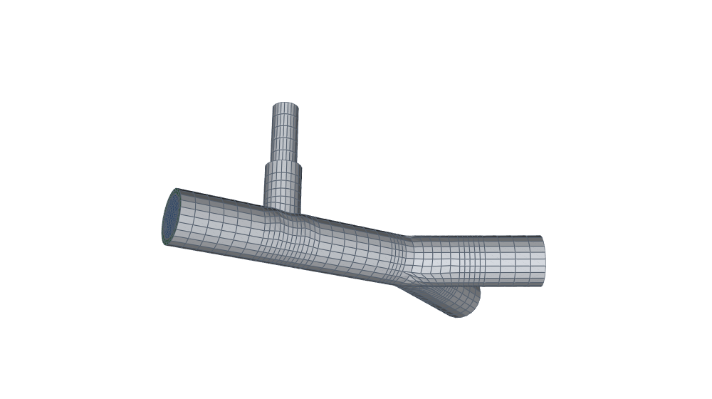

# hexmesh

```text
       _.-------._
   .-''     |     ''-.
 .'  \      |      /  '.     _                                         _
/     +-----+-----+     \   | |__   ___  __  __  _ __ ___   ___  ___  | |__
|     |     |     |     |   | '_ \ / _ \ \ \/ / | '_ ` _ \ / _ \/ __| | '_ \
|-----+-----+-----+-----|   | | | |  __/  >  <  | | | | | |  __/\__ \ | | | |
|     |     |     |     |   |_| |_|\___| /_/\_\ |_| |_| |_|\___||___/ |_| |_|
\     +-----+-----+     /
 '.  /      |      \  .'    structured all-hex meshes for pipe networks
   '-..     |     ..-'
       '---------'
```


**Structured all-hex meshes for pipe and duct networks, junctions included.**
No tetrahedra, no pyramids, no hanging nodes: conformal by construction,
with fluid, wall and insulation as separate regions for conjugate heat
transfer.

<p>


</p>

<!-- readme:features:start -->
| | |
|---|---|
| ✔ **All-hex everywhere**, including tees, wyes and duct taps | ✔ **Exact walls**: every wall node on the true surface |
| ✔ **Multi-region**: fluid, steel, insulation, conformal interfaces | ✔ **Cell count exact before meshing** (`cell_count()`) |
| ✔ **Writes OpenFOAM cases** (patches, regions, CHT setup) | ✔ **Same connectivity across a parameter sweep** (studies, surrogates) |
<!-- readme:features:end -->

---

## Ten lines, one checked mesh

```python
from hexmesh import Assembly, Bend, PipeSpec, Session, Straight, Tee

pipe = (PipeSpec(nang=6)
        .core("fluid", radius=0.1, nrad=5, first_cell=0.01)
        .shell("steel", dR=0.008, nrad=2)
        .shell("insulation", dR=0.04, nrad=3))

with Session("insulated_tee"):
    asm = Assembly(pipe, direction=[1, 0, 0], up=[0, 0, 1])
    asm.add(Straight(0.5, n_layers=8))
    main, branch = asm.add(Tee(branch_length=0.3, branch_radius=0.06))
    asm.add(main, Straight(0.5, n_layers=8), names=["main_end"])
    bend = asm.add(branch, Bend(radius=0.3, angle=90, n_layers=10))
    asm.add(bend, Straight(0.3, n_layers=6), names=["branch_end"])
    print(asm.cell_count())                   # exact, before any geometry
    asm.write_openfoam("insulated_tee.msh")   # then gmshToFoam
```

<!-- readme:metrics:start -->
What it gives (the gallery's `hexmesh.examples.sections.insulated_tee`):

| cells (predicted = meshed) | regions | min scaled Jacobian (where) | min SICN | build |
|---|---|---|---|---|
| 13 164 = 13 164 | fluid · steel · insulation | 0.32 (the tee) | 0.11 | 7.2 s |

<sub>gmsh 4.12.1, one core, 2026-10-30.  Every example's numbers: [GALLERY.md](docs/GALLERY.md).</sub>
<!-- readme:metrics:end -->

Doubling every density parameter doubles the nodes in each direction:
**8× the cells**, as for any structured 3-D mesh.

---

## Fittings

<table>
<tr>
<td align="center"><br><code>Bend</code> · <code>Elbow</code></td>
<td align="center"><br><code>MiterBend</code></td>
<td align="center"><br><code>SplinePipe</code></td>
<td align="center"><br><code>Reducer</code> (profiled)</td>
</tr>
<tr>
<td align="center"><br><code>Tee</code></td>
<td align="center"><br><code>Wye</code></td>
<td align="center"><br><code>Transition</code> (circle ↔ rectangle)</td>
<td align="center"><br><code>Closure</code> (loops)</td>
</tr>
</table>

Plus `Straight`, rectangular ducts, duct taps, layer outlines (round in
square and square in round) and insulation that stops and starts along a
run.

**Rectangular ducts** are one Cartesian patch with graded walls by
default since 0.4.0, because the O-H face converges badly on a rectangle
([RESEARCH §7.11](docs/RESEARCH.md)).  `layout="oh"` with `nrad=` keeps
the O-H face ([CHANGELOG](CHANGELOG.md)).

**Not yet:**
- tees with a non-perpendicular or offset branch (planned);
- unequal wye daughters;
- second-order export (in progress);
- insulation starting inside a fitting.

Full list in the [guide](docs/GUIDE.md#current-limitations).

---

## Validated, with the numbers

<!-- readme:validation:start -->
Each case is meshed by hexmesh, solved with OpenFOAM, and judged by grid
convergence against gates set in advance.

| Case | Reference | Result | Status |
|---|---|---|---|
| Hagen–Poiseuille pipe | exact (V1) | Δp and u_max extrapolated within 0.03 % | ✅ accepted |
| Heated rod, uniform source | exact (V1) | centre ΔT extrapolated within 0.1 % | ✅ accepted |
| Multi-layer conduction (rod, steel, insulation) | exact (V1) | temperatures within 0.001 %, second order | ✅ accepted |
| Womersley pulsatile flow | exact (V1) | profile error ≤ 1 % of u_c at every phase | ✅ accepted |
| Cosine stenosis, Re 500 | DNS (V2), Varghese et al. 2007 | reattachment 11.12 D vs 11.03 D (+0.9 %) | ✅ accepted |
| Cosine stenosis, pulsatile (Womersley, α 7.5) | DNS (V2), Varghese et al. 2007 | throat peak at peak flow −1.3 % of the DNS; separation and recirculation as in the DNS at all six phases | ✅ accepted |
| Heated insulated pipe, full CHT | exact (V1) | Nu extrapolated within 0.08 % of 48/11; shell ΔTs within 0.001 % | ✅ accepted |
| Rectangular duct; square-duct bend; turbulent pipe and bend; helical pipe | exact, experiment, DNS | | 📋 planned |
<!-- readme:validation:end -->

Categories, the coverage matrix (which features are validated and which
aren't yet) and every case's mesh: [GALLERY.md, Validation](docs/GALLERY.md#validation).

---

## Where it fits

- **Process piping and heat loss.** Insulated lines with the fluid, steel
  and insulation as conformal regions, ready for `chtMultiRegionFoam`.
  Read plant data from PCF isometrics.
- **HVAC ducts.** Rectangular ducts, round-to-rectangle transitions, duct
  taps.
- **Biomedical flows.** Stenoses, bifurcation trees, pulsatile inlets;
  the stenosis is validated against DNS.
- **Studies and surrogates.** A parameter sweep keeps the node numbering:
  node *i* is the same point of the network in every variant, only moved.
  Fields map one-to-one, which is what reduced-order and surrogate models
  need.  See `hexmesh.study`.

More in [Why hexmesh?](docs/WHY.md).

---

## Install

```bash
pip install -e .              # from a checkout; brings gmsh, numpy, scipy
pip install -e ".[dev]"       # + pytest, for the test suite
pip install hexmesh           # once it is on PyPI (not yet)
```

Python ≥ 3.10, gmsh ≥ 4.12.  An existing gmsh installation (e.g. from
your system's package manager) is used as is.  Extras: `[bathymetry]`
(GeoTIFF / NetCDF surfaces and shapefile routes), `[gallery]` (the
gallery images), `[study]` (`psutil`, so studies can see other runs on
any system).  OpenFOAM is only needed to run the cases; hexmesh writes
them without it.

| | Linux | macOS | Windows |
|---|---|---|---|
| meshing | yes | yes | yes |
| studies and validation, OpenFOAM in Docker | yes | yes | yes (Docker Desktop) |
| studies and validation, native OpenFOAM | yes | — | WSL only |

---

## Documentation

| | |
|---|---|
| [Guide](docs/GUIDE.md) | every fitting, cross-sections, physical groups, OpenFOAM output, studies, plant data |
| [API](API.md) | the reference |
| [Gallery](docs/GALLERY.md) | every example with its mesh, quality numbers and the code; the validation cases |
| [Why hexmesh?](docs/WHY.md) | the case for structured all-hex networks, and when not to use hexmesh |
| [Design](DESIGN.md) | the rules every fitting follows: interfaces first, fittings as fills, conformal by construction |

---

## Licence

hexmesh is released under the [BSD 3-Clause licence](LICENSE).

That licence covers hexmesh's own code.  Its dependencies keep theirs:
- **gmsh** is GPL-2.0-or-later (with an exception for some bundled
  meshers).  hexmesh doesn't ship gmsh; you install it.  If you
  distribute hexmesh together with gmsh, for example inside a product,
  the GPL's terms apply to that combination.  gmsh's authors offer
  commercial licences for other uses.
- **Planned, optional:** IfcOpenShell, for the IFC reader, is LGPL.
- **OpenFOAM**, used to run the cases, is GPL-3.0.
- **Validation reference data** (e.g. the Purdue stenosis DNS) isn't
  redistributed here.  The case scripts download it at run time, under
  its owners' terms.

## Citing

If you use hexmesh in your work, please cite it.  GitHub's **Cite this
repository** button gives APA and BibTeX from [CITATION.cff](CITATION.cff).
