# hexmesh

```text
       _.-------._
   .-''     |     ''-.
 .'  \      |      /  '.     _                                         _
/     +-----+-----+     \   | |__   ___  __  __  _ __ ___   ___  ___  | |__
|     |     |     |     |   | '_ \ / _ \ \ \/ / | '_ ` _ \ / _ \/ __| | '_ \
|-----+-----+-----+-----|   | | | |  __/  >  <  | | | | | |  __/\__ \ | | | |
|     |     |     |     |   |_| |_|\___| /_/\_\ |_| |_| |_|\___||___/ |_| |_|
\     +-----+-----+     /
 '.  /      |      \  .'    structured all-hex meshes for pipe networks
   '-..     |     ..-'
       '---------'
```


**Structured all-hex meshes for pipe and duct networks, junctions included.**
No tetrahedra, no pyramids, no hanging nodes: conformal by construction,
with fluid, wall and insulation as separate regions for conjugate heat
transfer.

<p>
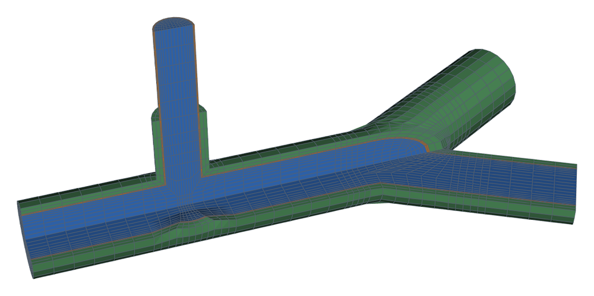
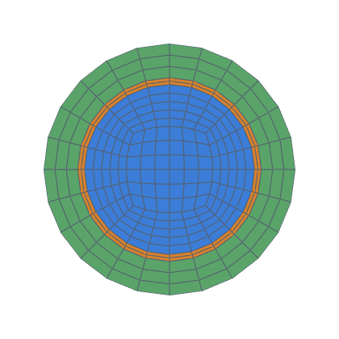
</p>

<!-- readme:features:start -->
| | |
|---|---|
| ✔ **All-hex everywhere**, including tees, wyes and duct taps | ✔ **Exact walls**: every wall node on the true surface |
| ✔ **Multi-region**: fluid, steel, insulation, conformal interfaces | ✔ **Cell count exact before meshing** (`cell_count()`) |
| ✔ **Writes OpenFOAM cases** (patches, regions, CHT setup) | ✔ **Same connectivity across a parameter sweep** (studies, surrogates) |
<!-- readme:features:end -->

**See it first: [the gallery](docs/GALLERY.md).**  Every
[feature](docs/gallery/FEATURES.md) by family (bends, reducers,
junctions, ducts, layers, networks), [applications](docs/gallery/APPLICATIONS.md)
built from them (an idealised aorta, ventilation runs, a plant line from
a PCF file, cooling channels), and the [validation cases](docs/gallery/VALIDATION.md),
each with its mesh, its cell quality and the code that made it.

---

## Ten lines, one checked mesh

```python
from hexmesh import Assembly, Bend, PipeSpec, Session, Straight, Tee

pipe = (PipeSpec(nang=6)
        .core("fluid", radius=0.1, nrad=5, first_cell=0.01)
        .shell("steel", dR=0.008, nrad=2)
        .shell("insulation", dR=0.04, nrad=3))

with Session("insulated_tee"):
    asm = Assembly(pipe, direction=[1, 0, 0], up=[0, 0, 1])
    asm.add(Straight(0.5, n_layers=8))
    main, branch = asm.add(Tee(branch_length=0.3, branch_radius=0.06))
    asm.add(main, Straight(0.5, n_layers=8), names=["main_end"])
    bend = asm.add(branch, Bend(radius=0.3, angle=90, n_layers=10))
    asm.add(bend, Straight(0.3, n_layers=6), names=["branch_end"])
    print(asm.cell_count())                   # exact, before any geometry
    asm.write_openfoam("insulated_tee.msh")   # then gmshToFoam
```

<!-- readme:metrics:start -->
What it gives (the gallery's `hexmesh.examples.sections.insulated_tee`):

| cells (predicted = meshed) | regions | min scaled Jacobian (where) | min SICN | build |
|---|---|---|---|---|
| 13 164 = 13 164 | fluid · steel · insulation | 0.32 (the tee) | 0.11 | 9.1 s |

<sub>gmsh 4.12.1, 2 examples at once, 2026-11-12.  Every example's numbers: [GALLERY.md](docs/GALLERY.md).</sub>
<!-- readme:metrics:end -->

Doubling every density parameter doubles the nodes in each direction:
**8× the cells**, as for any structured 3-D mesh.

**One density per network.**  `nang` (cells around) and each layer's
`nrad` (cells across) are the same in every pipe of a connected network:
a tee's branch, a reducer's outlet and every fitting downstream share
them.  Radial *grading* can differ (`first_cell`, `mprg`).  So cells
around a pipe are as wide as its radius makes them: in a network whose
radii span 10×, the large pipes' cells are 10× wider around than the
small ones'.  Choose `nang` for the smallest pipe that matters, grade the
walls with `first_cell`, or mesh a much larger vessel separately and
couple it in the solver.  hexmesh has no density change inside a network
([GUIDE](docs/GUIDE.md#one-density-per-network)).

---

## From plant data (PCF)

hexmesh reads PCF isometrics (Alias/Isogen's piping component file, which
most plant-design tools export) and builds the network from them: no
geometry to redraw.

```python
from hexmesh import PipeSpec
from hexmesh.examples.applications.pcf_line import SAMPLE   # a line shipped with hexmesh
from hexmesh.interchange import read_pcf

def pipe(bore):              # bore: each line's nominal size from the file, in metres
    return (PipeSpec(nang=8)
            .core("fluid", radius=bore / 2, nrad=4)   # use your schedule's inside radius
            .shell("steel", dR=0.004, nrad=2))

asm = read_pcf(SAMPLE).to_assembly(pipe, insulation=True)  # insulated where the file says
print(asm.cell_count())                                    # 35712
asm.write_openfoam("pcf_line.msh")
```

- **Components become fittings.** Pipes, flanges and valves become
  straights, elbows become bends, and concentric reducers become reducers.
  Tees, set-ons and olets become tees, and Y pieces become wyes. Welds and
  gaskets are absorbed rather than meshed as slivers.
- **Several files and branched lines make one network.** Patches are named
  after the file's components and open ends (`TEE_1`, `A_100_end3`, an
  equipment nozzle `V_101_N1`), so a result traces back to the isometric.
- **Insulation** comes from the file's `INSULATION ON` and thickness, and
  stops where the file says (a bare valve or flange).
- **Nothing moves silently.** Ends join only when they are closer than
  the [snap tolerance](docs/GUIDE.md#how-ends-are-connected-the-snap-tolerance):
  by default 0.11″ (2.79 mm, just above a 1/16″ weld gap), or 1e-4 of the
  model's size if that is larger.  Each reader sets its own
  (`read_pcf(snap_tolerance=…)`), and the build report says which was
  used and where it came from.  Every component is checked against its end points, and
  every error and warning names the component and its line in the file:

  ```json
  {"code": "run_length_too_short",
   "message": "component 1 (TEE TEE_1 at [1.1 0.  0. ], line.pcf:19): run_length must exceed the equal tee's stations 0.1315",
   "where": {"field": "run_length", "part": "1", "source": {"file": "line.pcf", "line": 19, "record": "TEE"}}}
  ```
  This is the sample with an equal tee: with its insulation, the forged tee's run is too short for the junction.
- **Not read yet:** crosses, `Y-PIECE-FITTING`s and asymmetric Y pieces,
  and tangential set-ons (`TTSO`, `TTRF`). Each is rejected by name; offset set-ons (`TOSO`,
  `TORF`) build.

The `hexmesh` commands take a PCF file directly, with a JSON file mapping
each nominal size to its section: `hexmesh validate line.pcf --spec
sizes.json`. An agent can go from a plant isometric to a checked cell
count without writing a line of Python.

---

## With an agent

hexmesh can be driven by an AI agent as well as by hand. Every command
returns JSON in one envelope (`{command, ok, result, version}`), and
every error carries a stable code. `hexmesh manifest` describes the whole
tool in one document: the commands and how they chain, what each fitting
supports, the limits, the error codes, and what has been validated. An
agent reads it first.

A session that builds the network at the top of this page, and then
refines it:

> **You:** Read `hexmesh manifest`. Build me a water header: 200 mm bore,
> 6 mm steel, 25 mm insulation. A 0.4 m straight; a tee to a 120 mm
> branch, 0.3 m long, then 0.4 m more that goes bare after its first
> cell; 0.4 m more header; then a 60° wye with 0.15 m of run and two
> 0.4 m legs, each followed by 0.3 m.
>
> **Agent:** Writes `header.json` (to `hexmesh schema`), and runs
> `hexmesh validate` (no errors; one warning: the wye's predicted
> non-orthogonality, 76°, at its crotch) and `hexmesh estimate`:
> 18 012 cells, exact. `hexmesh preview` draws it.
>
> **You:** Refine it for water at 1 cm/s, fine accuracy, but stay under
> 200 000 cells.
>
> **Agent:** `hexmesh advise` says fine accuracy needs 641 680 cells. To
> fit the budget it first stretched the straights' cells (axial aspect 6
> → 12, 536 432 cells), then fell back to medium: `nang` 12, `nrad` 6,
> 72 048 cells. It also notes that it was calibrated on developed flow in
> straight runs, so the junctions may be less accurate. `hexmesh apply`
> writes the counts in, `validate` passes again, and `hexmesh build`
> writes the mesh.

Every number above is what the commands return for that network. Under
the conversation, the agent runs:

```bash
hexmesh manifest                                 # the whole tool, as JSON: read first
hexmesh validate header.json                     # errors and warnings, each with a code
hexmesh estimate header.json                     # the exact cell count, before meshing
hexmesh advise header.json --inputs inputs.json  # counts for an accuracy class or a budget
hexmesh apply header.json --table table.json     # write the counts in
hexmesh build header.json --out header.msh       # the only step that runs gmsh
```

`python3 -m hexmesh.agent.cli <command>` works too, without installing.

---

## Fittings

Click a picture for the example, its numbers and its code; the
[features page](docs/gallery/FEATURES.md) has them all, by family.

<table>
<tr>
<td align="center"><a href="docs/gallery/FEATURES.md#smooth_bend">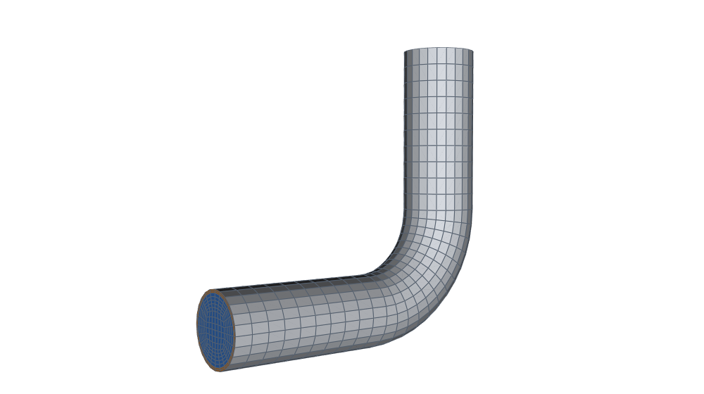</a><br><code>Bend</code> · <code>Elbow</code></td>
<td align="center"><a href="docs/gallery/FEATURES.md#miter_bend">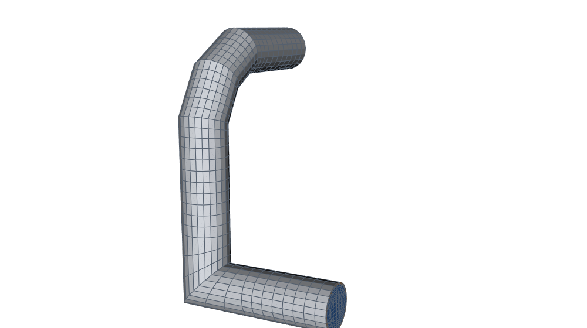</a><br><code>MiterBend</code></td>
<td align="center"><a href="docs/gallery/FEATURES.md#spline_pipe">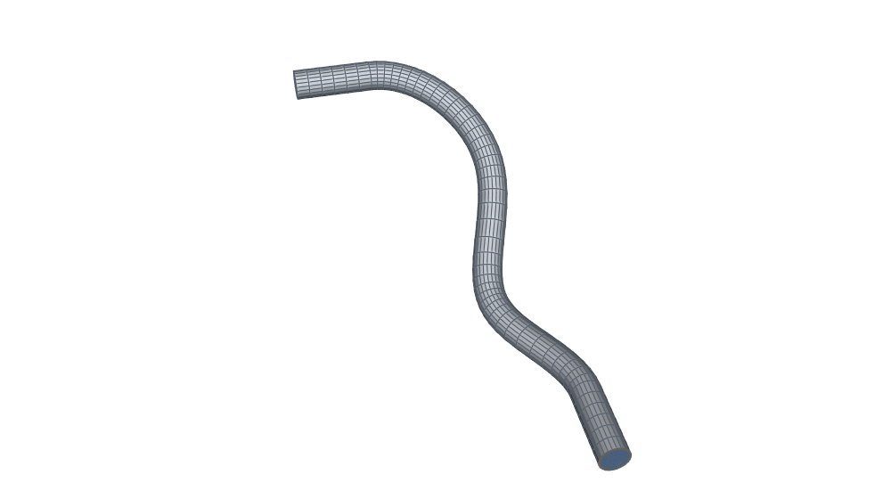</a><br><code>SplinePipe</code></td>
<td align="center"><a href="docs/gallery/FEATURES.md#stenosis">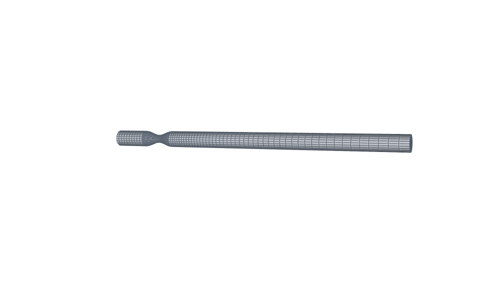</a><br><code>Reducer</code> (profiled)</td>
</tr>
<tr>
<td align="center"><a href="docs/gallery/FEATURES.md#tee">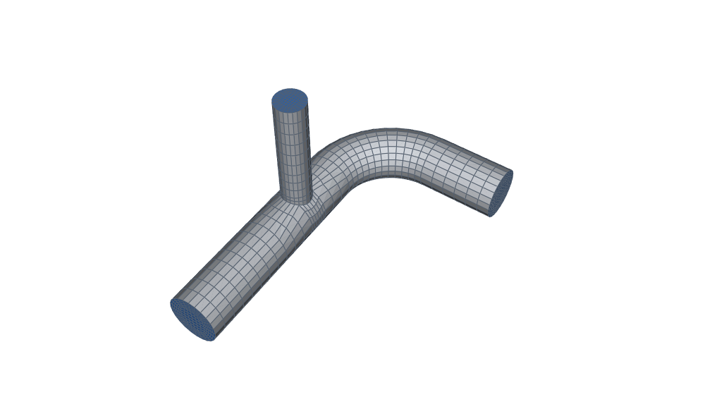</a><br><code>Tee</code></td>
<td align="center"><a href="docs/gallery/FEATURES.md#wye">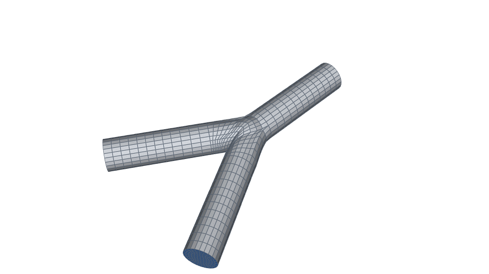</a><br><code>Wye</code></td>
<td align="center"><a href="docs/gallery/FEATURES.md#duct_transition">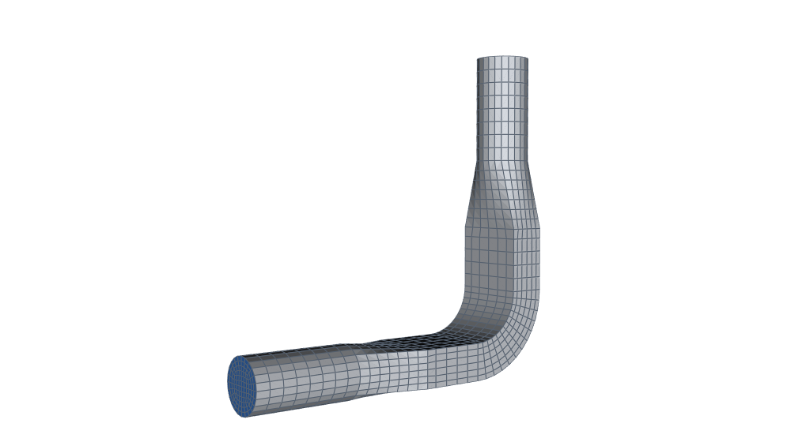</a><br><code>Transition</code> (circle ↔ rectangle)</td>
<td align="center"><a href="docs/gallery/FEATURES.md#loop">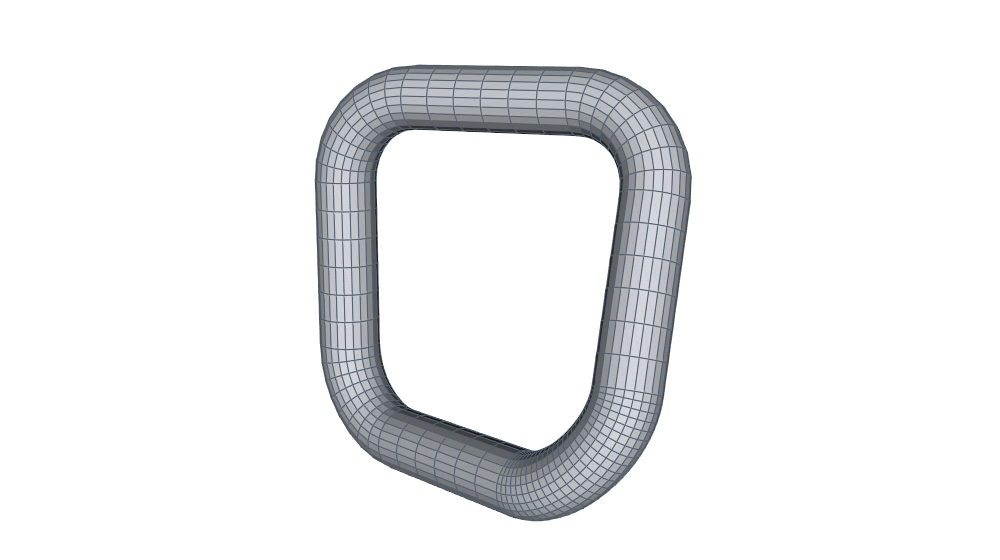</a><br><code>Closure</code> (loops)</td>
</tr>
<tr>
<td align="center"><a href="docs/gallery/FEATURES.md#equal_tee">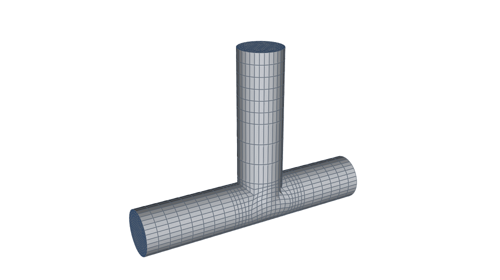</a><br><code>Tee</code> (equal)</td>
<td align="center"><a href="docs/gallery/FEATURES.md#rect_duct">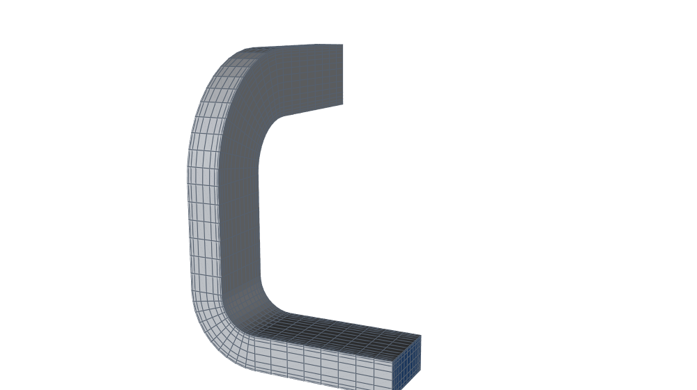</a><br>rectangular ducts</td>
<td align="center"><a href="docs/gallery/APPLICATIONS.md#hvac_branched">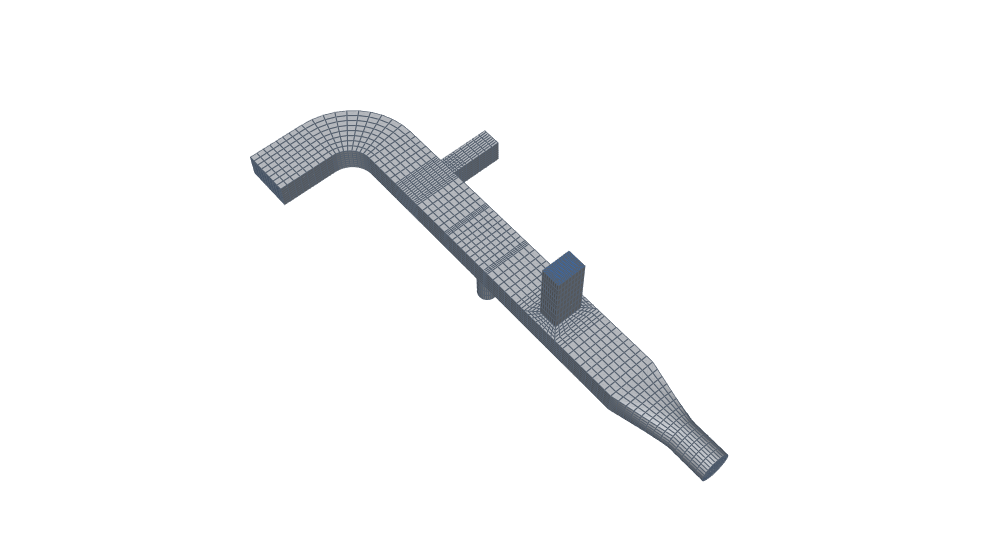</a><br>duct taps</td>
<td align="center"><a href="docs/gallery/FEATURES.md#layer_outlines">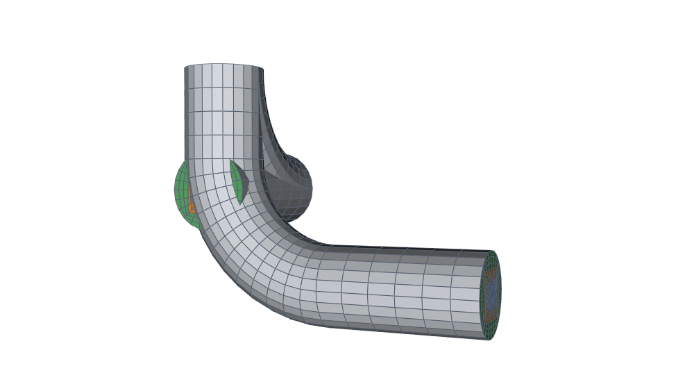</a><br>layer outlines</td>
</tr>
</table>

Plus `Straight` and insulation that stops and starts along a run.  Tees
take a reduced branch at any roll, leaning downstream (laterals) or off
the main's axis (offset taps), or a branch as wide as the main (equal
tees).

**Rectangular ducts** are one Cartesian patch with graded walls by
default since 0.4.0, because the O-H face converges badly on a rectangle
([RESEARCH §7.11](docs/RESEARCH.md)).  `layout="oh"` with `nrad=` keeps
the O-H face ([CHANGELOG](CHANGELOG.md)).

**Not yet:**
- equal laterals (an equal tee is square only);
- unequal wye daughters;
- second order on wyes and equal tees, and second-order OpenFOAM output
  (`gmshToFoam` reads first order; `mesh(order=2)` writes Hex27 for
  the other fittings);
- insulation starting inside a fitting.

Full list in the [guide](docs/GUIDE.md#current-limitations).

---

## Validated, with the numbers

<!-- readme:validation:start -->
Each case is meshed by hexmesh, solved with OpenFOAM, and judged by grid
convergence against gates set in advance.

| Case | Reference | Result | Status |
|---|---|---|---|
| Laminar Hagen–Poiseuille pipe | exact (V1) | Δp and u_max extrapolated within 0.03 % (+0.030 %, −0.007 %) | ✅ accepted |
| Solid rod with uniform heat generation | exact (V1) | centre ΔT extrapolated within 0.01 % (uniform and graded cells) | ✅ accepted |
| Conduction through a heated multi-layer cylinder | exact (V1) | temperatures extrapolated within 0.001 %; second order in every region | ✅ accepted |
| Heated multi-layer pipe with laminar flow (full CHT) | exact (V1) | Nu extrapolated +0.08 % from 48/11; shell ΔTs within 0.001 % | ✅ accepted |
| Womersley flow (pulsatile laminar pipe flow) | exact (V1) | profile error at most 0.31 % of u_c at every phase | ✅ accepted |
| Laminar flow in rectangular ducts (aspect ratios 1, 2, 4) | exact (V1) | f·Re extrapolated within 0.011 % at aspect ratios 1, 2 and 4 (H section) | ✅ accepted |
| Manufactured solutions for conduction on every fitting | manufactured (V1) | L2 error falls on all 16 fittings; 5 converge at the straight's order, the rest reported | ✅ accepted |
| FEniCSx: second-order export checked end to end | manufactured (V1) | Q2 on Hex27 converges at L2 order 2.78–2.98 on the straight, bend and tee; on Hex8, with the exact wall's flux, 2.0–2.6 | ✅ accepted |
| Smooth cosine constriction, Re = 500 | DNS (V2), Varghese et al. 2007 | reattachment 10.97 D vs the database's 11.03 D (−0.5 %) | ✅ accepted |
| Fully developed turbulent pipe flow, k-ω SST | simulation (V2), El Khoury et al. 2013 | f within 2.5 % of McKeon et al. at three Re; within 3.3 % with wall functions | ✅ accepted |
| Pulsatile flow through the cosine constriction (Varghese et al., Part 2) | DNS (V2), Varghese et al. 2007 | throat peak at peak flow −1.3 % from the DNS; the five flow features of its §3.1 as in the DNS | ✅ accepted |
| Laminar flow in a 90° square-duct bend, Re 790 | experiment (V3), Taylor et al. 1981 | peak velocity at the measured position at six stations; peak U/V_c converging (GCI ≤ 0.05 %) | ✅ accepted |
| Laminar flow in a helical pipe (the SIET coil) | experiment (V3), De Amicis et al. 2014 | f within 0.3 % of Ito at nang 24 (Re 1800, 2400), converging; Re 3000's nang 24 to run | 🔄 in progress |
| Turbulent flow in a 90° bend (Sudo et al. 1998); a Taylor bubble rising in stagnant liquid (VOF) | experiment (V3) | | 📋 planned |
<!-- readme:validation:end -->

Categories, the coverage matrix (which features are validated and which
aren't yet) and every case's mesh: [the gallery's Validation page](docs/gallery/VALIDATION.md).

---

## Where it fits

- **Process piping and heat loss.** Insulated lines with the fluid, steel
  and insulation as conformal regions, ready for `chtMultiRegionFoam`.
  Read plant data from PCF isometrics.
- **HVAC ducts.** Rectangular ducts, round-to-rectangle transitions, duct
  taps.
- **Biomedical flows.** Stenoses, bifurcation trees, pulsatile inlets;
  the stenosis is validated against DNS.
- **Studies and surrogates.** A parameter sweep keeps the node numbering:
  node *i* is the same point of the network in every variant, only moved.
  Fields map one-to-one, which is what reduced-order and surrogate models
  need.  See `hexmesh.study`.

More in [Why hexmesh?](docs/WHY.md).

---

## Install

```bash
pip install "hexmesh @ git+https://github.com/sigveka/hexmesh@v0.6.0"   # this release
pip install -e .              # from a checkout; brings gmsh, numpy, scipy
pip install -e ".[dev]"       # + pytest, for the test suite
pip install hexmesh           # once it is on PyPI (not yet)
```

Python ≥ 3.11, gmsh ≥ 4.12.  Tested with gmsh 4.12.1 (the reference
the gallery and validation cases use) and with the version `pip install`
gives (4.15.2 on 2026-11-11).  An existing gmsh installation (e.g. from
your system's package manager) is used as is.  Extras: `[bathymetry]`
(GeoTIFF / NetCDF surfaces and shapefile routes), `[gallery]` (the
gallery images), `[study]` (`psutil`, so studies can see other runs on
any system).  OpenFOAM is only needed to run the cases; hexmesh writes
them without it.

| | Linux | macOS | Windows |
|---|---|---|---|
| meshing | yes | yes | yes |
| studies and validation, OpenFOAM in Docker | yes | yes | yes (Docker Desktop) |
| studies and validation, native OpenFOAM | yes | — | WSL only |

### Stability

hexmesh is at 0.x.  The Python API and the commands' JSON may still
change between minor versions.  Every breaking change is marked
**Breaking** in the [CHANGELOG](CHANGELOG.md), with what to do.

- **Saved descriptions** (`Assembly.save`, `to_dict`) carry a format
  version.  An older one either loads, migrated on load (version 1's
  `rot` in radians is converted to degrees), or fails with
  `description_version_unsupported`, naming its version.  It is never
  misread.
- **Error codes are stable.**  A code may be added; removing or renaming
  one is a breaking change.
- **Meshes are reproducible.**  The same description, hexmesh version,
  gmsh version and system give the same mesh, byte for byte; every
  gallery example is checked.  A change that moves nodes is noted in
  the CHANGELOG.

---

## Documentation

| | |
|---|---|
| [Guide](docs/GUIDE.md) | every fitting, cross-sections, physical groups, OpenFOAM output, studies, plant data |
| [API](API.md) | the reference |
| [Gallery](docs/GALLERY.md) | every example with its mesh, quality numbers and the code, on three pages: features by family, applications, validation cases |
| [Why hexmesh?](docs/WHY.md) | the case for structured all-hex networks, and when not to use hexmesh |
| [Design](DESIGN.md) | the rules every fitting follows: interfaces first, fittings as fills, conformal by construction |
| [Contributing](CONTRIBUTING.md) | reporting a bug, asking for a feature, and how changes are made: decisions first |

---

## Licence

hexmesh is released under the [BSD 3-Clause licence](LICENSE).

That licence covers hexmesh's own code.  Its dependencies keep theirs:
- **gmsh** is GPL-2.0-or-later (with an exception for some bundled
  meshers).  hexmesh doesn't ship gmsh; you install it.  If you
  distribute hexmesh together with gmsh, for example inside a product,
  the GPL's terms apply to that combination.  gmsh's authors offer
  commercial licences for other uses.
- **Planned, optional:** IfcOpenShell, for the IFC reader, is LGPL.
- **OpenFOAM**, used to run the cases, is GPL-3.0.
- **Validation reference data** (e.g. the Purdue stenosis DNS) isn't
  redistributed here.  The case scripts download it at run time, under
  its owners' terms.

## Citing

If you use hexmesh in your work, please cite it.  GitHub's **Cite this
repository** button gives APA and BibTeX from [CITATION.cff](CITATION.cff).
