# hexmesh

```text
       _.-------._
   .-''     |     ''-.
 .'  \      |      /  '.     _                                         _
/     +-----+-----+     \   | |__   ___  __  __  _ __ ___   ___  ___  | |__
|     |     |     |     |   | '_ \ / _ \ \ \/ / | '_ ` _ \ / _ \/ __| | '_ \
|-----+-----+-----+-----|   | | | |  __/  >  <  | | | | | |  __/\__ \ | | | |
|     |     |     |     |   |_| |_|\___| /_/\_\ |_| |_| |_|\___||___/ |_| |_|
\     +-----+-----+     /
 '.  /      |      \  .'    structured all-hex meshes for pipe networks
   '-..     |     ..-'
       '---------'
```


**Structured all-hex meshes for pipe and duct networks, junctions included.**
No tetrahedra, no pyramids, no hanging nodes: conformal by construction,
with fluid, wall and insulation as separate regions for conjugate heat
transfer.

<p>
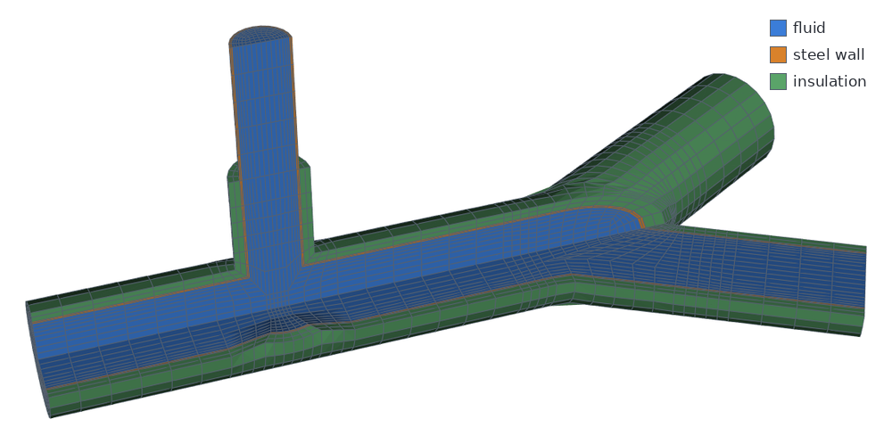
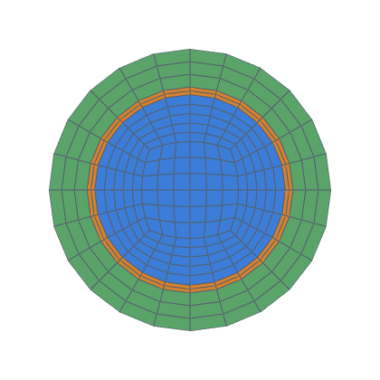
</p>

<!-- readme:features:start -->
| | |
|---|---|
| ✔ **All-hex everywhere**, including tees, wyes and duct taps | ✔ **Exact walls**: every wall node on the true surface |
| ✔ **Multi-region**: fluid, steel, insulation, conformal interfaces | ✔ **Cell count exact before meshing** (`cell_count()`) |
| ✔ **Writes OpenFOAM cases** (patches, regions, CHT setup) | ✔ **Same connectivity across a parameter sweep** (studies, surrogates) |
<!-- readme:features:end -->

**See it first: [the gallery](docs/GALLERY.md).**  Every
[feature](docs/gallery/FEATURES.md) by family (bends, reducers,
junctions, ducts, layers, networks), [applications](docs/gallery/APPLICATIONS.md)
built from them (an idealised aorta, ventilation runs, a plant line from
a PCF file, cooling channels), and the [validation cases](docs/gallery/VALIDATION.md),
each with its mesh, its cell quality and the code that made it.

## Contents

- [Ten lines, one checked mesh](#ten-lines-one-checked-mesh)
- [From plant data (PCF)](#from-plant-data-pcf)
- [With an agent](#with-an-agent)
- [Fittings](#fittings)
- [Validated, with the numbers](#validated-with-the-numbers)
- [Where it fits](#where-it-fits)
- [Install](#install):
  [use hexmesh](#use-hexmesh) ·
  [validate or volunteer](#validate-or-volunteer) ·
  [develop](#develop) ·
  [platforms](#platforms) ·
  [stability](#stability)
- [Documentation](#documentation)
- [Licence](#licence)
- [Citing](#citing)

---

## Ten lines, one checked mesh

```python
from hexmesh import Assembly, Bend, PipeSpec, Session, Straight, Tee

pipe = (PipeSpec(n_arc=6)
        .core("fluid", radius=0.1, n_radial=5, first_cell=0.01)
        .shell("steel", dR=0.008, n_radial=2)
        .shell("insulation", dR=0.04, n_radial=3))

with Session("insulated_tee"):
    asm = Assembly(pipe, direction=[1, 0, 0], up=[0, 0, 1])
    asm.add(Straight(0.5, n_layers=8))
    main, branch = asm.add(Tee(branch_length=0.3, branch_radius=0.06))
    asm.add(main, Straight(0.5, n_layers=8), names=["main_end"])
    bend = asm.add(branch, Bend(radius=0.3, angle=90, n_layers=10))
    asm.add(bend, Straight(0.3, n_layers=6), names=["branch_end"])
    print(asm.cell_count())                   # exact, before any geometry
    asm.write_openfoam("insulated_tee.msh")   # then gmshToFoam
```

<!-- readme:metrics:start -->
What it gives (the gallery's `hexmesh.examples.sections.insulated_tee`):

| cells (predicted = meshed) | regions | min scaled Jacobian (where) | min SICN | build |
|---|---|---|---|---|
| 13 164 = 13 164 | fluid · steel · insulation | 0.32 (the tee) | 0.11 | 9.1 s |

<sub>gmsh 4.12.1, one core, 2026-11-19.  Every example's numbers: [GALLERY.md](docs/GALLERY.md).</sub>
<!-- readme:metrics:end -->

Doubling every density parameter doubles the nodes in each direction:
**8× the cells**, as for any structured 3-D mesh.

**One density per network.**  `n_arc` (cells around) and each layer's
`n_radial` (cells across) are the same in every pipe of a connected network:
a tee's branch, a reducer's outlet and every fitting downstream share
them.  Radial *grading* can differ (`first_cell`, `radial_grading`).  So cells
around a pipe are as wide as its radius makes them: in a network whose
radii span 10×, the large pipes' cells are 10× wider around than the
small ones'.  Choose `n_arc` for the smallest pipe that matters, grade the
walls with `first_cell`, or mesh a much larger vessel separately and
couple it in the solver.  hexmesh has no density change inside a network
([GUIDE](docs/GUIDE.md#one-density-per-network)).

---

## From plant data (PCF)

hexmesh reads PCF isometrics (Alias/Isogen's piping component file, which
most plant-design tools export) and builds the network from them: no
geometry to redraw.

```python
from hexmesh import PipeSpec
from hexmesh.examples.applications.pcf_line import SAMPLE   # a line shipped with hexmesh
from hexmesh.interchange import read_pcf

def pipe(bore):              # bore: each line's nominal size from the file, in metres
    return (PipeSpec(n_arc=8)
            .core("fluid", radius=bore / 2, n_radial=4)   # use your schedule's inside radius
            .shell("steel", dR=0.004, n_radial=2))

asm = read_pcf(SAMPLE).to_assembly(pipe, insulation=True)  # insulated where the file says
print(asm.cell_count())                                    # 35712
asm.write_openfoam("pcf_line.msh")
```

- **Components become fittings.** Pipes, flanges and valves become
  straights, elbows become bends, and concentric reducers become reducers.
  Tees, set-ons and olets become tees, and Y pieces become wyes. Welds and
  gaskets are absorbed rather than meshed as slivers.
- **Several files and branched lines make one network.** Patches are named
  after the file's components and open ends (`TEE_1`, `A_100_end3`, an
  equipment nozzle `V_101_N1`), so a result traces back to the isometric.
- **Insulation** comes from the file's `INSULATION ON` and thickness, and
  stops where the file says (a bare valve or flange).
- **Nothing moves silently.** Ends join only when they are closer than
  the [snap tolerance](docs/GUIDE.md#how-ends-are-connected-the-snap-tolerance):
  by default 0.11″ (2.79 mm, just above a 1/16″ weld gap), or 1e-4 of the
  model's size if that is larger.  Each reader sets its own
  (`read_pcf(snap_tolerance=…)`), and the build report says which was
  used and where it came from.  Every component is checked against its end points, and
  every error and warning names the component and its line in the file:

  ```json
  {"code": "run_length_too_short",
   "message": "component 1 (TEE TEE_1 at [1.1 0.  0. ], line.pcf:19): run_length must exceed the equal tee's stations 0.1315",
   "where": {"field": "run_length", "part": "1", "source": {"file": "line.pcf", "line": 19, "record": "TEE"}}}
  ```
  This is the sample with an equal tee: with its insulation, the forged tee's run is too short for the junction.
- **Not read yet:** crosses, `Y-PIECE-FITTING`s and asymmetric Y pieces,
  and tangential set-ons (`TTSO`, `TTRF`). Each is rejected by name; offset set-ons (`TOSO`,
  `TORF`) build.

The `hexmesh` commands take a PCF file directly, with a JSON file mapping
each nominal size to its section: `hexmesh validate line.pcf --spec
sizes.json`. An agent can go from a plant isometric to a checked cell
count without writing a line of Python.

---

## With an agent

hexmesh can be driven by an AI agent as well as by hand. Every command
returns JSON in one envelope (`{command, ok, result, version}`), and
every error carries a stable code. `hexmesh manifest` describes the whole
tool in one document: the commands and how they chain, what each fitting
supports, the limits, the error codes, and what has been validated. An
agent reads it first.

A session that builds the network at the top of this page, and then
refines it:

> **You:** Read `hexmesh manifest`. Build me a water header: 200 mm bore,
> 6 mm steel, 25 mm insulation. A 0.4 m straight; a tee to a 120 mm
> branch, 0.3 m long, then 0.4 m more that goes bare after its first
> cell; 0.4 m more header; then a 60° wye with 0.15 m of run and two
> 0.4 m legs, each followed by 0.3 m.
>
> **Agent:** Writes `header.json` (to `hexmesh schema`), and runs
> `hexmesh validate` (no errors; one warning: the wye's predicted
> non-orthogonality, 76°, at its crotch) and `hexmesh estimate`:
> 18 012 cells, exact. `hexmesh preview` draws it.
>
> **You:** Refine it for water at 1 cm/s, fine accuracy, but stay under
> 200 000 cells.
>
> **Agent:** `hexmesh advise` says fine accuracy needs 641 680 cells. To
> fit the budget it first stretched the straights' cells (axial aspect 6
> → 12, 536 432 cells), then fell back to medium: `n_arc` 12, `n_radial` 6,
> 72 048 cells. It also notes that it was calibrated on developed flow in
> straight runs, so the junctions may be less accurate. `hexmesh apply`
> writes the counts in, `validate` passes again, and `hexmesh build`
> writes the mesh.

Every number above is what the commands return for that network. Under
the conversation, the agent runs:

```bash
hexmesh manifest                                 # the whole tool, as JSON: read first
hexmesh validate header.json                     # errors and warnings, each with a code
hexmesh estimate header.json                     # the exact cell count, before meshing
hexmesh advise header.json --inputs inputs.json  # counts for an accuracy class or a budget
hexmesh apply header.json --table table.json     # write the counts in
hexmesh build header.json --out header.msh       # the only step that runs gmsh
```

`python3 -m hexmesh.agent.cli <command>` works too, without installing.

---

## Fittings

Click a picture for the example, its numbers and its code; the
[features page](docs/gallery/FEATURES.md) has them all, by family.

<table>
<tr>
<td align="center"><a href="docs/gallery/FEATURES.md#smooth_bend">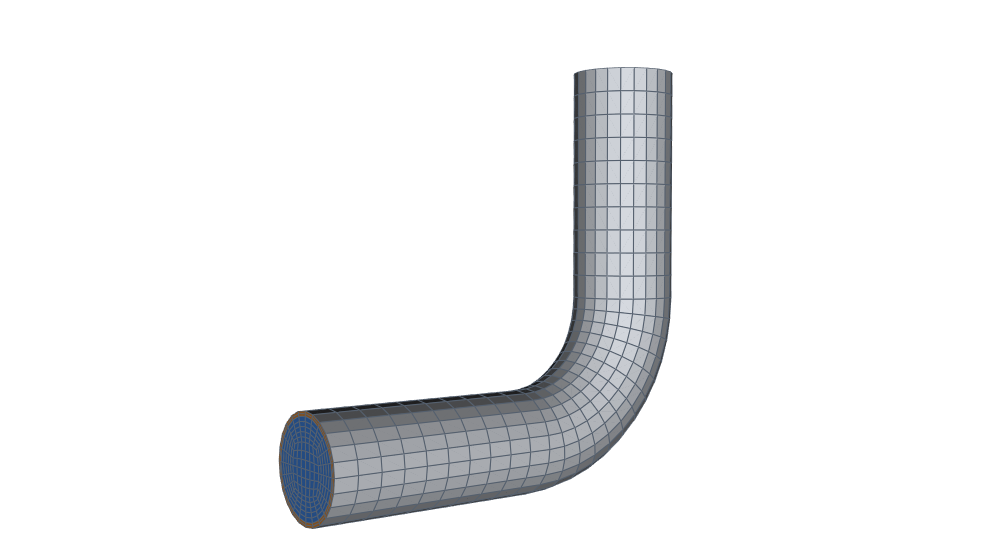</a><br><code>Bend</code> · <code>Elbow</code></td>
<td align="center"><a href="docs/gallery/FEATURES.md#miter_bend">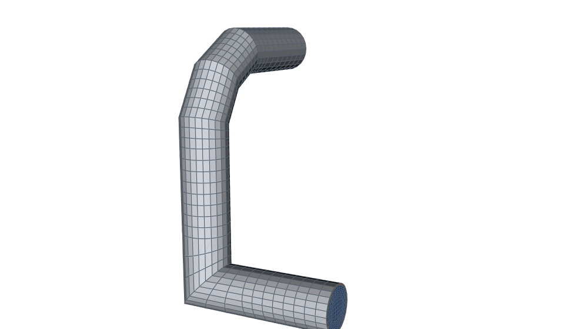</a><br><code>MiterBend</code></td>
<td align="center"><a href="docs/gallery/FEATURES.md#spline_pipe">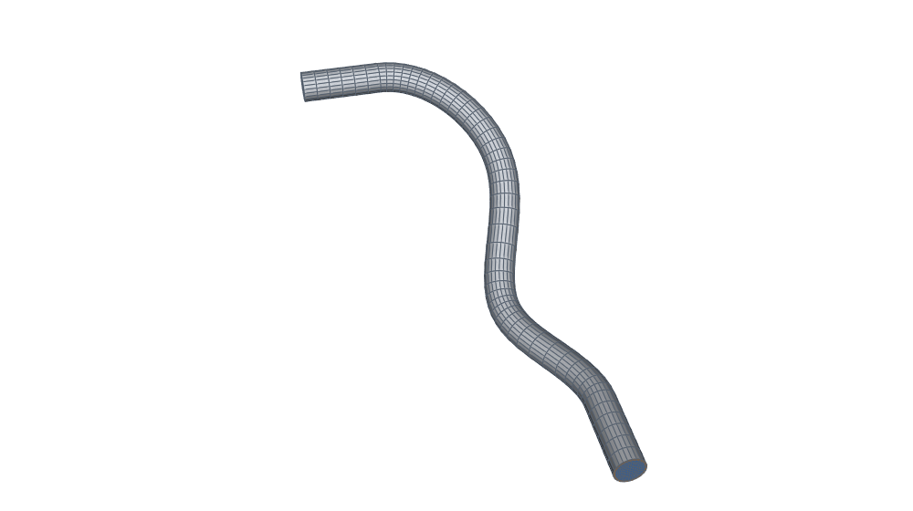</a><br><code>SplinePipe</code></td>
<td align="center"><a href="docs/gallery/FEATURES.md#stenosis">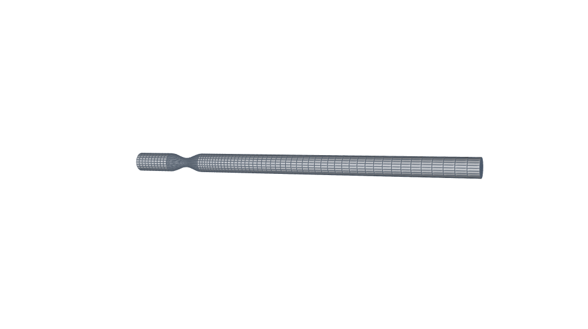</a><br><code>Reducer</code> (profiled)</td>
</tr>
<tr>
<td align="center"><a href="docs/gallery/FEATURES.md#tee">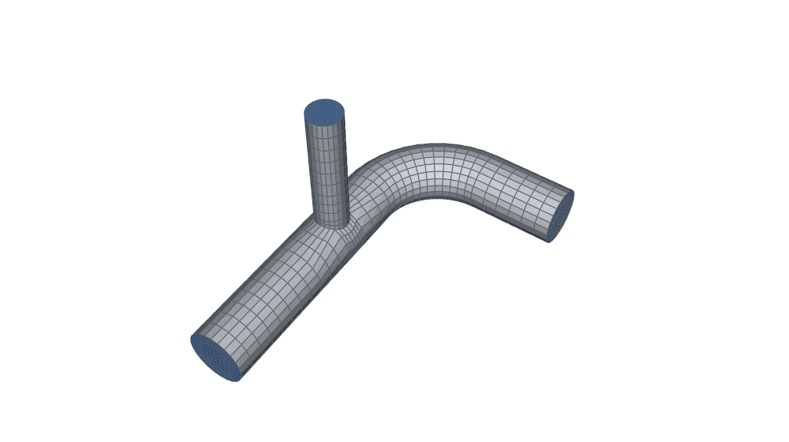</a><br><code>Tee</code></td>
<td align="center"><a href="docs/gallery/FEATURES.md#wye">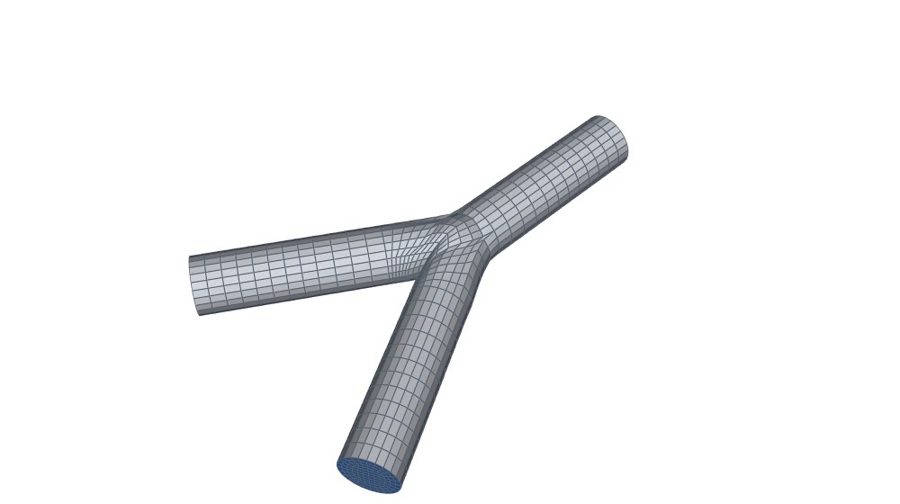</a><br><code>Wye</code></td>
<td align="center"><a href="docs/gallery/FEATURES.md#duct_transition">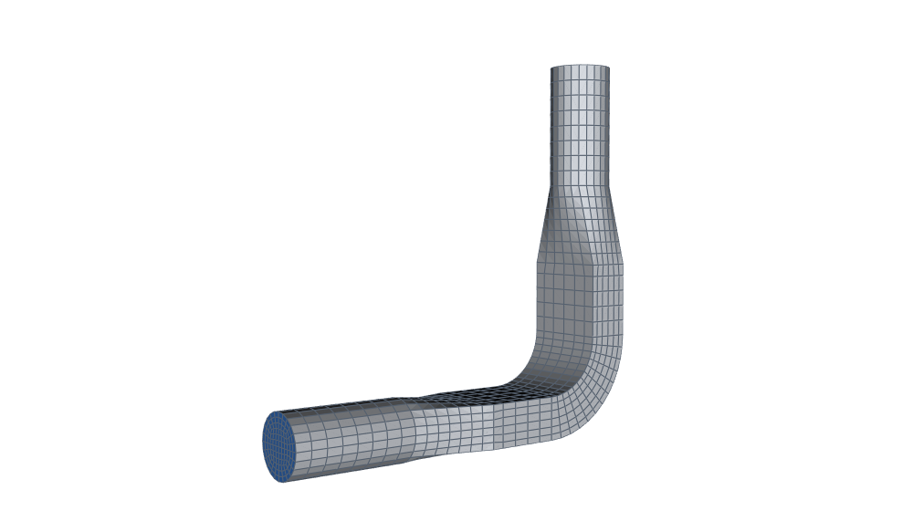</a><br><code>Transition</code> (circle ↔ rectangle)</td>
<td align="center"><a href="docs/gallery/FEATURES.md#loop">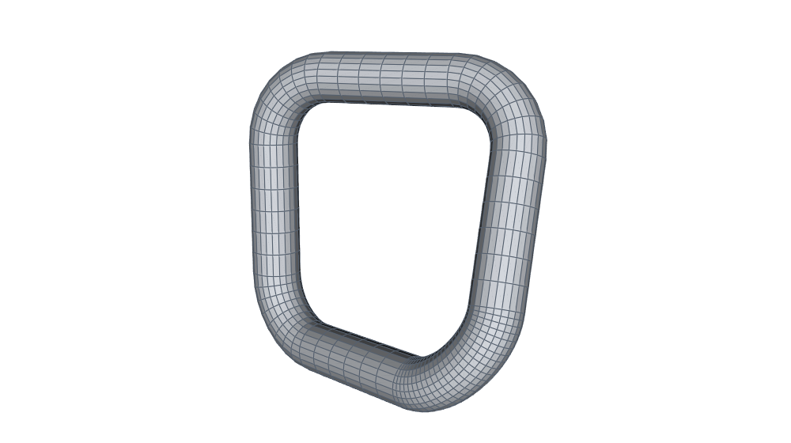</a><br><code>Closure</code> (loops)</td>
</tr>
<tr>
<td align="center"><a href="docs/gallery/FEATURES.md#equal_tee">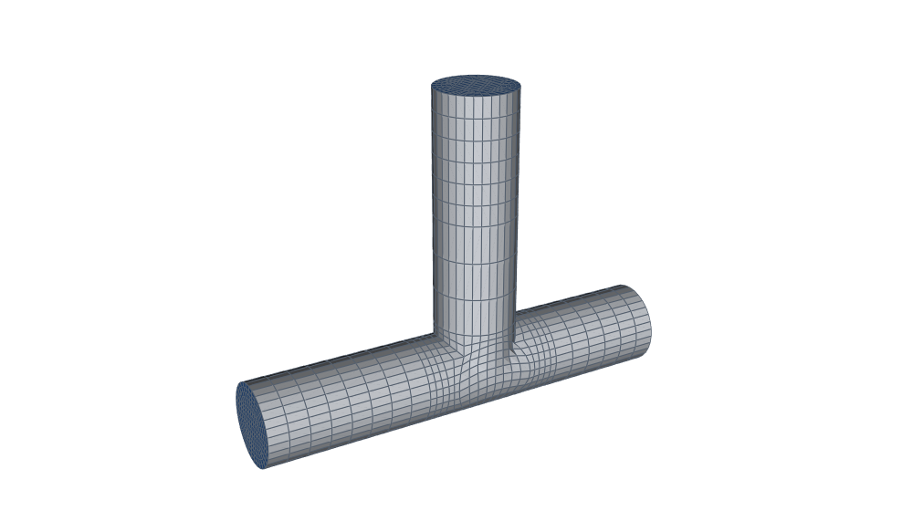</a><br><code>Tee</code> (equal)</td>
<td align="center"><a href="docs/gallery/FEATURES.md#rect_duct">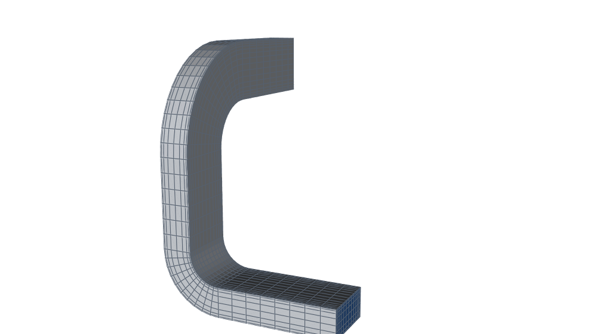</a><br>rectangular ducts</td>
<td align="center"><a href="docs/gallery/APPLICATIONS.md#hvac_branched">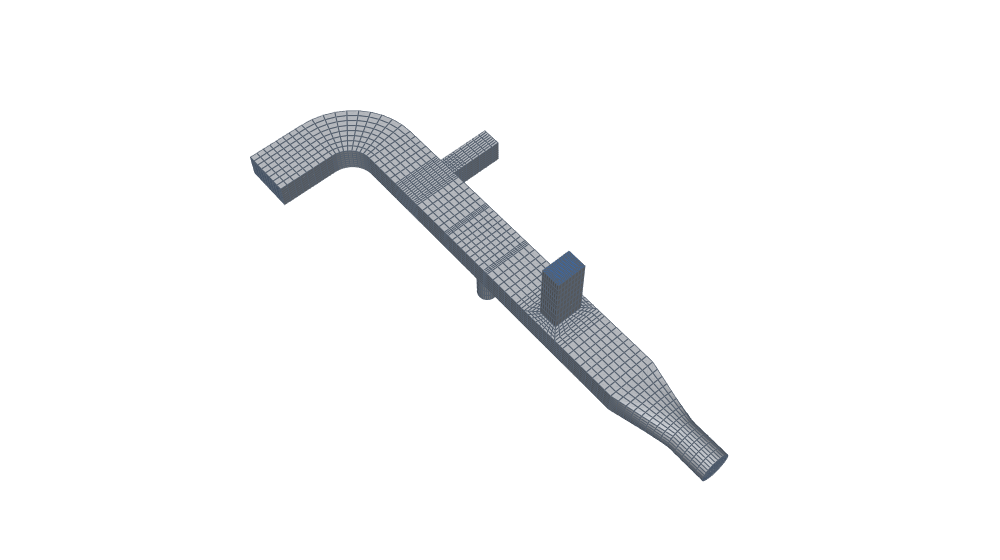</a><br>duct taps</td>
<td align="center"><a href="docs/gallery/FEATURES.md#layer_outlines">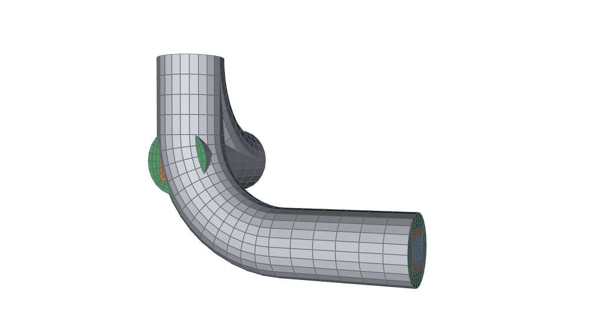</a><br>layer outlines</td>
</tr>
</table>

Plus `Straight` and insulation that stops and starts along a run.  Tees
take a reduced branch at any roll, leaning downstream (laterals) or off
the main's axis (offset taps), or a branch as wide as the main (equal
tees).

**Rectangular ducts** are one Cartesian patch with graded walls by
default since 0.4.0, because the O-H face converges badly on a rectangle
([RESEARCH §7.11](docs/RESEARCH.md)).  `layout="oh"` with `n_radial=` keeps
the O-H face ([CHANGELOG](CHANGELOG.md)).

**Not yet:**
- equal laterals (an equal tee is square only);
- unequal wye daughters;
- second order on wyes and equal tees, and second-order OpenFOAM output
  (`gmshToFoam` reads first order; `mesh(order=2)` writes Hex27 for
  the other fittings);
- insulation starting inside a fitting.

Full list in the [guide](docs/GUIDE.md#current-limitations).

---

## Validated, with the numbers

<!-- readme:validation:start -->
Each case is meshed by hexmesh, solved with OpenFOAM, and judged by grid
convergence against gates set in advance.

| Case | Reference | Result | Status |
|---|---|---|---|
| Laminar Hagen–Poiseuille pipe | exact (V1) | Δp and u_max extrapolated within 0.03 % (+0.030 %, −0.007 %) | ✅ accepted |
| Solid rod with uniform heat generation | exact (V1) | centre ΔT extrapolated within 0.01 % (uniform and graded cells) | ✅ accepted |
| Conduction through a heated multi-layer cylinder | exact (V1) | temperatures extrapolated within 0.001 %; second order in every region | ✅ accepted |
| Heated multi-layer pipe with laminar flow (full CHT) | exact (V1) | Nu extrapolated +0.08 % from 48/11; shell ΔTs within 0.001 % | ✅ accepted |
| Womersley flow (pulsatile laminar pipe flow) | exact (V1) | profile error at most 0.31 % of u_c at every phase | ✅ accepted |
| Laminar flow in rectangular ducts (aspect ratios 1, 2, 4) | exact (V1) | f·Re extrapolated within 0.011 % at aspect ratios 1, 2 and 4 (H section) | ✅ accepted |
| Manufactured solutions for conduction on every fitting | manufactured (V1) | L2 error falls on all 16 fittings; 5 converge at the straight's order, the rest reported | ✅ accepted |
| Smooth cosine constriction, Re = 500 | DNS (V2), Varghese et al. 2007 | reattachment 10.97 D vs the database's 11.03 D (−0.5 %) | ✅ accepted |
| Fully developed turbulent pipe flow, k-ω SST | simulation (V2), El Khoury et al. 2013 | f within 2.5 % of McKeon et al. at three Re; within 3.3 % with wall functions | ✅ accepted |
| Pulsatile flow through the cosine constriction (Varghese et al., Part 2) | DNS (V2), Varghese et al. 2007 | throat peak at peak flow −1.3 % from the DNS; the five flow features of its §3.1 as in the DNS | ✅ accepted |
| Laminar flow in a 90° square-duct bend, Re 790 | experiment (V3), Taylor et al. 1981 | peak velocity at the measured position at six stations; peak U/V_c converging (GCI ≤ 0.05 %) | ✅ accepted |
| Laminar flow in a helical pipe (the SIET coil) | experiment (V3), De Amicis et al. 2014 | f within 0.6 % of Ito at n_arc 24 (Re 1800 to 3000), converging at order 1.8 to 1.9; GCI at most 1.4 % | ✅ accepted |
| Equal-diameter 90° tee: loss coefficients, k-ω SST | experiment (V3), Štigler et al. 2014 | ξ_MGb 0.459 against 0.437 measured (gate 0.025); ξ_PG 0.605 against 0.50 missed (gate 0.03), grid-converged at 0.596 (GCI 0.012): the gap is the model and set-up | ⚠️ missed |
| Turbulent flow in a 90° bend (PTB LDA; Sudo et al. 1998 the ideal); a Taylor bubble rising in stagnant liquid (VOF); turbulent rectangular ducts against the KTH DNS, with a volunteer card | simulation (V2), experiment (V3) | | 📋 planned |

**Export checks** (decision 0057): does a mesh arrive intact in another code?  One consumer per format; each passes or fails.

| Check | Format | Consumer | Result | Status |
|---|---|---|---|---|
| FEniCSx: second-order export checked end to end | `.msh` 4.1 (Hex8, Hex27) | FEniCSx (dolfinx) v0.11.0 | Q2 on Hex27 converges at L2 order 2.78–2.98 on the straight, bend and tee; on Hex8, with the exact wall's flux, 2.0–2.6 | ✅ passes |
<!-- readme:validation:end -->

Categories, the coverage matrix (which features are validated and which
aren't yet) and every case's mesh: [the gallery's Validation page](docs/gallery/VALIDATION.md).

---

## Where it fits

- **Process piping and heat loss.** Insulated lines with the fluid, steel
  and insulation as conformal regions, ready for `chtMultiRegionFoam`.
  Read plant data from PCF isometrics.
- **HVAC ducts.** Rectangular ducts, round-to-rectangle transitions, duct
  taps.
- **Biomedical flows.** Stenoses, bifurcation trees, pulsatile inlets;
  the stenosis is validated against DNS.
- **Studies and surrogates.** A parameter sweep keeps the node numbering:
  node *i* is the same point of the network in every variant, only moved.
  Fields map one-to-one, which is what reduced-order and surrogate models
  need.  See `hexmesh.study`.

More in [Why hexmesh?](docs/WHY.md).

---

## Install

Three setups.  Pick by what you want to do: each one says what you get,
and how to check that it works.

| You want to | Setup | What you need |
|---|---|---|
| mesh pipe networks, write OpenFOAM cases, run studies | [Use hexmesh](#use-hexmesh) | Python, `pip` |
| run the validation cases, or volunteer a run | [Validate or volunteer](#validate-or-volunteer) | a **clone of the repository**, OpenFOAM (Docker is enough) |
| change hexmesh itself | [Develop](#develop) | a clone, the test tools |

Python ≥ 3.11 and gmsh ≥ 4.12 for all three.  `pip` brings gmsh, numpy
and scipy.  An existing gmsh installation (e.g. from your system's
package manager) is used as is.  Tested with gmsh 4.12.1 (the reference
the gallery and validation cases use) and with the version `pip install`
gives (4.15.2 on 2026-11-11).

The commands below are written for Linux and macOS (`python3`).  **On
Windows (PowerShell)**, write `python` (or `py`) for `python3`, and
activate a venv with `.\.venv\Scripts\Activate.ps1` in place of
`source .venv/bin/activate`.

### Use hexmesh

```bash
python3 -m venv .venv && source .venv/bin/activate
pip install https://github.com/sigveka/hexmesh/releases/download/v0.8.0/hexmesh-0.8.0-py3-none-any.whl
                              # this release's wheel: no git needed
pip install "hexmesh @ git+https://github.com/sigveka/hexmesh@v0.8.0"   # or: this release, from git
pip install hexmesh           # once it is on PyPI (not yet)
```

**You get** the `hexmesh` package: the assembly API, the writers
(`.msh` for gmsh and OpenFOAM), the importers (PCF, bathymetry),
`hexmesh.study` for parameter studies, and the 35 gallery examples as
`hexmesh.examples`.  Two commands come with it: `hexmesh` (the agent
tools: `schema`, `validate`, `estimate`, `build`, …) and
`hexmesh-study`.

**You don't get** the validation cases, the volunteer tool, the tests
or the docs: they live in the repository, not in the package (see the
next setup).  Neither do you get OpenFOAM.  hexmesh writes OpenFOAM's input
without it.  To *run* a case or a study's solves, install OpenFOAM
yourself (Docker is enough; [validation/README.md](validation/README.md#what-you-need)).

**Other solvers:** `write("….unv")`, `"….su2"` or `"….cgns"` writes
gmsh's other formats with the group names.  They are **experimental**:
checked in code_saturne and SU2 (the groups, the hex cells, a laminar
solve), not in Fluent or STAR-CCM+; a Fluent `.msh` is not a gmsh
`.msh` ([GUIDE](docs/GUIDE.md#other-solvers-experimental)).

**Check it works**, from any folder:

```bash
hexmesh --version
python3 -m hexmesh.examples.fittings.equal_tee
```

The second command meshes an equal tee in a few seconds, writes
`equal_tee.msh` (about 1 MB) in the current folder and prints:

```text
equal_tee.msh: 8000 cells (predicted 8000), min SICN 0.167
  groups: fluid, fluid_branch_end, fluid_inlet, fluid_main_end, fluid_wall
```

**Optional extras**, added in brackets (`pip install "hexmesh[study] @ …"`,
or `pip install -e ".[study]"` from a clone):

| Extra | Adds | For |
|---|---|---|
| `[bathymetry]` | rasterio, xarray, fiona, shapely | GeoTIFF and NetCDF seabed surfaces, shapefile routes |
| `[study]` | psutil | studies that see other runs on any system |
| `[preview]` | matplotlib | `hexmesh preview` images |
| `[gallery]` | vtk, Pillow, jsonschema | building the gallery's images (from a clone) |

### Validate or volunteer

> **To volunteer a run, start with the
> [step-by-step guide](validation/VOLUNTEERS.md#step-by-step-try-the-workflow-first):**
> every command from the clone to the checked result, for Linux, macOS
> and Windows, with what each prints.  Its try-out takes about a minute.

The validation cases, and `validation.volunteer` for
[volunteer runs](validation/VOLUNTEERS.md), are **not in the
package**.  They are 12 MB of case drivers, reference data and results
in the repository's `validation/` folder.  A volunteer's mesh is also
checked against the exact code of a tagged release.  So this setup needs
a clone, and every `validation` command runs **from the clone's top
folder**.  After a plain `pip install`, `python3 -m validation…` fails
with `ModuleNotFoundError: No module named 'validation'`.

```bash
git clone https://github.com/sigveka/hexmesh && cd hexmesh
#   to volunteer: git clone --branch <tag> …, the tag the case's card names
#   (python3 -m validation.volunteer list prints the whole line)
python3 -m venv .venv && source .venv/bin/activate
pip install -e .              # hexmesh from this clone, with gmsh, numpy, scipy
```

**You get** everything in [Use hexmesh](#use-hexmesh), from the clone,
plus the cases' drivers (`validation/<case>/run.py`), the tools
(`python3 -m validation.tools.recheck`, `…plots`) and the volunteer
command (`python3 -m validation.volunteer`).  **You also need
OpenFOAM v2406.**  The easiest way is
[Docker](https://docs.docker.com/get-started/get-docker/): the image
downloads itself on the first run (about 1.5 GB).  Apptainer and an
installed OpenFOAM work too ([validation/README.md](validation/README.md#what-you-need)).

**Check it works**, from the clone's top folder:

```bash
python3 -m validation.volunteer list      # the volunteer cases: no OpenFOAM needed
python3 validation/poiseuille/run.py --levels coarse --no-trend \
    --openfoam docker:opencfd/openfoam-default:2406 --json check.json
```

The first command lists each volunteer case, with what it costs and the
`prepare` command to copy.  The second meshes and solves the coarsest
Poiseuille pipe with OpenFOAM in Docker: about 15 s once the image is
downloaded.  It prints a table whose `e(Δp), circle` column is about
+0.45 %.  `--json check.json` keeps the stored results untouched.
Delete `check.json` afterwards.

**Windows:**
- The volunteer's `job.sh` needs bash.  Run the same step with
  `python -m validation.volunteer run run\` in its place.
- Set a runner for every case with `$env:HEXMESH_OPENFOAM = "docker:opencfd/openfoam-default:2406"`
  (PowerShell's form of `export HEXMESH_OPENFOAM=…`).
- Start the Docker engine first (Docker Desktop, or Rancher Desktop
  with `dockerd`).  If it isn't running, hexmesh says the runner "could
  not run" and shows Docker's own error.
- Use a `--dir` outside OneDrive: Windows may refuse to delete a folder
  that OneDrive has synced, and `prepare` deletes and remakes its case.
- Keep a laptop from sleeping during a run.  Sleep pauses Docker and
  the solver.
- **Fixed in 0.8.0:** with an older tag, `prepare` on native Windows
  fails with `FileNotFoundError` after meshing.  gmsh replaced the
  process's `PATH`, so `docker` was no longer found (task 0173).  With
  such a tag, use WSL 2 with Docker Desktop's *WSL integration*, and
  follow the Linux commands there.

### Develop

```bash
git clone https://github.com/sigveka/hexmesh && cd hexmesh
python3 -m venv .venv && source .venv/bin/activate
pip install -e ".[dev]"       # + pytest, pytest-xdist, jsonschema, matplotlib
python3 -m pytest -q          # the fast suite, in parallel: a few minutes
python3 tools/local_check.py  # OpenFOAM, which CI doesn't run: about 5 minutes with Docker
```

**You get** the previous setup plus the test tools.  The suite's
opt-in parts (`-m slow`: the wheel built and installed into a fresh
venv; `-m openfoam`: cases with an installed OpenFOAM), the pre-commit
hook, the docs site and the rules for a pull request are in
[CONTRIBUTING.md](CONTRIBUTING.md).

### Platforms

| | Linux | macOS | Windows |
|---|---|---|---|
| meshing | yes | yes | yes |
| studies and validation, OpenFOAM in Docker | yes | yes | yes (Docker Desktop or Rancher Desktop; before 0.8.0, WSL 2 only) |
| studies and validation, installed OpenFOAM | yes | — | WSL only |

### Stability

**From 1.0, nothing promised breaks until 2.0.**  Until then (0.8 is the
release candidate) a change is still possible, and every breaking
change is marked **Breaking** in the [CHANGELOG](CHANGELOG.md), with
what to do.

- **What is promised** is listed in
  [`docs/api-1.0.json`](docs/api-1.0.json), generated from the code and
  checked by a test:
  - the names in the `__all__` of `hexmesh`, `hexmesh.agent`,
    `hexmesh.assembly`, `hexmesh.core`, `hexmesh.errors`,
    `hexmesh.interchange`, `hexmesh.interchange.importers`, `hexmesh.io`,
    `hexmesh.study` and `hexmesh.units`, with every argument and default;
  - the saved description's schema (`hexmesh schema`), the CLI's
    commands and JSON envelope, and the manifest's format;
  - every error, warning and notice code.

  In 1.x a name, argument or code may be added, never removed or
  renamed.  A name may be deprecated (it warns) and is removed in 2.0
  at the earliest.
- **Importable but not promised:** everything else.  Named here because
  they are easy to reach: `hexmesh.sections` (the face builders),
  `hexmesh.io.writers` (use `hexmesh.io`), `hexmesh.assembly.fittings`
  (use `hexmesh` or `hexmesh.assembly`), the shapes' outline methods
  (`corner`, `ring_corner`, `extent`, `period`, …), the junctions'
  block-layout methods (`layout`, `skeleton`, `wall`), the constructors
  of `Interface` and `FillResult`, and any module or name starting with
  `_`.  The network document (decision 0032) isn't in 1.0.
- **Saved descriptions** (`Assembly.save`, `to_dict`) carry a format
  version.  An older one either loads, migrated on load (version 1's
  `rot` in radians is converted to degrees), or fails with
  `description_version_unsupported`, naming its version.  It is never
  misread.
- **Error codes are stable.**  A code may be added; removing or renaming
  one is a breaking change.
- **Limits may move.**  A limit's value (`hexmesh.assembly.limits`) and
  its level (warning or error) may change in 1.x as measurements justify.
  Loosening one isn't noted; tightening one, or turning a warning into an
  error, is noted in the CHANGELOG under *Behaviour*, with the
  measurement.  The limits' codes are only added.
- **Meshes are reproducible.**  The same description, hexmesh version,
  gmsh version and system give the same mesh, byte for byte; every
  gallery example is checked.  A change that moves nodes is noted in
  the CHANGELOG.

---

## Documentation

| | |
|---|---|
| [Guide](docs/GUIDE.md) | every fitting, cross-sections, physical groups, OpenFOAM output, studies, plant data |
| [API](API.md) | the reference |
| [Gallery](docs/GALLERY.md) | every example with its mesh, quality numbers and the code, on three pages: features by family, applications, validation cases |
| [Why hexmesh?](docs/WHY.md) | the case for structured all-hex networks, and when not to use hexmesh |
| [Design](DESIGN.md) | the rules every fitting follows: interfaces first, fittings as fills, conformal by construction |
| [Contributing](CONTRIBUTING.md) | reporting a bug, asking for a feature, and how changes are made: decisions first |

---

## Licence

hexmesh is released under the [BSD 3-Clause licence](LICENSE).

That licence covers hexmesh's own code.  Its dependencies keep theirs:
- **gmsh** is GPL-2.0-or-later (with an exception for some bundled
  meshers).  hexmesh doesn't ship gmsh; you install it.  If you
  distribute hexmesh together with gmsh, for example inside a product,
  the GPL's terms apply to that combination.  gmsh's authors offer
  commercial licences for other uses.
- **Planned, optional:** IfcOpenShell, for the IFC reader, is LGPL.
- **OpenFOAM**, used to run the cases, is GPL-3.0.
- **Validation reference data** (e.g. the Purdue stenosis DNS) isn't
  redistributed here.  The case scripts download it at run time, under
  its owners' terms.

## Citing

If you use hexmesh in your work, please cite it.  GitHub's **Cite this
repository** button gives APA and BibTeX from [CITATION.cff](CITATION.cff).
