# hexmesh examples

What each example shows, what its mesh looks like, and how good the cells are.  Every example is a runnable module; this page is generated by `docs/gallery/build.py` (prose from the examples' docstrings, numbers and images from meshing them).

## Reading the numbers

- **Cells:** hexahedra in the written mesh.  hexmesh predicts the count before GMSH runs (`Assembly.cell_count()`); a ✗ marks a mismatch.
- **SICN:** GMSH's signed inverse condition number, per cell: 1 for a cube, 0 or below for an inverted cell.  Examples must have none at or below 0.
- **SJ:** the minimum scaled Jacobian over a hex's corners (1 for a cube), with the fitting holding the worst cell.  Junctions (tee, wye) are where it is lowest.
- **Aspect:** the largest ratio of a cell's longest to shortest edge.  Wall grading and long axial cells raise it deliberately.
- **Build:** wall time of `main()` (build, mesh, write, quality check) on the machine below with 4 examples at once.  Compare within one run only.
- **Images:** the network from outside (walls grey, open ends coloured by material), and the inlet cross-section seen from upstream.

## Contents

| Example | Shows | Cells | min SICN | min SJ | Build |
|---|---|---|---|---|---|
| **Fittings: one building block each** | | | | | |
| [smooth_bend](#smooth_bend) | Smooth 90° bend between two straight runs. | 6 528 | 0.239 | 0.792 | 10.8 s |
| [miter_bend](#miter_bend) | Mitred bends: a single 90° miter joint and a 3-cut segmented elbow. | 9 792 | 0.110 | 0.531 | 42.0 s |
| [spline_pipe](#spline_pipe) | Pipe along a 3-D cubic spline through given points. | 9 360 | 0.146 | 0.792 | 87.7 s |
| [reducer_network](#reducer_network) | Reducer, bend and expander: a line that narrows, turns and widens again. | 11 832 | 0.221 | 0.788 | 77.7 s |
| [tee](#tee) | Side-branch tee: straight run, tee, then a bend on the main line. | 7 464 | 0.189 | 0.316 | 11.4 s |
| [wye](#wye) | Symmetric wye: straight inlet, a 60° Y-junction, a straight on each daughter. | 5 724 | 0.170 | 0.156 | 4.1 s |
| [loop](#loop) | Closed loop: three bends, a straight, and a `Closure` that joins the end back to the start. | 14 688 | 0.140 | 0.790 | 173.6 s |
| **Cross-sections, layers and grading: what runs through the pipe** | | | | | |
| [insulated_pipe](#insulated_pipe) | Three-layer insulated pipe: fluid, steel wall, insulation. | 10 800 | 0.144 | 0.792 | 26.8 s |
| [insulated_route](#insulated_route) | Insulated route: a three-layer stack carried through a reducer, a miter, a spline and an elbow. | 15 600 | 0.061 | 0.531 | 169.2 s |
| [graded_bend](#graded_bend) | CFD-ready bend: wall grading, axial cells clustered at the bend, inlet and outlet extensions, and one wall patch per fitting. | 11 160 | 0.100 | 0.792 | 10.8 s |
| [rect_duct](#rect_duct) | Rectangular duct: a 2:1 duct with an easy-way and a hard-way bend. | 4 576 | 0.317 | 0.705 | 13.9 s |
| [duct_transition](#duct_transition) | Duct transition: a circular pipe into a 2:1 duct, a duct bend, and back. | 5 616 | 0.377 | 0.689 | 51.3 s |
| **Networks: composing fittings into routes, branches and trees** | | | | | |
| [pipe_network](#pipe_network) | Branched network built as a graph: a header with two tees, each branch continued with its own fittings. | 13 992 | 0.189 | 0.316 | 38.2 s |
| [pipe_rack](#pipe_rack) | 3-D pipe route mixing every sweep fitting: elbow, riser, segmented miter, spline offset, reducer and a rolled bend. | 14 280 | 0.078 | 0.766 | 176.5 s |
| [distribution_tree](#distribution_tree) | Two-level distribution tree: a header with two tees, and a second tee on one of the branches after a reducer. | 16 152 | 0.149 | 0.258 | 53.2 s |
| [bifurcation_tree](#bifurcation_tree) | Two-level bifurcation tree: one inlet, two wyes deep, four parallel outlets. | 14 472 | 0.117 | 0.204 | 70.8 s |
| [skewed_network](#skewed_network) | Off-axis network: a drum on a skewed axis, a nozzle at 35° from vertical, and fittings at arbitrary angles and rolls. | 9 492 | 0.150 | 0.331 | 34.4 s |
| **Applications: equipment and engineering cases** | | | | | |
| [drum_nozzle](#drum_nozzle) | Line from a drum nozzle: a horizontal drum with a top nozzle, a riser, an elbow, a tee and CFD extensions on the open ends. | 10 272 | 0.150 | 0.331 | 23.4 s |
| [hvac_supply](#hvac_supply) | Ventilation supply run: a fan's round outlet, a flat duct through the building, and a square terminal. | 15 360 | 0.121 | 0.627 | 84.7 s |
| [cooling_channels](#cooling_channels) | Cooling channels: a supply pipe split by a wye into two flat rectangular channels, each returning to a round outlet. | 10 152 | 0.152 | 0.204 | 54.6 s |

## Fittings: one building block each

Bends (smooth, mitred, spline), a reducer, the tee and wye junctions, and
a closure that joins a network back onto itself.  Every example uses the
same single-layer O-H section, so the differences are the fittings'
own.

### smooth_bend

**Smooth 90° bend between two straight runs.**

<p>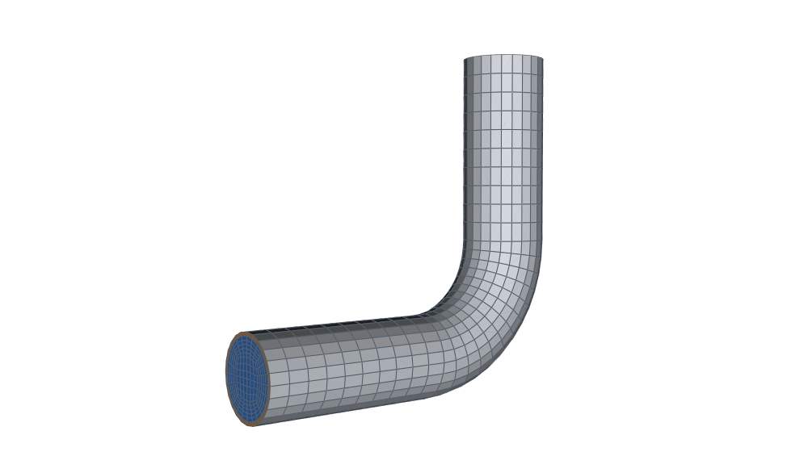 </p>

The bend places a station at every axial layer and joins them with exact
circular arcs, so every wall node lies on the torus.

```bash
python3 -m hexmesh.examples.fittings.smooth_bend
```

| Fittings | Volumes | Cells | min SICN | mean SICN | min SJ (where) | max aspect | Build |
|---|---|---|---|---|---|---|---|
| 3: Straight ×2, Bend | 126 | 6 528 | 0.239 | 0.440 | 0.792 (#1 Bend) | 10.7 | 10.8 s |

- **Open ends:** `fluid_inlet`, `fluid_outlet`, `pipe_wall_inlet`, `pipe_wall_outlet`
- **Walls:** `pipe_wall_wall`
- **Interfaces:** `interface_fluid_pipe_wall`
- **Colours:** fluid blue, pipe_wall orange; walls grey.

### miter_bend

**Mitred bends: a single 90° miter joint and a 3-cut segmented elbow.**

<p>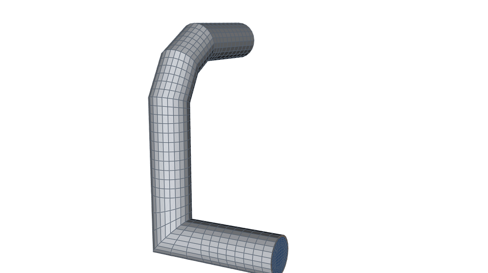 </p>

A `MiterBend` has the same ports as the smooth `Bend` with equal radius
and angle.  Its cut faces are the exact ellipses where the straight pipe
pieces meet, so wall nodes on a cut lie on both pipes.

```bash
python3 -m hexmesh.examples.fittings.miter_bend
```

| Fittings | Volumes | Cells | min SICN | mean SICN | min SJ (where) | max aspect | Build |
|---|---|---|---|---|---|---|---|
| 5: Straight ×3, MiterBend ×2 | 243 | 9 792 | 0.110 | 0.433 | 0.531 (#1 MiterBend) | 22.2 | 42.0 s |

- **Open ends:** `fluid_inlet`, `fluid_outlet`, `pipe_wall_inlet`, `pipe_wall_outlet`
- **Walls:** `pipe_wall_wall`
- **Interfaces:** `interface_fluid_pipe_wall`
- **Colours:** fluid blue, pipe_wall orange; walls grey.

### spline_pipe

**Pipe along a 3-D cubic spline through given points.**

<p>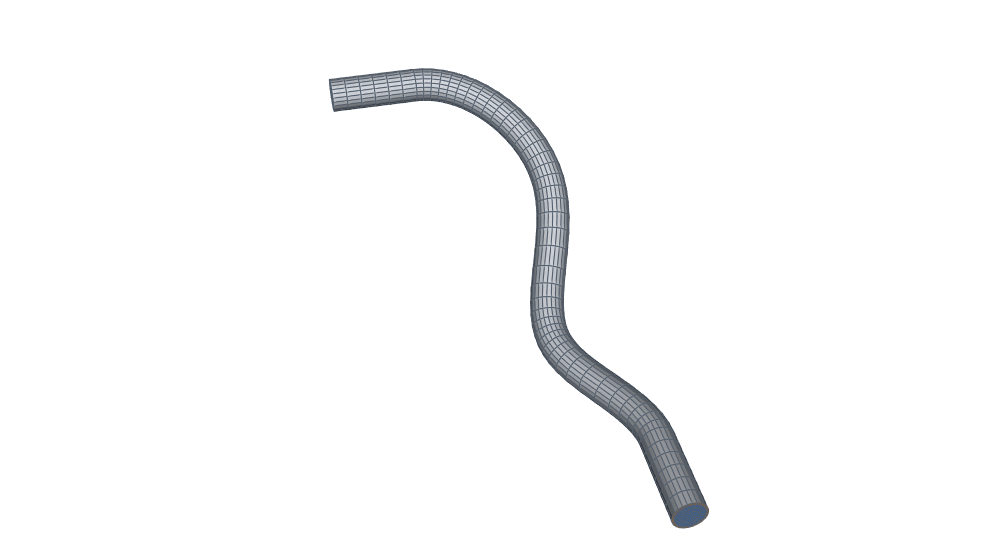 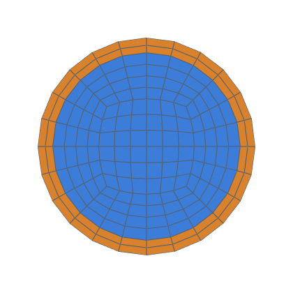</p>

The spline leaves the inlet along its direction; cross-sections follow
rotation-minimising (Bishop) frames, one station per axial layer.

```bash
python3 -m hexmesh.examples.fittings.spline_pipe
```

| Fittings | Volumes | Cells | min SICN | mean SICN | min SJ (where) | max aspect | Build |
|---|---|---|---|---|---|---|---|
| 3: Straight ×2, SplinePipe | 378 | 9 360 | 0.146 | 0.295 | 0.792 (#1 SplinePipe) | 19.0 | 87.7 s |

- **Open ends:** `fluid_inlet`, `fluid_outlet`, `pipe_wall_inlet`, `pipe_wall_outlet`
- **Walls:** `pipe_wall_wall`
- **Interfaces:** `interface_fluid_pipe_wall`
- **Colours:** fluid blue, pipe_wall orange; walls grey.

### reducer_network

**Reducer, bend and expander: a line that narrows, turns and widens again.**

<p>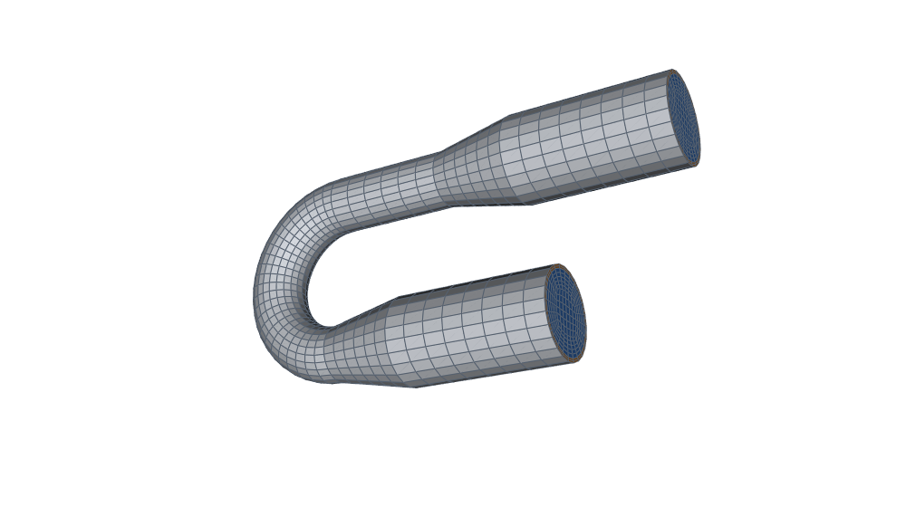 </p>

A `Reducer` may change radii only; the layer stack and every density
parameter must match on both sides, which `validate` checks before GMSH.

```bash
python3 -m hexmesh.examples.fittings.reducer_network
```

| Fittings | Volumes | Cells | min SICN | mean SICN | min SJ (where) | max aspect | Build |
|---|---|---|---|---|---|---|---|
| 6: Straight ×3, Reducer ×2, Bend | 351 | 11 832 | 0.221 | 0.442 | 0.788 (#4 Reducer) | 10.4 | 77.7 s |

- **Open ends:** `fluid_inlet`, `fluid_outlet`, `pipe_wall_inlet`, `pipe_wall_outlet`
- **Walls:** `pipe_wall_wall`
- **Interfaces:** `interface_fluid_pipe_wall`
- **Colours:** fluid blue, pipe_wall orange; walls grey.

### tee

**Side-branch tee: straight run, tee, then a bend on the main line.**

<p>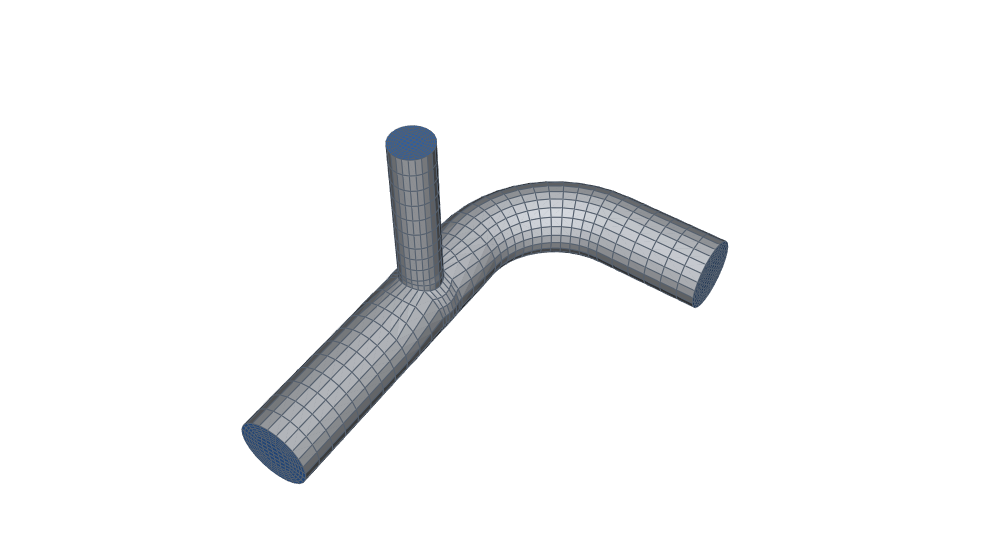 </p>

The tee is a block layout: its O-grid ring layer turns continuously from
the main pipe into the branch, so the junction is all-hex with no merged
nodes.  Ports are named, and the open ends become the patches
`fluid_inlet`, `fluid_main_end` and `fluid_branch_end`.
(Prototype limits: single-layer spec, branch radius below the main radius.)

```bash
python3 -m hexmesh.examples.fittings.tee
```

| Fittings | Volumes | Cells | min SICN | mean SICN | min SJ (where) | max aspect | Build |
|---|---|---|---|---|---|---|---|
| 5: Straight ×3, Tee, Bend | 99 | 7 464 | 0.189 | 0.478 | 0.316 (#1 Tee) | 10.4 | 11.4 s |

- **Open ends:** `fluid_branch_end`, `fluid_inlet`, `fluid_main_end`
- **Walls:** `fluid_wall`
- **Colours:** fluid blue; walls grey.

### wye

**Symmetric wye: straight inlet, a 60° Y-junction, a straight on each daughter.**

<p>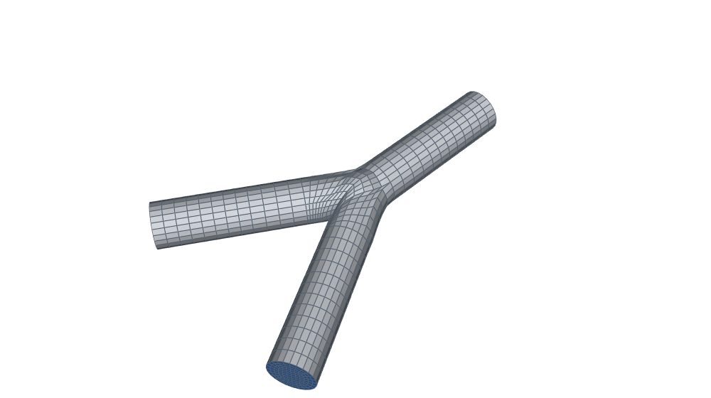 </p>

The wye is a block layout around a hub: the inlet core continues into the
hub, each daughter's core leaves one side of it, and the O-grid ring layer
covers the whole junction.  The daughters split in the inlet's (normal,
right) plane.  Ports are named, and the open ends become the patches
`fluid_inlet`, `fluid_left_end` and `fluid_right_end`.
(Prototype limits: single-layer spec, equal daughters, angle 30°–120°.)

```bash
python3 -m hexmesh.examples.fittings.wye
```

| Fittings | Volumes | Cells | min SICN | mean SICN | min SJ (where) | max aspect | Build |
|---|---|---|---|---|---|---|---|
| 4: Straight ×3, Wye | 44 | 5 724 | 0.170 | 0.560 | 0.156 (#1 Wye) | 5.0 | 4.1 s |

- **Open ends:** `fluid_inlet`, `fluid_left_end`, `fluid_right_end`
- **Walls:** `fluid_wall`
- **Colours:** fluid blue; walls grey.

### loop

**Closed loop: three bends, a straight, and a `Closure` that joins the end back to the start.**

<p>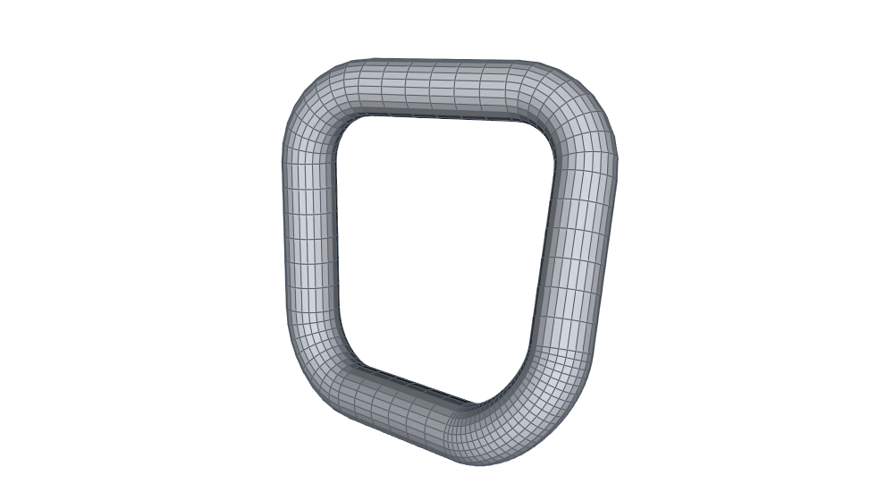 </p>

`Assembly.close` joins two existing open interfaces.  The closure follows
a smooth curve, absorbs any roll mismatch modulo the cross-section symmetry,
and gives an assembly with no open ends (DESIGN.md §8).

```bash
python3 -m hexmesh.examples.fittings.loop
```

| Fittings | Volumes | Cells | min SICN | mean SICN | min SJ (where) | max aspect | Build |
|---|---|---|---|---|---|---|---|
| 8: Straight ×4, Bend ×3, Closure | 468 | 14 688 | 0.140 | 0.411 | 0.790 (#5 Bend) | 20.0 | 173.6 s |

- **Open ends:** 
- **Walls:** `pipe_wall_wall`
- **Interfaces:** `interface_fluid_pipe_wall`
- **Colours:** fluid blue, pipe_wall orange; walls grey.

## Cross-sections, layers and grading: what runs through the pipe

Material layer stacks for conjugate heat transfer, wall grading for
boundary layers, rectangular ducts, and transitions between circles and
rectangles.  Every sweep fitting carries the whole section with it.

### insulated_pipe

**Three-layer insulated pipe: fluid, steel wall, insulation.**

<p>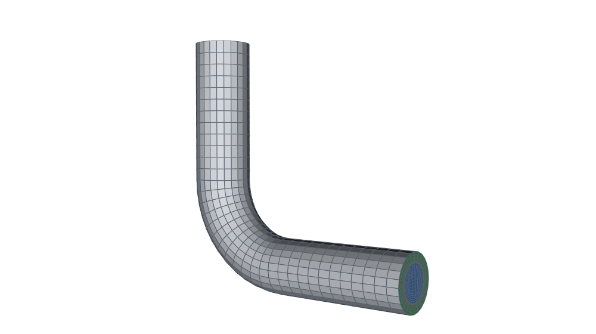 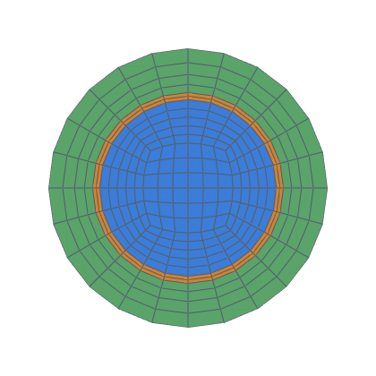</p>

Each layer is its own physical volume, and the layers meet at conformal
material interfaces (`interface_fluid_steel`, …) for conjugate heat transfer.
`Elbow` takes its radius from the pipe: 1.5 D for a long-radius elbow.

```bash
python3 -m hexmesh.examples.sections.insulated_pipe
```

| Fittings | Volumes | Cells | min SICN | mean SICN | min SJ (where) | max aspect | Build |
|---|---|---|---|---|---|---|---|
| 3: Straight ×2, Elbow | 182 | 10 800 | 0.144 | 0.362 | 0.792 (#1 Elbow) | 19.0 | 26.8 s |

- **Open ends:** `fluid_inlet`, `fluid_outlet`, `insulation_inlet`, `insulation_outlet`, `steel_inlet`, `steel_outlet`
- **Walls:** `insulation_wall`
- **Interfaces:** `interface_fluid_steel`, `interface_steel_insulation`
- **Colours:** fluid blue, steel orange, insulation green; walls grey.

### insulated_route

**Insulated route: a three-layer stack carried through a reducer, a miter, a spline and an elbow.**

<p>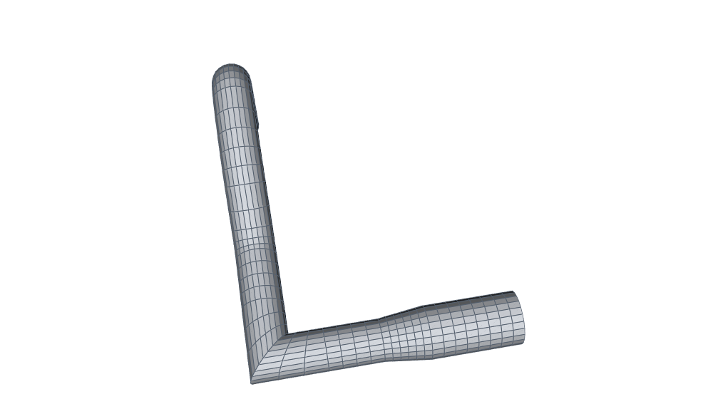 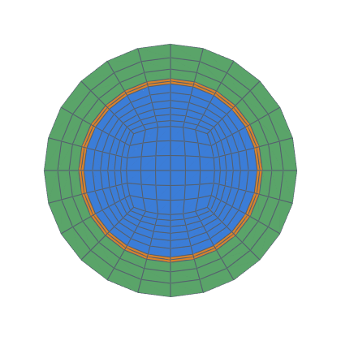</p>

Every sweep fitting takes the whole layer stack, so fluid, steel and
insulation stay separate volumes with conformal `interface_*` groups
along the full route.  The reducer shrinks the core and keeps the shell
thicknesses; it may change radii only, never the stack or the densities
(CLAUDE.md, "Parameter separation").  The fluid core is graded from the
wall with `first_cell`.

```bash
python3 -m hexmesh.examples.sections.insulated_route
```

| Fittings | Volumes | Cells | min SICN | mean SICN | min SJ (where) | max aspect | Build |
|---|---|---|---|---|---|---|---|
| 8: Straight ×4, Reducer, MiterBend, SplinePipe, Elbow | 442 | 15 600 | 0.061 | 0.289 | 0.531 (#3 MiterBend) | 47.5 | 169.2 s |

- **Open ends:** `fluid_inlet`, `fluid_outlet`, `insulation_inlet`, `insulation_outlet`, `steel_inlet`, `steel_outlet`
- **Walls:** `insulation_wall`
- **Interfaces:** `interface_fluid_steel`, `interface_steel_insulation`
- **Colours:** fluid blue, steel orange, insulation green; walls grey.

### graded_bend

**CFD-ready bend: wall grading, axial cells clustered at the bend, inlet and outlet extensions, and one wall patch per fitting.**

<p>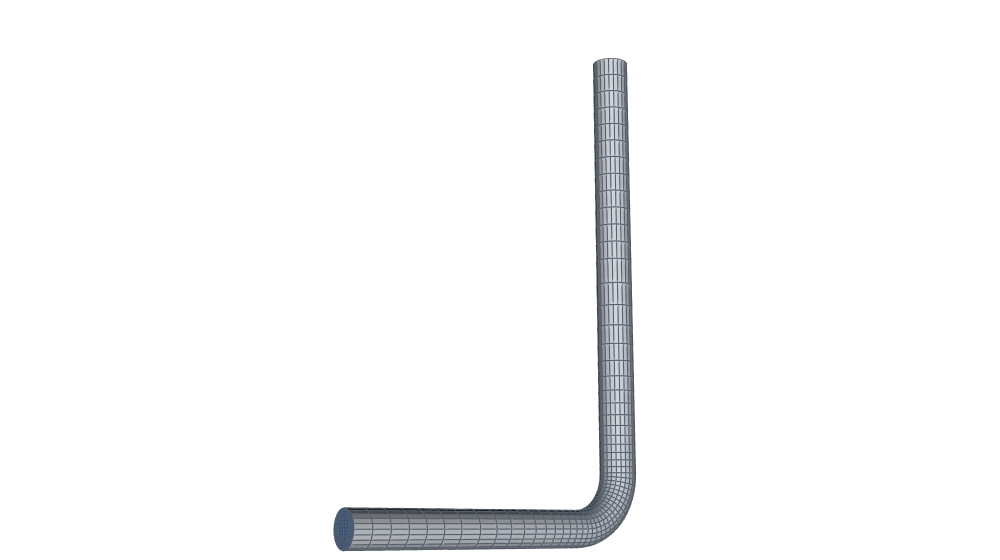 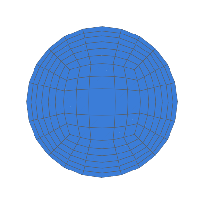</p>

- `first_cell` grades the core radially toward the wall.
- `axial_grading` is the ratio of consecutive axial cells, inlet to
  outlet: below 1 refines the upstream straight toward the bend, above 1
  refines the downstream straight from it.
- `extend_open_ends` adds developing lengths, in diameters.
- `walls_by_fitting=True` gives `fluid_wall_<label>` per fitting, so
  wall data can be read per fitting in the solver.  The extensions have
  no label, so their walls take the default `<Type><index>` names
  (`fluid_wall_Straight3`, …).

```bash
python3 -m hexmesh.examples.sections.graded_bend
```

| Fittings | Volumes | Cells | min SICN | mean SICN | min SJ (where) | max aspect | Build |
|---|---|---|---|---|---|---|---|
| 5: Straight ×4, Bend | 100 | 11 160 | 0.100 | 0.363 | 0.792 (#1 Bend) | 28.5 | 10.8 s |

- **Open ends:** `fluid_inlet`, `fluid_outlet`
- **Walls:** `fluid_wall_Straight3`, `fluid_wall_Straight4`, `fluid_wall_bend`, `fluid_wall_downstream`, `fluid_wall_upstream`
- **Colours:** fluid blue; walls grey.

### rect_duct

**Rectangular duct: a 2:1 duct with an easy-way and a hard-way bend.**

<p>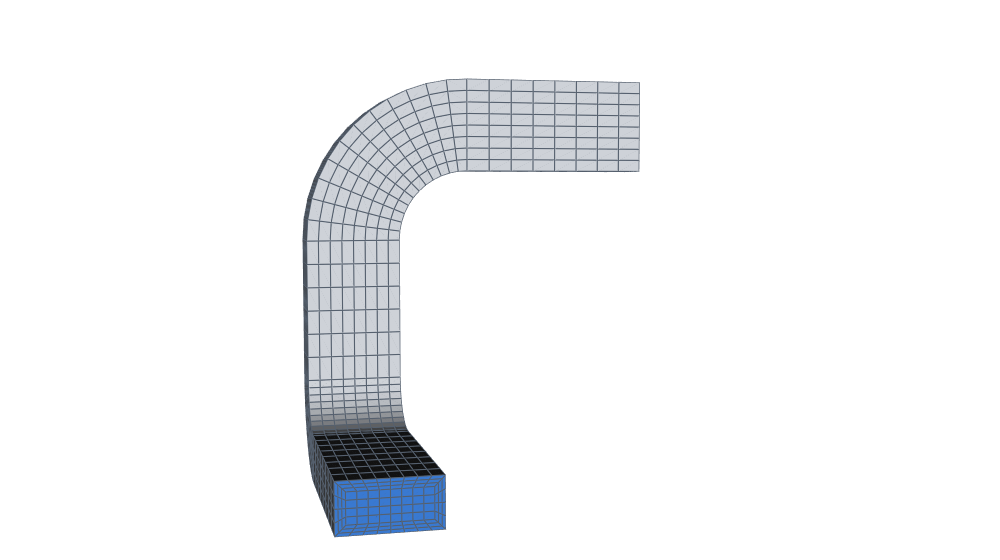 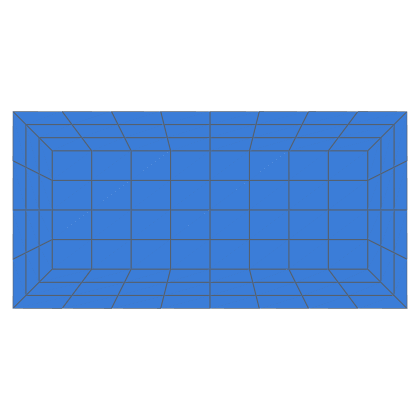</p>

The width runs along the frame's `right` and the height along `up`.
A bend with `roll=0` turns toward `up`, across the short side: the
"easy way" for a flat duct.  `roll=90` turns toward `right`, across the
long side: the "hard way", which needs the larger bend radius (it is
checked against the half-width).  The open ends become `air_inlet` and
`air_outlet`.
(Limits: single-layer ducts; no reducer, tee or elbow for ducts yet.)

```bash
python3 -m hexmesh.examples.sections.rect_duct
```

| Fittings | Volumes | Cells | min SICN | mean SICN | min SJ (where) | max aspect | Build |
|---|---|---|---|---|---|---|---|
| 5: Straight ×3, Bend ×2 | 125 | 4 576 | 0.317 | 0.513 | 0.705 (#1 Bend) | 7.5 | 13.9 s |

- **Open ends:** `air_inlet`, `air_outlet`
- **Walls:** `air_wall`
- **Colours:** air blue; walls grey.

### duct_transition

**Duct transition: a circular pipe into a 2:1 duct, a duct bend, and back.**

<p>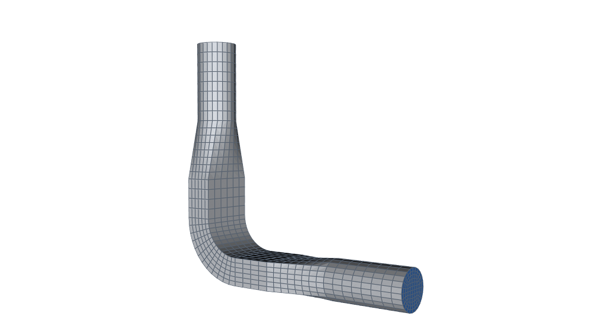 </p>

`Transition` joins a circle and a rectangle with the same counts per
side: the circle's `nang` equals the duct's `nang_w` and `nang_h`.
Then the two faces have the same mesh connectivity (switch class 0), and
every station between them blends the two outlines.  The open ends
become `air_inlet` and `air_outlet`.
(Limits: single-layer specs; equal counts per side.)

```bash
python3 -m hexmesh.examples.sections.duct_transition
```

| Fittings | Volumes | Cells | min SICN | mean SICN | min SJ (where) | max aspect | Build |
|---|---|---|---|---|---|---|---|
| 7: Straight ×4, Transition ×2, Bend | 160 | 5 616 | 0.377 | 0.579 | 0.689 (#5 Transition) | 5.4 | 51.3 s |

- **Open ends:** `air_inlet`, `air_outlet`
- **Walls:** `air_wall`
- **Colours:** air blue; walls grey.

## Networks: composing fittings into routes, branches and trees

Fittings join conformally whatever their order, so a network is a
sequence of `add` calls, branching from any interface.  Nothing is tied
to the coordinate axes.

### pipe_network

**Branched network built as a graph: a header with two tees, each branch continued with its own fittings.**

<p>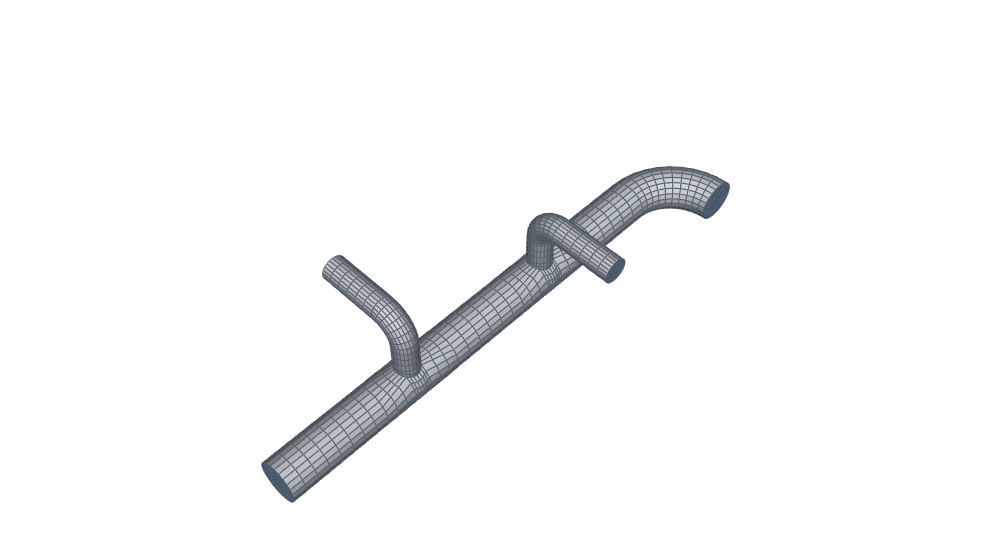 </p>

`add(fitting)` continues from the tail; `add(interface, fitting)`
branches from any interface.  Fittings are placed and validated in pure
Python first, then filled in any order (DESIGN.md A6).

```bash
python3 -m hexmesh.examples.networks.pipe_network
```

| Fittings | Volumes | Cells | min SICN | mean SICN | min SJ (where) | max aspect | Build |
|---|---|---|---|---|---|---|---|
| 10: Straight ×5, Tee ×2, Elbow ×3 | 203 | 13 992 | 0.189 | 0.454 | 0.316 (#3 Tee) | 10.4 | 38.2 s |

- **Open ends:** `water_header_end`, `water_inlet`, `water_tap0`, `water_tap1`
- **Walls:** `water_wall`
- **Colours:** water blue; walls grey.

### pipe_rack

**3-D pipe route mixing every sweep fitting: elbow, riser, segmented miter, spline offset, reducer and a rolled bend.**

<p>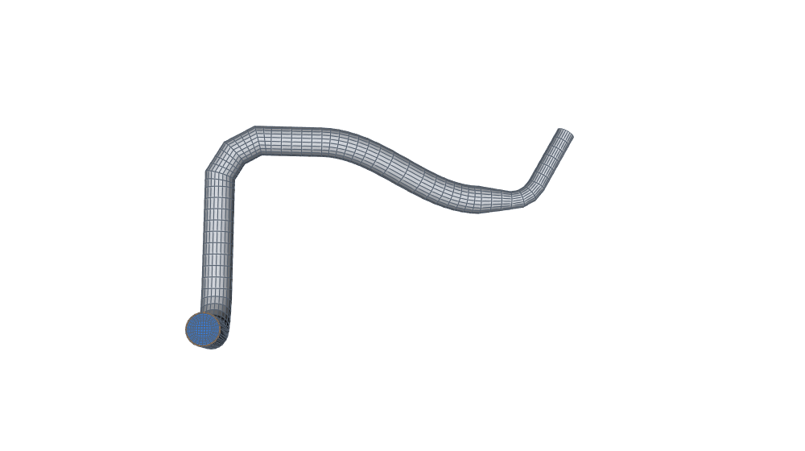 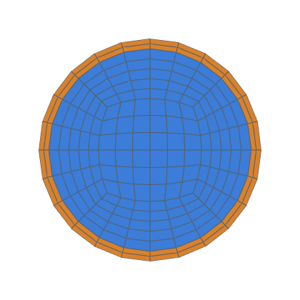</p>

Every fitting starts where the previous one ended, so the route is just a
sequence of `add` calls.  `roll` turns a bend about the pipe axis
(0 toward `up`, 90 toward `right`), which is how a planar fitting
leaves the plane.  Fittings of different kinds share one cross-section,
so they join conformally whatever their order (DESIGN.md P1).

```bash
python3 -m hexmesh.examples.networks.pipe_rack
```

| Fittings | Volumes | Cells | min SICN | mean SICN | min SJ (where) | max aspect | Build |
|---|---|---|---|---|---|---|---|
| 9: Straight ×4, Elbow, MiterBend, SplinePipe, Reducer, Bend | 432 | 14 280 | 0.078 | 0.295 | 0.766 (#3 MiterBend) | 36.9 | 176.5 s |

- **Open ends:** `fluid_inlet`, `fluid_outlet`, `pipe_wall_inlet`, `pipe_wall_outlet`
- **Walls:** `pipe_wall_wall`
- **Interfaces:** `interface_fluid_pipe_wall`
- **Colours:** fluid blue, pipe_wall orange; walls grey.

### distribution_tree

**Two-level distribution tree: a header with two tees, and a second tee on one of the branches after a reducer.**

<p>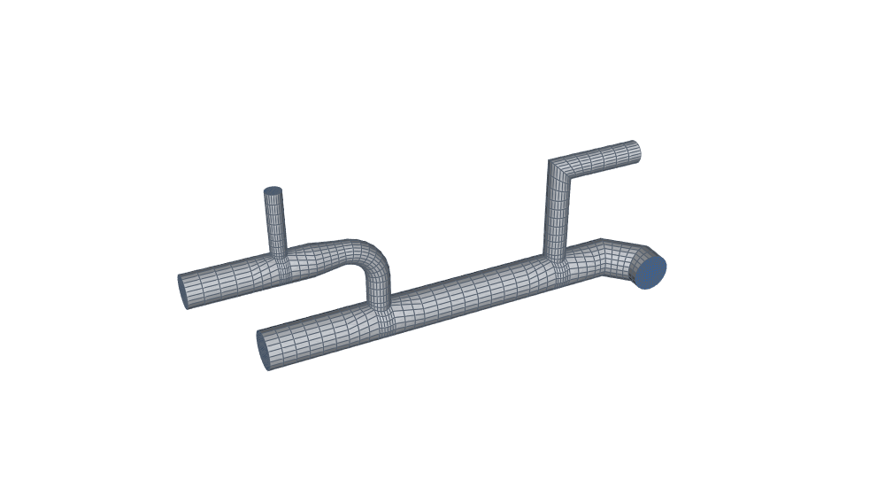 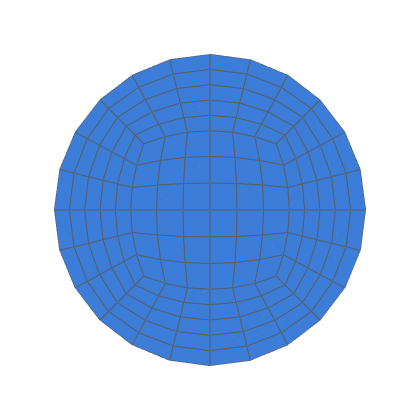</p>

A tee's branch outlet carries a smaller spec, so every fitting after it is
sized from the branch.  To tee off a branch, first widen it with a
`Reducer`: a tee needs its branch smaller than the pipe it sits on.
The outlets are named, so each open end becomes its own patch
(`water_branch_a`, …), and the branches use different bend kinds.

```bash
python3 -m hexmesh.examples.networks.distribution_tree
```

| Fittings | Volumes | Cells | min SICN | mean SICN | min SJ (where) | max aspect | Build |
|---|---|---|---|---|---|---|---|
| 13: Straight ×6, Tee ×3, MiterBend ×2, Elbow, Reducer | 232 | 16 152 | 0.149 | 0.412 | 0.258 (#7 Tee) | 15.6 | 53.2 s |

- **Open ends:** `water_branch_a`, `water_branch_a_tap`, `water_branch_b`, `water_header_end`, `water_inlet`
- **Walls:** `water_wall`
- **Colours:** water blue; walls grey.

### bifurcation_tree

**Two-level bifurcation tree: one inlet, two wyes deep, four parallel outlets.**

<p>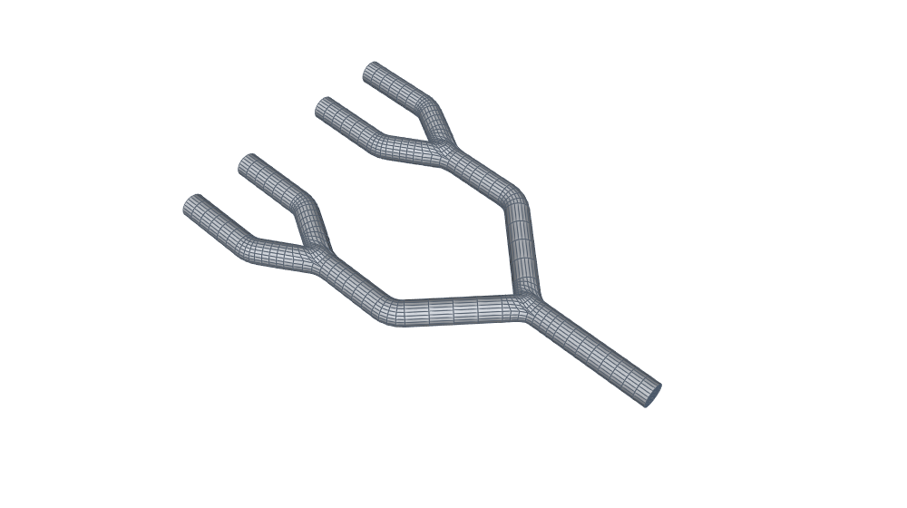 </p>

A flow-splitting manifold, or a symmetric model of a branching airway or
artery.  A 90° wye splits the inlet; each daughter bends back parallel to
the inlet and splits again in a 60° wye, whose daughters bend parallel
too.  The four outlets come out side by side, named `a` to `d`.

- A wye splits in the inlet's (normal, `right`) plane; `right` turns
  toward the inlet's `right`.  Its ports are `[left, right]`.
- A bend turns toward `up` at `roll=0` and toward `right` at
  `roll=90`, so the left daughters straighten with `roll=90` and the
  right ones with `roll=-90`.

Every junction keeps the inlet's spec, so the whole tree is one
connectivity type and meshes all-hex.  (Prototype limits of the wye:
single-layer, equal daughters, 30°–120°.)

```bash
python3 -m hexmesh.examples.networks.bifurcation_tree
```

| Fittings | Volumes | Cells | min SICN | mean SICN | min SJ (where) | max aspect | Build |
|---|---|---|---|---|---|---|---|
| 16: Straight ×7, Wye ×3, Bend ×6 | 242 | 14 472 | 0.117 | 0.470 | 0.204 (#9 Wye) | 13.1 | 70.8 s |

- **Open ends:** `fluid_a`, `fluid_b`, `fluid_c`, `fluid_d`, `fluid_inlet`
- **Walls:** `fluid_wall`
- **Colours:** fluid blue; walls grey.

### skewed_network

**Off-axis network: a drum on a skewed axis, a nozzle at 35° from vertical, and fittings at arbitrary angles and rolls.**

<p>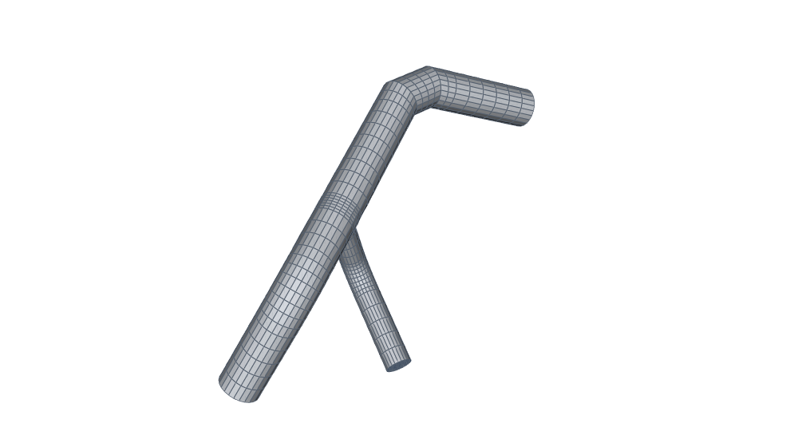 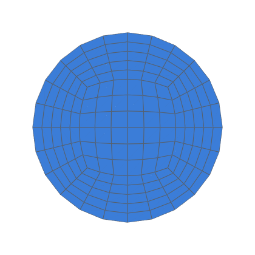</p>

Nothing in hexmesh is tied to the coordinate axes.  Every interface is a
`Frame` (position, normal, up) in absolute coordinates, so a drum axis,
a start direction, a bend angle and a `roll` can all take any value.
Here no pipe runs along x, y or z, and no bend lies in a coordinate plane.

```bash
python3 -m hexmesh.examples.networks.skewed_network
```

| Fittings | Volumes | Cells | min SICN | mean SICN | min SJ (where) | max aspect | Build |
|---|---|---|---|---|---|---|---|
| 8: Straight ×4, Bend, Tee, MiterBend, Elbow | 164 | 9 492 | 0.150 | 0.412 | 0.331 (#2 Tee) | 15.0 | 34.4 s |

- **Open ends:** `water_D201_N1`, `water_branch`, `water_outlet`
- **Walls:** `water_wall`
- **Colours:** water blue; walls grey.

## Applications: equipment and engineering cases

Networks starting at equipment nozzles, ventilation ducting, and cooling
channels: the examples closest to a real model.

### drum_nozzle

**Line from a drum nozzle: a horizontal drum with a top nozzle, a riser, an elbow, a tee and CFD extensions on the open ends.**

<p>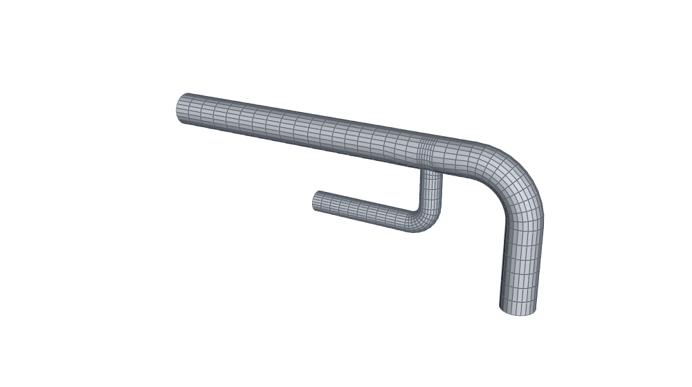 </p>

`Drum` builds no geometry; it gives the nozzle face's pose (decision
0002).  `Assembly.from_nozzle` starts the network there, and the inlet
patch is named after the drum and nozzle (`water_D101_N1`).
`extend_open_ends` adds straight runs after every open outlet, sized in
diameters of each end; the nozzle end is never extended.

```bash
python3 -m hexmesh.examples.applications.drum_nozzle
```

| Fittings | Volumes | Cells | min SICN | mean SICN | min SJ (where) | max aspect | Build |
|---|---|---|---|---|---|---|---|
| 7: Straight ×4, Elbow ×2, Tee | 134 | 10 272 | 0.150 | 0.381 | 0.331 (#2 Tee) | 12.5 | 23.4 s |

- **Open ends:** `water_D101_N1`, `water_outlet`, `water_vent`
- **Walls:** `water_wall`
- **Colours:** water blue; walls grey.

### hvac_supply

**Ventilation supply run: a fan's round outlet, a flat duct through the building, and a square terminal.**

<p>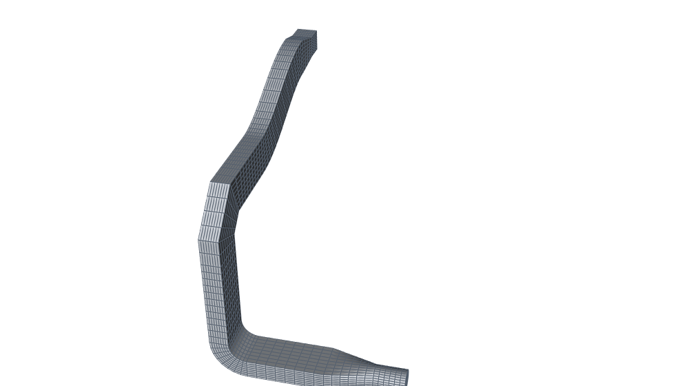 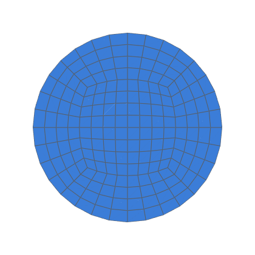</p>

- A `Transition` takes the round fan outlet (Ø 0.3) to a 0.5 × 0.25
  duct.  Counts per side match (`nang` = `nang_w` = `nang_h`), so the
  two faces have the same mesh connectivity.
- The duct rises with an easy-way bend (`roll=0`: across the height),
  turns along the ceiling with a two-cut mitred hard-way bend
  (`roll=90`: across the width, so its radius is checked against the
  half-width), and jogs sideways with a spline offset.
- A second `Transition` (rectangle → rectangle) ends at a 0.3 × 0.3
  square terminal, named `terminal`.

Patches: `air_inlet`, `air_terminal`, `air_wall`.

```bash
python3 -m hexmesh.examples.applications.hvac_supply
```

| Fittings | Volumes | Cells | min SICN | mean SICN | min SJ (where) | max aspect | Build |
|---|---|---|---|---|---|---|---|
| 10: Straight ×5, Transition ×2, Bend, MiterBend, SplinePipe | 235 | 15 360 | 0.121 | 0.363 | 0.627 (#5 MiterBend) | 18.0 | 84.7 s |

- **Open ends:** `air_inlet`, `air_terminal`
- **Walls:** `air_wall`
- **Colours:** air blue; walls grey.

### cooling_channels

**Cooling channels: a supply pipe split by a wye into two flat rectangular channels, each returning to a round outlet.**

<p>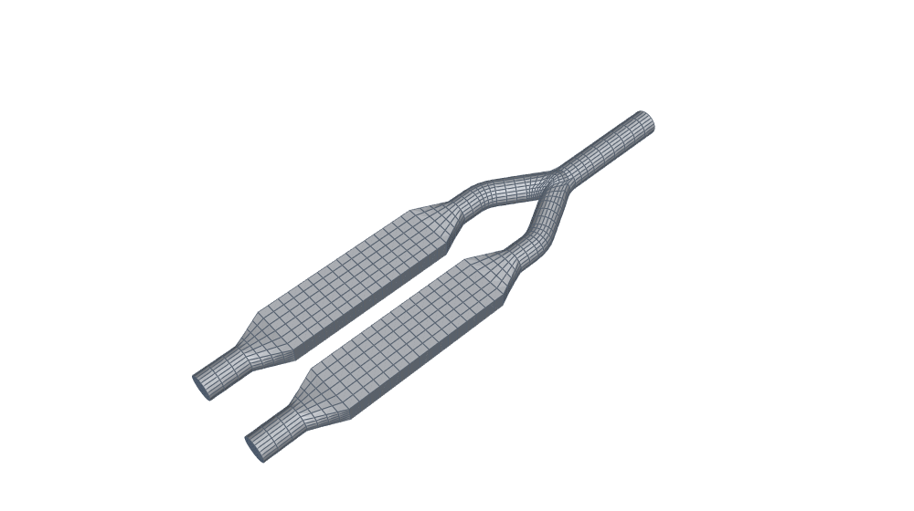 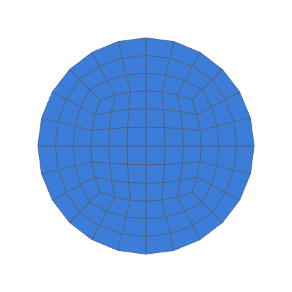</p>

Each daughter of the 60° wye bends back parallel to the supply, then a
`Transition` flattens it into a 3:1 channel (0.12 × 0.04), the kind of
passage that cools a plate or a mould.  After the channel a second
`Transition` rounds it off again.  The circle's `nang` equals the
channel's `nang_w` and `nang_h`, so every transition is a plain sweep.
Outlets: `fluid_left_out`, `fluid_right_out`.

```bash
python3 -m hexmesh.examples.applications.cooling_channels
```

| Fittings | Volumes | Cells | min SICN | mean SICN | min SJ (where) | max aspect | Build |
|---|---|---|---|---|---|---|---|
| 14: Straight ×7, Wye, Bend ×2, Transition ×4 | 184 | 10 152 | 0.152 | 0.380 | 0.204 (#1 Wye) | 9.4 | 54.6 s |

- **Open ends:** `fluid_inlet`, `fluid_left_out`, `fluid_right_out`
- **Walls:** `fluid_wall`
- **Colours:** fluid blue; walls grey.

## Validation

Meshes from hexmesh solved with OpenFOAM and compared with analytic or published solutions (decision 0012); each case is judged by grid convergence against gates set in advance (decision 0015).

Each case lives in `validation/<case>/`: `README.md` describes it, `RESULTS.md` holds the measurements and opens with a `**Status:**` line, and an optional `figure.png` is shown here.

### Heated rod: results

**Status:** —

Case: [validation/heated_rod/README.md](../validation/heated_rod/README.md); results: [RESULTS.md](../validation/heated_rod/RESULTS.md).

### laminar Hagen–Poiseuille

**Status:** accepted (task 0020, gates of decision 0015)

Case: [validation/poiseuille/README.md](../validation/poiseuille/README.md); results: [RESULTS.md](../validation/poiseuille/RESULTS.md).

### Planned

| Task | Status |
|---|---|
| [0032 — Validation: smooth cosine constriction (Varghese et al.), Re = 500](tasks/0032-validation-stenosis.md) | ready (after 0031 and 0020's re-run) |
| [0033 — Validation: solid rod with uniform heat generation (O-H core, pure diffusion)](tasks/0033-validation-heated-rod.md) | in progress |
| [0034 — Validation: conduction through a heated, multi-layer cylinder (CHT, solids only)](tasks/0034-validation-layered-conduction.md) | ready (after 0025 and 0033) |
| [0035 — Validation: heated multi-layer pipe with laminar flow (full CHT)](tasks/0035-validation-heated-pipe-cht.md) | ready (after 0034) |

---

Generated 2026-10-27 from hexmesh d71d0d8 + uncommitted changes, gmsh 4.12.1, Python 3.12.3, 8 CPUs, 4 job(s).
