# hexmesh gallery

What hexmesh's meshes look like and how good their cells are, on three pages.  Every example is a runnable module; the pages are generated by `docs/gallery/build.py` (prose from the examples' docstrings, numbers and images from meshing them).

- **[Features](gallery/FEATURES.md):** the building blocks, by family (7 families, 25 examples): bends, reducers, junctions, sections, layers, grading, and how networks are built.
- **[Applications](gallery/APPLICATIONS.md):** 6 networks closer to a real model, and which fittings they use.
- **[Validation](gallery/VALIDATION.md):** 13 cases solved and compared with a reference, judged by grid convergence.

## Features

| | Family | Examples |
|---|---|---|
| 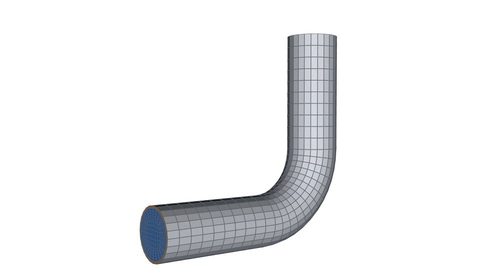 | [Bends](gallery/FEATURES.md#bends) | [smooth_bend](gallery/FEATURES.md#smooth_bend), [miter_bend](gallery/FEATURES.md#miter_bend), [spline_pipe](gallery/FEATURES.md#spline_pipe) |
| 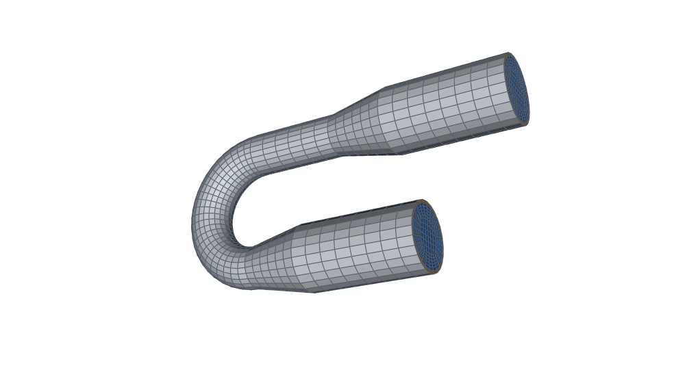 | [Reducers and profiles](gallery/FEATURES.md#reducers-and-profiles) | [reducer_network](gallery/FEATURES.md#reducer_network), [stenosis](gallery/FEATURES.md#stenosis) |
| 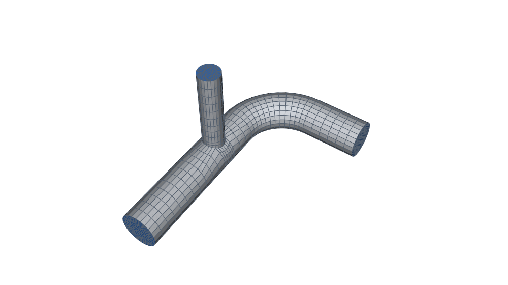 | [Junctions](gallery/FEATURES.md#junctions) | [tee](gallery/FEATURES.md#tee), [equal_tee](gallery/FEATURES.md#equal_tee), [wye](gallery/FEATURES.md#wye), [junction_walls](gallery/FEATURES.md#junction_walls) |
| 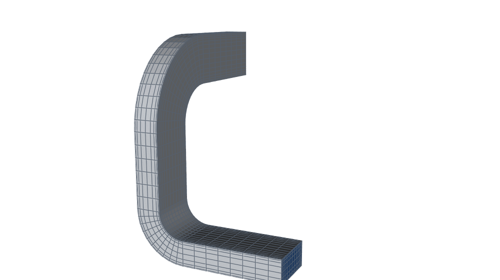 | [Sections and transitions](gallery/FEATURES.md#sections-and-transitions) | [rect_duct](gallery/FEATURES.md#rect_duct), [duct_transition](gallery/FEATURES.md#duct_transition) |
| 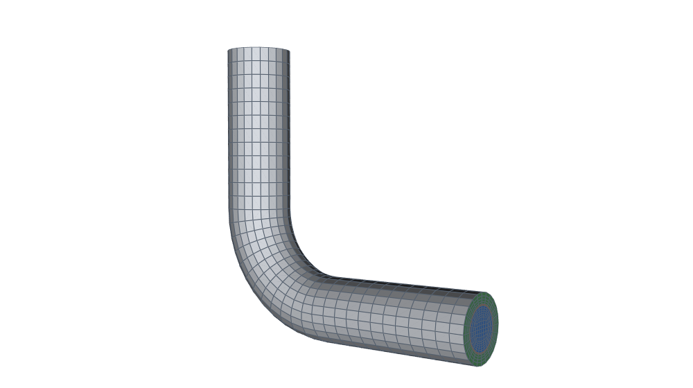 | [Layers](gallery/FEATURES.md#layers) | [insulated_pipe](gallery/FEATURES.md#insulated_pipe), [insulated_route](gallery/FEATURES.md#insulated_route), [layer_outlines](gallery/FEATURES.md#layer_outlines), [lagged_duct](gallery/FEATURES.md#lagged_duct), [insulated_transition](gallery/FEATURES.md#insulated_transition), [insulated_tee](gallery/FEATURES.md#insulated_tee), [insulated_network](gallery/FEATURES.md#insulated_network) |
| 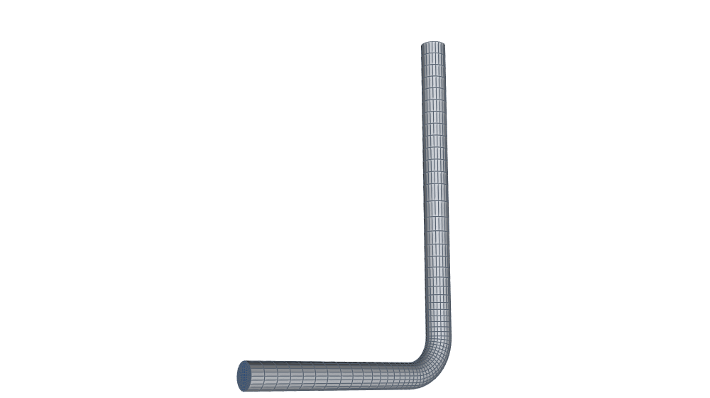 | [Grading and resolution](gallery/FEATURES.md#grading-and-resolution) | [graded_bend](gallery/FEATURES.md#graded_bend) |
| 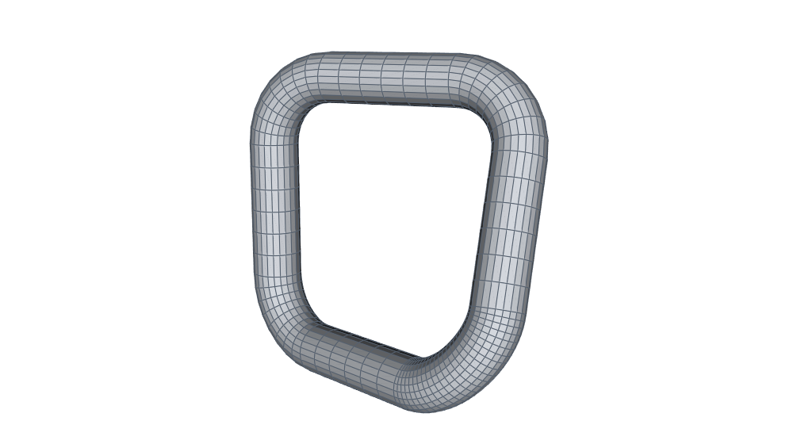 | [Building networks](gallery/FEATURES.md#building-networks) | [loop](gallery/FEATURES.md#loop), [pipe_network](gallery/FEATURES.md#pipe_network), [pipe_rack](gallery/FEATURES.md#pipe_rack), [distribution_tree](gallery/FEATURES.md#distribution_tree), [bifurcation_tree](gallery/FEATURES.md#bifurcation_tree), [skewed_network](gallery/FEATURES.md#skewed_network) |

## Applications

| | Example | Shows |
|---|---|---|
| 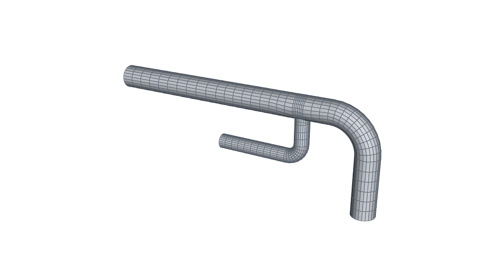 | [drum_nozzle](gallery/APPLICATIONS.md#drum_nozzle) | Line from a drum nozzle: a horizontal drum with a top nozzle, a riser, an elbow, a tee and CFD extensions on the open ends. |
| 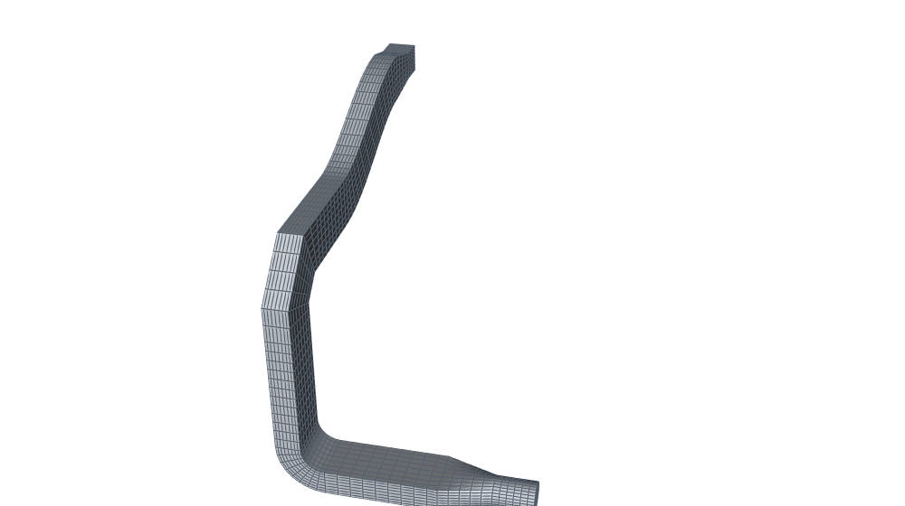 | [hvac_supply](gallery/APPLICATIONS.md#hvac_supply) | Ventilation supply run: a fan's round outlet, a flat duct through the building, and a square terminal. |
| 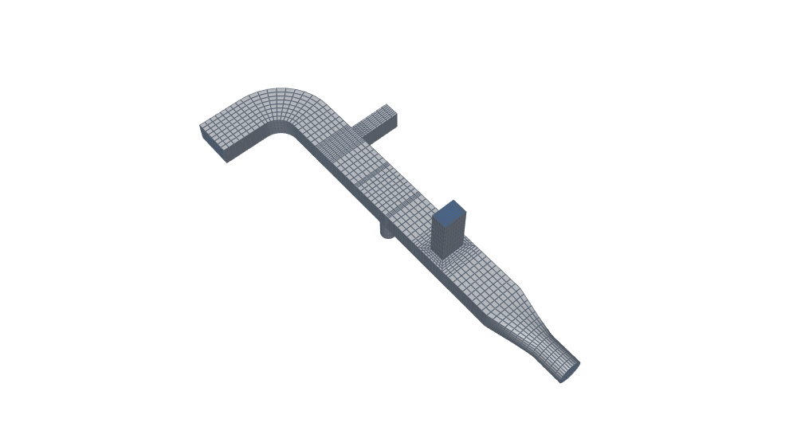 | [hvac_branched](gallery/APPLICATIONS.md#hvac_branched) | Branched ventilation supply: a fan's round outlet, a flat main duct with three taps, and a bend at the end of the run. |
| 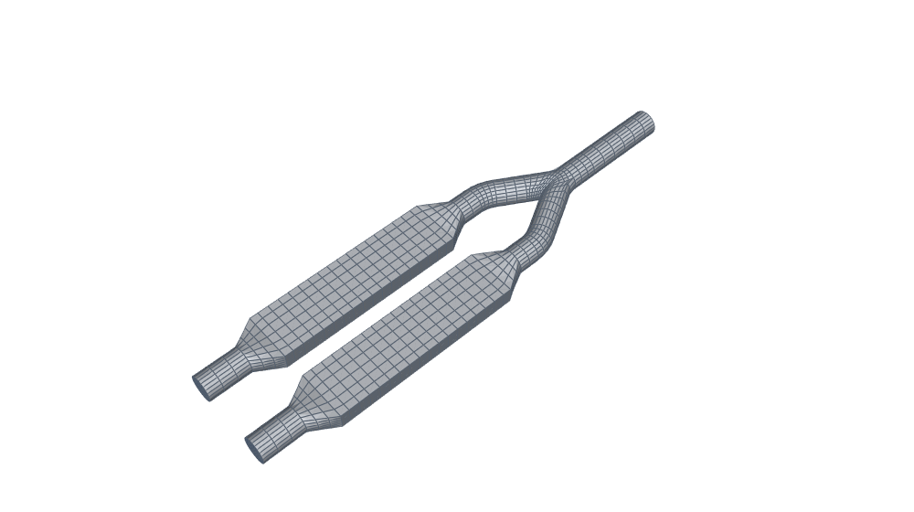 | [cooling_channels](gallery/APPLICATIONS.md#cooling_channels) | Cooling channels: a supply pipe split by a wye into two flat rectangular channels, each returning to a round outlet. |
| 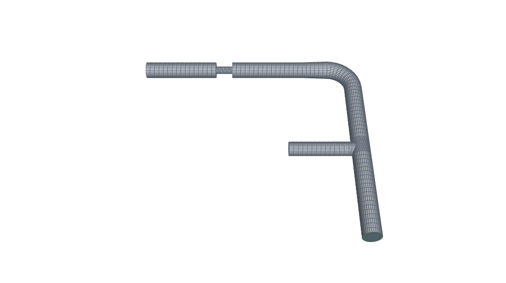 | [pcf_line](gallery/APPLICATIONS.md#pcf_line) | A plant line from a PCF isometric: the network comes from the file, not from Python. |
| 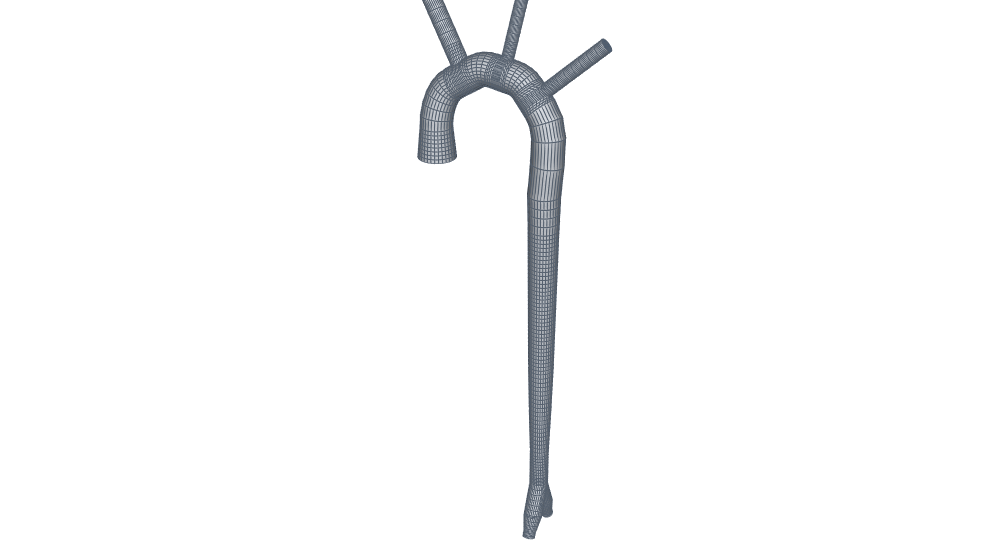 | [idealised_aorta](gallery/APPLICATIONS.md#idealised_aorta) | Idealised aorta: the arch with its three branches, the tapering descending and abdominal aorta, and the iliac bifurcation. |

## Validation

Cases by status: ● 12 accepted, ◐ 1 in progress.  [The Validation page](gallery/VALIDATION.md) has each case and the coverage matrix (which features each case exercises).

## Reading the numbers

- **Cells:** hexahedra in the written mesh.  hexmesh predicts the count before GMSH runs (`Assembly.cell_count()`); a ✗ marks a mismatch.
- **SICN:** GMSH's signed inverse condition number, per cell: 1 for a cube, 0 or below for an inverted cell.  Examples must have none at or below 0.
- **SJ:** the minimum scaled Jacobian over a hex's corners (1 for a cube), with the fitting holding the worst cell.  Junctions (tee, wye) are where it is lowest.
- **Aspect:** the largest ratio of a cell's longest to shortest edge.  Wall grading and long axial cells raise it deliberately.
- **Build:** wall time of `main()` (build, mesh, write, quality check) on the machine in the page's footer.  Compare within one run only.
- **Images:** the network from outside (walls grey, open ends coloured by material), and the inlet cross-section seen from upstream.

---

Generated 2026-11-10 from hexmesh 3bdc2d0 + uncommitted changes, gmsh 4.12.1, Python 3.12.3, 8 CPUs, 1 job(s).
