# Applications

Networks closer to a real model, built from the [features](FEATURES.md).  Each lists the fittings it uses, linked to their family.  [The gallery](../GALLERY.md) explains the numbers.

Networks starting at equipment nozzles, ventilation ducting, cooling
channels, an idealised aorta, a rocket engine's oxidiser manifold, a
lipid-nanoparticle micromixer, a subsea pipeline read from a seabed survey
and a buried district-heating pipe: the examples closest to a real model.

| Example | Shows | Cells | min SICN | min SJ | Build |
|---|---|---|---|---|---|
| [drum_nozzle](#drum_nozzle) | Line from a drum nozzle: a horizontal drum with a top nozzle, a riser, an elbow, a tee and CFD extensions on the open ends. | 10 272 | 0.150 | 0.331 | 5.2 s |
| [hvac_supply](#hvac_supply) | Ventilation supply run: a fan's round outlet, a flat duct through the building, and a square terminal. | 6 912 | 0.246 | 0.577 | 1.9 s |
| [hvac_branched](#hvac_branched) | Branched ventilation supply: a fan's round outlet, a flat main duct with three taps, and a bend at the end of the run. | 24 704 | 0.157 | 0.421 | 8.0 s |
| [cooling_channels](#cooling_channels) | Cooling channels: a supply pipe split by a wye into two flat rectangular channels, each returning to a round outlet. | 8 280 | 0.152 | 0.204 | 5.0 s |
| [pcf_line](#pcf_line) | A plant line from a PCF isometric: the network comes from the file, not from Python. | 35 712 | 0.062 | 0.258 | 12.3 s |
| [idealised_aorta](#idealised_aorta) | Idealised aorta: the arch with its three branches, the tapering descending and abdominal aorta, and the iliac bifurcation. | 40 448 | 0.089 | 0.133 | 21.8 s |
| [rocket_injector_manifold](#rocket_injector_manifold) | Rocket injector manifold: a liquid-oxygen ring feeding eight injector legs, supplied by an insulated feed line through a cavitating venturi. | 80 768 | 0.064 | 0.258 | 103.2 s |
| [micromixer](#micromixer) | Micromixer: a T-mixer for lipid nanoparticles, with a twisted mixing channel, at its real size in micrometres. | 10 112 | 0.146 | 0.577 | 28.7 s |
| [subsea_pipeline](#subsea_pipeline) | Subsea pipeline: an insulated flowline laid over a field of sand waves, read from a seabed survey, rising at its end into a riser. | 183 744 | 0.003 | 0.771 | 220.6 s |
| [district_heating](#district_heating) | District heating: a buried pre-insulated pipe, its soil meshed with it, turning a street corner. | 23 040 | 0.023 | 0.599 | 8.4 s |

## drum_nozzle

**Line from a drum nozzle: a horizontal drum with a top nozzle, a riser, an elbow, a tee and CFD extensions on the open ends.**

<p>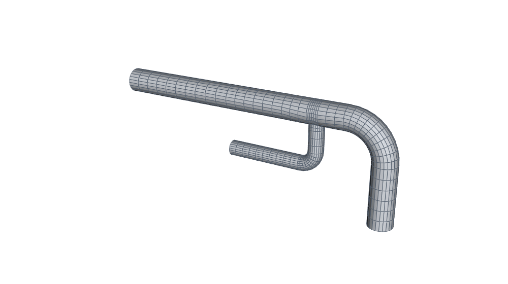 </p>

`Drum` builds no geometry; it gives the nozzle face's pose (decision
0002).  `Assembly.from_nozzle` starts the network there, and the inlet
patch is named after the drum and nozzle (`water_D101_N1`).
`extend_open_ends` adds straight runs after every open outlet, sized in
diameters of each end; the nozzle end is never extended.

```bash
python3 -m hexmesh.examples.applications.drum_nozzle
```

| Fittings | Volumes | Cells | min SICN | mean SICN | min SJ (where) | max aspect | Build |
|---|---|---|---|---|---|---|---|
| 7: Straight ×4, Elbow ×2, Tee | 134 | 10 272 | 0.150 | 0.381 | 0.331 (#2 Tee) | 12.5 | 5.2 s |

- **Open ends:** `water_D101_N1`, `water_outlet`, `water_vent`
- **Walls:** `water_wall`
- **Colours:** water blue; walls grey.
- **Parameters:** [`Straight`](../../API.md#straightlength-n_layersnone-axial_grading10-stack_changes-twist00), [`Elbow`](../../API.md#elbowangle900-schedulelong-n_layers8-roll00-axial_grading10-towardnone), [`Tee`](../../API.md#teerun_lengthnone-branch_length-branch_radius-n_run3-n_branch3-n_turn2-roll00-towardnone-angle900-offset00-branchnone-facenone-marginnone-domenone-sheetnone-n_wallnone-branch_first_cellnone-branch_mprgnone)
- **Fittings used:** Straight ×4 ([building networks](FEATURES.md#building-networks)), Elbow ×2 ([bends](FEATURES.md#bends)), Tee ([junctions](FEATURES.md#junctions))

## hvac_supply

**Ventilation supply run: a fan's round outlet, a flat duct through the building, and a square terminal.**

<p>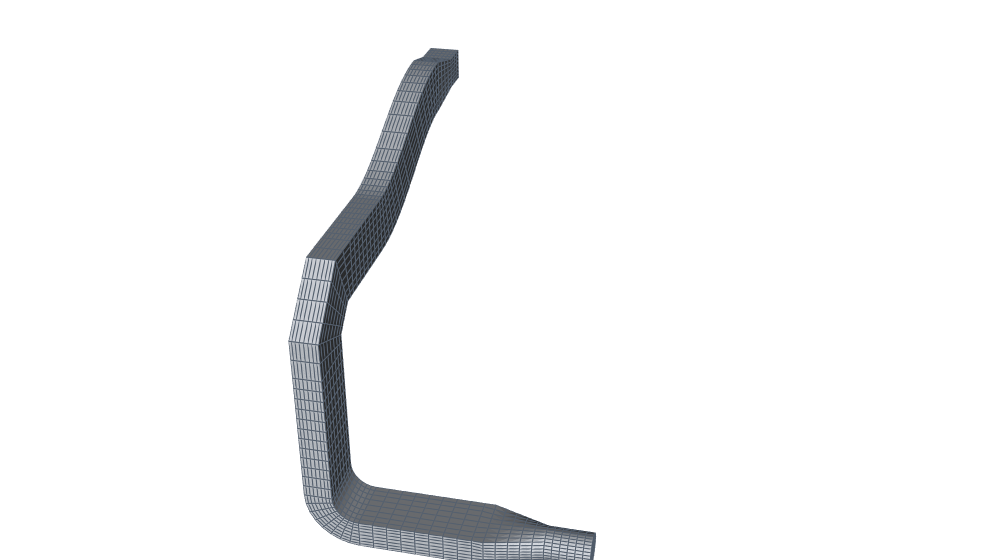 </p>

- A `Transition` takes the round fan outlet (Ø 0.3) to a 0.5 × 0.25
  duct.  Counts per side match (`nang` = `nang_w` = `nang_h`), so the
  two faces have the same mesh connectivity.
- The duct rises with an easy-way bend (`roll=0`: across the height),
  turns along the ceiling with a two-cut mitred hard-way bend
  (`roll=90`: across the width, so its radius is checked against the
  half-width), and jogs sideways with a spline offset.
- A `Reducer` (rectangle → rectangle: half_w and half_h change on the
  H face) ends at a 0.3 × 0.3 square terminal, named `terminal`.
- The rectangles are H faces (the default since 0.4.0), their walls
  graded by `mprg` (the second cell from each wall over the first).

Patches: `air_inlet`, `air_terminal`, `air_wall`.

```bash
python3 -m hexmesh.examples.applications.hvac_supply
```

| Fittings | Volumes | Cells | min SICN | mean SICN | min SJ (where) | max aspect | Build |
|---|---|---|---|---|---|---|---|
| 10: Straight ×5, Transition, Bend, MiterBend, SplinePipe, Reducer | 76 | 6 912 | 0.246 | 0.562 | 0.577 (#1 Transition) | 9.1 | 1.9 s |

- **Open ends:** `air_inlet`, `air_terminal`
- **Walls:** `air_wall`
- **Colours:** air blue; walls grey.
- **Parameters:** [`Straight`](../../API.md#straightlength-n_layersnone-axial_grading10-stack_changes-twist00), [`Transition`](../../API.md#transitionoutlet-length-n_layersnone-axial_grading10), [`Bend`](../../API.md#bendradius-angle-n_layersnone-roll00-axial_grading10-towardnone), [`MiterBend`](../../API.md#miterbendradius-angle-n_cuts1-n_layers2-roll00-towardnone), [`SplinePipe`](../../API.md#splinepipepoints-n_layersnone-end_tangentnone-axial_grading10), [`Reducer`](../../API.md#reduceroutlet-length-n_layersnone-axial_grading10-profilenone-chord_tol1e-3)
- **Fittings used:** Straight ×5 ([building networks](FEATURES.md#building-networks)), Transition ([sections and transitions](FEATURES.md#sections-and-transitions)), Bend ([bends](FEATURES.md#bends)), MiterBend ([bends](FEATURES.md#bends)), SplinePipe ([bends](FEATURES.md#bends)), Reducer ([reducers and profiles](FEATURES.md#reducers-and-profiles))

## hvac_branched

**Branched ventilation supply: a fan's round outlet, a flat main duct with three taps, and a bend at the end of the run.**

<p>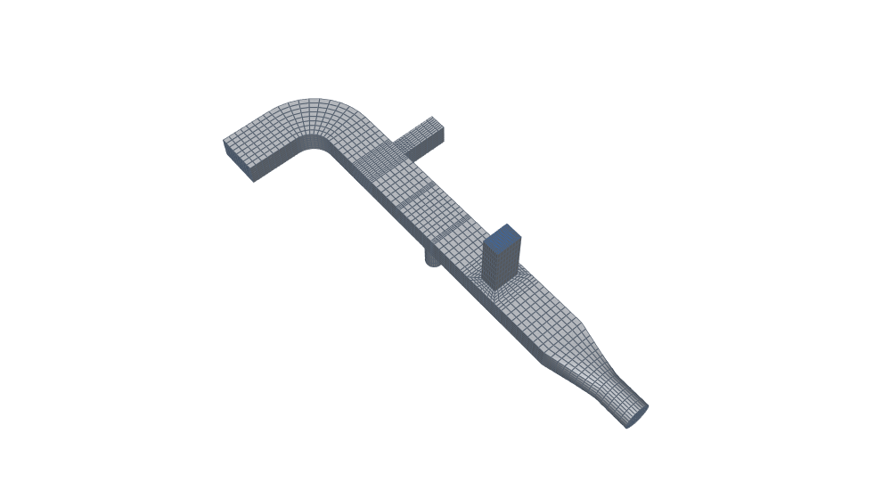 </p>

- A `Transition` takes the round fan outlet (Ø 0.3) to a 0.5 × 0.25
  duct.  Every section has `N` cells per side, which the duct taps need
  too: a tap keeps the main's counts, so its port is class 0.
- Three duct taps (decision 0033): a rectangular tap on the top (wide)
  face and a round tap on the bottom, each pillowed into its face
  (`add()` resolves the layout's tunables and the run length), and a
  full-width tap on the side (narrow) face, as tall as the duct, whose
  walls are all planes.  A pillowed tap on the narrow face of a 2:1 duct
  predicts a corner scaled Jacobian below 0.3 at any size and warns.
- The main turns sideways, away from the side tap, with a hard-way bend
  (its radius is checked against the half-width), and ends at `main_end`.
  Axial cells come from `axial_cell`; the taps' branches are named
  `supply_up`, `supply_down` and `supply_side`.

Limits: single-layer ducts only (no lagging through a tap); taps are
perpendicular.

Patches: `air_inlet`, `air_main_end`, `air_supply_up`,
`air_supply_down`, `air_supply_side`, `air_wall`.

```bash
python3 -m hexmesh.examples.applications.hvac_branched
```

| Fittings | Volumes | Cells | min SICN | mean SICN | min SJ (where) | max aspect | Build |
|---|---|---|---|---|---|---|---|
| 14: Straight ×9, Transition, Tee ×3, Bend | 216 | 24 704 | 0.157 | 0.551 | 0.421 (#6 Tee) | 10.7 | 8.0 s |

- **Open ends:** `air_inlet`, `air_main_end`, `air_supply_down`, `air_supply_side`, `air_supply_up`
- **Walls:** `air_wall`
- **Colours:** air blue; walls grey.
- **Parameters:** [`Straight`](../../API.md#straightlength-n_layersnone-axial_grading10-stack_changes-twist00), [`Transition`](../../API.md#transitionoutlet-length-n_layersnone-axial_grading10), [`Tee`](../../API.md#teerun_lengthnone-branch_length-branch_radius-n_run3-n_branch3-n_turn2-roll00-towardnone-angle900-offset00-branchnone-facenone-marginnone-domenone-sheetnone-n_wallnone-branch_first_cellnone-branch_mprgnone), [`Bend`](../../API.md#bendradius-angle-n_layersnone-roll00-axial_grading10-towardnone)
- **Fittings used:** Straight ×9 ([building networks](FEATURES.md#building-networks)), Transition ([sections and transitions](FEATURES.md#sections-and-transitions)), Tee ×3 ([junctions](FEATURES.md#junctions)), Bend ([bends](FEATURES.md#bends))

## cooling_channels

**Cooling channels: a supply pipe split by a wye into two flat rectangular channels, each returning to a round outlet.**

<p>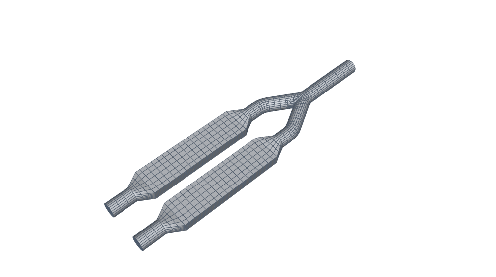 </p>

Each daughter of the 60° wye bends back parallel to the supply, then a
`Transition` flattens it into a 3:1 channel (0.12 × 0.04), the kind of
passage that cools a plate or a mould.  After the channel a second
`Transition` rounds it off again.  The circle's `nang` equals the
channel's `nang_w` and `nang_h`, so every transition is a plain sweep.
Outlets: `fluid_left_out`, `fluid_right_out`.

```bash
python3 -m hexmesh.examples.applications.cooling_channels
```

| Fittings | Volumes | Cells | min SICN | mean SICN | min SJ (where) | max aspect | Build |
|---|---|---|---|---|---|---|---|
| 14: Straight ×7, Wye, Bend ×2, Transition ×4 | 180 | 8 280 | 0.152 | 0.435 | 0.204 (#1 Wye) | 8.3 | 5.0 s |

- **Open ends:** `fluid_inlet`, `fluid_left_out`, `fluid_right_out`
- **Walls:** `fluid_wall`
- **Colours:** fluid blue; walls grey.
- **Parameters:** [`Straight`](../../API.md#straightlength-n_layersnone-axial_grading10-stack_changes-twist00), [`Wye`](../../API.md#wyeangle-run_length-branch_length-n_runnone-n_branchnone-n_splitnone-roll00-towardnone), [`Bend`](../../API.md#bendradius-angle-n_layersnone-roll00-axial_grading10-towardnone), [`Transition`](../../API.md#transitionoutlet-length-n_layersnone-axial_grading10)
- **Fittings used:** Straight ×7 ([building networks](FEATURES.md#building-networks)), Wye ([junctions](FEATURES.md#junctions)), Bend ×2 ([bends](FEATURES.md#bends)), Transition ×4 ([sections and transitions](FEATURES.md#sections-and-transitions))

## pcf_line

**A plant line from a PCF isometric: the network comes from the file, not from Python.**

<p>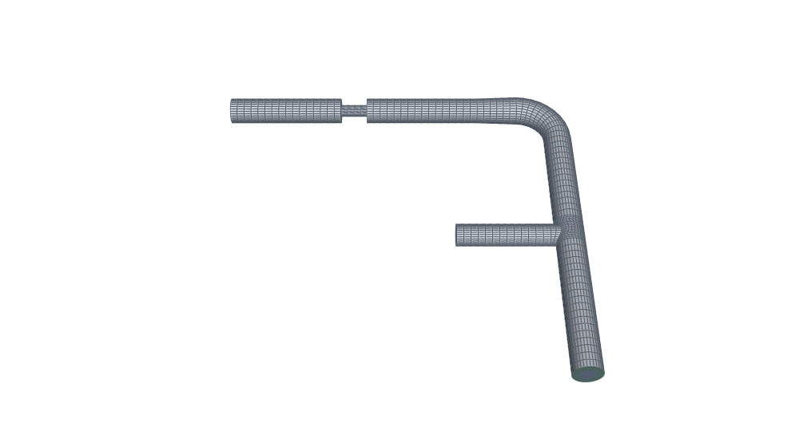 </p>

`SAMPLE` (`pcf_line.pcf`, shipped with the package, written for
hexmesh) is one insulated 100 mm line, A-100.  It leaves vessel V-101's
nozzle N1, passes a reducing tee to a 50 mm branch, then an elbow and a
concentric reducer to 80 mm.  Last come a bare flanged valve and a pipe.
`read_pcf` turns each component into a fitting, and `pipe` gives
each nominal bore its section.  With `insulation=True` the file's 50 mm
insulation is a third layer.  The valve is bare, so the insulation
stops one cell inside it from each side (`insulation_end`).
Patches: `*_V_101_N1` at the nozzle; the tee's branch and the line's
end are open ends named by the file.

```bash
python3 -m hexmesh.examples.applications.pcf_line
```

| Fittings | Volumes | Cells | min SICN | mean SICN | min SJ (where) | max aspect | Build |
|---|---|---|---|---|---|---|---|
| 9: Straight ×6, Tee, Bend, Reducer | 357 | 35 712 | 0.062 | 0.273 | 0.258 (#1 Tee) | 30.9 | 12.3 s |

- **Open ends:** `fluid_A_100_end2`, `fluid_A_100_end3`, `fluid_V_101_N1`, `insulation_A_100_end2`, `insulation_A_100_end3`, `insulation_V_101_N1`, `steel_A_100_end2`, `steel_A_100_end3`, `steel_V_101_N1`
- **Walls:** `insulation_end`, `insulation_wall`, `steel_wall`
- **Interfaces:** `interface_fluid_steel`, `interface_steel_insulation`
- **Colours:** fluid blue, steel orange, insulation green; walls grey.
- **Parameters:** [`Straight`](../../API.md#straightlength-n_layersnone-axial_grading10-stack_changes-twist00), [`Tee`](../../API.md#teerun_lengthnone-branch_length-branch_radius-n_run3-n_branch3-n_turn2-roll00-towardnone-angle900-offset00-branchnone-facenone-marginnone-domenone-sheetnone-n_wallnone-branch_first_cellnone-branch_mprgnone), [`Bend`](../../API.md#bendradius-angle-n_layersnone-roll00-axial_grading10-towardnone), [`Reducer`](../../API.md#reduceroutlet-length-n_layersnone-axial_grading10-profilenone-chord_tol1e-3)
- **Fittings used:** Straight ×6 ([building networks](FEATURES.md#building-networks)), Tee ([junctions](FEATURES.md#junctions)), Bend ([bends](FEATURES.md#bends)), Reducer ([reducers and profiles](FEATURES.md#reducers-and-profiles))

## idealised_aorta

**Idealised aorta: the arch with its three branches, the tapering descending and abdominal aorta, and the iliac bifurcation.**

<p>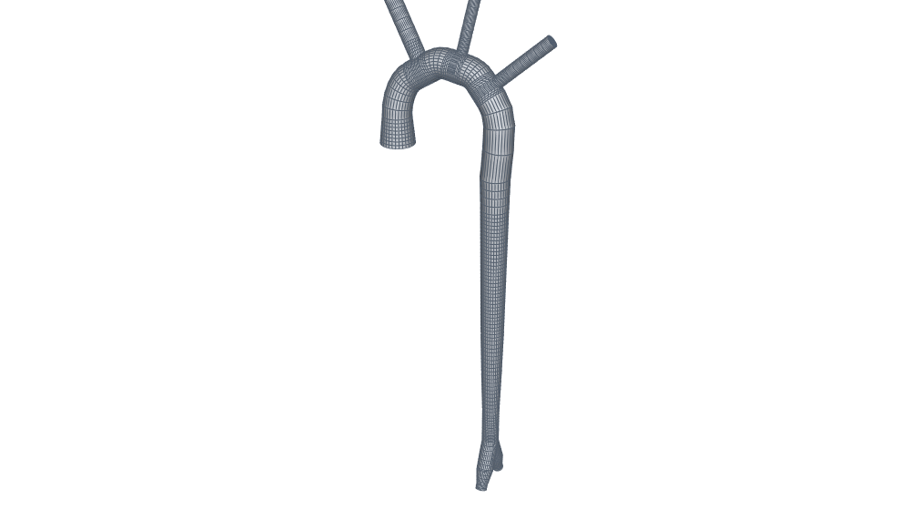 </p>

<p></p>

A lumen-only model built from hexmesh's ordinary fittings: a `Reducer`
for the ascending aorta, `SplinePipe` pieces along a slightly
non-planar arch, three `Tee`s for the arch branches, `Reducer`s for
the taper, and a `Wye` for the iliac fork.  No patient data.

**Where each number comes from** (metres in the code; the sources'
centimetres here):

- **Thoracic aorta**, Mansouri et al. 2024 (`mansouri_and_kemerli_etal_2024`),
  Table 10, the Normal (Type I) idealised model, weighted averages of
  published cohorts:
  ascending diameter D1 3.17, arch D2 2.65, mid-descending D3 2.5;
  arch width W 7.95 and height H 4.06; transverse curvature R 12.2;
  sinotubular junction (STJ) to the arch's start L 2.6; STJ to the
  brachiocephalic artery a 7.62; brachiocephalic to left common carotid
  d1 1.68; left common carotid to left subclavian d2 3.44; branch
  diameters 1.47 (brachiocephalic), 0.97 (left common carotid), 1.14
  (left subclavian).
- **Abdominal aorta and iliacs**, Minichil et al. 2022
  (`minichil_and_tesfaye_etal_2022`), Table 1, all 136 adults (outer
  diameters on CT, so the lumen is slightly smaller): aortic hiatus 2.13,
  suprarenal 1.91, infrarenal 1.63, common iliac 1.11 (right) and 1.10
  (left), taken here as 1.10 for both.
- **Bifurcation angle**, Góes Junior et al. 2020
  (`goes_and_albuquerque_etal_2020`): about 44° in women at every age and
  45.5° in men aged 20–30; taken as 45°.

**Not from a source** (modelling choices, stated as such):
- the arch's centreline shape: a half-ellipse above the arch's start,
  bowed out of plane by the sagitta of R over the arch's width;
- **the arch is 1.2 × the cited W and H** (9.54 × 4.87).  At the cited
  size it can't carry three branches from straight tees: each needs
  about two branch diameters of straight run, and the spline joining
  two tees then turns tighter than the aorta's own radius, which
  `SplinePipe` rejects.  1.2 is the smallest scale tried (in steps of
  0.1) that builds;
- **the left common carotid and left subclavian move downstream** to
  10.96 and 14.14 from the STJ (cited 9.30 and 12.74): a branch's tee
  starts at least half an arch diameter of curved arch after the
  previous one (`GAP`), so the spline between them can turn.  The
  brachiocephalic stays at its cited 7.62.  `PLACED` holds the
  positions;
- the descending thoracic (20 cm) and abdominal (13 cm) lengths and the
  common iliac length (5 cm): no normative centreline lengths were found
  with the sources above;
- the branches' outlet extensions (four branch diameters), which let a
  flow case's outlets sit away from the junctions.

**Idealised in hexmesh's terms:**
- the branches leave square to the arch, along its outward normal
  (Mansouri's angles to the arch are 84.8°, 73.3° and 69.8°; a `Tee`
  leans only downstream, and the arch branches lean toward the head);
- each tee's run is straight, along the arch's tangent at the branch,
  and the pieces between are splines on a smooth (Hermite) curve
  between the tees, not on the ellipse itself;
- the visceral and renal branches are left out;
- the iliacs leave the wye at the infrarenal diameter (a `Wye`'s
  daughters keep the inlet's section) and narrow to the common iliac
  diameter in a `Reducer` each: a stand-in for a fork with unequal
  daughters.

**Quality** (`nang` 8): the three arch tees warn (predicted min SJ
0.20, 0.14 and 0.15: small branch ratios, r/R 0.37–0.56), the left
common carotid's turn block also on non-orthogonality (70.6°), and the
wye on its crotch's non-orthogonality (79°), as every wye does.  No cell
is inverted.

Inlet `aortic_root`; outlets `brachiocephalic`,
`left_common_carotid`, `left_subclavian`, `right_common_iliac` and
`left_common_iliac`, so a flow case can be set up from the patch names.

```bash
python3 -m hexmesh.examples.applications.idealised_aorta
```

| Fittings | Volumes | Cells | min SICN | mean SICN | min SJ (where) | max aspect | Build |
|---|---|---|---|---|---|---|---|
| 24: Reducer ×7, SplinePipe ×4, Straight ×9, Tee ×3, Wye | 651 | 40 448 | 0.089 | 0.577 | 0.133 (#19 Wye) | 20.3 | 21.8 s |

- **Open ends:** `fluid_aortic_root`, `fluid_brachiocephalic`, `fluid_left_common_carotid`, `fluid_left_common_iliac`, `fluid_left_subclavian`, `fluid_right_common_iliac`
- **Walls:** `fluid_wall`
- **Colours:** fluid blue; walls grey.
- **Parameters:** [`Reducer`](../../API.md#reduceroutlet-length-n_layersnone-axial_grading10-profilenone-chord_tol1e-3), [`SplinePipe`](../../API.md#splinepipepoints-n_layersnone-end_tangentnone-axial_grading10), [`Straight`](../../API.md#straightlength-n_layersnone-axial_grading10-stack_changes-twist00), [`Tee`](../../API.md#teerun_lengthnone-branch_length-branch_radius-n_run3-n_branch3-n_turn2-roll00-towardnone-angle900-offset00-branchnone-facenone-marginnone-domenone-sheetnone-n_wallnone-branch_first_cellnone-branch_mprgnone), [`Wye`](../../API.md#wyeangle-run_length-branch_length-n_runnone-n_branchnone-n_splitnone-roll00-towardnone)
- **Fittings used:** Reducer ×7 ([reducers and profiles](FEATURES.md#reducers-and-profiles)), SplinePipe ×4 ([bends](FEATURES.md#bends)), Straight ×9 ([building networks](FEATURES.md#building-networks)), Tee ×3 ([junctions](FEATURES.md#junctions)), Wye ([junctions](FEATURES.md#junctions))

## rocket_injector_manifold

**Rocket injector manifold: a liquid-oxygen ring feeding eight injector legs, supplied by an insulated feed line through a cavitating venturi.**

<p>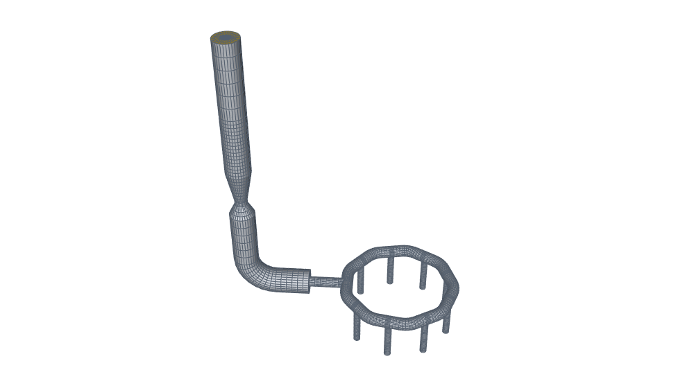 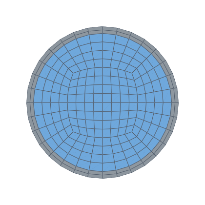</p>

<p>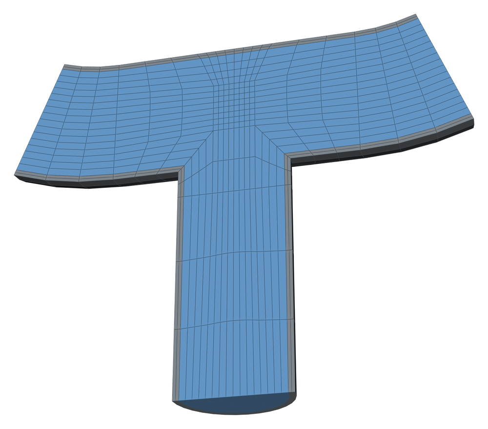</p>

A liquid-rocket engine's oxidiser reaches the injector through a
manifold: a ring around the injector that spreads the flow evenly to its
feeds.  Test stands and pressure-fed engines put a **cavitating venturi**
in the feed line.  Once its throat cavitates, the flow depends only on
the upstream pressure, so it fixes the mass flow and isolates the line
from chamber-pressure oscillations.

**The ring is a closed loop** (`Assembly.close`): nine tees, one for
the feed line and eight for the injector legs, joined by 40° bends, the
last bend closing back onto the ring's start.  The feed line is the
feed tee's branch, built outward to the tank end, `lox_inlet`.

**Where each number comes from:**
- **The line velocity** is the worked example's in Huzel and Huang,
  NASA SP-125 (`huzel_and_huang_1971`, p. 286): liquid oxygen at 79.4
  ft/s (24.2 m/s) in an 8 in. duct.
- **The venturi's divergent**, 8°, from the 6°–8° of a cavitating
  venturi patent for propellants (`us5647201`), within ISO 5167-4's
  7°–15° that hexmesh's venturi profile takes.

**Not from a source** (modelling choices, stated as such):
- **the engine:** 50 kN thrust, liquid oxygen and RP-1 at a mixture
  ratio of 2.35, specific impulse 280 s: 12.8 kg/s of oxygen
  (1141 kg/m³), 11.2 L/s;
- **the feed line** at the line velocity: 24.3 mm bore;
- **the ring and the injector legs at a third of it** (the ring slow, so
  the legs see the same pressure): a 29.7 mm ring, each half carrying
  half the flow, and 14.9 mm legs, each an eighth;
- the venturi's throat at half the bore (β 0.5), the ring's 60 mm bend
  radius, the tees' 30 mm runs, the lengths of the feed line and legs;
- 1.5 mm steel everywhere, and 20 mm of foam insulation on the feed line
  only, starting two cells out from the ring (a stack change);
- the venturi necks every layer down with the bore, insulation
  included.  A real venturi body is straight outside: a simplification.

**Quality:** each injector tee warns: predicted min scaled Jacobian 0.258
below the 0.3 tier, at a branch ratio r/R of 0.5 ("no run length reaches
it").  Faster legs would be narrower and worse; the warning is the cost
of eight legs off a slow ring.  No cell is inverted.

**A workaround, for now:** the feed line's insulated section is built
from the tee branch's own spec (`copy.deepcopy(feed.spec)`), because a
tee's branch recomputes its shells' thicknesses and differs from the
given 1.5 mm in the last bits (task 0155).

Inlet `lox_inlet`; outlets `injector_1` … `injector_8`.  The
ring's start, `ring_start`, is closed: it isn't an open end.

```bash
python3 -m hexmesh.examples.applications.rocket_injector_manifold
```

| Fittings | Volumes | Cells | min SICN | mean SICN | min SJ (where) | max aspect | Build |
|---|---|---|---|---|---|---|---|
| 31: Tee ×9, Bend ×10, Straight ×11, Reducer | 1487 | 80 768 | 0.064 | 0.370 | 0.258 (#14 Tee) | 44.4 | 103.2 s |

- **Open ends:** `insulation_lox_inlet`, `lox_injector_1`, `lox_injector_2`, `lox_injector_3`, `lox_injector_4`, `lox_injector_5`, `lox_injector_6`, `lox_injector_7`, `lox_injector_8`, `lox_lox_inlet`, `steel_injector_1`, `steel_injector_2`, `steel_injector_3`, `steel_injector_4`, `steel_injector_5`, `steel_injector_6`, `steel_injector_7`, `steel_injector_8`, `steel_lox_inlet`
- **Walls:** `insulation_end`, `insulation_wall`, `steel_wall`
- **Interfaces:** `interface_lox_steel`, `interface_steel_insulation`
- **Colours:** lox light blue, steel grey, insulation yellow; walls grey.
- **Parameters:** [`Tee`](../../API.md#teerun_lengthnone-branch_length-branch_radius-n_run3-n_branch3-n_turn2-roll00-towardnone-angle900-offset00-branchnone-facenone-marginnone-domenone-sheetnone-n_wallnone-branch_first_cellnone-branch_mprgnone), [`Bend`](../../API.md#bendradius-angle-n_layersnone-roll00-axial_grading10-towardnone), [`Straight`](../../API.md#straightlength-n_layersnone-axial_grading10-stack_changes-twist00), [`Reducer`](../../API.md#reduceroutlet-length-n_layersnone-axial_grading10-profilenone-chord_tol1e-3)
- **Fittings used:** Tee ×9 ([junctions](FEATURES.md#junctions)), Bend ×10 ([bends](FEATURES.md#bends)), Straight ×11 ([building networks](FEATURES.md#building-networks)), Reducer ([reducers and profiles](FEATURES.md#reducers-and-profiles))

## micromixer

**Micromixer: a T-mixer for lipid nanoparticles, with a twisted mixing channel, at its real size in micrometres.**

<p>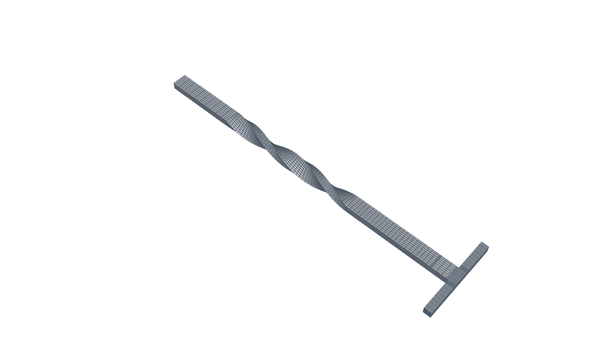 </p>

<p>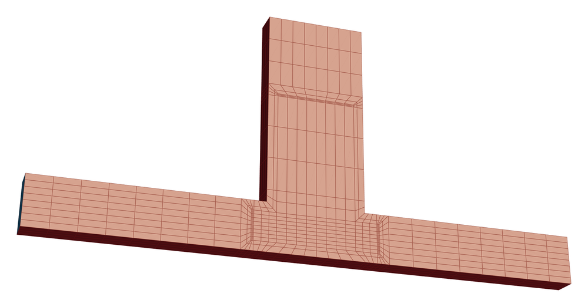</p>

The lipid nanoparticles in mRNA vaccines form when a lipid-in-ethanol
stream meets an mRNA-in-water stream and the two mix fast.  Lab work
uses microfluidic mixers, T-junctions among them.  Production uses
T-mixers and impinging-jet mixers.  Scaling between the two by Reynolds
number is an open problem.

**The T is the engulfment benchmark's** (Bothe, Stemich and Warnecke 2006,
`bothe_and_stemich_etal_2006`, and their proceedings paper,
`bothe_and_stemich_etal_2006b`; experiments in Hoffmann, Schlüter and
Räbiger 2006, `hoffmann_and_schluter_etal_2006`):
- two inlets 100 µm wide and 100 µm deep, meeting head-on;
- a mixing channel 200 µm wide and 100 µm deep, leaving at right angles;
- their computational domain: inlets 400 µm long, mixing channel 1.5 mm.

Below a critical Reynolds number the two streams run side by side; above
it they engulf each other and mix.  Bothe et al. put the onset at a mean
velocity of about 1.1 m/s in water: Re ≈ 146 on the mixing channel's
hydraulic diameter (133 µm).

**In hexmesh's terms** the inlet line is the main, a 100 µm square duct.
The mixing channel is a **full-width duct tap** on its side: as deep as
the duct across, and 200 µm along the inlets' axis.  The tap keeps the
main's 8 cells per side, so the mixing channel's cells are 25 × 12.5 µm.

**Not from a source** (modelling choices, stated as such):
- **the twisted channel:** after the benchmark's 1.5 mm, the mixing
  channel twists one full turn over 2 mm (`Straight(twist=360)`), then
  runs straight for 1 mm to the outlet.  Twisted microchannels mix
  passively by swirl (e.g. `sivashankar_and_agambayev_etal_2016`, whose
  twist comes from stacked quarter-circle units rather than a twisted
  duct).  This one is inspired by them, not a copy;
- the counts (8 per side), a resolution for the picture rather than a
  converged mixing study (Bothe et al. used about a million cells).

**Quality:** no `validate()` warning.  The T's turn blocks hold the worst
cells (min scaled Jacobian 0.58, the full-width tap's limit).  The
largest aspect ratio, 12, is in the inlet straights.

Inlets `lipid_inlet` and `aqueous_inlet`; outlet `outlet`.

```bash
python3 -m hexmesh.examples.applications.micromixer
```

| Fittings | Volumes | Cells | min SICN | mean SICN | min SJ (where) | max aspect | Build |
|---|---|---|---|---|---|---|---|
| 6: Straight ×5, Tee | 94 | 10 112 | 0.146 | 0.556 | 0.577 (#1 Tee) | 12.0 | 28.7 s |

- **Open ends:** `fluid_aqueous_inlet`, `fluid_lipid_inlet`, `fluid_outlet`
- **Walls:** `fluid_wall`
- **Colours:** fluid blue; walls grey.
- **Parameters:** [`Straight`](../../API.md#straightlength-n_layersnone-axial_grading10-stack_changes-twist00), [`Tee`](../../API.md#teerun_lengthnone-branch_length-branch_radius-n_run3-n_branch3-n_turn2-roll00-towardnone-angle900-offset00-branchnone-facenone-marginnone-domenone-sheetnone-n_wallnone-branch_first_cellnone-branch_mprgnone)
- **Fittings used:** Straight ×5 ([building networks](FEATURES.md#building-networks)), Tee ([junctions](FEATURES.md#junctions))

## subsea_pipeline

**Subsea pipeline: an insulated flowline laid over a field of sand waves, read from a seabed survey, rising at its end into a riser.**

<p>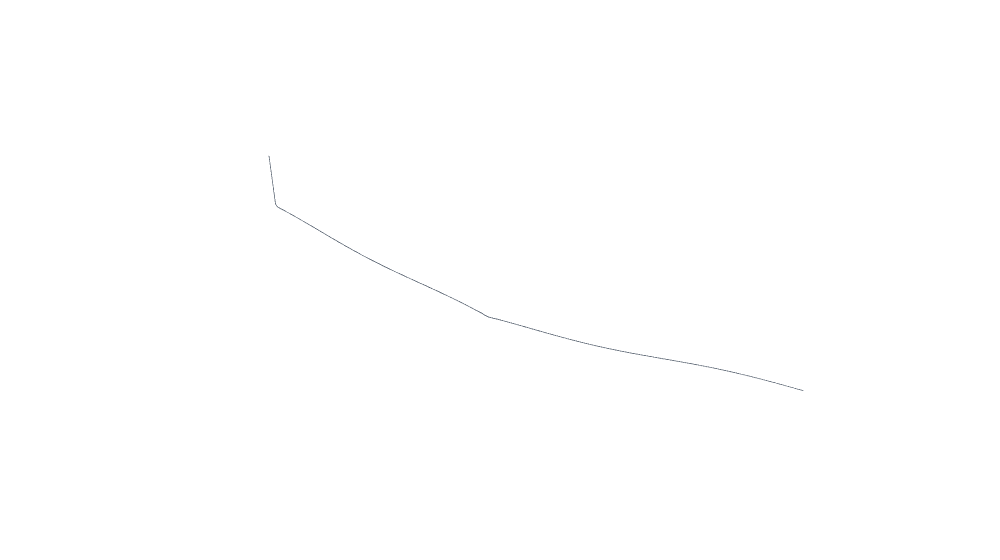 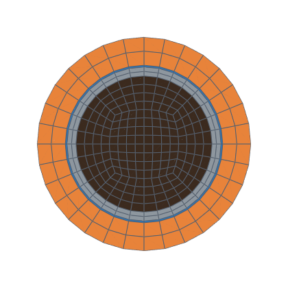</p>

<p>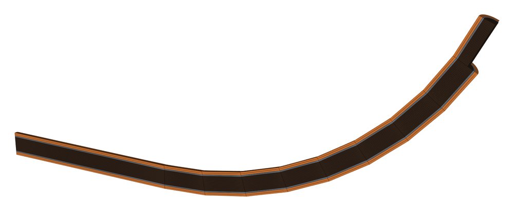</p>

The example shows the **bathymetry reader**.  `read_bathymetry` takes a
seabed surface (here an XYZ point file) and a route of waypoints in plan,
drapes the route on the seabed, and returns a network model.
`to_assembly(spec, kinks="spline")` turns it into one `SplinePipe` that
follows the terrain.  The riser is then added to the imported network
like any other fitting: an imported assembly is an ordinary one.

**The seabed is generated, not downloaded:** the example writes a small
XYZ file to a temporary folder.  For real data, public bathymetry such
as GEBCO's grids reads the same way (`surface_format="geotiff"` or
`"netcdf"`).  The surface is a gentle slope with straight-crested sand
waves crossing the route at an angle.  Sand waves are a real concern for
subsea lines: they migrate, and can leave a pipeline spanning between
their crests.  From Dronkers 2024 (`dronkers_2024`, the Coastal Wiki
review):
- crest spacing "most often between 200 and 700 m": **300 m** here;
- mean height H ≈ 0.07 λ^0.8 (Flemming 2000, as cited there): **6.7 m**
  at λ = 300 m.

**Not from a source** (modelling choices, stated as such):
- the water depth (80 m at the start, 1 m deeper per 100 m), the crests'
  angle to the route (17°) and the route (three waypoints over 700 m,
  turning once);
- **the section, typical values for a wet-insulated flowline:** a
  10-inch line (273.1 mm outer diameter, 15.9 mm steel wall), a 3 mm
  anti-corrosion coating and 50 mm of polypropylene insulation;
- the riser: a bend of 5 m radius at the route's end, then 70 m straight
  up, stopping short of the surface (`riser_top`).  A real riser here
  would often be a flexible pipe with a different wall.  That needs a
  layer that changes material along the line (decision 0021's note of
  2026-11-12), so this riser keeps the flowline's section;
- 1.5 m axial cells: a pipeline-scale mesh.  The coating's cells are
  3 mm thick, so the aspect ratio reaches about 1000 and SICN is small.
  A flow case near the riser base would refine there.

**What the reader did:** the route was split into segments of at most
10 m (`max_segment_length`) so the spline follows the sand waves.  The
build's join tolerance came out relative to the network's size
(`model.report["tol_source"] == "relative"`, task 0138).

Ends `flowline_start` and `riser_top`.

```bash
python3 -m hexmesh.examples.applications.subsea_pipeline
```

| Fittings | Volumes | Cells | min SICN | mean SICN | min SJ (where) | max aspect | Build |
|---|---|---|---|---|---|---|---|
| 5: Straight ×3, SplinePipe, Bend | 8092 | 183 744 | 0.003 | 0.062 | 0.771 (#3 Bend) | 985.3 | 220.6 s |

- **Open ends:** `coating_inlet`, `coating_riser_top`, `insulation_inlet`, `insulation_riser_top`, `oil_inlet`, `oil_riser_top`, `steel_inlet`, `steel_riser_top`
- **Walls:** `insulation_wall`
- **Interfaces:** `interface_coating_insulation`, `interface_oil_steel`, `interface_steel_coating`
- **Colours:** oil dark brown, steel grey, coating blue, insulation orange; walls grey.
- **Parameters:** [`Straight`](../../API.md#straightlength-n_layersnone-axial_grading10-stack_changes-twist00), [`SplinePipe`](../../API.md#splinepipepoints-n_layersnone-end_tangentnone-axial_grading10), [`Bend`](../../API.md#bendradius-angle-n_layersnone-roll00-axial_grading10-towardnone)
- **Fittings used:** Straight ×3 ([building networks](FEATURES.md#building-networks)), SplinePipe ([bends](FEATURES.md#bends)), Bend ([bends](FEATURES.md#bends))

## district_heating

**District heating: a buried pre-insulated pipe, its soil meshed with it, turning a street corner.**

<p>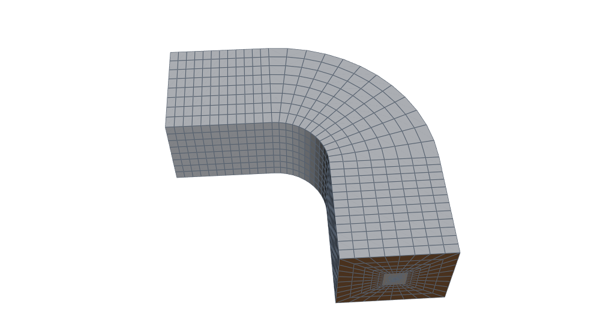 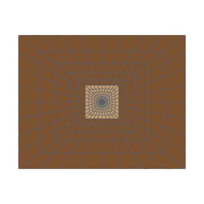</p>

<p>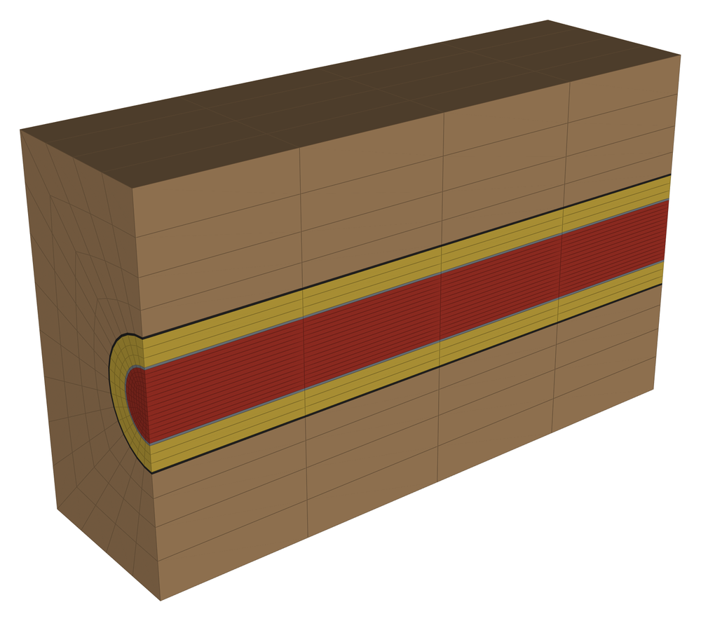</p>

A district-heating main is a steel service pipe, insulated with
polyurethane foam (PUR) inside a polyethylene casing, all bonded together
and buried (the single pipes of EN 253).  Heat lost to the ground is what
a model of it is usually for, so the soil is part of the mesh:
- a **square of near soil** around the casing, finely meshed, where the
  temperature changes fastest;
- a **rectangle of far soil** around that, to the domain's boundary, its
  cells growing outward (radial grading, `mprg`).

Every layer is a region of its own, with an interface to the next, so a
conjugate heat-transfer case can give each its conductivity.

**Typical values, not checked against the standard's table** (EN 253's
dimension table is not open): a DN 100 service pipe, 114.3 mm × 3.6 mm
steel, in a 200 mm casing (a manufacturer's insulation series 1) with a
3.2 mm wall.

**Not from a source** (modelling choices, stated as such):
- the near soil 0.6 m square, the far soil 3.0 m wide and 2.4 m deep;
- **the pipe is centred in the soil.**  A buried pipe sits about a metre
  down, nearer the surface than the bottom of a heat-loss domain.  An
  off-centre pipe in a rectangle isn't a hexmesh section today;
- the run: 3 m, a 90° bend of 3 m radius, 3 m.

**The pair waits for a design.**  Real networks lay a supply and a
return pipe side by side, hot and cold.  Two pipes in one block of soil
is a section with two cores, decision 0035 stage B, whose first case
this is (the user, 2026-11-12): each pipe in its square of near soil,
the two squares side by side, and the far soil around both.  The far
layer then also carries the depth: thinner above the pair than below.

**Colours** mean something here: water red, steel grey, PUR yellow,
casing black, near soil light brown, far soil dark brown.

Ends `supply` and `house_side`.

```bash
python3 -m hexmesh.examples.applications.district_heating
```

| Fittings | Volumes | Cells | min SICN | mean SICN | min SJ (where) | max aspect | Build |
|---|---|---|---|---|---|---|---|
| 3: Straight ×2, Bend | 350 | 23 040 | 0.023 | 0.256 | 0.599 (#1 Bend) | 126.9 | 8.4 s |

- **Open ends:** `casing_house_side`, `casing_supply`, `far_soil_house_side`, `far_soil_supply`, `near_soil_house_side`, `near_soil_supply`, `pur_house_side`, `pur_supply`, `steel_house_side`, `steel_supply`, `water_house_side`, `water_supply`
- **Walls:** `far_soil_wall`
- **Interfaces:** `interface_casing_near_soil`, `interface_near_soil_far_soil`, `interface_pur_casing`, `interface_steel_pur`, `interface_water_steel`
- **Colours:** water red, steel grey, pur yellow, casing black, near_soil light brown, far_soil dark brown; walls grey.
- **Parameters:** [`Straight`](../../API.md#straightlength-n_layersnone-axial_grading10-stack_changes-twist00), [`Bend`](../../API.md#bendradius-angle-n_layersnone-roll00-axial_grading10-towardnone)
- **Fittings used:** Straight ×2 ([building networks](FEATURES.md#building-networks)), Bend ([bends](FEATURES.md#bends))

---

Generated 2026-11-12 from hexmesh 73a2f07 + uncommitted changes, gmsh 4.12.1, Python 3.12.3, 8 CPUs, 2 job(s).
