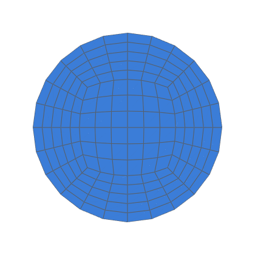
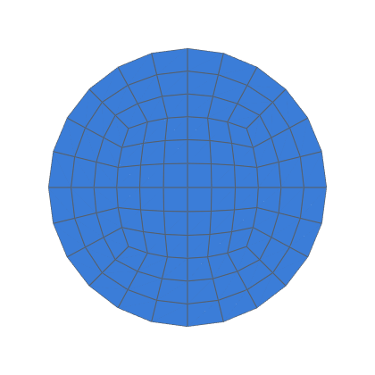
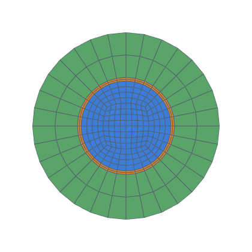
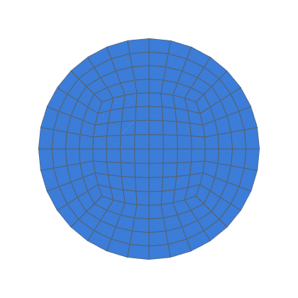
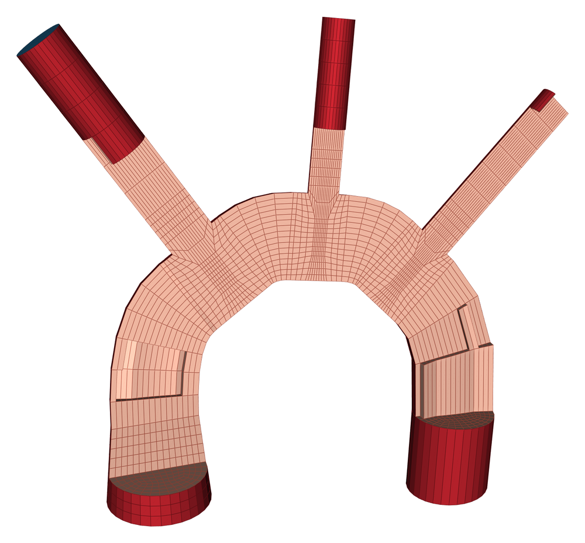

# Applications

Networks closer to a real model, built from the [features](FEATURES.md).  Each lists the fittings it uses, linked to their family.  [The gallery](../GALLERY.md) explains the numbers.

Networks starting at equipment nozzles, ventilation ducting, cooling
channels, and an idealised aorta: the examples closest to a real model.

| Example | Shows | Cells | min SICN | min SJ | Build |
|---|---|---|---|---|---|
| [drum_nozzle](#drum_nozzle) | Line from a drum nozzle: a horizontal drum with a top nozzle, a riser, an elbow, a tee and CFD extensions on the open ends. | 10 272 | 0.150 | 0.331 | 7.5 s |
| [hvac_supply](#hvac_supply) | Ventilation supply run: a fan's round outlet, a flat duct through the building, and a square terminal. | 6 912 | 0.246 | 0.577 | 1.9 s |
| [hvac_branched](#hvac_branched) | Branched ventilation supply: a fan's round outlet, a flat main duct with three taps, and a bend at the end of the run. | 24 704 | 0.157 | 0.421 | 8.0 s |
| [cooling_channels](#cooling_channels) | Cooling channels: a supply pipe split by a wye into two flat rectangular channels, each returning to a round outlet. | 8 280 | 0.152 | 0.204 | 5.0 s |
| [pcf_line](#pcf_line) | A plant line from a PCF isometric: the network comes from the file, not from Python. | 35 712 | 0.062 | 0.258 | 16.2 s |
| [idealised_aorta](#idealised_aorta) | Idealised aorta: the arch with its three branches, the tapering descending and abdominal aorta, and the iliac bifurcation. | 40 448 | 0.089 | 0.133 | 19.4 s |

## drum_nozzle

**Line from a drum nozzle: a horizontal drum with a top nozzle, a riser, an elbow, a tee and CFD extensions on the open ends.**

<p> </p>

`Drum` builds no geometry; it gives the nozzle face's pose (decision
0002).  `Assembly.from_nozzle` starts the network there, and the inlet
patch is named after the drum and nozzle (`water_D101_N1`).
`extend_open_ends` adds straight runs after every open outlet, sized in
diameters of each end; the nozzle end is never extended.

```bash
python3 -m hexmesh.examples.applications.drum_nozzle
```

| Fittings | Volumes | Cells | min SICN | mean SICN | min SJ (where) | max aspect | Build |
|---|---|---|---|---|---|---|---|
| 7: Straight ×4, Elbow ×2, Tee | 134 | 10 272 | 0.150 | 0.380 | 0.331 (#2 Tee) | 12.5 | 7.5 s |

- **Open ends:** `water_D101_N1`, `water_outlet`, `water_vent`
- **Walls:** `water_wall`
- **Colours:** water blue; walls grey.
- **Parameters:** [`Straight`](../../API.md#straightlength-n_layersnone-axial_grading10-stack_changes-twist00), [`Elbow`](../../API.md#elbowangle900-schedulelong-n_layers8-roll00-axial_grading10-towardnone), [`Tee`](../../API.md#teerun_lengthnone-branch_length-branch_radius-n_run3-n_branch3-n_turn2-roll00-towardnone-angle900-offset00-branchnone-facenone-marginnone-domenone-sheetnone-n_wallnone-branch_first_cellnone-branch_mprgnone)
- **Fittings used:** Straight ×4 ([building networks](FEATURES.md#building-networks)), Elbow ×2 ([bends](FEATURES.md#bends)), Tee ([junctions](FEATURES.md#junctions))

## hvac_supply

**Ventilation supply run: a fan's round outlet, a flat duct through the building, and a square terminal.**

<p> </p>

- A `Transition` takes the round fan outlet (Ø 0.3) to a 0.5 × 0.25
  duct.  Counts per side match (`nang` = `nang_w` = `nang_h`), so the
  two faces have the same mesh connectivity.
- The duct rises with an easy-way bend (`roll=0`: across the height),
  turns along the ceiling with a two-cut mitred hard-way bend
  (`roll=90`: across the width, so its radius is checked against the
  half-width), and jogs sideways with a spline offset.
- A `Reducer` (rectangle → rectangle: half_w and half_h change on the
  H face) ends at a 0.3 × 0.3 square terminal, named `terminal`.
- The rectangles are H faces (the default since 0.4.0), their walls
  graded by `mprg` (the second cell from each wall over the first).

Patches: `air_inlet`, `air_terminal`, `air_wall`.

```bash
python3 -m hexmesh.examples.applications.hvac_supply
```

| Fittings | Volumes | Cells | min SICN | mean SICN | min SJ (where) | max aspect | Build |
|---|---|---|---|---|---|---|---|
| 10: Straight ×5, Transition, Bend, MiterBend, SplinePipe, Reducer | 76 | 6 912 | 0.246 | 0.562 | 0.577 (#1 Transition) | 9.1 | 1.9 s |

- **Open ends:** `air_inlet`, `air_terminal`
- **Walls:** `air_wall`
- **Colours:** air blue; walls grey.
- **Parameters:** [`Straight`](../../API.md#straightlength-n_layersnone-axial_grading10-stack_changes-twist00), [`Transition`](../../API.md#transitionoutlet-length-n_layersnone-axial_grading10), [`Bend`](../../API.md#bendradius-angle-n_layersnone-roll00-axial_grading10-towardnone), [`MiterBend`](../../API.md#miterbendradius-angle-n_cuts1-n_layers2-roll00-towardnone), [`SplinePipe`](../../API.md#splinepipepoints-n_layersnone-end_tangentnone-axial_grading10), [`Reducer`](../../API.md#reduceroutlet-length-n_layersnone-axial_grading10-profilenone-chord_tol1e-3)
- **Fittings used:** Straight ×5 ([building networks](FEATURES.md#building-networks)), Transition ([sections and transitions](FEATURES.md#sections-and-transitions)), Bend ([bends](FEATURES.md#bends)), MiterBend ([bends](FEATURES.md#bends)), SplinePipe ([bends](FEATURES.md#bends)), Reducer ([reducers and profiles](FEATURES.md#reducers-and-profiles))

## hvac_branched

**Branched ventilation supply: a fan's round outlet, a flat main duct with three taps, and a bend at the end of the run.**

<p> </p>

- A `Transition` takes the round fan outlet (Ø 0.3) to a 0.5 × 0.25
  duct.  Every section has `N` cells per side, which the duct taps need
  too: a tap keeps the main's counts, so its port is class 0.
- Three duct taps (decision 0033): a rectangular tap on the top (wide)
  face and a round tap on the bottom, each pillowed into its face
  (`add()` resolves the layout's tunables and the run length), and a
  full-width tap on the side (narrow) face, as tall as the duct, whose
  walls are all planes.  A pillowed tap on the narrow face of a 2:1 duct
  predicts a corner scaled Jacobian below 0.3 at any size and warns.
- The main turns sideways, away from the side tap, with a hard-way bend
  (its radius is checked against the half-width), and ends at `main_end`.
  Axial cells come from `axial_cell`; the taps' branches are named
  `supply_up`, `supply_down` and `supply_side`.

Limits: single-layer ducts only (no lagging through a tap); taps are
perpendicular.

Patches: `air_inlet`, `air_main_end`, `air_supply_up`,
`air_supply_down`, `air_supply_side`, `air_wall`.

```bash
python3 -m hexmesh.examples.applications.hvac_branched
```

| Fittings | Volumes | Cells | min SICN | mean SICN | min SJ (where) | max aspect | Build |
|---|---|---|---|---|---|---|---|
| 14: Straight ×9, Transition, Tee ×3, Bend | 216 | 24 704 | 0.157 | 0.551 | 0.421 (#6 Tee) | 10.7 | 8.0 s |

- **Open ends:** `air_inlet`, `air_main_end`, `air_supply_down`, `air_supply_side`, `air_supply_up`
- **Walls:** `air_wall`
- **Colours:** air blue; walls grey.
- **Parameters:** [`Straight`](../../API.md#straightlength-n_layersnone-axial_grading10-stack_changes-twist00), [`Transition`](../../API.md#transitionoutlet-length-n_layersnone-axial_grading10), [`Tee`](../../API.md#teerun_lengthnone-branch_length-branch_radius-n_run3-n_branch3-n_turn2-roll00-towardnone-angle900-offset00-branchnone-facenone-marginnone-domenone-sheetnone-n_wallnone-branch_first_cellnone-branch_mprgnone), [`Bend`](../../API.md#bendradius-angle-n_layersnone-roll00-axial_grading10-towardnone)
- **Fittings used:** Straight ×9 ([building networks](FEATURES.md#building-networks)), Transition ([sections and transitions](FEATURES.md#sections-and-transitions)), Tee ×3 ([junctions](FEATURES.md#junctions)), Bend ([bends](FEATURES.md#bends))

## cooling_channels

**Cooling channels: a supply pipe split by a wye into two flat rectangular channels, each returning to a round outlet.**

<p> </p>

Each daughter of the 60° wye bends back parallel to the supply, then a
`Transition` flattens it into a 3:1 channel (0.12 × 0.04), the kind of
passage that cools a plate or a mould.  After the channel a second
`Transition` rounds it off again.  The circle's `nang` equals the
channel's `nang_w` and `nang_h`, so every transition is a plain sweep.
Outlets: `fluid_left_out`, `fluid_right_out`.

```bash
python3 -m hexmesh.examples.applications.cooling_channels
```

| Fittings | Volumes | Cells | min SICN | mean SICN | min SJ (where) | max aspect | Build |
|---|---|---|---|---|---|---|---|
| 14: Straight ×7, Wye, Bend ×2, Transition ×4 | 180 | 8 280 | 0.152 | 0.435 | 0.204 (#1 Wye) | 8.3 | 5.0 s |

- **Open ends:** `fluid_inlet`, `fluid_left_out`, `fluid_right_out`
- **Walls:** `fluid_wall`
- **Colours:** fluid blue; walls grey.
- **Parameters:** [`Straight`](../../API.md#straightlength-n_layersnone-axial_grading10-stack_changes-twist00), [`Wye`](../../API.md#wyeangle-run_length-branch_length-n_runnone-n_branchnone-n_splitnone-roll00-towardnone), [`Bend`](../../API.md#bendradius-angle-n_layersnone-roll00-axial_grading10-towardnone), [`Transition`](../../API.md#transitionoutlet-length-n_layersnone-axial_grading10)
- **Fittings used:** Straight ×7 ([building networks](FEATURES.md#building-networks)), Wye ([junctions](FEATURES.md#junctions)), Bend ×2 ([bends](FEATURES.md#bends)), Transition ×4 ([sections and transitions](FEATURES.md#sections-and-transitions))

## pcf_line

**A plant line from a PCF isometric: the network comes from the file, not from Python.**

<p> </p>

`SAMPLE` (`pcf_line.pcf`, shipped with the package, written for
hexmesh) is one insulated 100 mm line, A-100.  It leaves vessel V-101's
nozzle N1, passes a reducing tee to a 50 mm branch, then an elbow and a
concentric reducer to 80 mm.  Last come a bare flanged valve and a pipe.
`read_pcf` turns each component into a fitting, and `pipe` gives
each nominal bore its section.  With `insulation=True` the file's 50 mm
insulation is a third layer.  The valve is bare, so the insulation
stops one cell inside it from each side (`insulation_end`).
Patches: `*_V_101_N1` at the nozzle; the tee's branch and the line's
end are open ends named by the file.

```bash
python3 -m hexmesh.examples.applications.pcf_line
```

| Fittings | Volumes | Cells | min SICN | mean SICN | min SJ (where) | max aspect | Build |
|---|---|---|---|---|---|---|---|
| 9: Straight ×6, Tee, Bend, Reducer | 357 | 35 712 | 0.062 | 0.273 | 0.258 (#1 Tee) | 30.9 | 16.2 s |

- **Open ends:** `fluid_A_100_end2`, `fluid_A_100_end3`, `fluid_V_101_N1`, `insulation_A_100_end2`, `insulation_A_100_end3`, `insulation_V_101_N1`, `steel_A_100_end2`, `steel_A_100_end3`, `steel_V_101_N1`
- **Walls:** `insulation_end`, `insulation_wall`, `steel_wall`
- **Interfaces:** `interface_fluid_steel`, `interface_steel_insulation`
- **Colours:** fluid blue, steel orange, insulation green; walls grey.
- **Parameters:** [`Straight`](../../API.md#straightlength-n_layersnone-axial_grading10-stack_changes-twist00), [`Tee`](../../API.md#teerun_lengthnone-branch_length-branch_radius-n_run3-n_branch3-n_turn2-roll00-towardnone-angle900-offset00-branchnone-facenone-marginnone-domenone-sheetnone-n_wallnone-branch_first_cellnone-branch_mprgnone), [`Bend`](../../API.md#bendradius-angle-n_layersnone-roll00-axial_grading10-towardnone), [`Reducer`](../../API.md#reduceroutlet-length-n_layersnone-axial_grading10-profilenone-chord_tol1e-3)
- **Fittings used:** Straight ×6 ([building networks](FEATURES.md#building-networks)), Tee ([junctions](FEATURES.md#junctions)), Bend ([bends](FEATURES.md#bends)), Reducer ([reducers and profiles](FEATURES.md#reducers-and-profiles))

## idealised_aorta

**Idealised aorta: the arch with its three branches, the tapering descending and abdominal aorta, and the iliac bifurcation.**

<p> </p>

<p></p>

A lumen-only model built from hexmesh's ordinary fittings: a `Reducer`
for the ascending aorta, `SplinePipe` pieces along a slightly
non-planar arch, three `Tee`s for the arch branches, `Reducer`s for
the taper, and a `Wye` for the iliac fork.  No patient data.

**Where each number comes from** (metres in the code; the sources'
centimetres here):

- **Thoracic aorta**, Mansouri et al. 2024 (`mansouri_and_kemerli_etal_2024`),
  Table 10, the Normal (Type I) idealised model, weighted averages of
  published cohorts:
  ascending diameter D1 3.17, arch D2 2.65, mid-descending D3 2.5;
  arch width W 7.95 and height H 4.06; transverse curvature R 12.2;
  sinotubular junction (STJ) to the arch's start L 2.6; STJ to the
  brachiocephalic artery a 7.62; brachiocephalic to left common carotid
  d1 1.68; left common carotid to left subclavian d2 3.44; branch
  diameters 1.47 (brachiocephalic), 0.97 (left common carotid), 1.14
  (left subclavian).
- **Abdominal aorta and iliacs**, Minichil et al. 2022
  (`minichil_and_tesfaye_etal_2022`), Table 1, all 136 adults (outer
  diameters on CT, so the lumen is slightly smaller): aortic hiatus 2.13,
  suprarenal 1.91, infrarenal 1.63, common iliac 1.11 (right) and 1.10
  (left), taken here as 1.10 for both.
- **Bifurcation angle**, Góes Junior et al. 2020
  (`goes_and_albuquerque_etal_2020`): about 44° in women at every age and
  45.5° in men aged 20–30; taken as 45°.

**Not from a source** (modelling choices, stated as such):
- the arch's centreline shape: a half-ellipse above the arch's start,
  bowed out of plane by the sagitta of R over the arch's width;
- **the arch is 1.2 × the cited W and H** (9.54 × 4.87).  At the cited
  size it can't carry three branches from straight tees: each needs
  about two branch diameters of straight run, and the spline joining
  two tees then turns tighter than the aorta's own radius, which
  `SplinePipe` rejects.  1.2 is the smallest scale tried (in steps of
  0.1) that builds;
- **the left common carotid and left subclavian move downstream** to
  10.96 and 14.14 from the STJ (cited 9.30 and 12.74): a branch's tee
  starts at least half an arch diameter of curved arch after the
  previous one (`GAP`), so the spline between them can turn.  The
  brachiocephalic stays at its cited 7.62.  `PLACED` holds the
  positions;
- the descending thoracic (20 cm) and abdominal (13 cm) lengths and the
  common iliac length (5 cm): no normative centreline lengths were found
  with the sources above;
- the branches' outlet extensions (four branch diameters), which let a
  flow case's outlets sit away from the junctions.

**Idealised in hexmesh's terms:**
- the branches leave square to the arch, along its outward normal
  (Mansouri's angles to the arch are 84.8°, 73.3° and 69.8°; a `Tee`
  leans only downstream, and the arch branches lean toward the head);
- each tee's run is straight, along the arch's tangent at the branch,
  and the pieces between are splines on a smooth (Hermite) curve
  between the tees, not on the ellipse itself;
- the visceral and renal branches are left out;
- the iliacs leave the wye at the infrarenal diameter (a `Wye`'s
  daughters keep the inlet's section) and narrow to the common iliac
  diameter in a `Reducer` each: a stand-in for a fork with unequal
  daughters.

**Quality** (`nang` 8): the three arch tees warn (predicted min SJ
0.20, 0.14 and 0.15: small branch ratios, r/R 0.37–0.56), the left
common carotid's turn block also on non-orthogonality (70.6°), and the
wye on its crotch's non-orthogonality (79°), as every wye does.  No cell
is inverted.

Inlet `aortic_root`; outlets `brachiocephalic`,
`left_common_carotid`, `left_subclavian`, `right_common_iliac` and
`left_common_iliac`, so a flow case can be set up from the patch names.

```bash
python3 -m hexmesh.examples.applications.idealised_aorta
```

| Fittings | Volumes | Cells | min SICN | mean SICN | min SJ (where) | max aspect | Build |
|---|---|---|---|---|---|---|---|
| 24: Reducer ×7, SplinePipe ×4, Straight ×9, Tee ×3, Wye | 651 | 40 448 | 0.089 | 0.577 | 0.133 (#19 Wye) | 20.3 | 19.4 s |

- **Open ends:** `fluid_aortic_root`, `fluid_brachiocephalic`, `fluid_left_common_carotid`, `fluid_left_common_iliac`, `fluid_left_subclavian`, `fluid_right_common_iliac`
- **Walls:** `fluid_wall`
- **Colours:** fluid blue; walls grey.
- **Parameters:** [`Reducer`](../../API.md#reduceroutlet-length-n_layersnone-axial_grading10-profilenone-chord_tol1e-3), [`SplinePipe`](../../API.md#splinepipepoints-n_layersnone-end_tangentnone-axial_grading10), [`Straight`](../../API.md#straightlength-n_layersnone-axial_grading10-stack_changes-twist00), [`Tee`](../../API.md#teerun_lengthnone-branch_length-branch_radius-n_run3-n_branch3-n_turn2-roll00-towardnone-angle900-offset00-branchnone-facenone-marginnone-domenone-sheetnone-n_wallnone-branch_first_cellnone-branch_mprgnone), [`Wye`](../../API.md#wyeangle-run_length-branch_length-n_runnone-n_branchnone-n_splitnone-roll00-towardnone)
- **Fittings used:** Reducer ×7 ([reducers and profiles](FEATURES.md#reducers-and-profiles)), SplinePipe ×4 ([bends](FEATURES.md#bends)), Straight ×9 ([building networks](FEATURES.md#building-networks)), Tee ×3 ([junctions](FEATURES.md#junctions)), Wye ([junctions](FEATURES.md#junctions))

---

Generated 2026-11-11 from hexmesh c04a71e + uncommitted changes, gmsh 4.12.1, Python 3.12.3, 8 CPUs, 1 job(s).
