# Features

The building blocks of a hexmesh network, by family: what each looks like, how good its cells are, the API sections that explain its parameters, and the validation cases that cover it.  [The gallery](../GALLERY.md) explains the numbers.

| Family | Examples |
|---|---|
| [Bends](#bends) | [smooth_bend](#smooth_bend), [miter_bend](#miter_bend), [spline_pipe](#spline_pipe) |
| [Reducers and profiles](#reducers-and-profiles) | [reducer_network](#reducer_network), [stenosis](#stenosis) |
| [Junctions](#junctions) | [tee](#tee), [equal_tee](#equal_tee), [wye](#wye), [junction_walls](#junction_walls) |
| [Sections and transitions](#sections-and-transitions) | [rect_duct](#rect_duct), [duct_transition](#duct_transition) |
| [Layers](#layers) | [insulated_pipe](#insulated_pipe), [insulated_route](#insulated_route), [layer_outlines](#layer_outlines), [lagged_duct](#lagged_duct), [insulated_transition](#insulated_transition), [insulated_tee](#insulated_tee), [insulated_network](#insulated_network) |
| [Grading and resolution](#grading-and-resolution) | [graded_bend](#graded_bend) |
| [Building networks](#building-networks) | [loop](#loop), [pipe_network](#pipe_network), [pipe_rack](#pipe_rack), [distribution_tree](#distribution_tree), [bifurcation_tree](#bifurcation_tree), [skewed_network](#skewed_network) |

## Bends

A pipe that changes direction: a smooth circular arc, a standard butt-weld elbow, a mitred bend of straight pieces, or a pipe along a spline through given points.  Every bend carries the whole cross-section, layers included.

**Fittings:** [`Bend`](../../API.md#bendradius-angle-n_layersnone-roll00-axial_grading10-towardnone), [`Elbow`](../../API.md#elbowangle900-schedulelong-n_layers8-roll00-axial_grading10-towardnone), [`MiterBend`](../../API.md#miterbendradius-angle-n_cuts1-n_layers2-roll00-towardnone), [`SplinePipe`](../../API.md#splinepipepoints-n_layersnone-end_tangentnone-axial_grading10).

**Validated by** (tags `bend`, `elbow`, `miter`, `spline`):

- ● [FEniCSx: second-order export checked end to end](../../validation/fenicsx_second_order/README.md) (V1, accepted; last run 2026-11-11, hexmesh 5952340; `bend`)
- ◐ [Laminar flow in a helical pipe (the SIET coil)](../../validation/helical_pipe/README.md) (V3, in progress; last run 2026-11-08, hexmesh c8c7c76+local; `spline`)
- ● [Manufactured solutions for conduction on every fitting](../../validation/mms/README.md) (V1, accepted; last run 2026-11-09, hexmesh b3fbf76; `bend`, `miter`, `spline`)
- ● [Laminar flow in a 90° square-duct bend, Re 790](../../validation/square_bend/README.md) (V3, accepted; last run 2026-11-06, hexmesh 42357ca+local; `bend`)
- ○ [task 0050](../tasks/0050-validation-turbulent-bend.md) (V3, planned; `bend`)

| Example | Shows | Cells | min SICN | min SJ | Build |
|---|---|---|---|---|---|
| [smooth_bend](#smooth_bend) | Smooth 90° bend between two straight runs. | 6 528 | 0.239 | 0.792 | 2.4 s |
| [miter_bend](#miter_bend) | Mitred bends: a single 90° miter joint and a 3-cut segmented elbow. | 9 792 | 0.110 | 0.531 | 3.8 s |
| [spline_pipe](#spline_pipe) | Pipe along a 3-D cubic spline through given points. | 9 360 | 0.146 | 0.792 | 6.0 s |

### smooth_bend

**Smooth 90° bend between two straight runs.**

<p>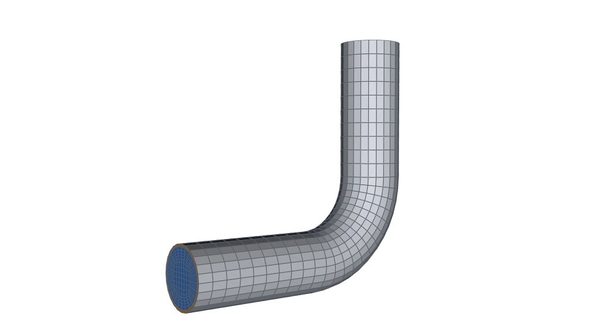 </p>

The bend places a station at every axial layer and joins them with exact
circular arcs, so every wall node lies on the torus.

```bash
python3 -m hexmesh.examples.fittings.smooth_bend
```

| Fittings | Volumes | Cells | min SICN | mean SICN | min SJ (where) | max aspect | Build |
|---|---|---|---|---|---|---|---|
| 3: Straight ×2, Bend | 126 | 6 528 | 0.239 | 0.440 | 0.792 (#1 Bend) | 10.7 | 2.4 s |

- **Open ends:** `fluid_inlet`, `fluid_outlet`, `pipe_wall_inlet`, `pipe_wall_outlet`
- **Walls:** `pipe_wall_wall`
- **Interfaces:** `interface_fluid_pipe_wall`
- **Colours:** fluid blue, pipe_wall orange; walls grey.
- **Parameters:** [`Straight`](../../API.md#straightlength-n_layersnone-axial_grading10-stack_changes-twist00), [`Bend`](../../API.md#bendradius-angle-n_layersnone-roll00-axial_grading10-towardnone)

### miter_bend

**Mitred bends: a single 90° miter joint and a 3-cut segmented elbow.**

<p>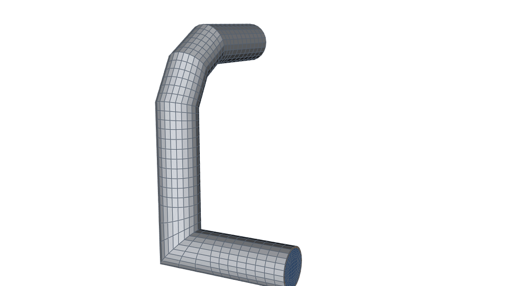 </p>

A `MiterBend` has the same ports as the smooth `Bend` with equal radius
and angle.  Its cut faces are the exact ellipses where the straight pipe
pieces meet, so wall nodes on a cut lie on both pipes.

```bash
python3 -m hexmesh.examples.fittings.miter_bend
```

| Fittings | Volumes | Cells | min SICN | mean SICN | min SJ (where) | max aspect | Build |
|---|---|---|---|---|---|---|---|
| 5: Straight ×3, MiterBend ×2 | 243 | 9 792 | 0.110 | 0.433 | 0.531 (#1 MiterBend) | 22.2 | 3.8 s |

- **Open ends:** `fluid_inlet`, `fluid_outlet`, `pipe_wall_inlet`, `pipe_wall_outlet`
- **Walls:** `pipe_wall_wall`
- **Interfaces:** `interface_fluid_pipe_wall`
- **Colours:** fluid blue, pipe_wall orange; walls grey.
- **Parameters:** [`Straight`](../../API.md#straightlength-n_layersnone-axial_grading10-stack_changes-twist00), [`MiterBend`](../../API.md#miterbendradius-angle-n_cuts1-n_layers2-roll00-towardnone)

### spline_pipe

**Pipe along a 3-D cubic spline through given points.**

<p>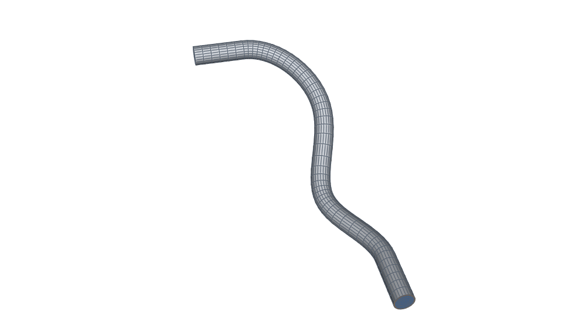 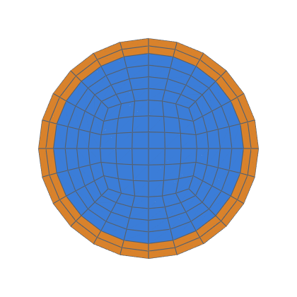</p>

The spline leaves the inlet along its direction; cross-sections follow
rotation-minimising (Bishop) frames, one station per axial layer.

```bash
python3 -m hexmesh.examples.fittings.spline_pipe
```

| Fittings | Volumes | Cells | min SICN | mean SICN | min SJ (where) | max aspect | Build |
|---|---|---|---|---|---|---|---|
| 3: Straight ×2, SplinePipe | 378 | 9 360 | 0.146 | 0.295 | 0.792 (#1 SplinePipe) | 19.0 | 6.0 s |

- **Open ends:** `fluid_inlet`, `fluid_outlet`, `pipe_wall_inlet`, `pipe_wall_outlet`
- **Walls:** `pipe_wall_wall`
- **Interfaces:** `interface_fluid_pipe_wall`
- **Colours:** fluid blue, pipe_wall orange; walls grey.
- **Parameters:** [`Straight`](../../API.md#straightlength-n_layersnone-axial_grading10-stack_changes-twist00), [`SplinePipe`](../../API.md#splinepipepoints-n_layersnone-end_tangentnone-axial_grading10)

## Reducers and profiles

A pipe that changes size: a concentric cone, or a profile along the axis, such as a smooth constriction (a stenosis) or a venturi.  The cell counts stay the same; only the sizes change.

**Fittings:** [`Reducer`](../../API.md#reduceroutlet-length-n_layersnone-axial_grading10-profilenone-chord_tol1e-3).

**Validated by** (tags `reducer`, `profiled-reducer`):

- ● [Manufactured solutions for conduction on every fitting](../../validation/mms/README.md) (V1, accepted; last run 2026-11-09, hexmesh b3fbf76; `profiled-reducer`)
- ● [Smooth cosine constriction, Re = 500](../../validation/stenosis/README.md) (V2, accepted; last run 2026-10-29, hexmesh a92840c; `profiled-reducer`)
- ● [Pulsatile flow through the cosine constriction (Varghese et al., Part 2)](../../validation/stenosis_pulsatile/README.md) (V2, accepted; last run 2026-10-31, hexmesh 2ca8836; `profiled-reducer`)

| Example | Shows | Cells | min SICN | min SJ | Build |
|---|---|---|---|---|---|
| [reducer_network](#reducer_network) | Reducer, bend and expander: a line that narrows, turns and widens again. | 11 832 | 0.221 | 0.788 | 6.0 s |
| [stenosis](#stenosis) | Stenosis: a smooth cosine constriction in a straight pipe, the benchmark geometry of Varghese et al. (RESEARCH §7.3). | 23 220 | 0.101 | 0.772 | 5.5 s |

### reducer_network

**Reducer, bend and expander: a line that narrows, turns and widens again.**

<p>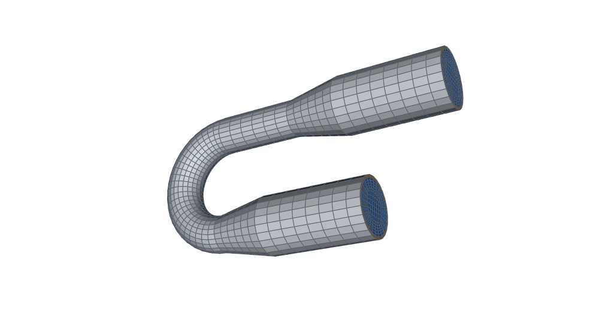 </p>

A `Reducer` may change radii only; the layer stack and every density
parameter must match on both sides, which `validate` checks before GMSH.

```bash
python3 -m hexmesh.examples.fittings.reducer_network
```

| Fittings | Volumes | Cells | min SICN | mean SICN | min SJ (where) | max aspect | Build |
|---|---|---|---|---|---|---|---|
| 6: Straight ×3, Reducer ×2, Bend | 351 | 11 832 | 0.221 | 0.442 | 0.788 (#4 Reducer) | 10.4 | 6.0 s |

- **Open ends:** `fluid_inlet`, `fluid_outlet`, `pipe_wall_inlet`, `pipe_wall_outlet`
- **Walls:** `pipe_wall_wall`
- **Interfaces:** `interface_fluid_pipe_wall`
- **Colours:** fluid blue, pipe_wall orange; walls grey.
- **Parameters:** [`Straight`](../../API.md#straightlength-n_layersnone-axial_grading10-stack_changes-twist00), [`Reducer`](../../API.md#reduceroutlet-length-n_layersnone-axial_grading10-profilenone-chord_tol1e-3), [`Bend`](../../API.md#bendradius-angle-n_layersnone-roll00-axial_grading10-towardnone)

### stenosis

**Stenosis: a smooth cosine constriction in a straight pipe, the benchmark geometry of Varghese et al. (RESEARCH §7.3).**

<p>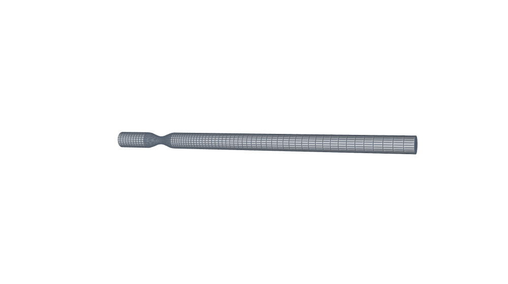 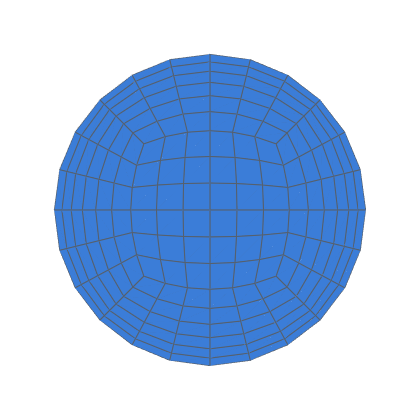</p>

A profiled `Reducer` with `profile=("cosine", s0)` narrows the pipe to
a throat of radius `(1 − 2·s0)·R` and widens it back over `length`.
The defaults are the benchmark: `s0 = 0.25` (75 % area reduction),
`length = 2 D`, 3 D of pipe upstream and 16 D downstream of the throat.
Every wall node at a station lies on the profile, and `validate` rejects
a chord further than `chord_tol` from it, naming the layers needed.

`s0 < 0` makes a bulge instead (an aneurysm, an expansion chamber), of
largest radius `(1 − 2·s0)·R`; `s0 = 0` is a plain pipe.

The counts are fixed, not derived from the geometry, so every
`build(s0, length_d)` with `−1 ≤ s0 ≤ 0.25` and `length_d ≥ 1` has
the same mesh connectivity: node *i* is the same point of the network in
every variant, only moved.  That is what a parameter study or a surrogate
model over shapes needs, from constriction through plain pipe to bulge.
The counts are sized for the variant needing the most layers: the bulge
`s0 = −1` needs 71 to keep every wall chord within `chord_tol` of the
profile (a constriction of 0.25 needs 36).

Fittings are labelled, so with `walls_by_fitting=True` the constriction's
wall is its own patch (`fluid_wall_stenosis`), e.g. for wall shear
stress.  Open ends: `fluid_inlet`, `fluid_outlet`.

```bash
python3 -m hexmesh.examples.fittings.stenosis
```

| Fittings | Volumes | Cells | min SICN | mean SICN | min SJ (where) | max aspect | Build |
|---|---|---|---|---|---|---|---|
| 3: Straight ×2, Reducer | 365 | 23 220 | 0.101 | 0.515 | 0.772 (#1 Reducer) | 28.3 | 5.5 s |

- **Open ends:** `fluid_inlet`, `fluid_outlet`
- **Walls:** `fluid_wall_downstream`, `fluid_wall_stenosis`, `fluid_wall_upstream`
- **Colours:** fluid blue; walls grey.
- **Parameters:** [`Straight`](../../API.md#straightlength-n_layersnone-axial_grading10-stack_changes-twist00), [`Reducer`](../../API.md#reduceroutlet-length-n_layersnone-axial_grading10-profilenone-chord_tol1e-3)

## Junctions

Where a network branches: a tee puts a side branch on a pipe, a wye splits one pipe into two.  Junctions hold the lowest-quality cells of a network, so their limits are checked before meshing.

**Fittings:** [`Tee`](../../API.md#teerun_lengthnone-branch_length-branch_radius-n_run3-n_branch3-n_turn2-roll00-towardnone-angle900-offset00-branchnone-facenone-marginnone-domenone-sheetnone-n_wallnone-branch_first_cellnone-branch_mprgnone), [`Wye`](../../API.md#wyeangle-run_length-branch_length-n_runnone-n_branchnone-n_splitnone-roll00-towardnone).

**Validated by** (tags `tee`, `duct-tap`, `wye`, `projection`):

- ● [FEniCSx: second-order export checked end to end](../../validation/fenicsx_second_order/README.md) (V1, accepted; last run 2026-11-11, hexmesh 5952340; `tee`, `projection`)
- ● [Manufactured solutions for conduction on every fitting](../../validation/mms/README.md) (V1, accepted; last run 2026-11-09, hexmesh b3fbf76; `tee`, `duct-tap`, `wye`, `projection`)

| Example | Shows | Cells | min SICN | min SJ | Build |
|---|---|---|---|---|---|
| [tee](#tee) | Side-branch tee: straight run, tee, then a bend on the main line. | 7 464 | 0.189 | 0.316 | 3.6 s |
| [equal_tee](#equal_tee) | Equal tee: a branch as wide as the main. | 8 000 | 0.167 | 0.511 | 2.8 s |
| [wye](#wye) | Symmetric wye: straight inlet, a 60° Y-junction, a straight on each daughter. | 5 724 | 0.170 | 0.156 | 1.4 s |
| [junction_walls](#junction_walls) | Exact junction walls: a tee and a narrow 30° wye, their wall nodes moved onto the analytic walls after surface meshing. | 16 576 | 0.041 | 0.065 | 4.4 s |

### tee

**Side-branch tee: straight run, tee, then a bend on the main line.**

<p>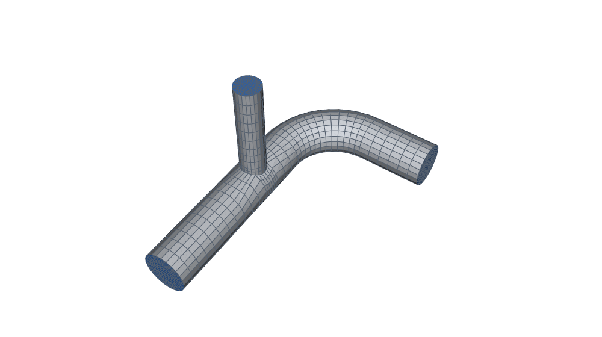 </p>

The tee is a block layout: its O-grid ring layer turns continuously from
the main pipe into the branch, so the junction is all-hex with no merged
nodes.  Ports are named, and the open ends become the patches
`fluid_inlet`, `fluid_main_end` and `fluid_branch_end`.
(Limits: circular layers, branch radius below the main radius.  Shells run
through the junction too: decision 0028.)

```bash
python3 -m hexmesh.examples.fittings.tee
```

| Fittings | Volumes | Cells | min SICN | mean SICN | min SJ (where) | max aspect | Build |
|---|---|---|---|---|---|---|---|
| 5: Straight ×3, Tee, Bend | 99 | 7 464 | 0.189 | 0.478 | 0.316 (#1 Tee) | 10.4 | 3.6 s |

- **Open ends:** `fluid_branch_end`, `fluid_inlet`, `fluid_main_end`
- **Walls:** `fluid_wall`
- **Colours:** fluid blue; walls grey.
- **Parameters:** [`Straight`](../../API.md#straightlength-n_layersnone-axial_grading10-stack_changes-twist00), [`Tee`](../../API.md#teerun_lengthnone-branch_length-branch_radius-n_run3-n_branch3-n_turn2-roll00-towardnone-angle900-offset00-branchnone-facenone-marginnone-domenone-sheetnone-n_wallnone-branch_first_cellnone-branch_mprgnone), [`Bend`](../../API.md#bendradius-angle-n_layersnone-roll00-axial_grading10-towardnone)

### equal_tee

**Equal tee: a branch as wide as the main.**

<p>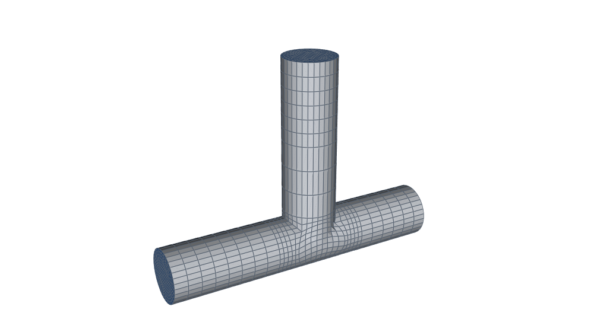 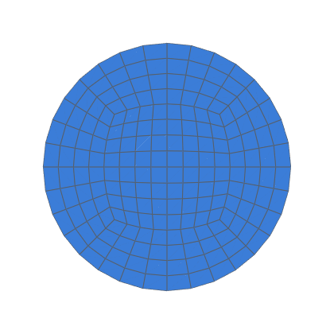</p>

A `Tee` whose `branch_radius` is the main's builds its junction
around an oriented cube, square to all three pipes: a centre hex, a
five-block column to each pipe, and one block on each of the other
three sides, whose outer face is projected onto the wall.
`run_length` is left out, so the tee resolves the length the cube
needs.  (Limits: circular layers, square and centred, first order only.
The crease where branch and main meet crosses the cube's faces beside
the branch, so its chord error falls as `nang` rises: 3.7 % of the
radius at `nang` 8.)

```bash
python3 -m hexmesh.examples.fittings.equal_tee
```

| Fittings | Volumes | Cells | min SICN | mean SICN | min SJ (where) | max aspect | Build |
|---|---|---|---|---|---|---|---|
| 4: Straight ×3, Tee | 49 | 8 000 | 0.167 | 0.595 | 0.511 (#1 Tee) | 9.1 | 2.8 s |

- **Open ends:** `fluid_branch_end`, `fluid_inlet`, `fluid_main_end`
- **Walls:** `fluid_wall`
- **Colours:** fluid blue; walls grey.
- **Parameters:** [`Straight`](../../API.md#straightlength-n_layersnone-axial_grading10-stack_changes-twist00), [`Tee`](../../API.md#teerun_lengthnone-branch_length-branch_radius-n_run3-n_branch3-n_turn2-roll00-towardnone-angle900-offset00-branchnone-facenone-marginnone-domenone-sheetnone-n_wallnone-branch_first_cellnone-branch_mprgnone)

### wye

**Symmetric wye: straight inlet, a 60° Y-junction, a straight on each daughter.**

<p>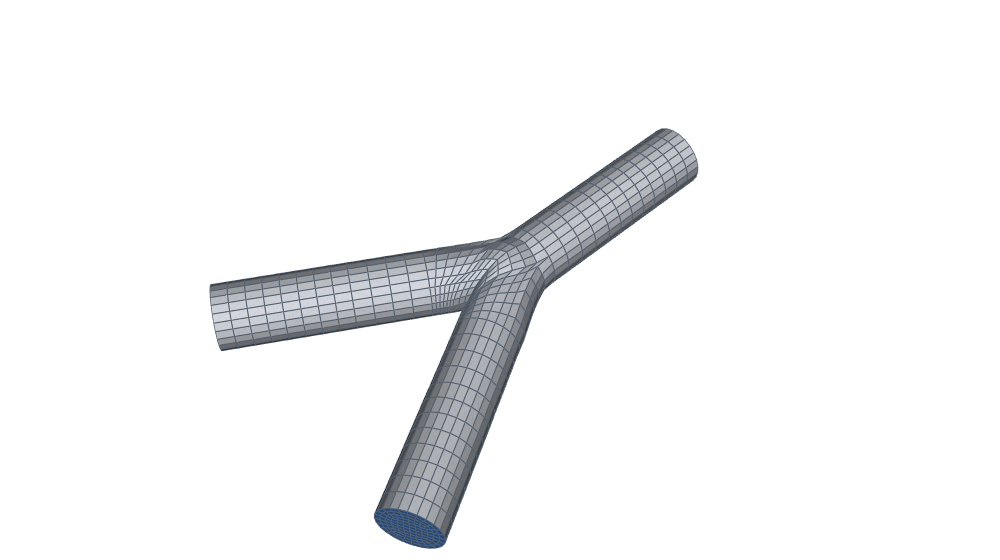 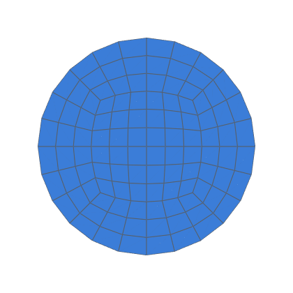</p>

The wye is a block layout around a hub: the inlet core continues into the
hub, each daughter's core leaves one side of it, and the O-grid ring layer
covers the whole junction.  The daughters split in the inlet's (normal,
right) plane.  Ports are named, and the open ends become the patches
`fluid_inlet`, `fluid_left_end` and `fluid_right_end`.
(Prototype limits: single-layer spec, equal daughters, angle 30°–120°.)

```bash
python3 -m hexmesh.examples.fittings.wye
```

| Fittings | Volumes | Cells | min SICN | mean SICN | min SJ (where) | max aspect | Build |
|---|---|---|---|---|---|---|---|
| 4: Straight ×3, Wye | 44 | 5 724 | 0.170 | 0.560 | 0.156 (#1 Wye) | 5.0 | 1.4 s |

- **Open ends:** `fluid_inlet`, `fluid_left_end`, `fluid_right_end`
- **Walls:** `fluid_wall`
- **Colours:** fluid blue; walls grey.
- **Parameters:** [`Straight`](../../API.md#straightlength-n_layersnone-axial_grading10-stack_changes-twist00), [`Wye`](../../API.md#wyeangle-run_length-branch_length-n_runnone-n_branchnone-n_splitnone-roll00-towardnone)

### junction_walls

**Exact junction walls: a tee and a narrow 30° wye, their wall nodes moved onto the analytic walls after surface meshing.**

<p>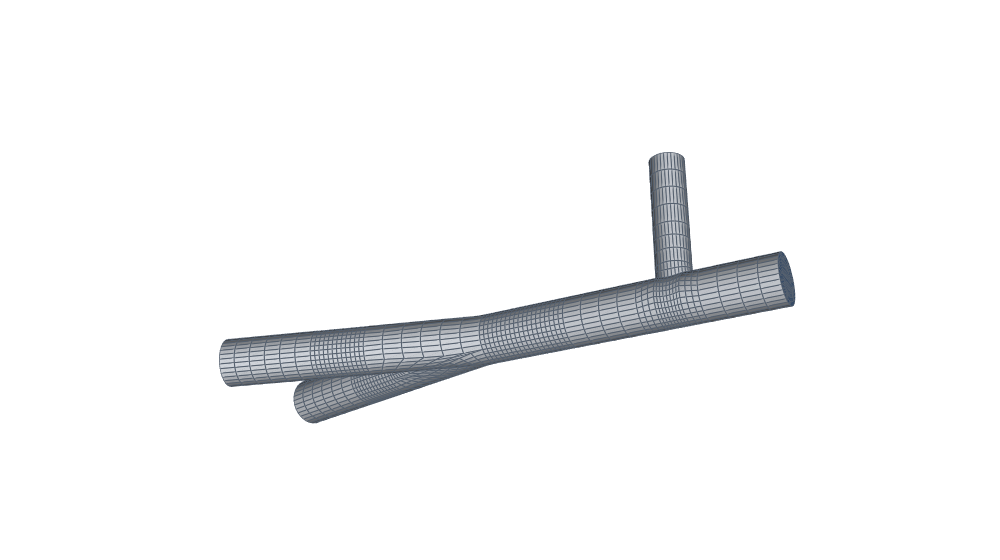 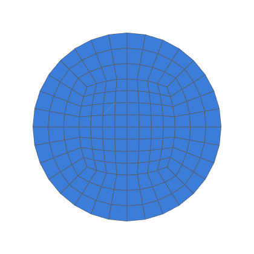</p>

A junction's wall is not one smooth surface: the tee's is the union of two
cylinders, the wye's the union of three tubes with a sharp crease at the
crotch.  The OCC surfaces between the layout's exact wall curves are
fillings: within 0.03 % of the radius for the tee (plates through wall
points), but 16 % for a 60° wye and 77 % for this 30° one.  So
`Assembly.mesh()` meshes the surfaces, moves every junction wall node
onto the analytic wall (`hexmesh.assembly.projection.TubeUnion`), then
meshes the volumes from the moved nodes (decision 0029, task 0051).

Near the crotch the nodes move along a smoothed normal, not to the nearest
point, so rows of nodes stay in order across the crease and no cell folds,
down to 30°.  `Assembly.projection_report` gives each fitting's largest
move.  The OCC geometry itself stays approximate: export the mesh, not
the CAD.

```bash
python3 -m hexmesh.examples.fittings.junction_walls
```

| Fittings | Volumes | Cells | min SICN | mean SICN | min SJ (where) | max aspect | Build |
|---|---|---|---|---|---|---|---|
| 7: Straight ×5, Tee, Wye | 78 | 16 576 | 0.041 | 0.634 | 0.065 (#4 Wye) | 12.8 | 4.4 s |

- **Open ends:** `fluid_branch_end`, `fluid_inlet`, `fluid_left_end`, `fluid_right_end`
- **Walls:** `fluid_wall`
- **Colours:** fluid blue; walls grey.
- **Parameters:** [`Straight`](../../API.md#straightlength-n_layersnone-axial_grading10-stack_changes-twist00), [`Tee`](../../API.md#teerun_lengthnone-branch_length-branch_radius-n_run3-n_branch3-n_turn2-roll00-towardnone-angle900-offset00-branchnone-facenone-marginnone-domenone-sheetnone-n_wallnone-branch_first_cellnone-branch_mprgnone), [`Wye`](../../API.md#wyeangle-run_length-branch_length-n_runnone-n_branchnone-n_splitnone-roll00-towardnone)

## Sections and transitions

The shape of the pipe: round, or a rectangular duct, and the fittings that change one into the other.

**Fittings:** [`PipeSpec`](../../API.md#pipespecnangnone-nang_wnone-nang_hnone-mbmp10-rot00-n_outer4), [`Transition`](../../API.md#transitionoutlet-length-n_layersnone-axial_grading10), [`Switch`](../../API.md#switchlength-n_layersnone-outletnone).

**Validated by** (tags `section:circle`, `section:rect`, `transition`, `switch`):

- ● [FEniCSx: second-order export checked end to end](../../validation/fenicsx_second_order/README.md) (V1, accepted; last run 2026-11-11, hexmesh 5952340; `section:circle`)
- ● [Heated multi-layer pipe with laminar flow (full CHT)](../../validation/heated_pipe/README.md) (V1, accepted; last run 2026-10-31, hexmesh d1baada+local; `section:circle`)
- ● [Solid rod with uniform heat generation](../../validation/heated_rod/README.md) (V1, accepted; last run 2026-11-02, hexmesh e54faae; `section:circle`)
- ◐ [Laminar flow in a helical pipe (the SIET coil)](../../validation/helical_pipe/README.md) (V3, in progress; last run 2026-11-08, hexmesh c8c7c76+local; `section:circle`)
- ● [Conduction through a heated multi-layer cylinder](../../validation/layered_conduction/README.md) (V1, accepted; last run 2026-10-28, hexmesh 91c897a; `section:circle`)
- ● [Manufactured solutions for conduction on every fitting](../../validation/mms/README.md) (V1, accepted; last run 2026-11-09, hexmesh b3fbf76; `section:circle`, `section:rect`, `transition`)
- ● [Laminar Hagen–Poiseuille pipe](../../validation/poiseuille/README.md) (V1, accepted; last run 2026-10-26, hexmesh 4ba565b; `section:circle`)
- ● [Laminar flow in rectangular ducts (aspect ratios 1, 2, 4)](../../validation/rect_duct/README.md) (V1, accepted; last run 2026-11-04, hexmesh 61d760c; `section:rect`)
- ● [Laminar flow in a 90° square-duct bend, Re 790](../../validation/square_bend/README.md) (V3, accepted; last run 2026-11-06, hexmesh 42357ca+local; `section:rect`)
- ● [Smooth cosine constriction, Re = 500](../../validation/stenosis/README.md) (V2, accepted; last run 2026-10-29, hexmesh a92840c; `section:circle`)
- ● [Pulsatile flow through the cosine constriction (Varghese et al., Part 2)](../../validation/stenosis_pulsatile/README.md) (V2, accepted; last run 2026-10-31, hexmesh 2ca8836; `section:circle`)
- ● [Fully developed turbulent pipe flow, k-ω SST](../../validation/turbulent_pipe/README.md) (V2, accepted; last run 2026-11-06, hexmesh 42357ca+local; `section:circle`)
- ● [Womersley flow (pulsatile laminar pipe flow)](../../validation/womersley/README.md) (V1, accepted; last run 2026-10-30, hexmesh 75e9f27; `section:circle`)
- ○ [task 0050](../tasks/0050-validation-turbulent-bend.md) (V3, planned; `section:circle`)
- ○ [task 0079](../tasks/0079-validation-taylor-bubble.md) (V3, planned; `section:circle`)

| Example | Shows | Cells | min SICN | min SJ | Build |
|---|---|---|---|---|---|
| [rect_duct](#rect_duct) | Rectangular duct: a 2:1 duct with an easy-way and a hard-way bend. | 5 632 | 0.168 | 0.997 | 0.8 s |
| [duct_transition](#duct_transition) | Duct transition: a circular pipe into a 2:1 duct, a duct bend, and back. | 4 392 | 0.356 | 0.546 | 2.9 s |

### rect_duct

**Rectangular duct: a 2:1 duct with an easy-way and a hard-way bend.**

<p>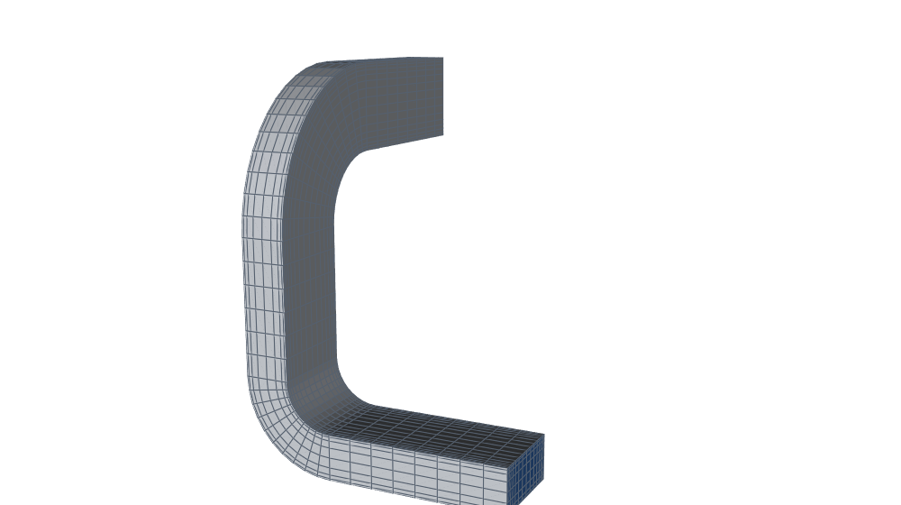 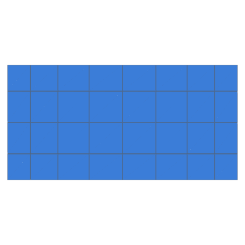</p>

The width runs along the frame's `right` and the height along `up`.
A bend with `roll=0` turns toward `up`, across the short side: the
"easy way" for a flat duct.  `roll=90` turns toward `right`, across the
long side: the "hard way", which needs the larger bend radius (it is
checked against the half-width).  The open ends become `air_inlet` and
`air_outlet`.

The section is an H face, one Cartesian patch (the default for a
rectangle since 0.4.0).  `first_cell` grades its walls: the end cell of
every side, here 4 mm against a uniform cell of 12.5 mm.  `layout="oh"` with `nrad=` gives the O-H
face instead.
(Limits: no elbow for ducts yet; duct tees are single-layer.  A duct with a wall and lagging:
`sections.lagged_duct`.)

```bash
python3 -m hexmesh.examples.sections.rect_duct
```

| Fittings | Volumes | Cells | min SICN | mean SICN | min SJ (where) | max aspect | Build |
|---|---|---|---|---|---|---|---|
| 5: Straight ×3, Bend ×2 | 25 | 5 632 | 0.168 | 0.489 | 0.997 (#1 Bend) | 12.5 | 0.8 s |

- **Open ends:** `air_inlet`, `air_outlet`
- **Walls:** `air_wall`
- **Colours:** air blue; walls grey.
- **Parameters:** [`Straight`](../../API.md#straightlength-n_layersnone-axial_grading10-stack_changes-twist00), [`Bend`](../../API.md#bendradius-angle-n_layersnone-roll00-axial_grading10-towardnone)

### duct_transition

**Duct transition: a circular pipe into a 2:1 duct, a duct bend, and back.**

<p>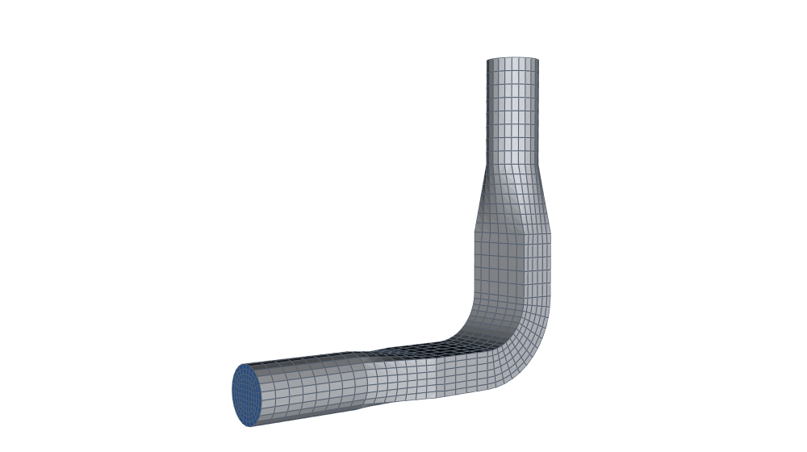 </p>

`Transition` joins a circle and a rectangle with the same counts per
side: the circle's `nang` equals the duct's `nang_w` and `nang_h`.
Then the two faces have the same mesh connectivity (switch class 0), and
every station between them blends the two outlines.  The open ends
become `air_inlet` and `air_outlet`.
(Limits: equal counts per side.  A layer stack changes shape the same way:
`sections.insulated_transition`.)

```bash
python3 -m hexmesh.examples.sections.duct_transition
```

| Fittings | Volumes | Cells | min SICN | mean SICN | min SJ (where) | max aspect | Build |
|---|---|---|---|---|---|---|---|
| 7: Straight ×4, Transition ×2, Bend | 106 | 4 392 | 0.356 | 0.625 | 0.546 (#5 Transition) | 5.3 | 2.9 s |

- **Open ends:** `air_inlet`, `air_outlet`
- **Walls:** `air_wall`
- **Colours:** air blue; walls grey.
- **Parameters:** [`Straight`](../../API.md#straightlength-n_layersnone-axial_grading10-stack_changes-twist00), [`Transition`](../../API.md#transitionoutlet-length-n_layersnone-axial_grading10), [`Bend`](../../API.md#bendradius-angle-n_layersnone-roll00-axial_grading10-towardnone)

## Layers

What surrounds the flow: a pipe wall, insulation, lagging, each its own region for conjugate heat transfer.  Every fitting carries the whole stack, and a layer can end or start along a straight run.

**Fittings:** [`PipeSpec`](../../API.md#pipespecnangnone-nang_wnone-nang_hnone-mbmp10-rot00-n_outer4), [`Straight`](../../API.md#straightlength-n_layersnone-axial_grading10-stack_changes-twist00).

**Validated by** (tags `layers`, `stack-changes`):

- ● [Heated multi-layer pipe with laminar flow (full CHT)](../../validation/heated_pipe/README.md) (V1, accepted; last run 2026-10-31, hexmesh d1baada+local; `layers`)
- ● [Conduction through a heated multi-layer cylinder](../../validation/layered_conduction/README.md) (V1, accepted; last run 2026-10-28, hexmesh 91c897a; `layers`)
- ● [Manufactured solutions for conduction on every fitting](../../validation/mms/README.md) (V1, accepted; last run 2026-11-09, hexmesh b3fbf76; `layers`, `stack-changes`)

| Example | Shows | Cells | min SICN | min SJ | Build |
|---|---|---|---|---|---|
| [insulated_pipe](#insulated_pipe) | Three-layer insulated pipe: fluid, steel wall, insulation. | 10 800 | 0.144 | 0.792 | 3.5 s |
| [insulated_route](#insulated_route) | Insulated route: a three-layer stack carried through a reducer, a miter, a spline and an elbow. | 15 600 | 0.061 | 0.531 | 6.9 s |
| [layer_outlines](#layer_outlines) | Layer outlines: a round conductor in a square filler in a round sheath. | 11 040 | 0.132 | 0.706 | 5.8 s |
| [lagged_duct](#lagged_duct) | Lagged duct: a rectangular air duct with a steel wall and lagging, through a reducer and bends both ways. | 7 176 | 0.024 | 0.690 | 4.6 s |
| [insulated_transition](#insulated_transition) | Insulated transition: an insulated round pipe becomes an insulated duct, turns, and the insulation stops. | 6 972 | 0.048 | 0.577 | 7.3 s |
| [insulated_tee](#insulated_tee) | Insulated tee: a three-layer header with a side branch, the steel and the insulation running through the junction into the branch. | 13 164 | 0.107 | 0.316 | 9.1 s |
| [insulated_network](#insulated_network) | Insulated network: a three-layer header with a tee and a wye, the steel and the insulation running through both junctions, and one branch left bare. | 18 012 | 0.059 | 0.156 | 10.4 s |

### insulated_pipe

**Three-layer insulated pipe: fluid, steel wall, insulation.**

<p>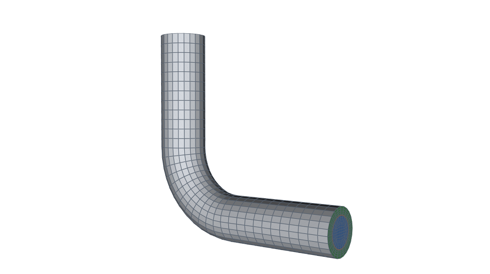 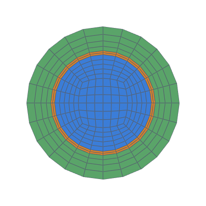</p>

Each layer is its own physical volume, and the layers meet at conformal
material interfaces (`interface_fluid_steel`, …) for conjugate heat transfer.
`Elbow` takes its radius from the pipe: 1.5 D for a long-radius elbow.

```bash
python3 -m hexmesh.examples.sections.insulated_pipe
```

| Fittings | Volumes | Cells | min SICN | mean SICN | min SJ (where) | max aspect | Build |
|---|---|---|---|---|---|---|---|
| 3: Straight ×2, Elbow | 182 | 10 800 | 0.144 | 0.362 | 0.792 (#1 Elbow) | 19.0 | 3.5 s |

- **Open ends:** `fluid_inlet`, `fluid_outlet`, `insulation_inlet`, `insulation_outlet`, `steel_inlet`, `steel_outlet`
- **Walls:** `insulation_wall`
- **Interfaces:** `interface_fluid_steel`, `interface_steel_insulation`
- **Colours:** fluid blue, steel orange, insulation green; walls grey.
- **Parameters:** [`Straight`](../../API.md#straightlength-n_layersnone-axial_grading10-stack_changes-twist00), [`Elbow`](../../API.md#elbowangle900-schedulelong-n_layers8-roll00-axial_grading10-towardnone)

### insulated_route

**Insulated route: a three-layer stack carried through a reducer, a miter, a spline and an elbow.**

<p>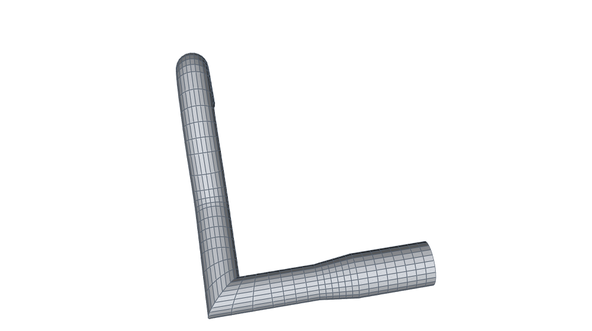 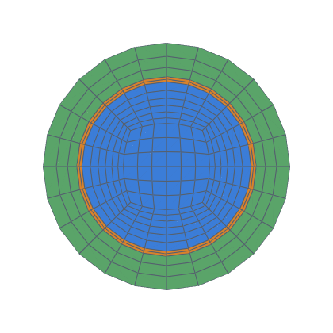</p>

Every sweep fitting takes the whole layer stack, so fluid, steel and
insulation stay separate volumes with conformal `interface_*` groups
along the full route.  The reducer shrinks the core and keeps the shell
thicknesses; it may change radii only, never the stack or the densities
(CLAUDE.md, "Parameter separation").  The fluid core is graded from the
wall with `first_cell`.

```bash
python3 -m hexmesh.examples.sections.insulated_route
```

| Fittings | Volumes | Cells | min SICN | mean SICN | min SJ (where) | max aspect | Build |
|---|---|---|---|---|---|---|---|
| 8: Straight ×4, Reducer, MiterBend, SplinePipe, Elbow | 442 | 15 600 | 0.061 | 0.289 | 0.531 (#3 MiterBend) | 47.5 | 6.9 s |

- **Open ends:** `fluid_inlet`, `fluid_outlet`, `insulation_inlet`, `insulation_outlet`, `steel_inlet`, `steel_outlet`
- **Walls:** `insulation_wall`
- **Interfaces:** `interface_fluid_steel`, `interface_steel_insulation`
- **Colours:** fluid blue, steel orange, insulation green; walls grey.
- **Parameters:** [`Straight`](../../API.md#straightlength-n_layersnone-axial_grading10-stack_changes-twist00), [`Reducer`](../../API.md#reduceroutlet-length-n_layersnone-axial_grading10-profilenone-chord_tol1e-3), [`MiterBend`](../../API.md#miterbendradius-angle-n_cuts1-n_layers2-roll00-towardnone), [`SplinePipe`](../../API.md#splinepipepoints-n_layersnone-end_tangentnone-axial_grading10), [`Elbow`](../../API.md#elbowangle900-schedulelong-n_layers8-roll00-axial_grading10-towardnone)

### layer_outlines

**Layer outlines: a round conductor in a square filler in a round sheath.**

<p>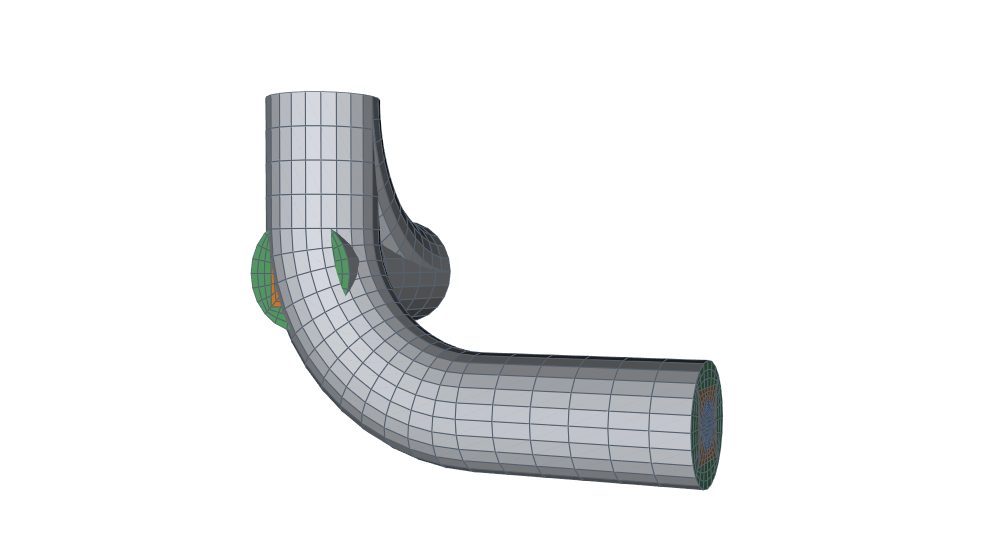 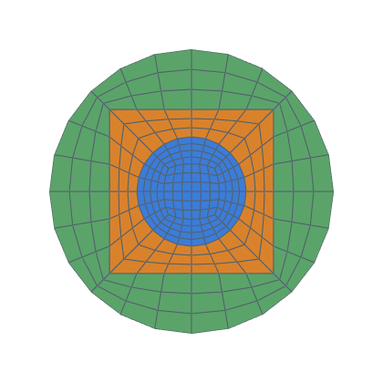</p>

A shell's outline need not be a circle (decision 0026).  ``.shell(name,
outer=…)` gives a layer its own outline, `CircleShape`` or
`RectShape`; `dR` grows the previous one.  Here the copper's circle
sits in a square filler, and the filler in a round sheath, so the stack
has a circle inside a rectangle and a rectangle inside a circle.  Every
layer goes through the bends as a separate volume, with conformal
`interface_*` groups between them.

Rules: a stack with a circle and a rectangle has one count on every
side (`nang` equals each rectangle's `nang_w` and `nang_h`), and each
outline lies inside the next all round.  Quality falls as the rectangles flatten;
task 0047 measured it.

```bash
python3 -m hexmesh.examples.sections.layer_outlines
```

| Fittings | Volumes | Cells | min SICN | mean SICN | min SJ (where) | max aspect | Build |
|---|---|---|---|---|---|---|---|
| 5: Straight ×3, Bend ×2 | 351 | 11 040 | 0.132 | 0.330 | 0.706 (#3 Bend) | 16.7 | 5.8 s |

- **Open ends:** `copper_inlet`, `copper_outlet`, `filler_inlet`, `filler_outlet`, `sheath_inlet`, `sheath_outlet`
- **Walls:** `sheath_wall`
- **Interfaces:** `interface_copper_filler`, `interface_filler_sheath`
- **Colours:** copper blue, filler orange, sheath green; walls grey.
- **Parameters:** [`Straight`](../../API.md#straightlength-n_layersnone-axial_grading10-stack_changes-twist00), [`Bend`](../../API.md#bendradius-angle-n_layersnone-roll00-axial_grading10-towardnone)

### lagged_duct

**Lagged duct: a rectangular air duct with a steel wall and lagging, through a reducer and bends both ways.**

<p>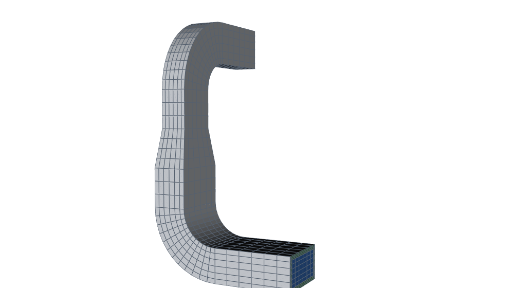 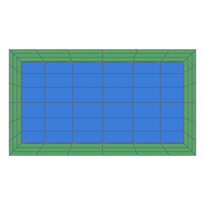</p>

`dR` around a rectangle grows it: half_w and half_h each by `dR`,
corners kept sharp (decision 0026).  So the wall and the lagging are
rectangles too, and every ring's corner lines run along the diagonals.
The `Reducer` shrinks every layer's outline at once; it changes sizes
only.  A change of shape is a `Transition`
(`sections.insulated_transition`).

Rules: in a stack of rectangles every outline takes the core's counts,
here 6 × 6.  They may differ (`nang_w ≠ nang_h`, decision 0041).

```bash
python3 -m hexmesh.examples.sections.lagged_duct
```

| Fittings | Volumes | Cells | min SICN | mean SICN | min SJ (where) | max aspect | Build |
|---|---|---|---|---|---|---|---|
| 7: Straight ×4, Bend ×2, Reducer | 288 | 7 176 | 0.024 | 0.328 | 0.690 (#3 Reducer) | 100.0 | 4.6 s |

- **Open ends:** `air_inlet`, `air_outlet`, `lagging_inlet`, `lagging_outlet`, `steel_inlet`, `steel_outlet`
- **Walls:** `lagging_wall`
- **Interfaces:** `interface_air_steel`, `interface_steel_lagging`
- **Colours:** air blue, steel orange, lagging green; walls grey.
- **Parameters:** [`Straight`](../../API.md#straightlength-n_layersnone-axial_grading10-stack_changes-twist00), [`Bend`](../../API.md#bendradius-angle-n_layersnone-roll00-axial_grading10-towardnone), [`Reducer`](../../API.md#reduceroutlet-length-n_layersnone-axial_grading10-profilenone-chord_tol1e-3)

### insulated_transition

**Insulated transition: an insulated round pipe becomes an insulated duct, turns, and the insulation stops.**

<p>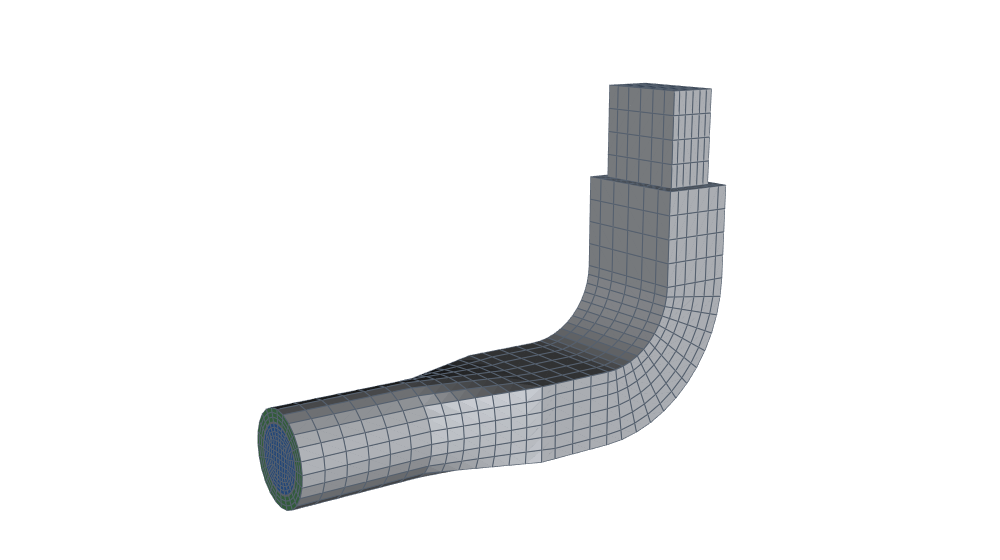 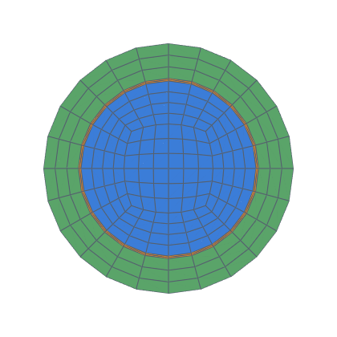</p>

`Transition` changes the shape of every layer together (task 0046):
each station blends each layer's two end outlines, so the steel and the
insulation turn from circles into rectangles alongside the air, and stay
nested.  The two ends have the same layers, counts per side and radial
gradings.  `Reducer` changes sizes, `Transition` changes shapes.

Past the duct bend, `stack_changes` ends the insulation part-way along
the last straight.  Its end face becomes the `insulation_end` wall, and
the bare duct runs on.

```bash
python3 -m hexmesh.examples.sections.insulated_transition
```

| Fittings | Volumes | Cells | min SICN | mean SICN | min SJ (where) | max aspect | Build |
|---|---|---|---|---|---|---|---|
| 5: Straight ×3, Transition, Bend | 249 | 6 972 | 0.048 | 0.400 | 0.577 (#1 Transition) | 50.0 | 7.3 s |

- **Open ends:** `air_inlet`, `air_outlet`, `insulation_inlet`, `steel_inlet`, `steel_outlet`
- **Walls:** `insulation_end`, `insulation_wall`, `steel_wall`
- **Interfaces:** `interface_air_steel`, `interface_steel_insulation`
- **Colours:** air blue, steel orange, insulation green; walls grey.
- **Parameters:** [`Straight`](../../API.md#straightlength-n_layersnone-axial_grading10-stack_changes-twist00), [`Transition`](../../API.md#transitionoutlet-length-n_layersnone-axial_grading10), [`Bend`](../../API.md#bendradius-angle-n_layersnone-roll00-axial_grading10-towardnone)

### insulated_tee

**Insulated tee: a three-layer header with a side branch, the steel and the insulation running through the junction into the branch.**

<p>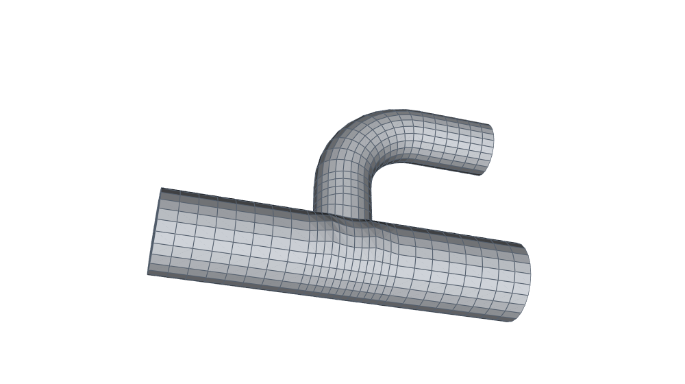 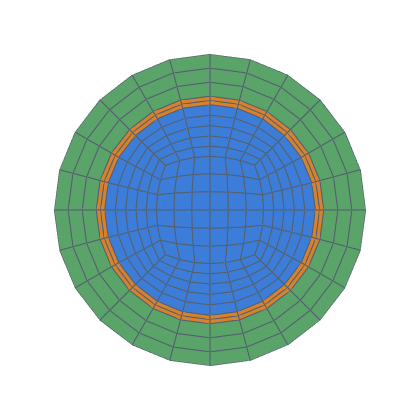</p>

The branch copies the header's shells (same names, thicknesses and
densities), so `interface_fluid_steel` and `interface_steel_insulation`
each run as one conformal sheet from the header through the tee into the
branch (decision 0028).  Wall and shell-boundary nodes lie exactly on their
offset cylinders: `mesh()` projects them onto the analytic surfaces
(decision 0029).

The tee's `run_length` is left out: `add()` picks one that keeps the
shells' slabs well shaped (`r + T + R/2`, T the total shell thickness).
A run chosen too short is rejected before GMSH, naming the shortest run
that would do.  A branch below about 0.57 of the header radius also warns
at any run: the junction core's quality is set by the branch ratio
(`Assembly.warnings`; task 0052).

```bash
python3 -m hexmesh.examples.sections.insulated_tee
```

| Fittings | Volumes | Cells | min SICN | mean SICN | min SJ (where) | max aspect | Build |
|---|---|---|---|---|---|---|---|
| 5: Straight ×3, Tee, Bend | 231 | 13 164 | 0.107 | 0.422 | 0.316 (#1 Tee) | 15.6 | 9.1 s |

- **Open ends:** `fluid_branch_end`, `fluid_inlet`, `fluid_main_end`, `insulation_branch_end`, `insulation_inlet`, `insulation_main_end`, `steel_branch_end`, `steel_inlet`, `steel_main_end`
- **Walls:** `insulation_wall`
- **Interfaces:** `interface_fluid_steel`, `interface_steel_insulation`
- **Colours:** fluid blue, steel orange, insulation green; walls grey.
- **Parameters:** [`Straight`](../../API.md#straightlength-n_layersnone-axial_grading10-stack_changes-twist00), [`Tee`](../../API.md#teerun_lengthnone-branch_length-branch_radius-n_run3-n_branch3-n_turn2-roll00-towardnone-angle900-offset00-branchnone-facenone-marginnone-domenone-sheetnone-n_wallnone-branch_first_cellnone-branch_mprgnone), [`Bend`](../../API.md#bendradius-angle-n_layersnone-roll00-axial_grading10-towardnone)

### insulated_network

**Insulated network: a three-layer header with a tee and a wye, the steel and the insulation running through both junctions, and one branch left bare.**

<p>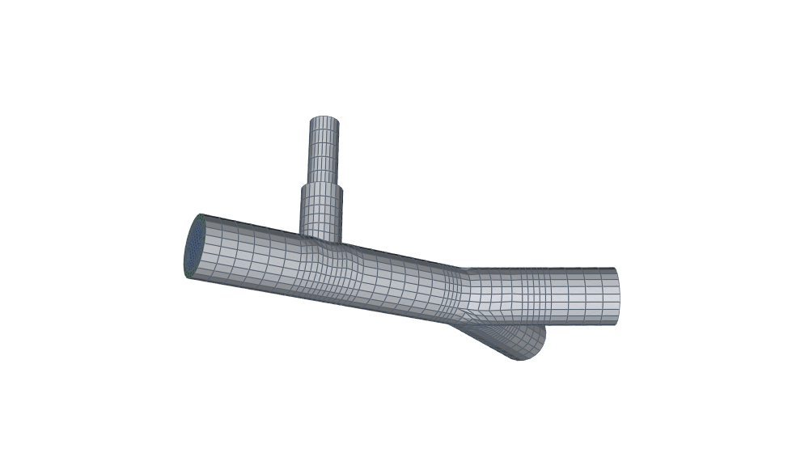 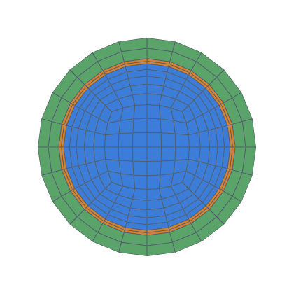</p>

Junctions carry the whole layer stack (decision 0028): the tee's branch
copies the header's shells, and the wye's daughters keep the header's
spec, so every `interface_*` group is one conformal sheet through the
network.  The tee's branch is bare beyond its first cell: its straight's
`stack_changes` drops the insulation, and the annulus where it stops is
`insulation_end` (decision 0006).  That is where the PCF reader places a
bare leg's switch too (task 0054).

Junction shells have limits, checked before GMSH (`API.md`): a wye with
shells needs 40° or more, and its total shell thickness at most
$R \min\left(0.65 \tan(\theta/2),\ 0.55\right)$ for a wye of angle $\theta$:
$0.375\,R$ at 60°; here $0.31\,R$.

```bash
python3 -m hexmesh.examples.sections.insulated_network
```

| Fittings | Volumes | Cells | min SICN | mean SICN | min SJ (where) | max aspect | Build |
|---|---|---|---|---|---|---|---|
| 7: Straight ×5, Tee, Wye | 211 | 18 012 | 0.059 | 0.440 | 0.156 (#4 Wye) | 25.0 | 10.4 s |

- **Open ends:** `fluid_inlet`, `fluid_left`, `fluid_right`, `fluid_tap`, `insulation_inlet`, `insulation_left`, `insulation_right`, `steel_inlet`, `steel_left`, `steel_right`, `steel_tap`
- **Walls:** `insulation_end`, `insulation_wall`, `steel_wall`
- **Interfaces:** `interface_fluid_steel`, `interface_steel_insulation`
- **Colours:** fluid blue, steel orange, insulation green; walls grey.
- **Parameters:** [`Straight`](../../API.md#straightlength-n_layersnone-axial_grading10-stack_changes-twist00), [`Tee`](../../API.md#teerun_lengthnone-branch_length-branch_radius-n_run3-n_branch3-n_turn2-roll00-towardnone-angle900-offset00-branchnone-facenone-marginnone-domenone-sheetnone-n_wallnone-branch_first_cellnone-branch_mprgnone), [`Wye`](../../API.md#wyeangle-run_length-branch_length-n_runnone-n_branchnone-n_splitnone-roll00-towardnone)

## Grading and resolution

Where the cells go: thin cells at the wall for boundary layers, axial cells clustered where the flow changes, and straight runs added at the open ends for a CFD case.

**Fittings:** [`PipeSpec`](../../API.md#pipespecnangnone-nang_wnone-nang_hnone-mbmp10-rot00-n_outer4), [`Assembly`](../../API.md#assemblyspec-positionnone-directionnone-upnone-lcnone-inlet_nameinlet-axial_cellnone).

**Validated by:** no validation tag covers this family yet.

| Example | Shows | Cells | min SICN | min SJ | Build |
|---|---|---|---|---|---|
| [graded_bend](#graded_bend) | CFD-ready bend: wall grading, axial cells clustered at the bend, inlet and outlet extensions, and one wall patch per fitting. | 11 160 | 0.100 | 0.792 | 1.9 s |

### graded_bend

**CFD-ready bend: wall grading, axial cells clustered at the bend, inlet and outlet extensions, and one wall patch per fitting.**

<p>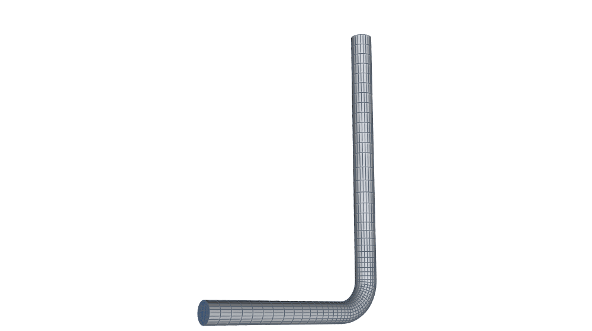 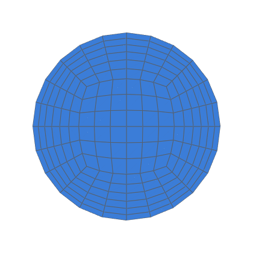</p>

- `first_cell` grades the core radially toward the wall.
- `axial_grading` is the ratio of consecutive axial cells, inlet to
  outlet: below 1 refines the upstream straight toward the bend, above 1
  refines the downstream straight from it.
- `extend_open_ends` adds developing lengths, in diameters.
- `walls_by_fitting=True` gives `fluid_wall_<label>` per fitting, so
  wall data can be read per fitting in the solver.  The extensions have
  no label, so their walls take the default `<Type><index>` names
  (`fluid_wall_Straight3`, …).

```bash
python3 -m hexmesh.examples.sections.graded_bend
```

| Fittings | Volumes | Cells | min SICN | mean SICN | min SJ (where) | max aspect | Build |
|---|---|---|---|---|---|---|---|
| 5: Straight ×4, Bend | 100 | 11 160 | 0.100 | 0.363 | 0.792 (#1 Bend) | 28.5 | 1.9 s |

- **Open ends:** `fluid_inlet`, `fluid_outlet`
- **Walls:** `fluid_wall_Straight3`, `fluid_wall_Straight4`, `fluid_wall_bend`, `fluid_wall_downstream`, `fluid_wall_upstream`
- **Colours:** fluid blue; walls grey.
- **Parameters:** [`Straight`](../../API.md#straightlength-n_layersnone-axial_grading10-stack_changes-twist00), [`Bend`](../../API.md#bendradius-angle-n_layersnone-roll00-axial_grading10-towardnone)

## Building networks

Fittings join in any order and any orientation: a network is a sequence of `add` calls, branching from any open end, and `close` joins two ends into a loop.

**Fittings:** [`Assembly`](../../API.md#assemblyspec-positionnone-directionnone-upnone-lcnone-inlet_nameinlet-axial_cellnone), [`Straight`](../../API.md#straightlength-n_layersnone-axial_grading10-stack_changes-twist00), [`Closure`](../../API.md#closuren_layersnone-tension10-axial_grading10).

**Validated by** (tags `straight`, `closure`):

- ● [FEniCSx: second-order export checked end to end](../../validation/fenicsx_second_order/README.md) (V1, accepted; last run 2026-11-11, hexmesh 5952340; `straight`)
- ● [Heated multi-layer pipe with laminar flow (full CHT)](../../validation/heated_pipe/README.md) (V1, accepted; last run 2026-10-31, hexmesh d1baada+local; `straight`)
- ● [Solid rod with uniform heat generation](../../validation/heated_rod/README.md) (V1, accepted; last run 2026-11-02, hexmesh e54faae; `straight`)
- ◐ [Laminar flow in a helical pipe (the SIET coil)](../../validation/helical_pipe/README.md) (V3, in progress; last run 2026-11-08, hexmesh c8c7c76+local; `straight`)
- ● [Conduction through a heated multi-layer cylinder](../../validation/layered_conduction/README.md) (V1, accepted; last run 2026-10-28, hexmesh 91c897a; `straight`)
- ● [Manufactured solutions for conduction on every fitting](../../validation/mms/README.md) (V1, accepted; last run 2026-11-09, hexmesh b3fbf76; `straight`)
- ● [Laminar Hagen–Poiseuille pipe](../../validation/poiseuille/README.md) (V1, accepted; last run 2026-10-26, hexmesh 4ba565b; `straight`)
- ● [Laminar flow in rectangular ducts (aspect ratios 1, 2, 4)](../../validation/rect_duct/README.md) (V1, accepted; last run 2026-11-04, hexmesh 61d760c; `straight`)
- ● [Laminar flow in a 90° square-duct bend, Re 790](../../validation/square_bend/README.md) (V3, accepted; last run 2026-11-06, hexmesh 42357ca+local; `straight`)
- ● [Smooth cosine constriction, Re = 500](../../validation/stenosis/README.md) (V2, accepted; last run 2026-10-29, hexmesh a92840c; `straight`)
- ● [Pulsatile flow through the cosine constriction (Varghese et al., Part 2)](../../validation/stenosis_pulsatile/README.md) (V2, accepted; last run 2026-10-31, hexmesh 2ca8836; `straight`)
- ● [Fully developed turbulent pipe flow, k-ω SST](../../validation/turbulent_pipe/README.md) (V2, accepted; last run 2026-11-06, hexmesh 42357ca+local; `straight`)
- ● [Womersley flow (pulsatile laminar pipe flow)](../../validation/womersley/README.md) (V1, accepted; last run 2026-10-30, hexmesh 75e9f27; `straight`)
- ○ [task 0050](../tasks/0050-validation-turbulent-bend.md) (V3, planned; `straight`)
- ○ [task 0079](../tasks/0079-validation-taylor-bubble.md) (V3, planned; `straight`)

| Example | Shows | Cells | min SICN | min SJ | Build |
|---|---|---|---|---|---|
| [loop](#loop) | Closed loop: three bends, a straight, and a `Closure` that joins the end back to the start. | 14 688 | 0.140 | 0.790 | 8.1 s |
| [pipe_network](#pipe_network) | Branched network built as a graph: a header with two side taps, each pointing a different way. | 11 496 | 0.189 | 0.316 | 6.0 s |
| [pipe_rack](#pipe_rack) | 3-D pipe route mixing every sweep fitting: elbow, riser, segmented miter, spline offset, reducer and a rolled bend. | 13 872 | 0.100 | 0.766 | 6.4 s |
| [distribution_tree](#distribution_tree) | Two-level distribution tree: a header with two tees, and a second tee on one of the branches after a reducer. | 16 152 | 0.149 | 0.258 | 8.9 s |
| [bifurcation_tree](#bifurcation_tree) | Two-level bifurcation tree: one inlet, two wyes deep, four parallel outlets. | 14 472 | 0.117 | 0.204 | 6.7 s |
| [skewed_network](#skewed_network) | Off-axis network: a drum on a skewed axis, a nozzle at 35° from vertical, and fittings at arbitrary angles and rolls. | 9 492 | 0.150 | 0.331 | 5.8 s |

### loop

**Closed loop: three bends, a straight, and a `Closure` that joins the end back to the start.**

<p>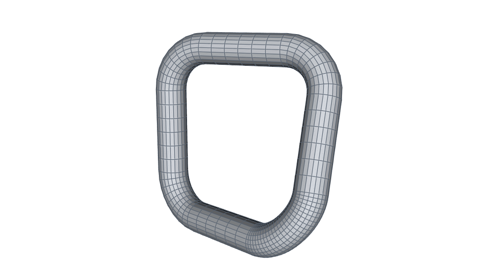 </p>

`Assembly.close` joins two existing open interfaces.  The closure follows
a smooth curve, absorbs any roll mismatch modulo the cross-section symmetry,
and gives an assembly with no open ends (DESIGN.md §8).

```bash
python3 -m hexmesh.examples.fittings.loop
```

| Fittings | Volumes | Cells | min SICN | mean SICN | min SJ (where) | max aspect | Build |
|---|---|---|---|---|---|---|---|
| 8: Straight ×4, Bend ×3, Closure | 468 | 14 688 | 0.140 | 0.411 | 0.790 (#5 Bend) | 20.0 | 8.1 s |

- **Open ends:** 
- **Walls:** `pipe_wall_wall`
- **Interfaces:** `interface_fluid_pipe_wall`
- **Colours:** fluid blue, pipe_wall orange; walls grey.
- **Parameters:** [`Straight`](../../API.md#straightlength-n_layersnone-axial_grading10-stack_changes-twist00), [`Bend`](../../API.md#bendradius-angle-n_layersnone-roll00-axial_grading10-towardnone), [`Closure`](../../API.md#closuren_layersnone-tension10-axial_grading10)

### pipe_network

**Branched network built as a graph: a header with two side taps, each pointing a different way.**

<p>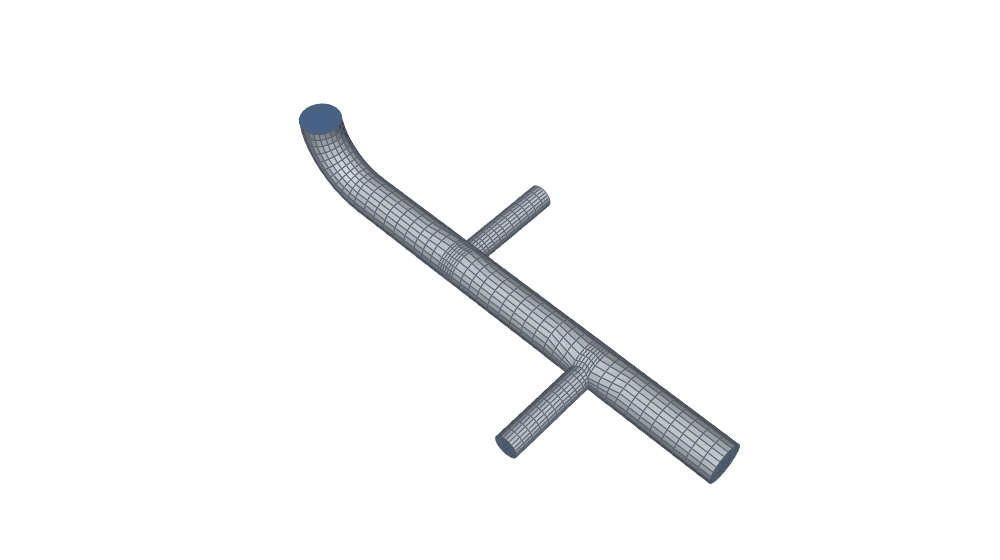 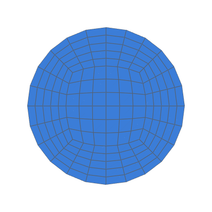</p>

`add(fitting)` continues from the tail; `add(interface, fitting)`
branches from any interface.  `toward=` gives absolute directions, so a
tee's branch can leave sideways without an extra elbow.  Fittings are
placed and validated in pure Python first, then filled in any order
(DESIGN.md A6).

```bash
python3 -m hexmesh.examples.networks.pipe_network
```

| Fittings | Volumes | Cells | min SICN | mean SICN | min SJ (where) | max aspect | Build |
|---|---|---|---|---|---|---|---|
| 8: Straight ×5, Tee ×2, Elbow | 123 | 11 496 | 0.189 | 0.432 | 0.316 (#4 Tee) | 10.4 | 6.0 s |

- **Open ends:** `water_header_end`, `water_inlet`, `water_tap0`, `water_tap1`
- **Walls:** `water_wall`
- **Colours:** water blue; walls grey.
- **Parameters:** [`Straight`](../../API.md#straightlength-n_layersnone-axial_grading10-stack_changes-twist00), [`Tee`](../../API.md#teerun_lengthnone-branch_length-branch_radius-n_run3-n_branch3-n_turn2-roll00-towardnone-angle900-offset00-branchnone-facenone-marginnone-domenone-sheetnone-n_wallnone-branch_first_cellnone-branch_mprgnone), [`Elbow`](../../API.md#elbowangle900-schedulelong-n_layers8-roll00-axial_grading10-towardnone)

### pipe_rack

**3-D pipe route mixing every sweep fitting: elbow, riser, segmented miter, spline offset, reducer and a rolled bend.**

<p>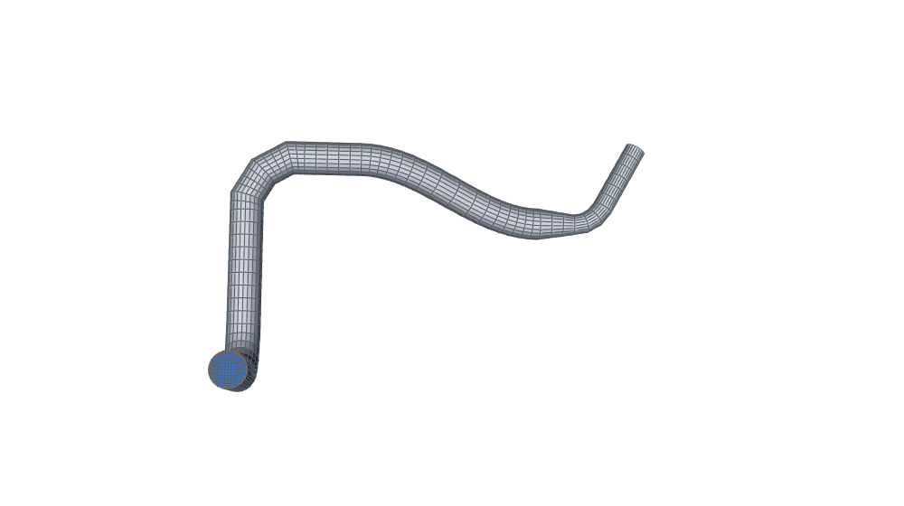 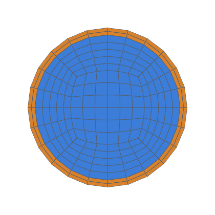</p>

Every fitting starts where the previous one ended, so the route is just a
sequence of `add` calls.  `toward=` turns a bend toward an absolute
direction, which is how a planar fitting leaves the plane.  The assembly's
`axial_cell` sets every fitting's axial layers from its length, so no
fitting gives `n_layers` (`Elbow` and `MiterBend` have their own
default, so they say `n_layers=None`).  Fittings of different kinds
share one cross-section, so they join conformally whatever their order
(DESIGN.md P1).

```bash
python3 -m hexmesh.examples.networks.pipe_rack
```

| Fittings | Volumes | Cells | min SICN | mean SICN | min SJ (where) | max aspect | Build |
|---|---|---|---|---|---|---|---|
| 9: Straight ×4, Elbow, MiterBend, SplinePipe, Reducer, Bend | 396 | 13 872 | 0.100 | 0.282 | 0.766 (#3 MiterBend) | 28.8 | 6.4 s |

- **Open ends:** `fluid_inlet`, `fluid_outlet`, `pipe_wall_inlet`, `pipe_wall_outlet`
- **Walls:** `pipe_wall_wall`
- **Interfaces:** `interface_fluid_pipe_wall`
- **Colours:** fluid blue, pipe_wall orange; walls grey.
- **Parameters:** [`Straight`](../../API.md#straightlength-n_layersnone-axial_grading10-stack_changes-twist00), [`Elbow`](../../API.md#elbowangle900-schedulelong-n_layers8-roll00-axial_grading10-towardnone), [`MiterBend`](../../API.md#miterbendradius-angle-n_cuts1-n_layers2-roll00-towardnone), [`SplinePipe`](../../API.md#splinepipepoints-n_layersnone-end_tangentnone-axial_grading10), [`Reducer`](../../API.md#reduceroutlet-length-n_layersnone-axial_grading10-profilenone-chord_tol1e-3), [`Bend`](../../API.md#bendradius-angle-n_layersnone-roll00-axial_grading10-towardnone)

### distribution_tree

**Two-level distribution tree: a header with two tees, and a second tee on one of the branches after a reducer.**

<p>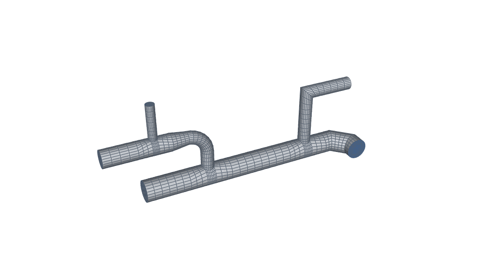 </p>

A tee's branch outlet carries a smaller spec, so every fitting after it is
sized from the branch.  To tee off a branch, first widen it with a
`Reducer`: a tee needs its branch smaller than the pipe it sits on.
The outlets are named, so each open end becomes its own patch
(`water_branch_a`, …), and the branches use different bend kinds.

```bash
python3 -m hexmesh.examples.networks.distribution_tree
```

| Fittings | Volumes | Cells | min SICN | mean SICN | min SJ (where) | max aspect | Build |
|---|---|---|---|---|---|---|---|
| 13: Straight ×6, Tee ×3, MiterBend ×2, Elbow, Reducer | 232 | 16 152 | 0.149 | 0.412 | 0.258 (#7 Tee) | 15.6 | 8.9 s |

- **Open ends:** `water_branch_a`, `water_branch_a_tap`, `water_branch_b`, `water_header_end`, `water_inlet`
- **Walls:** `water_wall`
- **Colours:** water blue; walls grey.
- **Parameters:** [`Straight`](../../API.md#straightlength-n_layersnone-axial_grading10-stack_changes-twist00), [`Tee`](../../API.md#teerun_lengthnone-branch_length-branch_radius-n_run3-n_branch3-n_turn2-roll00-towardnone-angle900-offset00-branchnone-facenone-marginnone-domenone-sheetnone-n_wallnone-branch_first_cellnone-branch_mprgnone), [`MiterBend`](../../API.md#miterbendradius-angle-n_cuts1-n_layers2-roll00-towardnone), [`Elbow`](../../API.md#elbowangle900-schedulelong-n_layers8-roll00-axial_grading10-towardnone), [`Reducer`](../../API.md#reduceroutlet-length-n_layersnone-axial_grading10-profilenone-chord_tol1e-3)

### bifurcation_tree

**Two-level bifurcation tree: one inlet, two wyes deep, four parallel outlets.**

<p>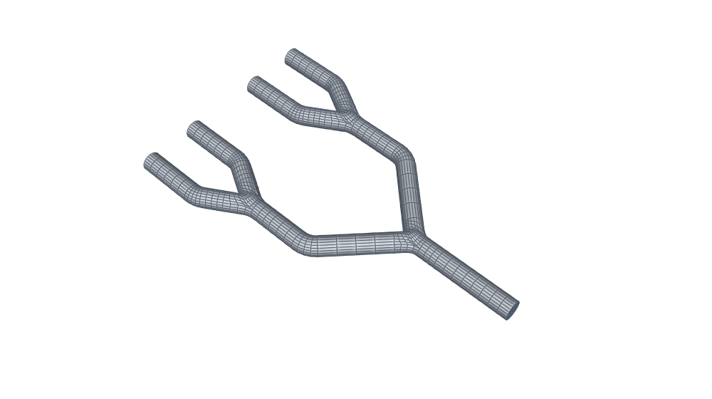 </p>

A flow-splitting manifold, or a symmetric model of a branching airway or
artery.  A 90° wye splits the inlet; each daughter bends back parallel to
the inlet and splits again in a 60° wye, whose daughters bend parallel
too.  The four outlets come out side by side, named `a` to `d`.

- A wye splits in the inlet's (normal, `right`) plane; `right` turns
  toward the inlet's `right`.  Its ports are `[left, right]`.
- A bend turns toward `up` at `roll=0` and toward `right` at
  `roll=90`, so the left daughters straighten with `roll=90` and the
  right ones with `roll=-90`.

Every junction keeps the inlet's spec, so the whole tree is one
connectivity type and meshes all-hex.  (Prototype limits of the wye:
single-layer, equal daughters, 30°–120°.)

```bash
python3 -m hexmesh.examples.networks.bifurcation_tree
```

| Fittings | Volumes | Cells | min SICN | mean SICN | min SJ (where) | max aspect | Build |
|---|---|---|---|---|---|---|---|
| 16: Straight ×7, Wye ×3, Bend ×6 | 242 | 14 472 | 0.117 | 0.470 | 0.204 (#9 Wye) | 13.1 | 6.7 s |

- **Open ends:** `fluid_a`, `fluid_b`, `fluid_c`, `fluid_d`, `fluid_inlet`
- **Walls:** `fluid_wall`
- **Colours:** fluid blue; walls grey.
- **Parameters:** [`Straight`](../../API.md#straightlength-n_layersnone-axial_grading10-stack_changes-twist00), [`Wye`](../../API.md#wyeangle-run_length-branch_length-n_runnone-n_branchnone-n_splitnone-roll00-towardnone), [`Bend`](../../API.md#bendradius-angle-n_layersnone-roll00-axial_grading10-towardnone)

### skewed_network

**Off-axis network: a drum on a skewed axis, a nozzle at 35° from vertical, and fittings at arbitrary angles and rolls.**

<p>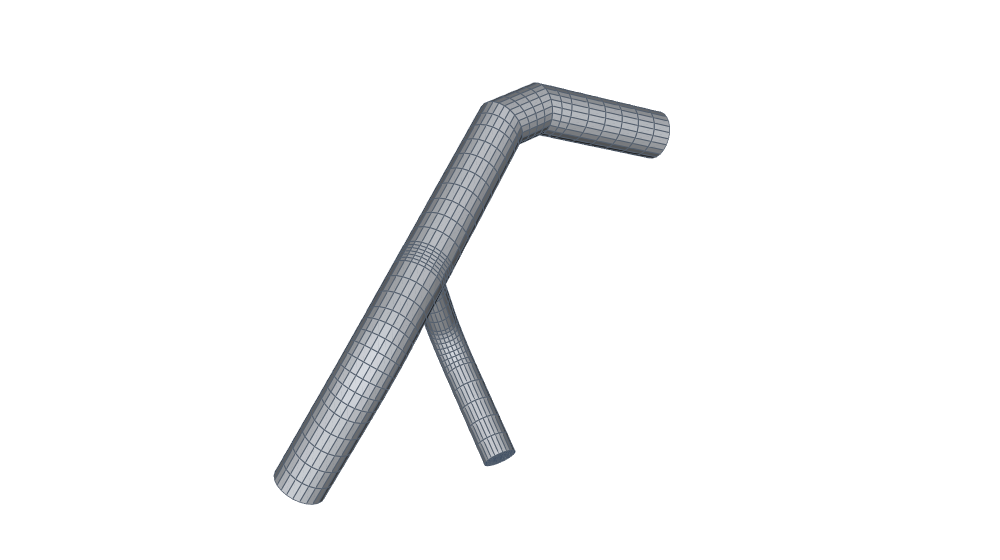 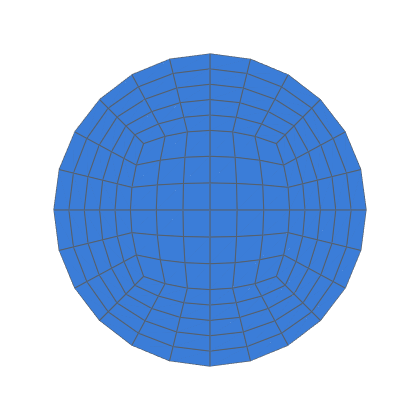</p>

Nothing in hexmesh is tied to the coordinate axes.  Every interface is a
`Frame` (position, normal, up) in absolute coordinates, so a drum axis,
a start direction, a bend angle and a `roll` can all take any value.
Here no pipe runs along x, y or z, and no bend lies in a coordinate plane.

```bash
python3 -m hexmesh.examples.networks.skewed_network
```

| Fittings | Volumes | Cells | min SICN | mean SICN | min SJ (where) | max aspect | Build |
|---|---|---|---|---|---|---|---|
| 8: Straight ×4, Bend, Tee, MiterBend, Elbow | 164 | 9 492 | 0.150 | 0.412 | 0.331 (#2 Tee) | 15.0 | 5.8 s |

- **Open ends:** `water_D201_N1`, `water_branch`, `water_outlet`
- **Walls:** `water_wall`
- **Colours:** water blue; walls grey.
- **Parameters:** [`Straight`](../../API.md#straightlength-n_layersnone-axial_grading10-stack_changes-twist00), [`Bend`](../../API.md#bendradius-angle-n_layersnone-roll00-axial_grading10-towardnone), [`Tee`](../../API.md#teerun_lengthnone-branch_length-branch_radius-n_run3-n_branch3-n_turn2-roll00-towardnone-angle900-offset00-branchnone-facenone-marginnone-domenone-sheetnone-n_wallnone-branch_first_cellnone-branch_mprgnone), [`MiterBend`](../../API.md#miterbendradius-angle-n_cuts1-n_layers2-roll00-towardnone), [`Elbow`](../../API.md#elbowangle900-schedulelong-n_layers8-roll00-axial_grading10-towardnone)

---

Generated 2026-11-12 from hexmesh e19c844 + uncommitted changes, gmsh 4.12.1, Python 3.12.3, 8 CPUs, 1 job(s).
