# Validation cases

Meshes from hexmesh solved with OpenFOAM and compared with a reference (decision 0012); each case is judged by grid convergence against gates set in advance (decision 0015).  Cases are grouped by their reference: V1 exact solutions (code verification), V2 high-fidelity simulations, V3 experiments, V4 correlations and standards.

Each case lives in `validation/<case>/`: `case.json` gives its category, references, tags, status and gates; `README.md` describes it; `RESULTS.md` holds the measurements; an optional `figure.png` is shown here.

## V1: exact solution (code verification)

### FEniCSx: second-order export checked end to end

**Status:** accepted (task 0077).  **Reference:** manufactured: $u_m = \sin(a x + 0.3)\,\sin(b y + 0.7)\,\sin(c z + 1.1)$, $-\nabla^2 u = -\nabla^2 u_m$, wall flux with the exact wall's normal.  **Last run:** 2026-11-11, hexmesh 5952340.

Tags: `conduction`, `section:circle`, `straight`, `bend`, `tee`, `projection`, `FEniCSx dolfinx:v0.11.0 (docker)`.

Gates: L2 order of Q2 on the Hex27 mesh, Dirichlet and Neumann, every pair of levels: >= 2.7 on straight, bend and tee.

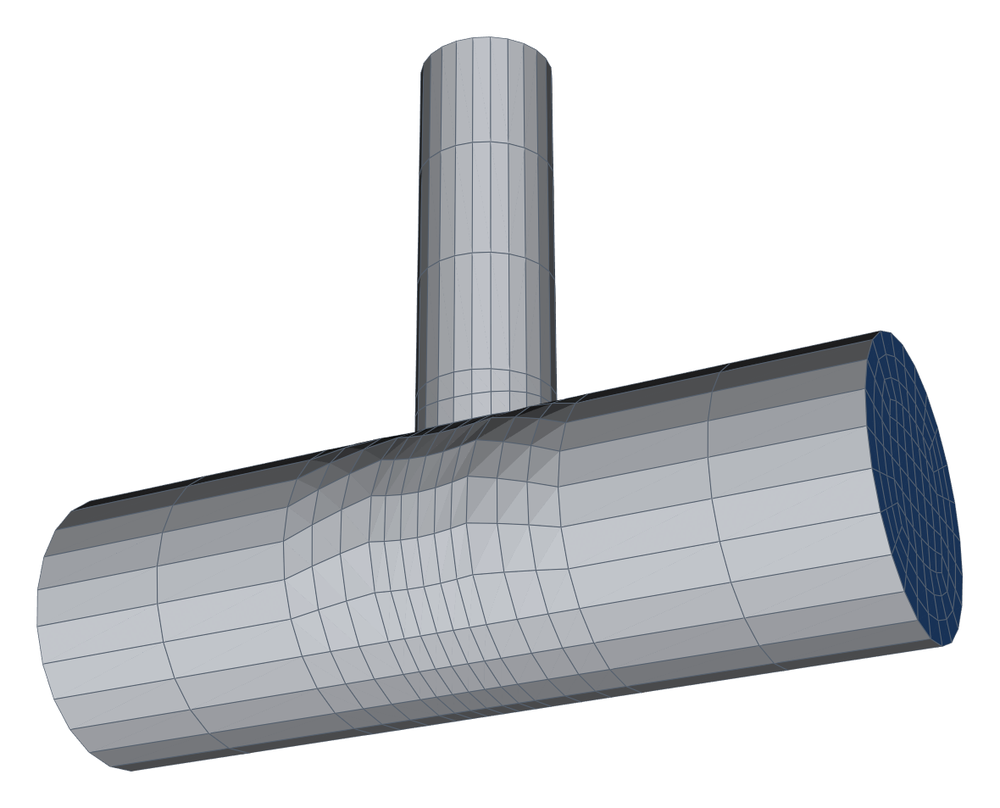 

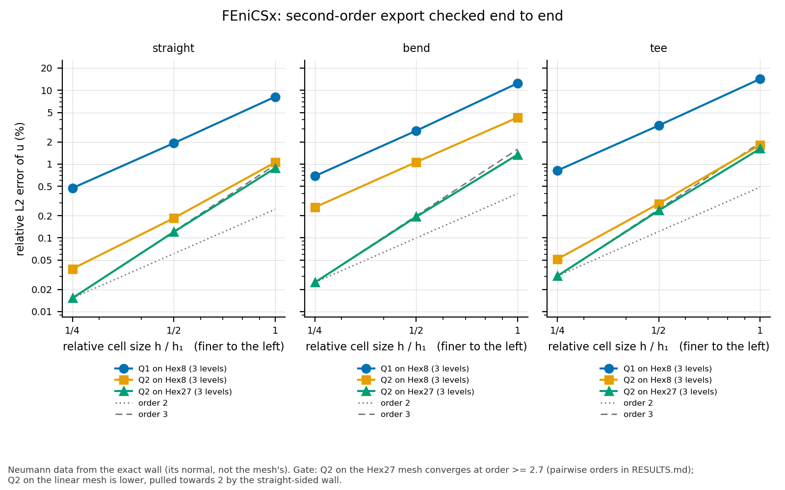

Case: `validation/fenicsx_second_order/`: [README.md](../../validation/fenicsx_second_order/README.md), [RESULTS.md](../../validation/fenicsx_second_order/RESULTS.md), [case.json](../../validation/fenicsx_second_order/case.json).

### Heated multi-layer pipe with laminar flow (full CHT)

**Status:** accepted (task 0035).  **Reference:** exact: fully developed $\mathrm{Nu} = 48/11$ (uniform flux), radial conduction through the shells.  **Last run:** 2026-10-31, hexmesh d1baada+local.

Tags: `laminar`, `flow`, `cht`, `section:circle`, `layers`, `straight`, `OpenFOAM v2406 (docker)`.

Gates: checkMesh: Mesh OK per region, every level; energy balance: within 0.1 % at every level; extrapolated $\mathrm{Nu}$: within 1 % of $48/11$; extrapolated solid $\Delta T$s: within 0.5 %.

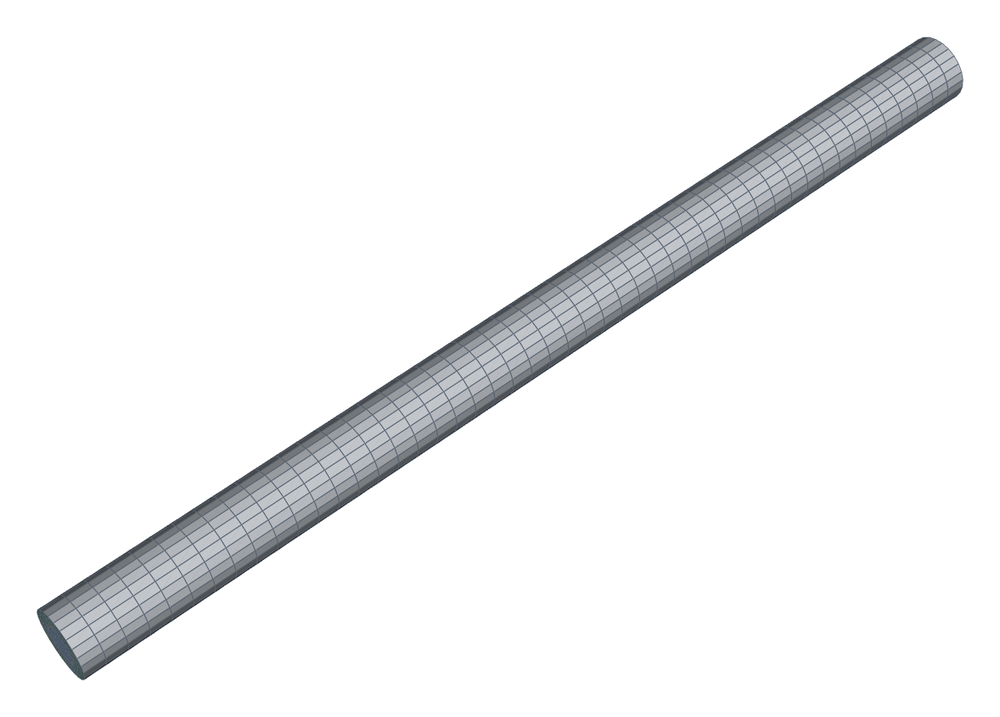 

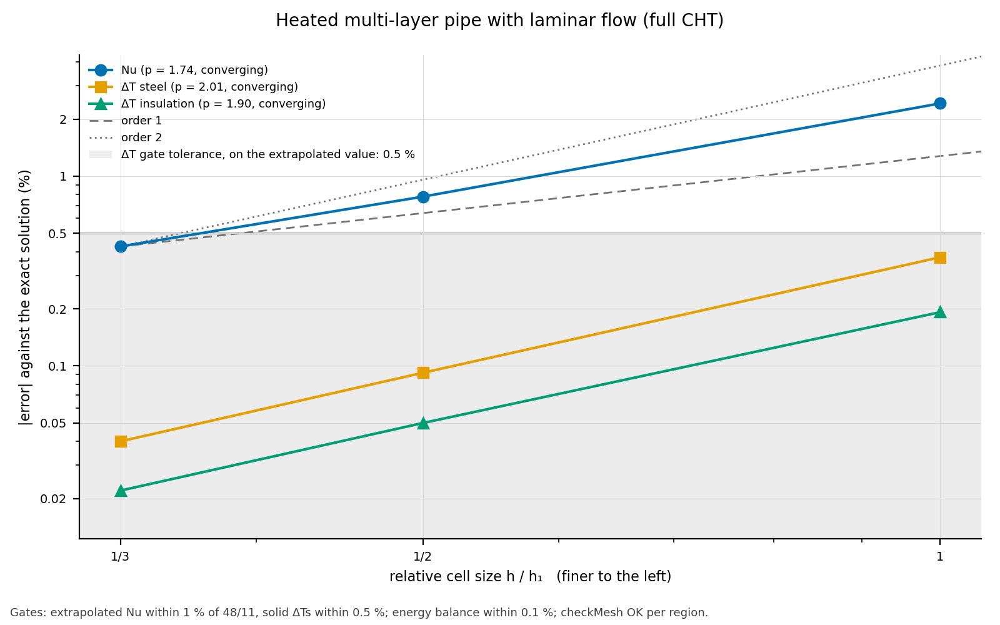

Case: `validation/heated_pipe/`: [README.md](../../validation/heated_pipe/README.md), [RESULTS.md](../../validation/heated_pipe/RESULTS.md), [case.json](../../validation/heated_pipe/case.json).

### Solid rod with uniform heat generation

**Status:** accepted (task 0033).  **Reference:** exact: $T(r) = T_w + \dfrac{S_u\,(R^2 - r^2)}{4\,D_T}$.  **Last run:** 2026-11-02, hexmesh e54faae.

Tags: `conduction`, `section:circle`, `straight`, `OpenFOAM v1912 (native)`.

Gates: extrapolated centre excess $\Delta T_0$: within 0.1 % of exact.

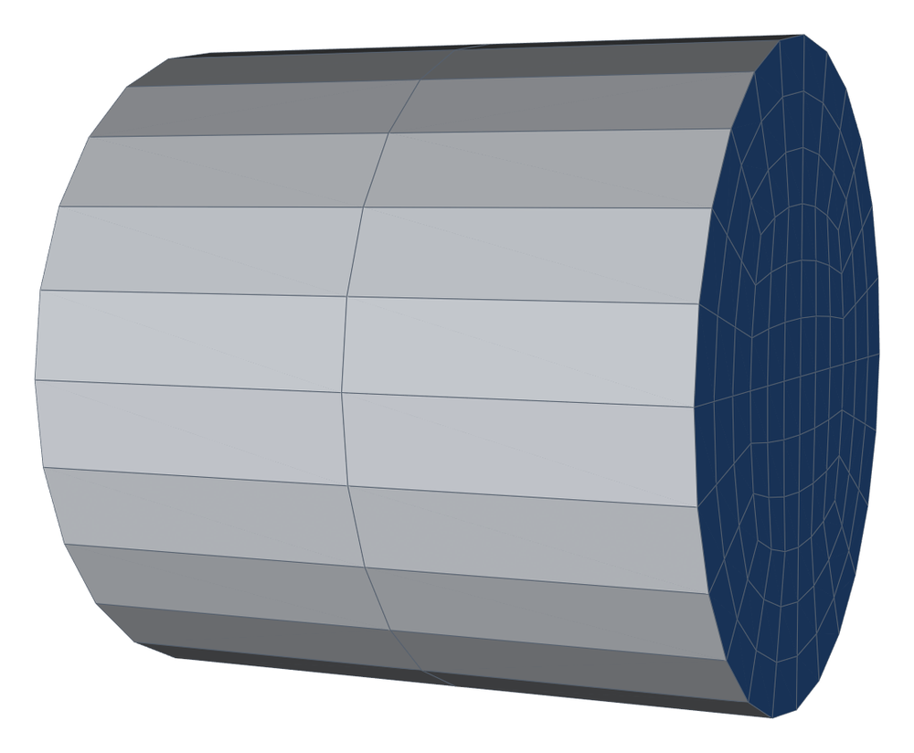 

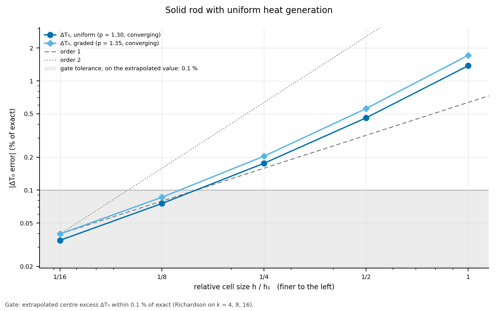

Case: `validation/heated_rod/`: [README.md](../../validation/heated_rod/README.md), [RESULTS.md](../../validation/heated_rod/RESULTS.md), [case.json](../../validation/heated_rod/case.json).

### Conduction through a heated multi-layer cylinder

**Status:** accepted (task 0034).  **Reference:** exact: piecewise radial conduction through rod, steel and insulation.  **Last run:** 2026-10-28, hexmesh 91c897a.

Tags: `conduction`, `section:circle`, `layers`, `straight`, `OpenFOAM v1912 (native)`.

Gates: checkMesh: Mesh OK, every region, every level; energy balance through every interface and the outer wall: $\le 10^{-8}$ (relative; measured $5 \times 10^{-12}$ to $1.2 \times 10^{-9}$); extrapolated $T_0$, $T(r_1)$, $T(r_2)$: within 0.1 % of exact; L2 order per region: $2 \pm 0.2$.

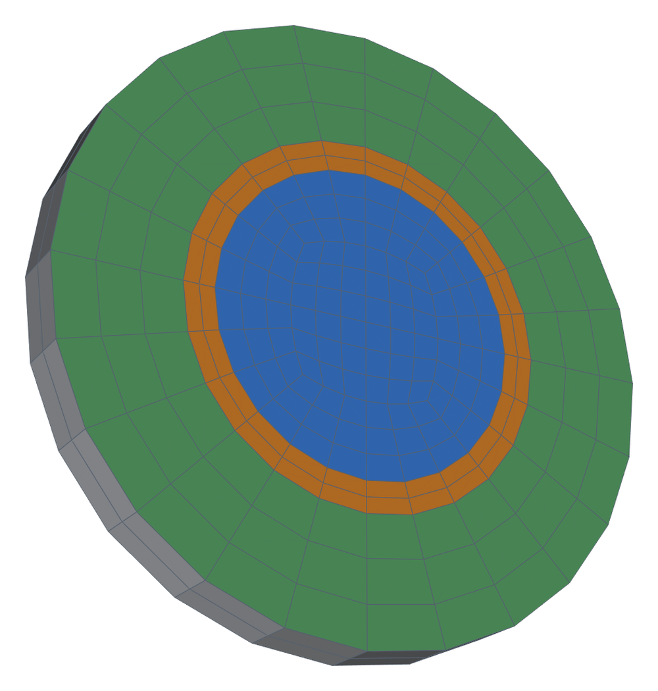 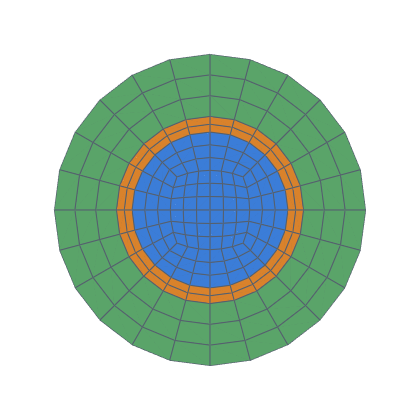

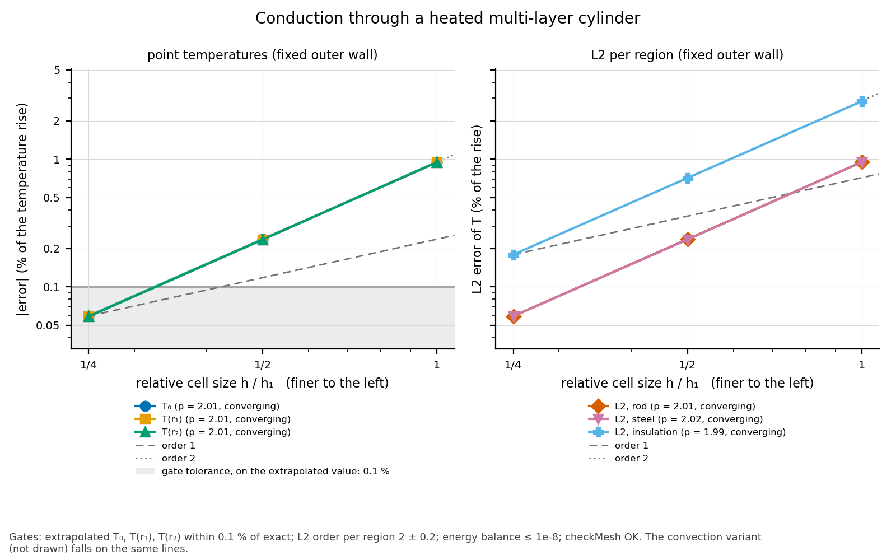

Case: `validation/layered_conduction/`: [README.md](../../validation/layered_conduction/README.md), [RESULTS.md](../../validation/layered_conduction/RESULTS.md), [case.json](../../validation/layered_conduction/case.json).

### Manufactured solutions for conduction on every fitting

**Status:** accepted (task 0074).  **Reference:** manufactured: $T_m = \sin(a x + 0.3)\,\sin(b y + 0.7)\,\sin(c z + 1.1)$, source $S = (a^2 + b^2 + c^2)\,T_m$.  **Last run:** 2026-11-09, hexmesh b3fbf76.

Tags: `conduction`, `section:circle`, `section:rect`, `layers`, `straight`, `bend`, `miter`, `spline`, `profiled-reducer`, `transition`, `tee`, `duct-tap`, `wye`, `stack-changes`, `projection`, `OpenFOAM v2406 (docker)`.

Gates: volume-weighted L2 error of T, every case: falls with refinement (orders reported, not gated).

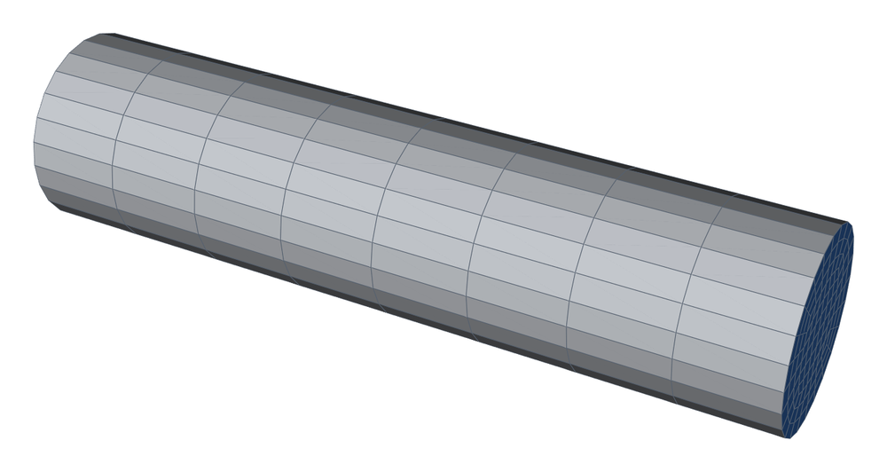 

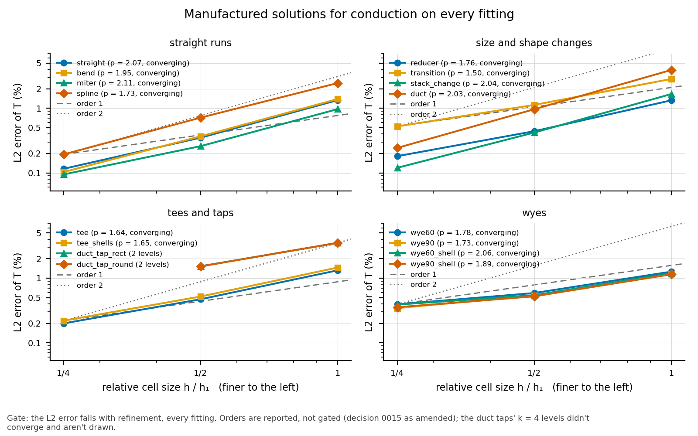

Case: `validation/mms/`: [README.md](../../validation/mms/README.md), [RESULTS.md](../../validation/mms/RESULTS.md), [case.json](../../validation/mms/case.json).

### Laminar Hagen–Poiseuille pipe

**Status:** accepted (task 0020).  **Reference:** exact: $u = 2\bar{U}\left(1 - r^2/R^2\right)$, $\Delta p = 32\,\mu \bar{U} L / D^2$.  **Last run:** 2026-10-26, hexmesh 4ba565b.

Tags: `laminar`, `flow`, `section:circle`, `straight`, `OpenFOAM v1912 (native)`.

Gates: extrapolated $\Delta p$ and $u_\mathrm{max}$: within 0.1 % of exact; fine-level |error|: < 1 %; error over levels: decreases monotonically; $u_\mathrm{max}$ observed order: $\ge 1.5$.

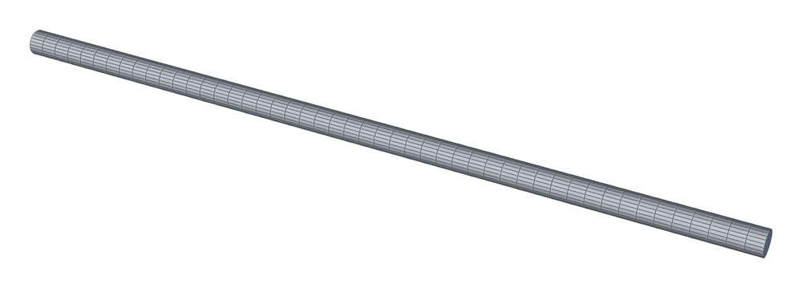 

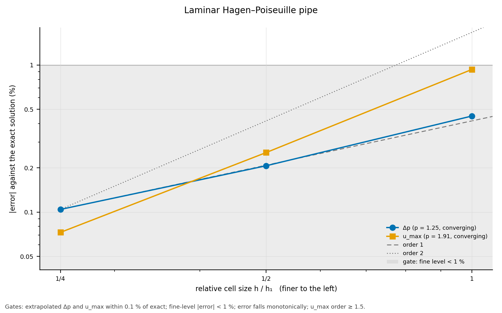

Case: `validation/poiseuille/`: [README.md](../../validation/poiseuille/README.md), [RESULTS.md](../../validation/poiseuille/RESULTS.md), [case.json](../../validation/poiseuille/case.json).

### Laminar flow in rectangular ducts (aspect ratios 1, 2, 4)

**Status:** accepted (task 0071).  **Reference:** exact: Fourier series for fully developed flow in a rectangle; $f\,\mathrm{Re}$ checked against Shah & London (1978).  **Last run:** 2026-11-04, hexmesh 61d760c.

Tags: `laminar`, `flow`, `section:rect`, `straight`, `OpenFOAM v2406 (docker)`.

Gates: Cartesian control: extrapolated $f\,\mathrm{Re}$ and $u_c$, every aspect ratio: within 0.1 % of exact; Cartesian control: finest-level |error|: < 1 %; Cartesian control: observed order: $2 \pm 0.2$, status converging (else the setup is suspect); hexmesh H section (the accepted hexmesh result, task 0084): extrapolated $f\,\mathrm{Re}$ and $u_c$, every aspect ratio: within 0.1 % of exact; hexmesh H section: finest-level |error|: < 1 %; hexmesh H section: observed order: $2 \pm 0.2$, status converging; hexmesh O-H levels: reported against the control, not gated (decision 0015 amendment 2).

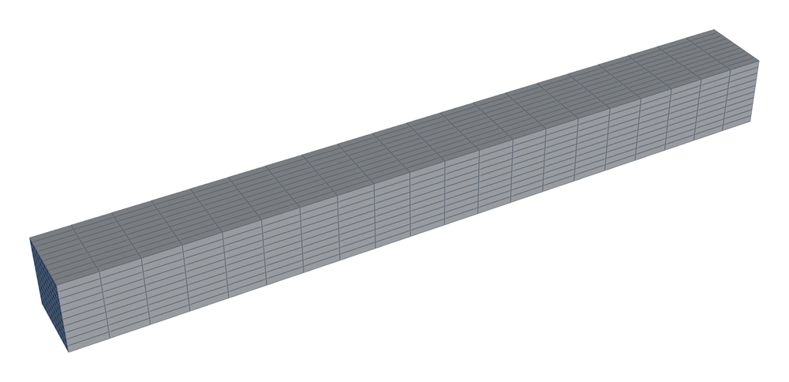 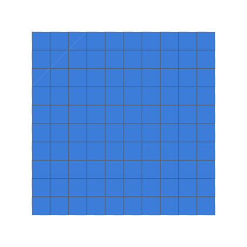

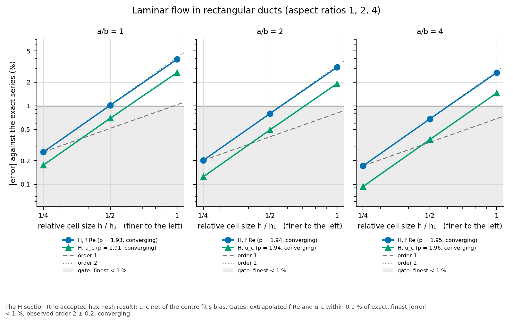

Case: `validation/rect_duct/`: [README.md](../../validation/rect_duct/README.md), [RESULTS.md](../../validation/rect_duct/RESULTS.md), [case.json](../../validation/rect_duct/case.json).

### Womersley flow (pulsatile laminar pipe flow)

**Status:** accepted (task 0067).  **Reference:** exact: Womersley profile and pressure gradient, the inlet of `varghese_and_frankel_etal_2007b` eq. 2.1 ($\alpha = 7.5$, $A = 0.667$, $\mathrm{Re} = 600$); inlet waveform and phases $t/T = 0.09 + k/6$ [`varghese_and_frankel_etal_2007b`] (secondary).  **Last run:** 2026-10-30, hexmesh 75e9f27.

Tags: `laminar`, `transient`, `flow`, `section:circle`, `straight`, `OpenFOAM v2406 (docker)`.

Gates: max profile error, finest level, every phase: $\le 1$ % of $u_c$; extrapolated within 0.3 %; axial pressure gradient, finest level: amplitude within 1 %, phase within 2°; time-step study: time error below space error at the finest level (or the split reported); periodicity: phase values change < 0.1 % between periods; periods reported.

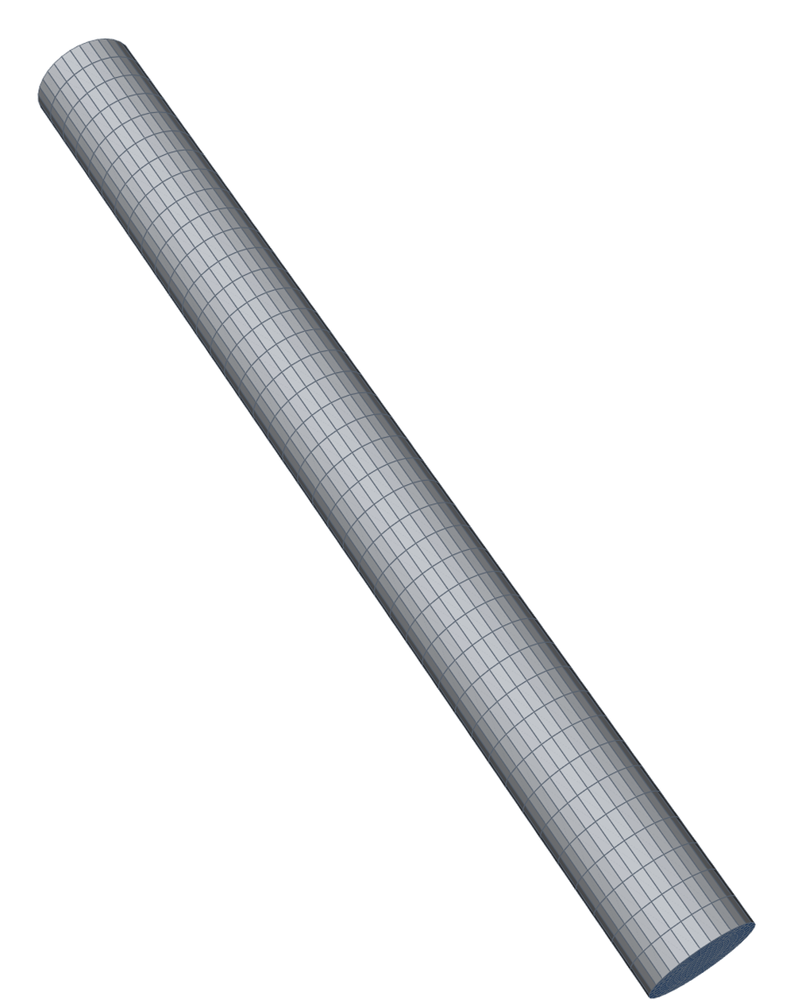 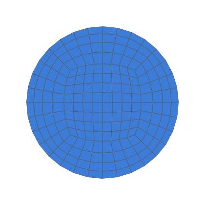

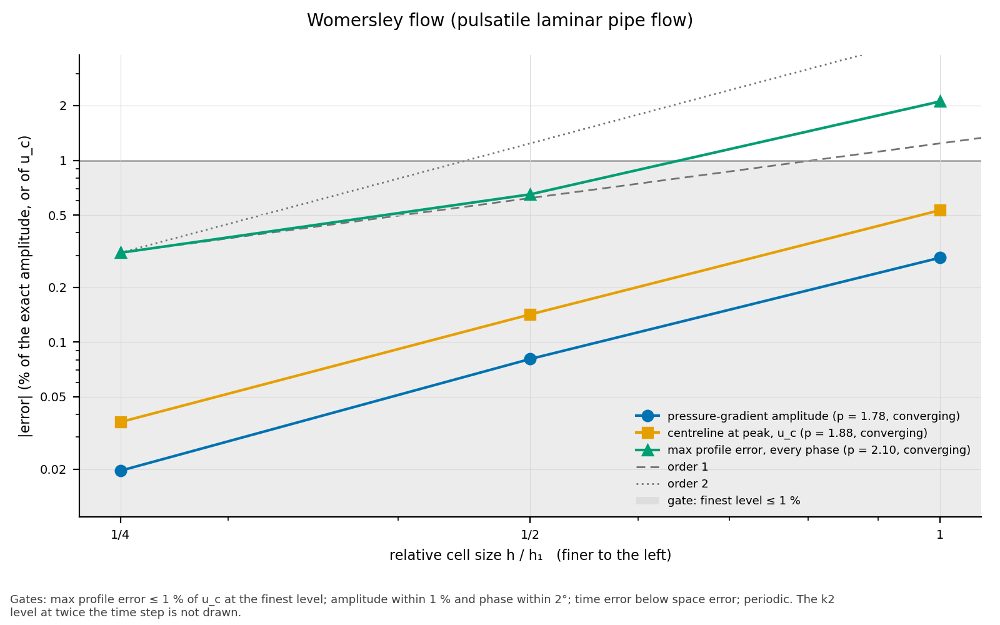

Case: `validation/womersley/`: [README.md](../../validation/womersley/README.md), [RESULTS.md](../../validation/womersley/RESULTS.md), [case.json](../../validation/womersley/case.json).

## V2: high-fidelity simulation

### Smooth cosine constriction, Re = 500

**Status:** accepted (task 0032).  **Reference:** DNS, Part 1: centreline velocity and reattachment (Purdue CFD Lab database) [`varghese_and_frankel_etal_2007`].  **Last run:** 2026-10-29, hexmesh a92840c.

Tags: `laminar`, `flow`, `section:circle`, `straight`, `profiled-reducer`, `OpenFOAM v1912 (native)`.

Gates: reattachment, by $u(0.48\,D) = 0$ and by wall shear stress: within 5 % of the DNS's $11.03\,D$; centreline velocity, $x/D = -2 \ldots 15$: within 2 % of the DNS peak.

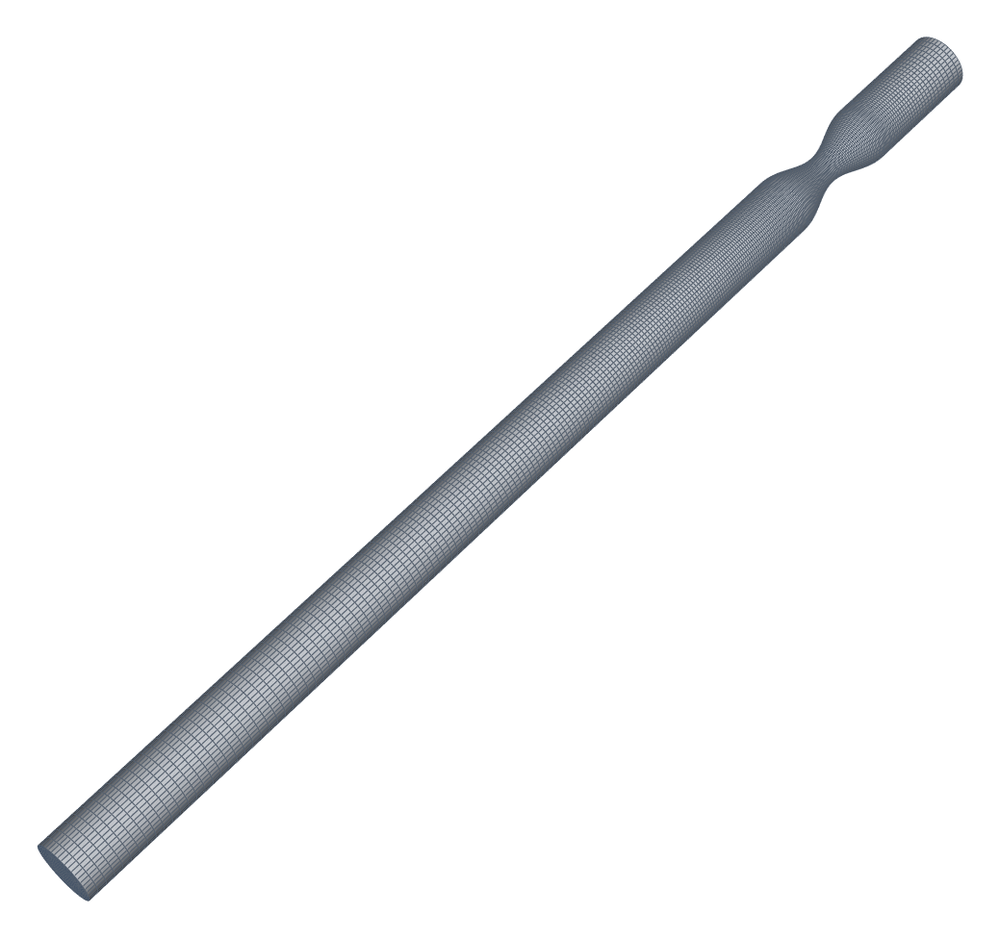 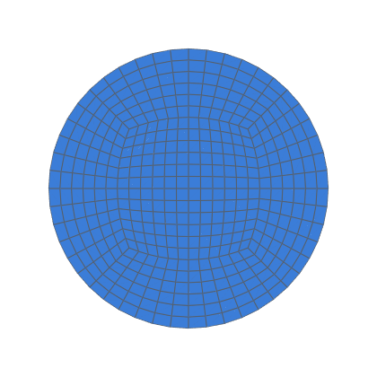

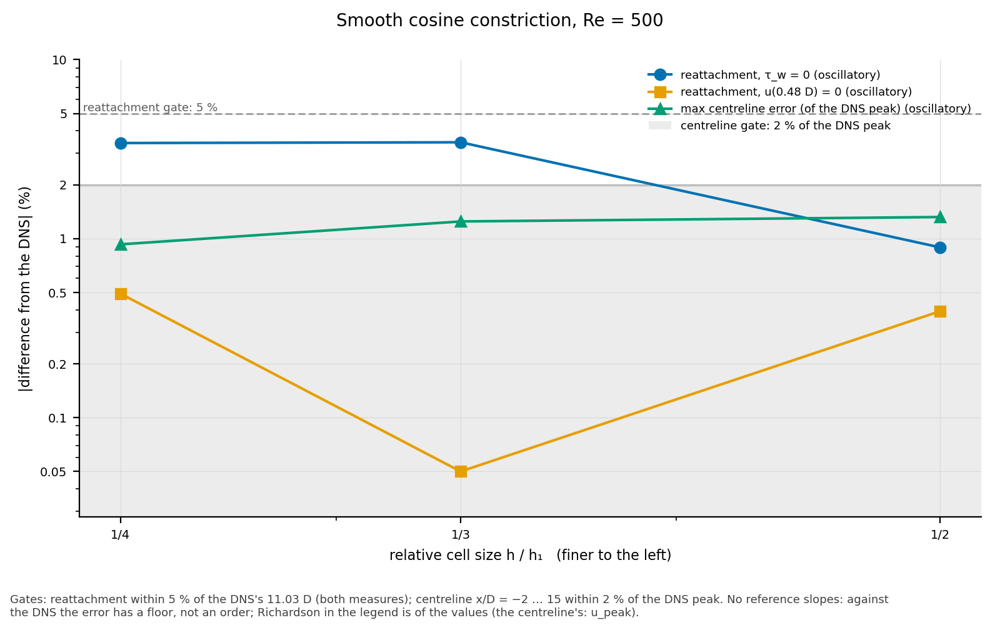

Case: `validation/stenosis/`: [README.md](../../validation/stenosis/README.md), [RESULTS.md](../../validation/stenosis/RESULTS.md), [case.json](../../validation/stenosis/case.json).

### Pulsatile flow through the cosine constriction (Varghese et al., Part 2)

**Status:** accepted (task 0068).  **Reference:** DNS, Part 2: axial velocity profiles at six phases, x/D -2 ... 15 (Purdue CFD Lab database, Axi_puls) [`varghese_and_frankel_etal_2007b`].  **Last run:** 2026-10-31, hexmesh 2ca8836.

Tags: `laminar`, `transient`, `flow`, `section:circle`, `straight`, `profiled-reducer`, `OpenFOAM v2406 (docker)`.

Gates: throat centreline velocity at peak flow (p2, $x = 0$): within 5 % of the DNS, and above $3.65\,u_c$; flow features of the paper's §3.1 (jet in acceleration, post-stenotic separation in late deceleration, upstream separation at $-1\,D$ and $-2\,D$, no permanent recirculation, laminar and axisymmetric): present, as in the DNS.

**Note:** Inlet: eq. 2.1 of the paper (Womersley), as stated.  The database's own x = -2D profiles differ from it by up to 0.145 u_c at the phases their flow rates give, so the station-by-station profile RMS is reported, not gated (design answer to task 0068's Q1-Q2).

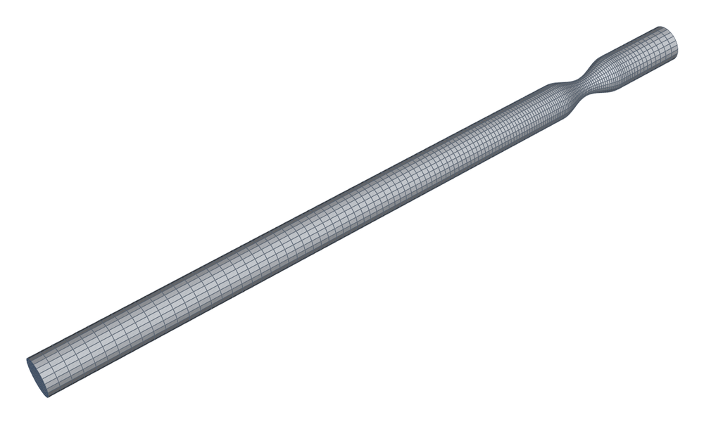 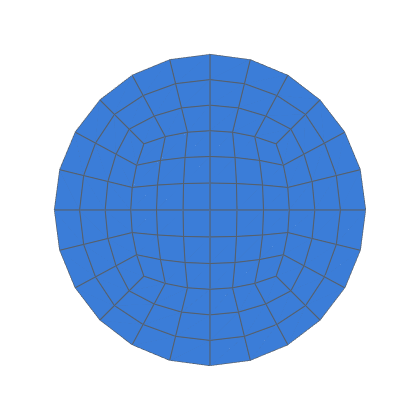

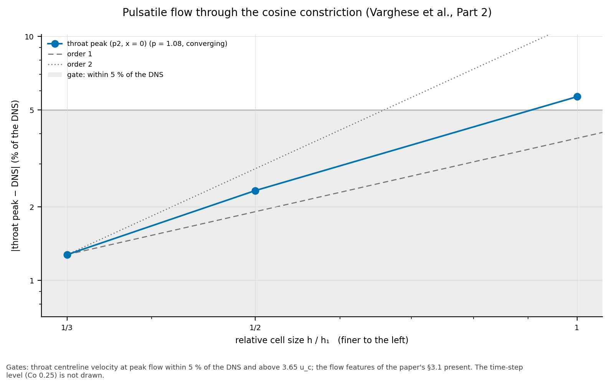

Case: `validation/stenosis_pulsatile/`: [README.md](../../validation/stenosis_pulsatile/README.md), [RESULTS.md](../../validation/stenosis_pulsatile/RESULTS.md), [case.json](../../validation/stenosis_pulsatile/case.json).

### Fully developed turbulent pipe flow, k-ω SST

**Status:** accepted (task 0049).  **Reference:** el_khoury_and_schlatter_etal_2013 (data: el_khoury_and_schlatter_etal_2013_data); mckeon_and_zagarola_etal_2005 (secondary).  **Last run:** 2026-11-06, hexmesh 42357ca+local.

Tags: `rans:kOmegaSST`, `flow`, `section:circle`, `straight`, `OpenFOAM v2406 (docker)`.

Gates: friction factor $f$, wall-resolved, finest level (Re_b 19 000, 37 700, 10⁵): within 3 % of McKeon et al. eq. 3.5; friction factor $f$, Spalding wall functions (`nutUSpaldingWallFunction`), Re_b 19 000, 37 700, 10⁵: within 5 % of McKeon et al. eq. 3.5; mesh convergence of $f$ and $U_c/U_b$ (wall-resolved, Re_τ 550, k = 1, 2, 4): Richardson status converging; order, extrapolation and GCI reported; reported, not gated: $U_c/U_b$ against the DNS (3 % comparison, missed: k-ω SST's wake); u⁺(y⁺) against the DNS; the `nutkWallFunction` and `nutUWallFunction` variants: reported.

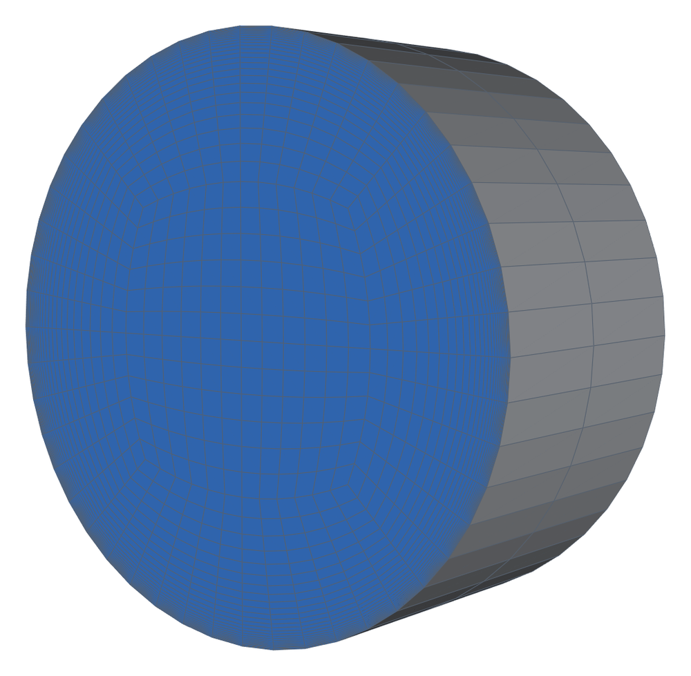 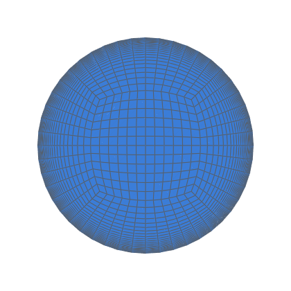

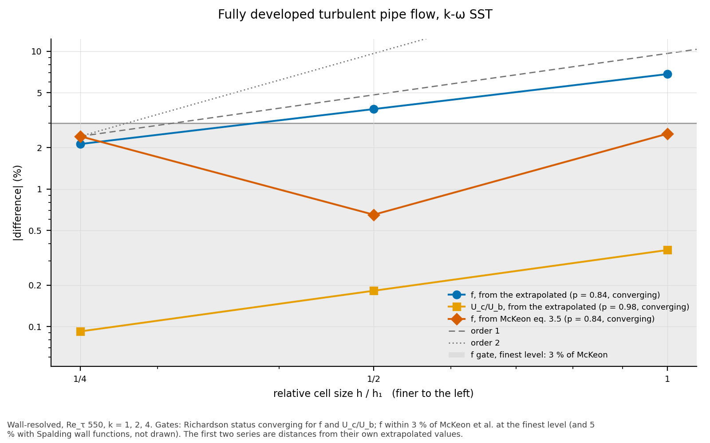

Case: `validation/turbulent_pipe/`: [README.md](../../validation/turbulent_pipe/README.md), [RESULTS.md](../../validation/turbulent_pipe/RESULTS.md), [case.json](../../validation/turbulent_pipe/case.json).

## V3: experiment

### Laminar flow in a helical pipe (the SIET coil)

**Status:** in progress (task 0075).  **Reference:** deamicis_and_cammi_etal_2014 (the SIET coil; Ito (1959) as their eq. 2; Fig. 12 digitised in data/).  **Last run:** 2026-11-08, hexmesh c8c7c76+local.

Tags: `laminar`, `flow`, `section:circle`, `straight`, `spline`, `OpenFOAM v2406 (docker)`.

Gates: the spline's distance from the exact helix (32 points per turn): within 0.1 % of $d$; Darcy friction factor $f$, finest level, at Re 1800, 2400 and 3000: within 5 % of Ito (1959); mesh convergence of $f$ at each Re (nang 12, 16, 24): Richardson status converging; GCI reported; reported, not gated: the digitised measured points (Fig. 12); f per pair of consecutive turns: reported.

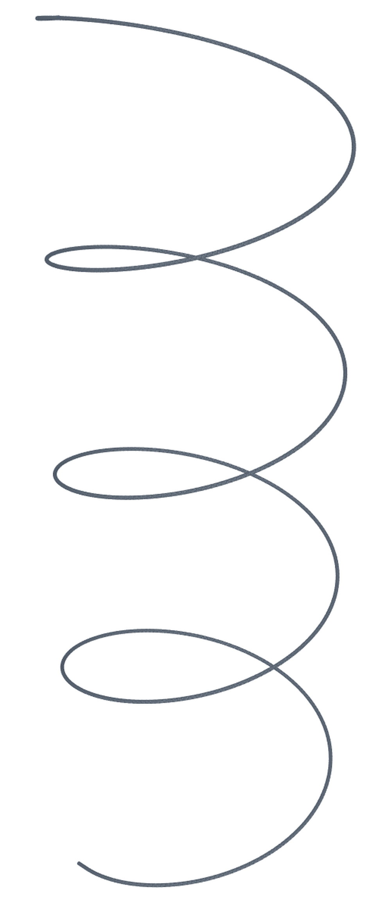 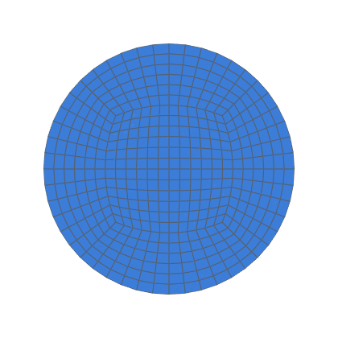

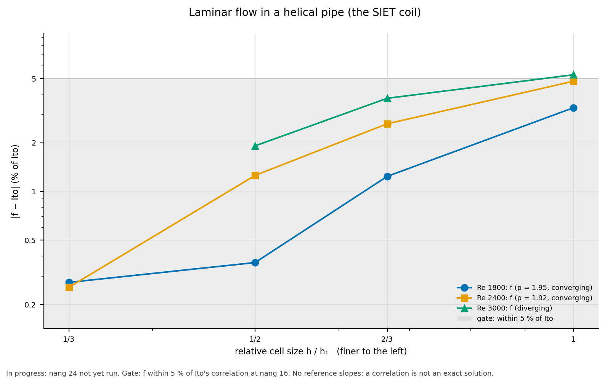

Case: `validation/helical_pipe/`: [README.md](../../validation/helical_pipe/README.md), [RESULTS.md](../../validation/helical_pipe/RESULTS.md), [case.json](../../validation/helical_pipe/case.json).

### Laminar flow in a 90° square-duct bend, Re 790

**Status:** accepted (task 0072).  **Reference:** taylor_and_whitelaw_etal_1981 (NASA CR-3367, Table I).  **Last run:** 2026-11-06, hexmesh 42357ca+local.

Tags: `laminar`, `flow`, `section:rect`, `straight`, `bend`, `OpenFOAM v2406 (docker)`.

Gates: matched inlet (a plug 12.6 $D_h$ upstream, the length fitted to the X_H = −0.50 profile alone): peak $U/V_c$ on the symmetry plane at θ = 60° and 77.5°, k = 1, 2, 3: Richardson status converging; GCI reported; matched inlet, finest level: the peak's gapwise position on the symmetry plane at every station from X_H = −0.25 on (its outward shift through the bend): at the measured gapwise point; reported, not gated: X_H = −0.50 (the calibration station); $U/V_c$ RMS difference per station (5 % comparison, floor: the upstream mismatch); the rig inlet (plug at 7.5 $D_h$) as a sensitivity run: reported.

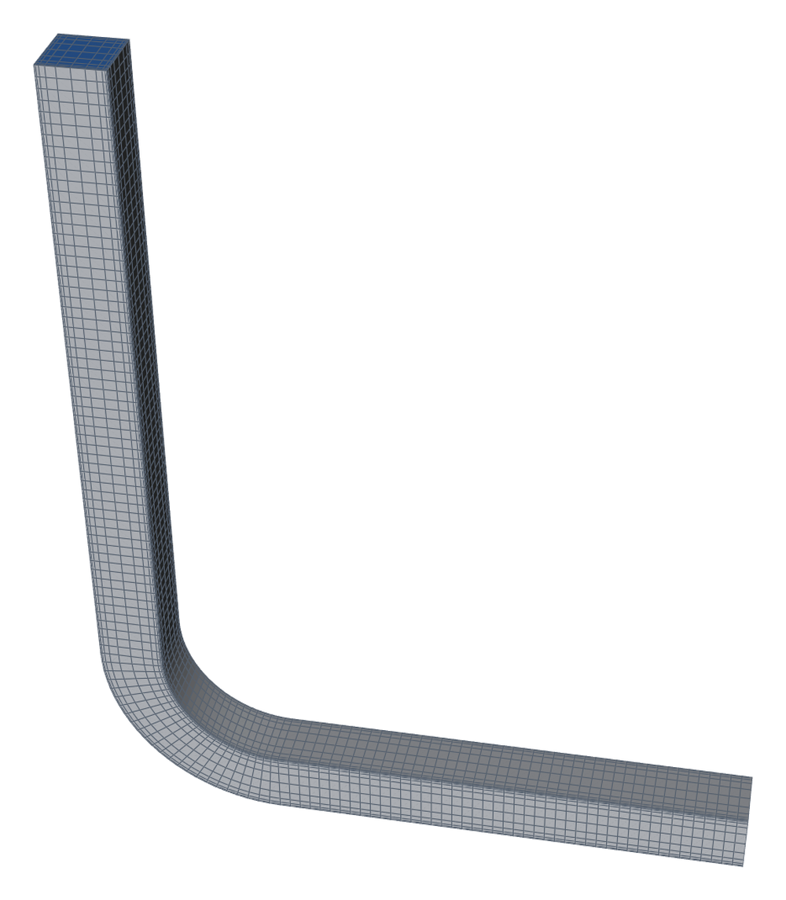 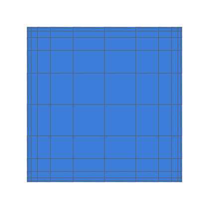

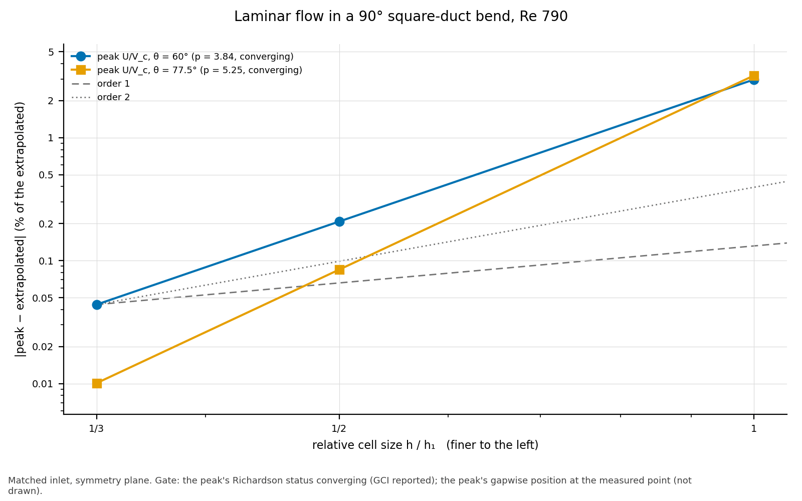

Case: `validation/square_bend/`: [README.md](../../validation/square_bend/README.md), [RESULTS.md](../../validation/square_bend/RESULTS.md), [case.json](../../validation/square_bend/case.json).

Planned:

| Task | Status |
|---|---|
| [0050: Validation: turbulent flow in a 90° bend (Sudo et al. 1998)](../tasks/0050-validation-turbulent-bend.md) | ready (after 0049) |
| [0079: Validation (V3): a Taylor bubble rising in stagnant liquid (VOF)](../tasks/0079-validation-taylor-bubble.md) | ready (on the v2406 runner) |

## V4: correlation or standard

_No cases yet._

## Coverage

Which hexmesh features each case exercises (decision 0012's list, extended by decision 0050). Marks: ● accepted, ◐ in progress, ○ planned, ✗ rejected; planned cases are named by task.  Rows marked *(none)* have no validation case, existing or planned.

| Feature | fenicsx_second_order V1 | heated_pipe V1 | heated_rod V1 | helical_pipe V3 | layered_conduction V1 | mms V1 | poiseuille V1 | rect_duct V1 | square_bend V3 | stenosis V2 | stenosis_pulsatile V2 | turbulent_pipe V2 | womersley V1 | 0050 V3 | 0079 V3 |
|---|---|---|---|---|---|---|---|---|---|---|---|---|---|---|---|
| `section:circle` | ● | ● | ● | ◐ | ● | ● | ● |  |  | ● | ● | ● | ● | ○ | ○ |
| `section:rect` |  |  |  |  |  | ● |  | ● | ● |  |  |  |  |  |  |
| `layers` |  | ● |  |  | ● | ● |  |  |  |  |  |  |  |  |  |
| `straight` | ● | ● | ● | ◐ | ● | ● | ● | ● | ● | ● | ● | ● | ● | ○ | ○ |
| `bend` | ● |  |  |  |  | ● |  |  | ● |  |  |  |  | ○ |  |
| `elbow` (none) |  |  |  |  |  |  |  |  |  |  |  |  |  |  |  |
| `miter` |  |  |  |  |  | ● |  |  |  |  |  |  |  |  |  |
| `spline` |  |  |  | ◐ |  | ● |  |  |  |  |  |  |  |  |  |
| `reducer` (none) |  |  |  |  |  |  |  |  |  |  |  |  |  |  |  |
| `profiled-reducer` |  |  |  |  |  | ● |  |  |  | ● | ● |  |  |  |  |
| `transition` |  |  |  |  |  | ● |  |  |  |  |  |  |  |  |  |
| `switch` (none) |  |  |  |  |  |  |  |  |  |  |  |  |  |  |  |
| `tee` | ● |  |  |  |  | ● |  |  |  |  |  |  |  |  |  |
| `duct-tap` |  |  |  |  |  | ● |  |  |  |  |  |  |  |  |  |
| `wye` |  |  |  |  |  | ● |  |  |  |  |  |  |  |  |  |
| `closure` (none) |  |  |  |  |  |  |  |  |  |  |  |  |  |  |  |
| `stack-changes` |  |  |  |  |  | ● |  |  |  |  |  |  |  |  |  |
| `projection` | ● |  |  |  |  | ● |  |  |  |  |  |  |  |  |  |

---

Generated 2026-11-12 from hexmesh e19c844 + uncommitted changes, gmsh 4.12.1, Python 3.12.3, 8 CPUs, 1 job(s).
