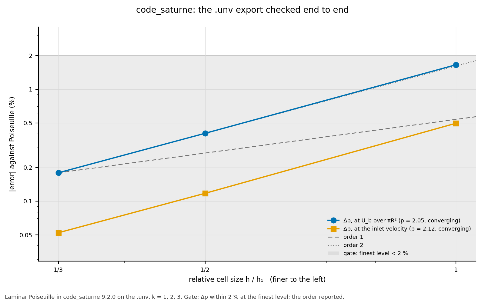
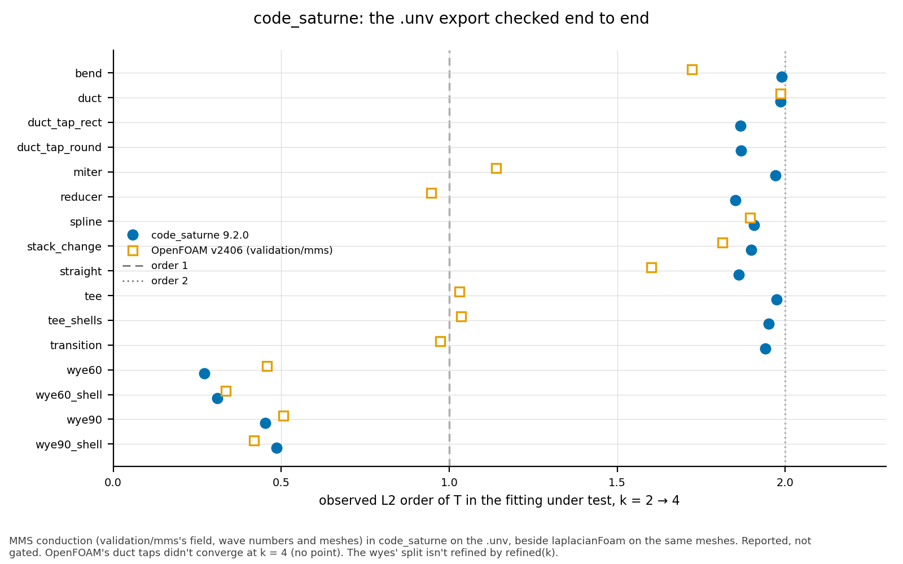

# Results: code_saturne, the .unv export checked end to end

**Status: passes** (an export check, decision 0057; task 0181).
code_saturne 9.2.0 reads every cell and group of hexmesh's `.unv` (the
tee, the pipe and the 16 MMS fittings at every level), laminar
Poiseuille's Δp converges at order 2.05 to within +0.18 % at k = 3
(extrapolated: +0.006 %), and MMS conduction converges at order 1.85 to
2.0 on every fitting but the wyes.  Run on 2026-11-19 and 20 with
`simvia/code_saturne:9.2.0` (Docker, pinned by digest) and gmsh 4.12.1,
at hexmesh 3680ced (Poiseuille) and 56a5cf9 (MMS; the working tree carried uncommitted
validation drivers, no library change).  The numbers below are recomputed from
`results.json` by `python3 -m validation.tools.recheck
code_saturne_poiseuille`.

<!-- graphs:start -->
## Graphs

_Drawn from `results.json` by `python3 -m validation.tools.plots`; don't edit between the markers._

code_saturne's Δp error against cell size: second order to the exact value.

The manufactured solution's order in each fitting, code_saturne beside OpenFOAM: second order wherever the mesh is refined, where OpenFOAM's wall gradient drops to first.

<!-- graphs:end -->

## Import

| mesh        | cells (`cell_count()`) | preprocessor cells | hexa8 | groups |
|-------------|------------------------|--------------------|-------|---|
| equal tee   | 8 000 | 8 000 | 8 000 | `fluid` (8 000 cells); `fluid_inlet`, `fluid_main_end`, `fluid_branch_end` (192 faces each), `fluid_wall` (1 312) |
| pipe, k = 1 | 5 184 | 5 184 | 5 184 | `fluid`, `fluid_inlet`, `fluid_outlet`, `fluid_wall` |
| pipe, k = 2 | 41 472 | 41 472 | 41 472 | the same |
| pipe, k = 3 | 139 968 | 139 968 | 139 968 | the same |

The preprocessor's orientation check passes silently.  Every group's
family also carries `Group "7"`: gmsh's element colour.

## Gate: Poiseuille Δp within 2 % at the finest level

| k | cells | U_b / U_in | Δp error (U_b over πR²) | Δp error (at U_in) |
|---|---|---|---|---|
| 1 | 5 184 | 0.9886 | +1.65 % | +0.50 % |
| 2 | 41 472 | 0.9971 | +0.40 % | +0.12 % |
| 3 | 139 968 | 0.9987 | **+0.18 %** | +0.05 % |

Richardson over k = 1, 2, 3 (spacing ratios 2 and 1.5): **order 2.05**,
extrapolated error +5.8e-5, GCI 0.22 % on the fine level.  The inlet's
and outlet's mass flows agree to 1e-9 (code_saturne is cell-centred: a
uniform inlet passes exactly U·A of the meshed section).  U_b / U_in is
the polygon's area over πR².

The solver is a different code from OpenFOAM, on the same mesh as
`validation/poiseuille/`: its Δp converging at order 2 to the exact
value is the mesh arriving intact, with its geometry.

## Reported: MMS conduction on the 16 fittings

`validation/mms`'s manufactured field, wave numbers and meshes (k = 1, 2,
4), solved as a frozen-flow scalar (`src/cs_user_mms.cpp`): the
volume-weighted L2 error of T in the fitting under test.  Every level's
import passes (cells, `hexa8` and each group by name and size); the
scalar's residual is below 1e-13 at every level; 24 min for all 48 runs
on one core.

| case | cells, k = 4 | L2 in the fitting, k = 1, 2, 4 | order 1→2, 2→4 | OpenFOAM's order, same meshes |
|---|---|---|---|---|
| bend | 82 944 | 0.0125, 0.00312, 0.000785 | 2.00, 1.99 | 2.06, 1.72 |
| duct | 36 864 | 0.0391, 0.00966, 0.00244 | 2.02, 1.99 | 2.02, 1.99 |
| duct_tap_rect | 507 904 | 0.0155, 0.00452, 0.00124 | 1.78, 1.87 | not converged at k = 4 |
| duct_tap_round | 606 208 | 0.0153, 0.00442, 0.00121 | 1.79, 1.87 | not converged at k = 4 |
| miter | 110 592 | 0.00825, 0.0021, 0.000535 | 1.98, 1.97 | 1.84, 1.14 |
| reducer | 82 944 | 0.00734, 0.00223, 0.000616 | 1.72, 1.85 | 0.93, 0.95 |
| spline | 124 416 | 0.0267, 0.00785, 0.00209 | 1.77, 1.91 | 1.77, 1.90 |
| stack_change | 92 160 | 0.0171, 0.00448, 0.0012 | 1.93, 1.90 | 1.98, 1.81 |
| straight | 55 296 | 0.0141, 0.00378, 0.00104 | 1.90, 1.86 | 1.93, 1.60 |
| tee | 152 064 | 0.0115, 0.00295, 0.00075 | 1.96, 1.97 | 1.31, 1.06 |
| tee_shells | 284 160 | 0.014, 0.00367, 0.000949 | 1.93, 1.95 | 1.33, 1.07 |
| transition | 66 816 | 0.017, 0.00447, 0.00117 | 1.93, 1.94 | 0.97, 0.97 |
| wye60 | 193 536 | 0.00911, 0.00382, 0.00317 | 1.25, 0.27 | 0.81, 0.46 |
| wye60_shell | 278 016 | 0.00898, 0.00366, 0.00295 | 1.29, 0.31 | 0.79, 0.34 |
| wye90 | 221 184 | 0.00804, 0.00294, 0.00215 | 1.45, 0.45 | 0.80, 0.51 |
| wye90_shell | 317 952 | 0.008, 0.00292, 0.00209 | 1.45, 0.49 | 0.76, 0.42 |

- **code_saturne holds order 1.85–2.0 where OpenFOAM falls to about 1**
  (the miter, the reducer, the transition, the tees), on the same
  meshes.  RESEARCH §7.14 traces OpenFOAM's loss to its `fixedValue`
  wall gradient, which ignores the wall cells' non-orthogonality (task
  0109); code_saturne reconstructs the boundary flux (`b_diff_flux_rc 1`
  in its `setup.log`), and the order comes back.  The meshes don't
  limit the order there.
- **The wyes stay low in both solvers** (0.27–0.49 at 2→4): `refined(k)`
  doesn't refine a wye's `n_split` (RESEARCH §7.14), so its split region
  isn't refined; a property of the meshes, not of either solver.
- **The duct taps converge at k = 4 here** (order 1.87), where
  OpenFOAM's didn't.
- Not gated: decision 0057 gates the import; the MMS orders are
  reported, as in `validation/mms` (decision 0015 as amended).
