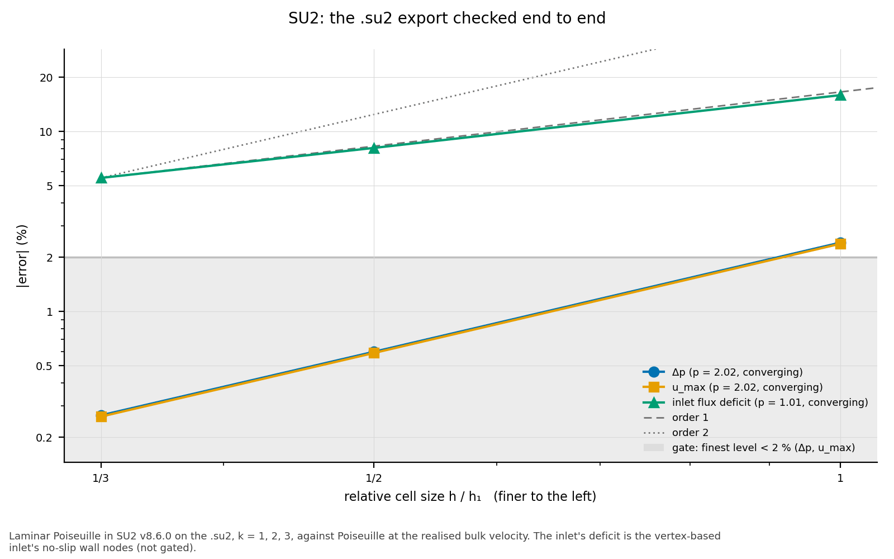

# Results: SU2, the .su2 export checked end to end

**Status: passes** (an export check, decision 0057; task 0183).  SU2
v8.6.0 reads every hexahedron and marker of hexmesh's `.su2`, and
laminar Poiseuille's Δp and u_max converge at order 2.02 to within
+0.26 % at k = 3 (extrapolated: +0.003 %).  Run on 2026-11-23
with `hexmesh-su2:8.6.0` (Docker, built from the pinned release zip) and
gmsh 4.12.1, at hexmesh 367b7e6 (task 0178; first run 2026-11-19 and 20
at 3680ced).  The numbers below are recomputed from
`results.json` by `python3 -m validation.tools.recheck su2_poiseuille`.

<!-- graphs:start -->
## Graphs

_Drawn from `results.json` by `python3 -m validation.tools.plots`; don't edit between the markers._

SU2's Δp and u_max errors, and the inlet's flux deficit, against cell size.

<!-- graphs:end -->

## Import

| k | cells (`cell_count()`) | SU2 hexahedra | markers | orientation | end-face quads re-oriented |
|---|---|---|---|---|---|
| 1 | 5 184 | 5 184 | `fluid_inlet`, `fluid_outlet`, `fluid_wall` | all correct | 108 |
| 2 | 41 472 | 41 472 | the same | all correct | 432 |
| 3 | 139 968 | 139 968 | the same | all correct | 972 |

SU2 re-orients one end face's quads on reading (108 k²): gmsh writes
that face's normal the other way from SU2's convention.  SU2 fixes it
itself; the volume elements are untouched.

## Gate: Δp and u_max within 2 % at the finest level

| k | U_b / U_in | Δp error | u_max error |
|---|---|---|---|
| 1 | 0.8411 | +2.41 % | +2.38 % |
| 2 | 0.9190 | +0.60 % | +0.59 % |
| 3 | 0.9448 | **+0.26 %** | **+0.26 %** |

Richardson over k = 1, 2, 3 (spacing ratios 2 and 1.5): Δp and u_max
both **order 2.02**, extrapolated errors 3.2e-5 and 2.8e-5, GCI 0.33 %
and 0.32 %.  The inlet's flux deficit (1 − U_b/U_in, not gated) falls
at **order 1.01**, as a strip of no-slip nodes h wide would.

**The runs:** a fixed 2000 iterations (`docs/integrations/su2.md`;
`converged: false` in `results.json`): SU2's convergence monitor never
reaches the residual set, though the fields are stationary from about
iteration 1000.  The levels were first run to a 20 000-iteration cap;
these 2000-iteration levels agree with them to 3e-7 in every value.  An earlier stop at the pressure residual
1e-12 (152 iterations at k = 3) left Δp 5 % off: SU2 needs to be run
well past its residual's first drop here.
