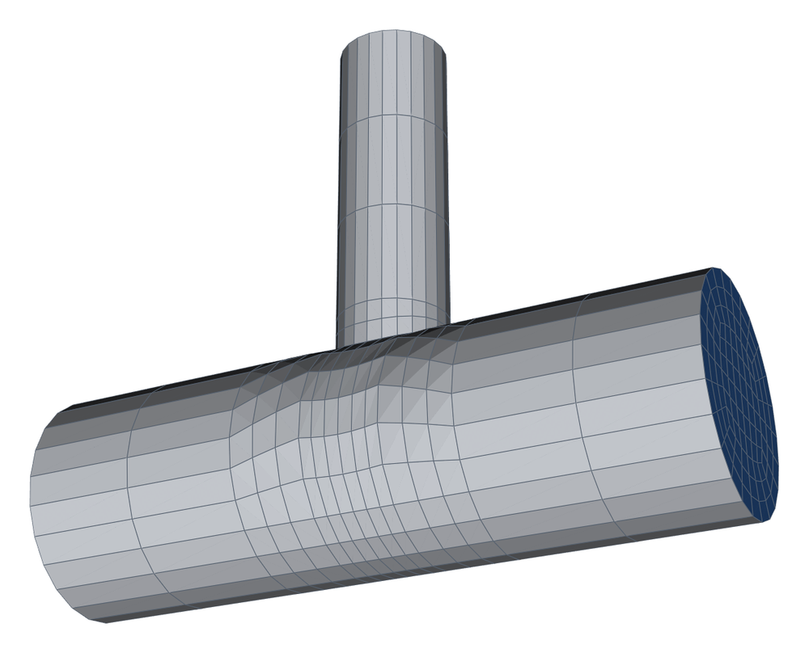
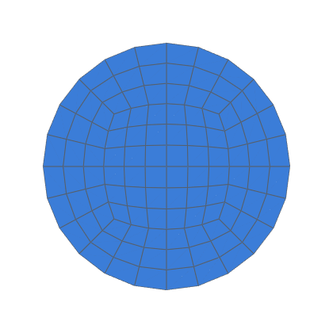

# FEniCSx: second-order export checked end to end

A Poisson problem with a manufactured solution, solved by FEniCSx (dolfinx)
on hexmesh's linear (Hex8) and second-order (Hex27) meshes of a straight
pipe, a bend and a tee (decision 0034's first secondary solver; decision
0012, V1; task 0077).  Q2 elements converge at order 3 in L2 only on a
second-order geometry.  On straight-sided cells, the wall's error holds
them near order 2.

```bash
python3 validation/fenicsx_second_order/run.py --memory 6g       # 3 cases × k = 1, 2, 4
python3 validation/fenicsx_second_order/run.py --cases bend --levels 1 2
python3 -m validation.tools.recheck fenicsx_second_order          # the table, from results.json
```

The solves run in Docker: `dolfinx/dolfinx:v0.11.0`, pinned by digest,
one container per solve, run as the host user
(`docs/integrations/fenicsx.md`).  FEniCSx isn't a hexmesh dependency.
`--memory` caps each container: the Q2 solves at k = 4 peak at 4.4 GB.
Meshes go to `validation/fenicsx_second_order/work/` (git-ignored), or
`--work DIR`, and are deleted once their level is stored.

## Method

| | |
|---|---|
| Exact field | u_m = sin(a x + 0.3) sin(b y + 0.7) sin(c z + 1.1).  a, b, c give 1.5 wavelengths along each extent of the k = 1 mesh's bounding box, but no wavelength shorter than the diameter (task 0074's field) |
| Equation | −∇²u = f, f = −∇²u_m (UFL, symbolically) |
| Dirichlet variant | u = u_m on every boundary.  A control: the data are consistent on the meshed domain, so the wall's position isn't tested and Q2 converges at order 3 on both meshes |
| Neumann variant | ∂u/∂n = ∇u_m · n on the wall, with **n the exact wall's normal**: the nearest of the capped cylinders (straights, the tee's run and branch) and the torus (the bend), from the assembly's ports and the bend's arc.  u = u_m on the ends.  The wall's position enters here |
| Elements | Hex8 mesh: Q1 and Q2.  Hex27 mesh (`write(order=2)`): Q2, isoparametric |
| Solver | CG, BoomerAMG (HMIS coarsening, ext+i interpolation, P_max 4, agg_nl 1), relative tolerance 1e-12 |
| Error | ‖u − u_m‖ in L2 relative to ‖u_m‖, and the H1 seminorm, quadrature degree 8 |
| Levels | `refined(k)`, k = 1, 2, 4 (8× the cells per level) |

## Cases (`R` = 0.05 m, `nang` 6, `nrad` 3 at k = 1)

`straight` (8 R), `bend` (2 R, a 90° bend of radius 3 R, 2 R) and `tee`
(r/R 0.5, branch 4 R, 2 R runs).  The wye and the equal tee are skipped:
`mesh(order=2)` rejects them (`second_order_unsupported`, task 0076).
<!-- mesh:start -->
## Mesh

_Generated by `python3 docs/gallery/build.py --validation fenicsx_second_order`; don't edit between the markers._



<p>  </p>

Inlet cross-sections, left to right: tee, k = 1; bend, k = 1; straight, k = 1.

| Mesh | Cells | min SICN | min SJ (where) | max aspect |
|---|---|---|---|---|
| tee | 2 160 | 0.112 | 0.258 (#1 Tee) | 13.8 |
| bend | 1 296 | 0.238 | 0.790 (#1 Bend) | 7.5 |
| straight | 864 | 0.238 | 0.793 (#0 Straight) | 7.5 |

<!-- mesh:end -->

