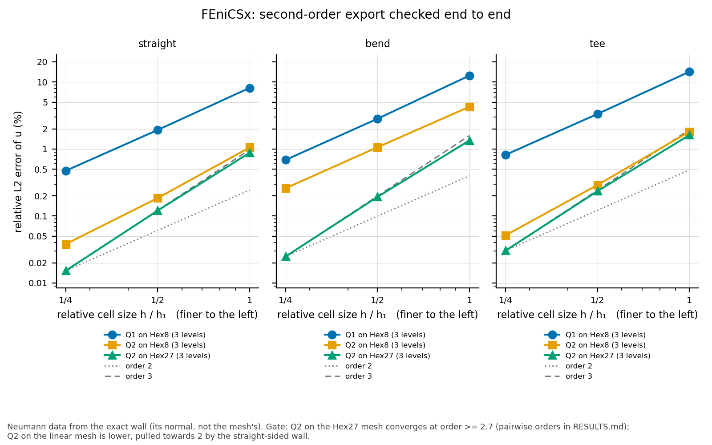

# Results: FEniCSx, second-order export checked end to end

**Status: accepted** (task 0077): Q2 on hexmesh's Hex27 meshes converges
at L2 order 2.78–2.98 on the straight, the bend and the tee, Dirichlet
and Neumann.  With the exact wall's flux, Q2 on the Hex8 meshes is
visibly lower: order 2.0 on the bend, 2.3–2.6 on the straight and tee.
Run on 2026-11-10 and 11 with dolfinx v0.11.0 (Docker, pinned by
digest) and gmsh 4.12.1, at hexmesh f91e22b and 5952340 (the second
changed docs only: identical meshes).  The numbers below are recomputed
from `results.json` by `python3 -m validation.tools.recheck
fenicsx_second_order`.

<!-- graphs:start -->
## Graphs

_Drawn from `results.json` by `python3 -m validation.tools.plots`; don't edit between the markers._

The relative L2 error of the manufactured solution against cell size, per mesh and element.

<!-- graphs:end -->

## Gate: Q2 on Hex27 converges at L2 order ≥ 2.7

| case | variant | Q2 on Hex27 | Q2 on Hex8 | Q1 on Hex8 | verdict |
|---|---|---|---|---|---|
| straight | Dirichlet | 2.91, 2.98 | 2.90, 2.98 | 1.96, 1.99 | pass |
| straight | Neumann | 2.87, 2.98 | 2.50, 2.28 | 2.08, 2.02 | pass |
| bend | Dirichlet | 2.81, 2.96 | 2.81, 2.96 | 2.06, 2.01 | pass |
| bend | Neumann | 2.80, 2.96 | 2.00, 2.03 | 2.13, 2.04 | pass |
| tee | Dirichlet | 2.80, 2.95 | 2.79, 2.95 | 2.02, 2.01 | pass |
| tee | Neumann | 2.78, 2.95 | 2.64, 2.50 | 2.09, 2.03 | pass |

Orders are between k = 1 → 2 and 2 → 4.

- **Dirichlet (the control):** Q2 converges at order 3 on both meshes,
  with errors equal to three digits.  The data are consistent on the
  meshed domain, so the wall's position isn't tested (README, *Method*).
- **Neumann (the test):** the exact wall's normal brings in the
  straight-sided wall's O(h²) error.  On the bend, the Hex8 row is at
  order 2 from the start and its k = 4 error is 10× Hex27's.  On the
  straight and the tee, the Hex8 row is still falling towards 2: the
  geometry error is smaller there (the wall curves in one direction
  only), and the k = 4 errors are 2.5× and 1.7× Hex27's.  The Hex27
  Neumann errors equal the Dirichlet ones to three digits: the curved
  wall carries the exact geometry, to the discretisation's order.
- **Q1** converges at order 2 everywhere, as expected; the geometry
  error is of the same order.

## Errors (relative L2, ‖u − u_m‖ / ‖u_m‖)

### straight (864, 6 912, 55 296 cells)

| mesh, element | variant | k = 1 | k = 2 | k = 4 |
|---|---|---|---|---|
| Q1 on Hex8 | Dirichlet | 1.232e-01 | 3.160e-02 | 7.956e-03 |
| Q2 on Hex8 | Dirichlet | 9.007e-03 | 1.204e-03 | 1.523e-04 |
| Q2 on Hex27 | Dirichlet | 9.048e-03 | 1.207e-03 | 1.525e-04 |
| Q1 on Hex8 | Neumann | 8.171e-02 | 1.922e-02 | 4.730e-03 |
| Q2 on Hex8 | Neumann | 1.054e-02 | 1.850e-03 | 3.801e-04 |
| Q2 on Hex27 | Neumann | 8.800e-03 | 1.201e-03 | 1.523e-04 |

### bend (1 296, 10 368, 82 944 cells)

| mesh, element | variant | k = 1 | k = 2 | k = 4 |
|---|---|---|---|---|
| Q1 on Hex8 | Dirichlet | 1.360e-01 | 3.257e-02 | 8.068e-03 |
| Q2 on Hex8 | Dirichlet | 1.365e-02 | 1.938e-03 | 2.494e-04 |
| Q2 on Hex27 | Dirichlet | 1.356e-02 | 1.932e-03 | 2.488e-04 |
| Q1 on Hex8 | Neumann | 1.248e-01 | 2.833e-02 | 6.879e-03 |
| Q2 on Hex8 | Neumann | 4.279e-02 | 1.064e-02 | 2.599e-03 |
| Q2 on Hex27 | Neumann | 1.344e-02 | 1.930e-03 | 2.487e-04 |

### tee (2 160, 17 280, 138 240 cells)

| mesh, element | variant | k = 1 | k = 2 | k = 4 |
|---|---|---|---|---|
| Q1 on Hex8 | Dirichlet | 1.622e-01 | 3.978e-02 | 9.900e-03 |
| Q2 on Hex8 | Dirichlet | 1.637e-02 | 2.354e-03 | 3.041e-04 |
| Q2 on Hex27 | Dirichlet | 1.638e-02 | 2.355e-03 | 3.042e-04 |
| Q1 on Hex8 | Neumann | 1.426e-01 | 3.337e-02 | 8.189e-03 |
| Q2 on Hex8 | Neumann | 1.817e-02 | 2.909e-03 | 5.145e-04 |
| Q2 on Hex27 | Neumann | 1.617e-02 | 2.351e-03 | 3.041e-04 |

## Cost

Serial, one container per solve.  The largest solves (Q2 at k = 4 on the
tee, 1 131 505 dofs) peak at 4.4 GB and take 150–185 s each; the whole
matrix took 22 minutes of solving.  BoomerAMG's default setup ran
out of a 6 GB cap on those solves; the low-complexity settings in
README's *Method* fixed it without changing the results
(`docs/integrations/fenicsx.md`).

## Not covered

- The wye and the equal tee: `mesh(order=2)` rejects them (task 0076).
- Hex20 (`write(order=2, incomplete=True)`): dolfinx's reader rejects
  type 17.
- Flow (Stokes, Navier–Stokes) and a cross-check of task 0074's
  OpenFOAM results: proposed follow-ups (task 0077's *Outcome*).
