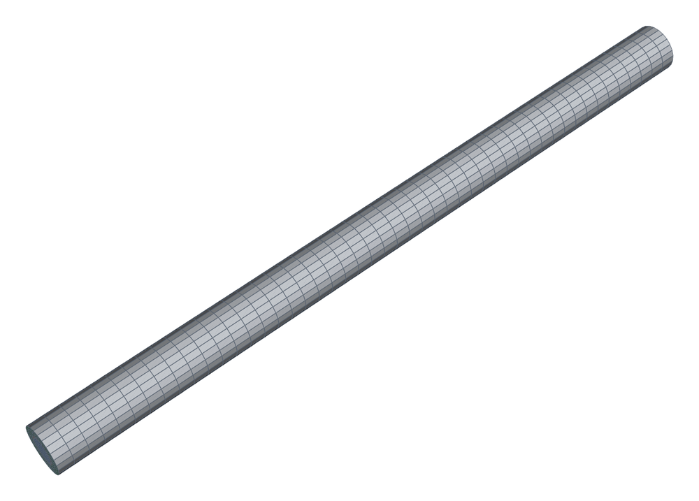
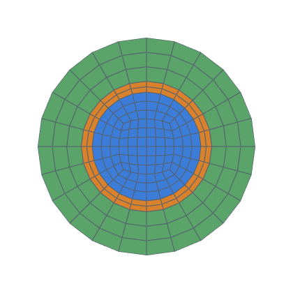
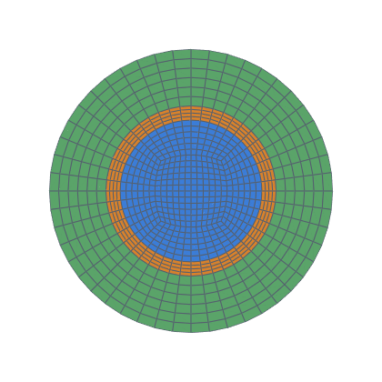
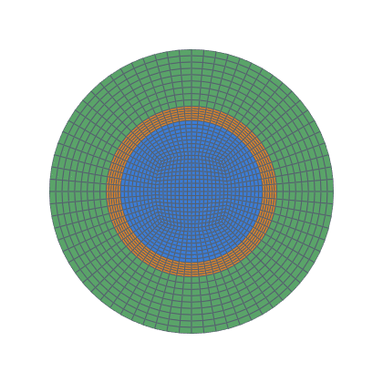

# Heated multi-layer pipe with laminar flow (full CHT)

Poiseuille flow in a fluid core inside a steel shell and an insulation
shell, uniform heat flux into the outer surface, against the exact
developed solution (decision 0012, task 0035).  The full conjugate
heat-transfer pipeline on a hexmesh mesh: three regions split from one
mesh, coupled `mappedWall` interfaces, walls retyped per region.  Three
independent exact quantities locate an error: the energy balance
(fluid), the Nusselt number (the fluid side of the wall) and the log
profiles (solids).

```bash
python3 validation/heated_pipe/run.py --levels 1 2 3 --np 4 --json out.json   # ~17 h
python3 validation/heated_pipe/run.py --levels 1                              # ~15 min
```

Needs Docker and the `opencfd/openfoam-default:2406` image, for
conversion and solver alike (`--openfoam`).  **OpenFOAM v1912's buoyant
and CHT solvers diverge on any non-orthogonal mesh** (task 0035,
`docs/integrations/openfoam.md`), and every hexmesh mesh is
non-orthogonal.  Cases go to `validation/heated_pipe/work/k<k>/`
(git-ignored), or to `--work DIR`.

## Case

| | |
|---|---|
| Geometry | fluid r₁ = 10 mm, steel to r₂ = 12 mm, insulation to r₃ = 20 mm; length 30 D (D = 2 r₁) |
| Fluid | ρ 1000, c_p 4000, μ 1e-3, k_f 4 W/(m K) (Pr = 1), Ū = 5e-3 m/s (Re = 100); constant properties, g = 0 |
| Solids | steel k = 50 W/(m K), insulation k = 0.05 W/(m K) (as task 0034) |
| Boundary conditions | inlet: the developed parabolic profile at the inlet face centres, scaled so the discrete flow rate is Ū times the meshed (polygonal) area, T = 300 K; the same profile is the initial field; outlet p_rgh fixed, U and T zero gradient; outer insulation wall `externalWallHeatFluxTemperature`, `mode flux`, q″₃ = 800 W/m²; solid ends adiabatic |
| Exact (developed, uniform flux) | q′ = q″₃ · 2π r₃; dT_b/dx = q′/(ṁ c_p); Nu = hD/k_f = 48/11; ΔT across a shell = q′/(2πk) ln(r_out/r_in) |
| Mesh-exact | the meshed surfaces are polygons: q′_mesh is q″₃ times the meshed outer area per length, and ṁ is measured.  The per-level dT_b/dx and ΔTs are judged against q′_mesh and the measured ṁ (decision 0015); the extrapolated values against the exact ones |
| Levels | `Assembly.refined(k)`, k = 1, 2, 3: `nang` 6 / 12 / 18; `nrad` fluid 3k, steel 2k, insulation 3k; 48k axial layers (32k + 8k + 8k over 20 + 5 + 5 D, uniform) |
| Solver | `chtMultiRegionSimpleFoam` (v2406), laminar fluid (`heRhoThermo`, `rhoConst`, `hConst`), relaxation 0.3 (U, h, p_rgh), solids unrelaxed; run in chunks of 500 iterations until Nu, dT_b/dx and both ΔTs change by less than 1e-6 between chunks |

## Measurement

- **Bulk temperature:** mixing-cup T on the fluid faces of planes at 20 D
  and 25 D (face zones by `topoSet`); dT_b/dx from the two.
- **Wall temperatures:** area-weighted mean over the band 20–25 D of the
  wall faces of each interface and the outer wall.  T is linear in x
  there, so the band mean is the value at 22.5 D.
- **Nu** = q′_mesh/(2π r₁) · D / (k_f (T_w − T_b)), with T_b at 22.5 D.
- **Energy balance:** heat in through the outer wall = enthalpy rise plus
  the axial conduction through the fluid's ends.
- Richardson extrapolation over the three levels at ratios 2 and 3/2
  ([`celik_and_ghia_etal_2008`], non-constant form, as task 0032).

<!-- mesh:start -->
## Mesh

_Generated by `python3 docs/gallery/build.py --validation heated_pipe`; don't edit between the markers._



<p>  </p>

Inlet cross-sections, left to right: k = 1: nang 6, nrad 3 / 2 / 3, 48 axial layers; k = 2: nang 12, nrad 6 / 4 / 6, 96 axial layers; k = 3: nang 18, nrad 9 / 6 / 9, 144 axial layers.

| Mesh | Cells | min SICN | min SJ (where) | max aspect |
|---|---|---|---|---|
| k1 | 10 944 | 0.192 | 0.793 (#1 Straight) | 12.5 |
| k2 | 87 552 | 0.182 | 0.752 (#1 Straight) | 12.5 |
| k3 | 295 488 | 0.179 | 0.737 (#1 Straight) | 12.5 |

<!-- mesh:end -->

## Results

See [RESULTS.md](RESULTS.md).
