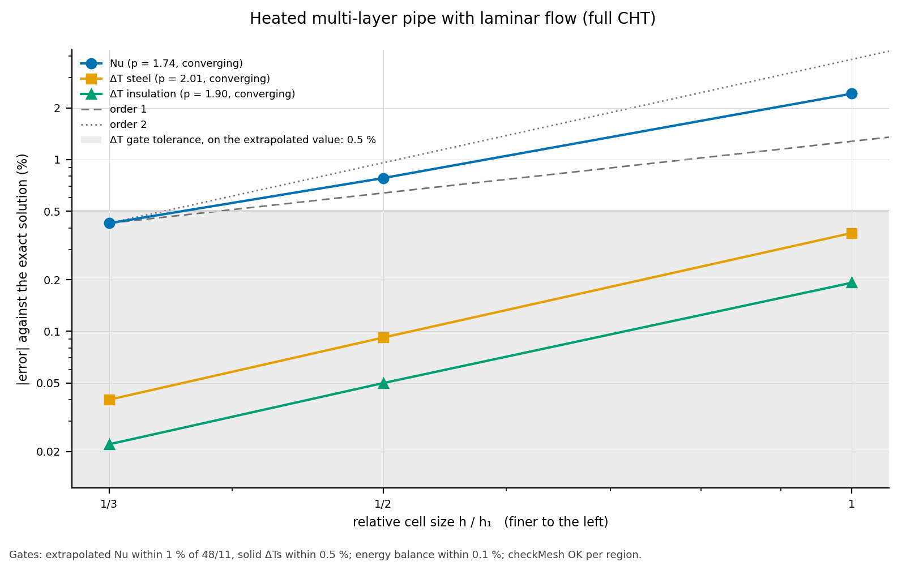

# Results: heated multi-layer pipe, Re = 100, Pr = 1 (full CHT)

**Status: accepted** (task 0035; gates of decision 0012 as set in the
task).  Every gate passes.

Run 2026-10-31/11-01: hexmesh d1baada plus the task's driver changes,
gmsh 4.12.1, OpenFOAM v2406 (`opencfd/openfoam-default:2406` in Docker,
conversion and solver), k2 and k3 on 4 MPI processes (`decomposePar`
method simple).  Reference: the exact developed solution (README.md):
Nu = 48/11 = 4.3636, dT_b/dx = 16.000 K/m, ΔT steel 0.058343 K,
ΔT insulation 163.464 K.

<!-- graphs:start -->
## Graphs

_Drawn from `results.json` by `python3 -m validation.tools.plots`; don't edit between the markers._



The Nusselt number and the solid temperature differences against cell size.

<!-- graphs:end -->

## Levels

| Level | Cells (fluid / steel / insulation) | min SJ | max non-orth. fluid (°) | iterations | solver time (s) | mass balance | energy balance |
|---|---|---|---|---|---|---|---|
| k1 | 10 944 (5 184 / 2 304 / 3 456) | 0.793 | 23.5 | 2 000 | 833 (1 process) | 4.5e-09 | −1.5e-07 |
| k2 | 87 552 (41 472 / 18 432 / 27 648) | 0.752 | 33.2 | 4 500 | 7 631 | 2.1e-09 | −1.0e-07 |
| k3 | 295 488 (139 968 / 62 208 / 93 312) | 0.737 | 36.9 | 8 500 | 50 507 | 8.9e-10 | −8.2e-07 |

- **Mesh OK** in every region at every level; the solids are orthogonal
  (non-orthogonality 0°: their O-grid is purely radial).  Patches per
  region as expected; `insulation_wall` retyped to `wall`.
- **Converged:** Nu, dT_b/dx and both ΔTs change by less than 1e-6
  between 500-iteration chunks (last changes 5.8e-08, 2.4e-07,
  7.6e-07).  The first initial residuals at the end are below 6e-10 (h),
  8e-06 (U) and 8e-07 (p_rgh).  `residualControl` isn't used: v2406's
  `chtMultiRegionSimpleFoam` ignored it (`openfoam.md`).
- **Interfaces:** the temperatures either side of each `mappedWall`
  interface agree to 5e-10 K.
- **Energy balance:** heat in through the outer wall against the enthalpy
  rise plus axial conduction through the fluid's ends (0.06–0.12 W of
  60 W); within 1e-6 at every level (gate 0.1 %).

## Errors per level

Nu against 48/11; the others against the mesh-exact values (q′ from the
meshed outer area, ṁ measured).

| Level | Nu | e(Nu) | e(dT_b/dx) | e(ΔT steel) | e(ΔT insulation) |
|---|---|---|---|---|---|
| k1 | 4.46929 | +2.421 % | −0.032 % | −0.374 % | +0.192 % |
| k2 | 4.39770 | +0.781 % | −0.0074 % | −0.092 % | +0.050 % |
| k3 | 4.38223 | +0.426 % | −0.0014 % | −0.040 % | +0.022 % |

## Convergence (decision 0015)

Richardson extrapolation over k = 1, 2, 3, ratios 2 and 3/2
([`celik_and_ghia_etal_2008`], the non-constant form).  Every quantity
converges monotonically.

| Quantity | observed order | extrapolated | exact | extrapolated − exact | GCI (k3) |
|---|---|---|---|---|---|
| Nu | 1.74 | 4.36714 | 4.36364 | **+0.080 %** | 0.43 % |
| dT_b/dx (K/m) | 2.03 | 16.00086 | 16.00000 | +0.005 % | 0.11 % |
| ΔT steel (K) | 2.02 | 0.0583428 | 0.0583429 | **−0.0001 %** | 0.09 % |
| ΔT insulation (K) | 2.17 | 163.46286 | 163.46420 | **−0.0008 %** | 0.011 % |

Nu converges at order 1.74, the solids and the energy balance at about
2.  The wall heat flux and T_w − T_b come from the near-wall cells of the
non-orthogonal O-H fluid region; the solids' cells are orthogonal.

## Gates

| Gate | Value | |
|---|---|---|
| Mesh OK per region, every level | yes | **pass** |
| Energy balance within 0.1 % at every level | ≤ 8.2e-07 | **pass** |
| Extrapolated Nu within 1 % of 48/11 | +0.080 % | **pass** |
| Extrapolated solid ΔTs within 0.5 % | −0.0001 % (steel), −0.0008 % (insulation) | **pass** |

## Toolchain

- **v1912 can't run this case:** its buoyant and CHT solvers diverge on
  any non-orthogonal mesh (task 0035's diagnosis, `openfoam.md`).
- **k1 on v2406 end to end** (conversion included) gives the October
  mixed-toolchain run's numbers (v1912 conversion, v2406 solver) to
  every digit reported, so v2406's `gmshToFoam` gives the same mesh.
- **Levels 1, 2, 3 instead of 1, 2, 4** (the user, 2026-10-31): the
  iterations grow about 2.25× per level, and k4 would have taken about
  37 h here.

## Reproduce

```bash
python3 validation/heated_pipe/run.py --levels 1 2 3 --np 4 --json out.json
```
