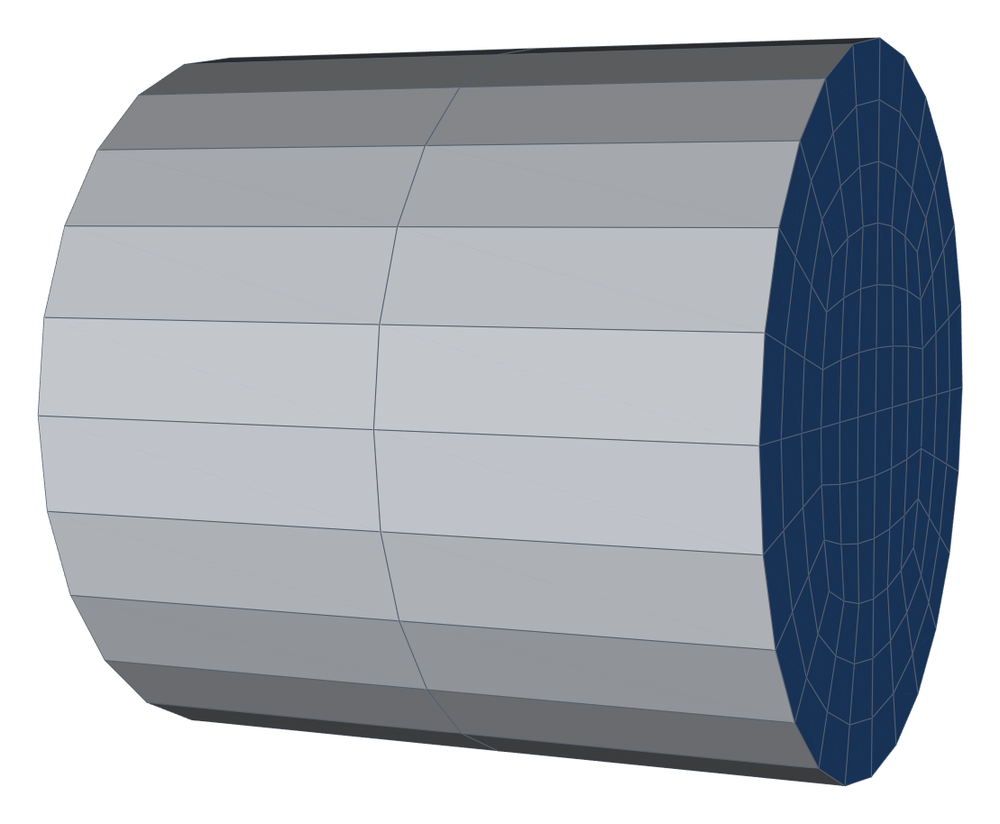
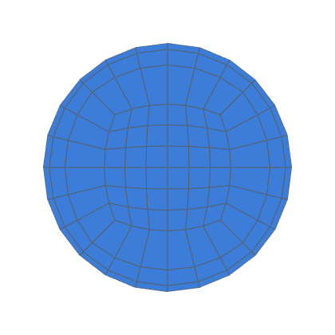
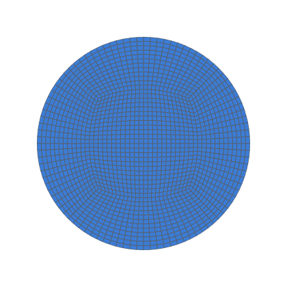

# Heated rod validation

Steady conduction in a solid rod with uniform heat generation, against the
exact solution (decision 0012, task 0033).  Same Poisson equation as
Poiseuille flow, but with no pressure–velocity coupling or convection, so
it tests the O-H cross-section alone.

```bash
python3 validation/heated_rod/run.py                         # both series, 5 levels
python3 validation/heated_rod/run.py --levels 1 --series uniform   # one level (~2 s)
python3 validation/heated_rod/run.py --json out.json         # results as JSON
python3 -m pytest -m openfoam tests/test_validation.py -k heated   # coarsest level
```

Needs OpenFOAM v1912 (`/usr/share/openfoam/etc/bashrc`).  Cases go to
`validation/heated_rod/work/<series>-<k>/` (git-ignored), or to `--work DIR`.

## Case

| | |
|---|---|
| Rod | R = 0.01 m, length 2 R, 2 axial layers (axially uniform: a 2-D problem in a 3-D mesh) |
| Physics | DT = k/(ρc) = 1e-5 m²/s, source Su = q‴/(ρc) = 0.4 K/s, so ΔT₀ = Su R²/(4 DT) = 1 K |
| Exact | T(r) = T_w + Su (R² − r²)/(4 DT); heat out through the wall = Su · V_mesh |
| Boundary conditions | `rod_wall` fixedValue T_w = 0; `rod_inlet`, `rod_outlet` zeroGradient |
| Levels | `nang` 6 / 12 / 24 / 48 / 96, `nrad` = `nang` / 2: the coarse rod refined by `Assembly.refined(k)`, k = 1, 2, 4, 8, 16, with the axial count put back to 2 |
| Series | *uniform*; *graded*, `first_cell` = 0.05 R at k = 1 (refined: `mprg^(1/k)`, so each coarse cell splits into k cells of the same growth) |
| Solver | `laplacianFoam`, `steadyState`, `Gauss linear corrected`; source by `fvOptions` `scalarSemiImplicitSource` (`volumeMode specific`); 10 non-orthogonal correctors per step, `residualControl` T 1e-11 |

<!-- mesh:start -->
## Mesh

_Generated by `python3 docs/gallery/build.py --validation heated_rod`; don't edit between the markers._



<p>  </p>

Inlet cross-sections, left to right: uniform, k = 1: nang 6, nrad 3; graded, k = 1: nang 6, nrad 3; uniform, k = 4: nang 24, nrad 12.

| Mesh | Cells | min SICN | min SJ (where) | max aspect |
|---|---|---|---|---|
| uniform-1 | 216 | 0.238 | 0.793 (#0 Straight) | 7.5 |
| graded-1 | 216 | 0.115 | 0.793 (#0 Straight) | 24.6 |
| uniform-4 | 3 456 | 0.056 | 0.730 (#0 Straight) | 30.0 |

<!-- mesh:end -->

## Post-processing (Python, from the ASCII case files)

OpenFOAM function objects abort on this build (`docs/integrations/openfoam.md`).
- **Cell centres and volumes** are recomputed as OpenFOAM does
  (`primitiveMesh`: face triangles about the point average; cell pyramids
  about the face-centre average).
- **Error of T:** volume-weighted L2 and max of T − T_exact(r) at the cell
  centres, relative to ΔT₀.
- **Centre excess ΔT₀:** T = c₀ − c₂ r² fitted to the cells within R/3.
- **Energy balance:** the wall heat flow as `laplacianFoam` discretises it
  (fixedValue patch, delta coefficient 1/max(n·d, 0.05|d|)) against
  Su · V_mesh.  V_mesh is the inscribed-polygon prism.
- **Error by region:** L2 over the core square, the ring near the
  diagonals (the core corners' sector), and the rest of the ring.
- **Richardson** on the three finest levels [`celik_and_ghia_etal_2008`].
  On O-H sections the order is reported, not gated (decision 0015,
  amended); the gate is the extrapolated ΔT₀ within 0.1 %.

Results: [`RESULTS.md`](RESULTS.md).
