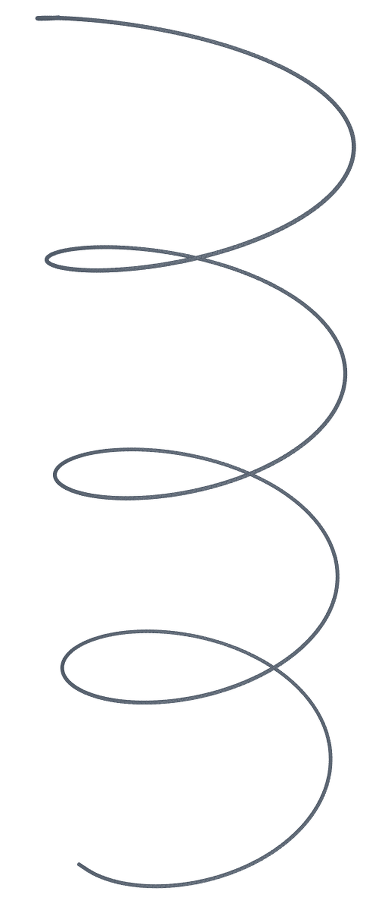
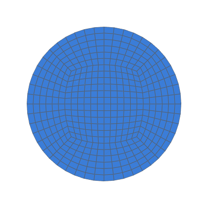
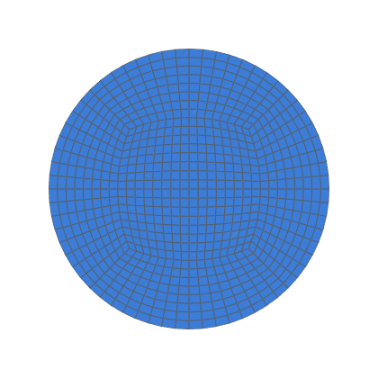

# Laminar flow in a helical pipe (the SIET coil)

Steady laminar flow through a helically coiled tube, meshed as a
`SplinePipe` through points on the exact helix.  It is checked against
Ito's laminar correlation, which De Amicis et al. (2014) validated on
this coil (decision 0012, V3; task 0075).

```bash
python3 validation/helical_pipe/run.py --np 4          # 3 Re × nang 12, 16, 24 (24 from mapped 16)
# resumable: run it again with the same --work after an interruption
python3 -m validation.tools.recheck helical_pipe        # gates, from results.json
```

The runs need OpenFOAM v2406 (Docker `opencfd/openfoam-default:2406` by
default).

## Case

| | |
|---|---|
| Coil | De Amicis et al. (2014), Table 2: d = 12.53 mm, helix diameter 1 m, pitch 0.8 m/turn (κa = 0.0118, λ = 0.255); 4 turns after a 5 d straight |
| Centreline | a `SplinePipe` through 32 points per turn, clamped to the helix tangent at both ends; within 3.4e-4 d of the helix |
| Flow | steady laminar `simpleFoam` (SIMPLEC, `linearUpwind`); Poiseuille inlet profile (an `expression` boundary value); zero pressure at the outlet |
| Re | 1800, 2400, 3000 (De 201, 269, 336), inside the measured laminar range (Re 1750–3200) |
| Levels | nang 12, 16, 24 (core nrad = nang/2), with 195, 260, 390 layers per turn; nang 8 (130) reported, not gated |
| f | from turn-averaged pressure: f_D = Δp d / (L_turn ½ u_b²) between consecutive turns.  The helical symmetry makes the difference of turn means exactly one turn's drop.  u_b and Re come from the bulk velocity the mesh carries.  Gated on turns 2 → 3 |
| Reference | Ito (1959): f_c/f_s = 21.5 De / (1.56 + log₁₀ De)^5.73, De = Re √(r/R), f_s = 64/Re |

Data: [data/README.md](data/README.md) (Fig. 12, digitised).  Results:
[RESULTS.md](RESULTS.md).
<!-- mesh:start -->
## Mesh

_Generated by `python3 docs/gallery/build.py --validation helical_pipe`; don't edit between the markers._



<p> </p>

Inlet cross-sections, left to right: nang 12, 195 layers per turn; nang 16, 260 layers per turn.

| Mesh | Cells | min SICN | min SJ (where) | max aspect |
|---|---|---|---|---|
| n12 | 338 688 | 0.043 | 0.752 (#1 SplinePipe) | 40.3 |
| n16 | 803 328 | 0.043 | 0.741 (#1 SplinePipe) | 40.3 |

<!-- mesh:end -->

