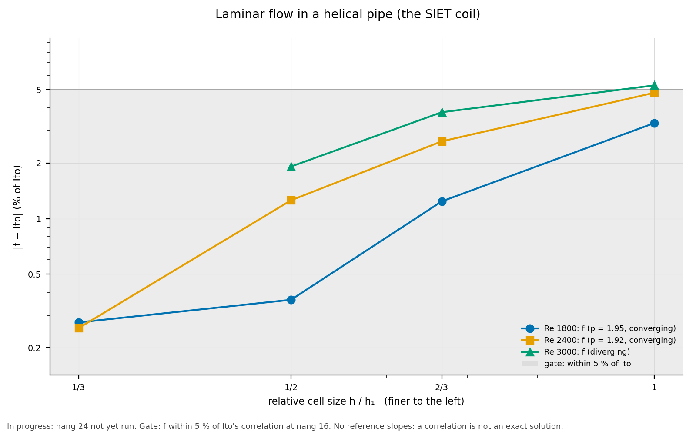

# Results: laminar flow in a helical pipe (the SIET coil)

**Status: in progress, undecided.**  Task 0075 is held by the user until
better hardware (2026-11-08); Re 3000's nang 24 level is missing.
- Design moved the convergence study to nang 12, 16, 24 (Q3), because
  nang 8 is too coarse at these Dean numbers.
- **nang 24 at Re 1800 and 2400 is done** (2026-11-07/08, the restartable
  driver, mapped from the nang 16 field, np 4, v2406 in Docker):

  | Re | steps | wall | f, nang 24 | vs Ito | f (nang 12, 16, 24) |
  |---|---|---|---|---|---|
  | 1800 | 322 | 5.0 h | 0.06633 | −0.27 % | converging, order 1.93, GCI 0.55 % |
  | 2400 | 398 | 5.6 h | 0.05557 | +0.26 % | converging, order 1.90, GCI 0.95 % |

  The re-solved nang 16 sources matched the stored levels' f to 1e-8.
  Wall times overlapped other runs on the machine (task 0074's
  diagnostics, on 3 processes, for about an hour).
- **Re 3000's nang 24 isn't run.**  It was stopped 6 minutes into its
  nang 16 source when the user postponed the run; the case was deleted.
  At nang 16 its f is +1.92 % from Ito.
- Earlier: two attempts at Re 1800 (from rest, and mapped without
  chunks, Q4 and Q5) stopped unconverged after 4.5–5 h.
- Under the Q4 rule, an unfinished level leaves the case neither
  accepted nor rejected.
- The nang 8–16 results below stand as measured.  The nang 8 runs are
  reported, but not in the Richardson series.

- **Run:** 2026-11-06, with OpenFOAM v2406 (Docker
  `opencfd/openfoam-default:2406`) and gmsh 4.12.1, on 4 MPI processes.
  The nine solves took about 2 h 45 min.
- **Reference:** De Amicis et al. (2014), the SIET coil.  The gate is
  Ito (1959), as the paper's eq. (2).
- **Recheck:** `python3 -m validation.tools.recheck helical_pipe`.

<!-- graphs:start -->
## Graphs

_Drawn from `results.json` by `python3 -m validation.tools.plots`; don't edit between the markers._

The friction factor's difference from Ito's correlation per level.

<!-- graphs:end -->

## Geometry

- **The coil:** d = 12.53 mm, helix diameter 1 m, pitch 0.8 m per turn,
  4 turns after a 5 d straight.
- **The spline:** 32 points per turn.  Its largest distance from the
  exact helix is **3.4 × 10⁻⁴ d** (gate 0.1 %: **pass**), and
  1.6 × 10⁻⁴ d over its interior.
- **Between stations,** the faceted centreline sags from the curve by
  s²κ/8: 1.2 × 10⁻², 5.2 × 10⁻³ and 2.9 × 10⁻³ d at nang 8, 12 and 16.
  That is discretisation, and it falls with the levels.

## Gates

f and Re are based on the bulk velocity the mesh carries (the volume
mean of the tangential velocity over the gated turns).  That is 0.5–1.4 %
above the nominal U_B: the faceted section is smaller than πa², and the
inlet parabola is set at face centres.

| Re (nominal) | Re_b (nang 16) | f (nang 16) | Ito at Re_b | vs Ito (gate 5 %) | f converging (nang 8, 12, 16) |
|---|---|---|---|---|---|
| 1800 | 1809 | 0.06668 | 0.06643 | +0.36 %: **pass** | converging, order 1.29, GCI 2.0 %: **pass** |
| 2400 | 2411 | 0.05606 | 0.05536 | +1.26 %: **pass** | converging, order 0.04, GCI 130 %: passes as written, but not in the asymptotic range |
| 3000 | 3015 | 0.04918 | 0.04825 | +1.92 %: **pass** | diverging (\|ε32\| 0.00051 ≤ \|ε21\| 0.00082): **fail** |

- **All levels:**

  | Re | nang 8 | 12 | 16 |
  |---|---|---|---|
  | 1800 | +3.30 % | +1.24 % | +0.36 % |
  | 2400 | +4.81 % | +2.62 % | +1.26 % |
  | 3000 | +5.27 % | +3.77 % | +1.92 % |

  Cells: 100 416, 338 688 and 803 328 (130, 195 and 260 layers per turn).
- **Re 3000 at nang 8** didn't reach the residual target in 5000 SIMPLE
  steps.  Its f agrees across turns to 1.6 × 10⁻⁶.
- **The Re drift between levels doesn't explain the slow convergence.**
  Moving each level's f to the nominal Re along Ito's local slope gives
  orders 1.45 (Re 1800) and 0.36 (Re 2400), and Re 3000 is still
  diverging.
- **The coarse levels aren't in the asymptotic range at higher Dean
  number** (De 270–340).  The error falls monotonically toward Ito at
  every Re.

## Development (reported)

f from consecutive turn pairs, at nang 16:

| Re | turns 1→2 | 2→3 (gated) | 3→4 |
|---|---|---|---|
| 1800 | 0.06665 | 0.06668 | 0.06668 |
| 2400 | 0.05604 | 0.05606 | 0.05606 |
| 3000 | 0.04915 | 0.04918 | 0.04918 |

The flow is developed within the first turn.  Turns 2→3 and 3→4 agree
to 10⁻⁶.

## Measured points (reported, not gated)

`data/deamicis_2014_fig12.csv` holds the 15 laminar points, digitised
(Re 1801–3195; method and uncertainty in `data/README.md`).
- They lie 3.7 % below Ito on average (RMS 5.2 %), with error bars of
  ±10–15 % at low Re.
- At nang 16 the computed f is +0.4 to +1.9 % from Ito, so about 4–6 %
  above the points' mean.
- That is inside the points' error bars, and similar to the paper's own
  OpenFOAM result (2.56 % RMS against the data, Table 7).
