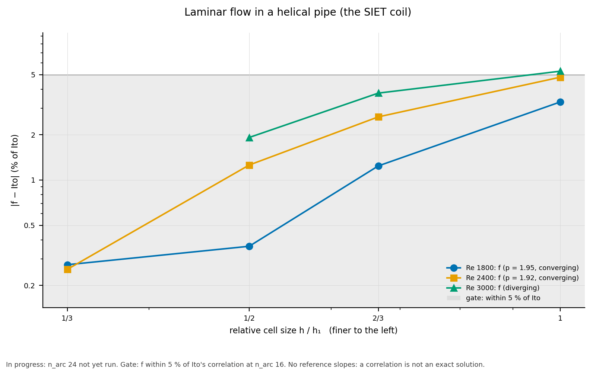

# Results: laminar flow in a helical pipe (the SIET coil)

**Status: accepted** (2026-11-18, task 0075).  Every gate passes at
n_arc 24 (see *Gates*).  Re 3000's n_arc 24 level, the last one, was a
volunteer run on Windows (task 0173).
- Design moved the convergence study to n_arc 12, 16, 24 (Q3), because
  n_arc 8 is too coarse at these Dean numbers.
- **n_arc 24 at Re 1800 and 2400 is done** (2026-11-07/08, the restartable
  driver, mapped from the n_arc 16 field, np 4, v2406 in Docker):

  | Re | steps | wall | f, n_arc 24 | vs Ito | f (n_arc 12, 16, 24) |
  |---|---|---|---|---|---|
  | 1800 | 322 | 5.0 h | 0.06633 | −0.27 % | converging, order 1.93, GCI 0.55 % |
  | 2400 | 398 | 5.6 h | 0.05557 | +0.26 % | converging, order 1.90, GCI 0.95 % |
  | 3000 | 440 | 1.2 h* | 0.04856 | +0.53 % | converging, order 1.84, GCI 1.44 % |

  The re-solved n_arc 16 sources matched the stored levels' f to 1e-8.
  Wall times overlapped other runs on the machine (task 0074's
  diagnostics, on 3 processes, for about an hour).
- **Re 3000's n_arc 24** (2026-11-18, task 0173): run with the volunteer
  tool on a laptop, Windows 11, v2406 in Docker (Rancher Desktop), on 16
  processes, and merged with `volunteer check --merge`.  *The fine
  solve's 440 steps took about 4190 s (9.5 s/step), with the laptop's
  sleep removed.  Its n_arc 16 source re-solved in 812 steps (34 min)
  and matched the stored level's f to 1.0e-9.  The `wall_s` stored with
  the level (12 730 s) also counts restarts after the Windows fixes and
  the sleep.
- Earlier: two attempts at Re 1800 (from rest, and mapped without
  chunks, Q4 and Q5) stopped unconverged after 4.5–5 h.
- Under the Q4 rule, an unfinished level leaves the case neither
  accepted nor rejected.
- The n_arc 8–16 results below stand as measured.  The n_arc 8 runs are
  reported, but not in the Richardson series.

- **Run:** 2026-11-06, with OpenFOAM v2406 (Docker
  `opencfd/openfoam-default:2406`) and gmsh 4.12.1, on 4 MPI processes.
  The nine solves took about 2 h 45 min.
- **Reference:** De Amicis et al. (2014), the SIET coil.  The gate is
  Ito (1959), as the paper's eq. (2).
- **Recheck:** `python3 -m validation.tools.recheck helical_pipe`.

<!-- graphs:start -->
## Graphs

_Drawn from `results.json` by `python3 -m validation.tools.plots`; don't edit between the markers._

The friction factor's difference from Ito's correlation per level.

<!-- graphs:end -->

## Geometry

- **The coil:** d = 12.53 mm, helix diameter 1 m, pitch 0.8 m per turn,
  4 turns after a 5 d straight.
- **The spline:** 32 points per turn.  Its largest distance from the
  exact helix is **3.4 × 10⁻⁴ d** (gate 0.1 %: **pass**), and
  1.6 × 10⁻⁴ d over its interior.
- **Between stations,** the faceted centreline sags from the curve by
  s²κ/8: 1.2 × 10⁻², 5.2 × 10⁻³ and 2.9 × 10⁻³ d at n_arc 8, 12 and 16.
  That is discretisation, and it falls with the levels.

## Gates

**Verdict: accepted** (2026-11-18, task 0075): every gate passes at
n_arc 24.  Recheck: `python3 -m validation.tools.recheck helical_pipe`.

f and Re are based on the bulk velocity the mesh carries (the volume
mean of the tangential velocity over the gated turns).  That is 0.5–1.4 %
above the nominal U_B: the faceted section is smaller than πa², and the
inlet parabola is set at face centres.  Ito is evaluated at each level's
own Re_b.

| Re (nominal) | f (n_arc 24) | Ito at Re_b | vs Ito (gate 5 %) | f converging (n_arc 12, 16, 24) |
|---|---|---|---|---|
| 1800 | 0.06633 | 0.06651 | −0.27 %: **pass** | converging, order 1.93, GCI 0.55 %: **pass** |
| 2400 | 0.05557 | 0.05543 | +0.26 %: **pass** | converging, order 1.90, GCI 0.95 %: **pass** |
| 3000 | 0.04856 | 0.04830 | +0.53 %: **pass** | converging, order 1.84, GCI 1.44 %: **pass** |

The spline is 3.41 × 10⁻⁴ d from the exact helix (gate 0.1 % of d):
**pass**.

- **All levels**, f against Ito:

  | Re | n_arc 8 | 12 | 16 | 24 |
  |---|---|---|---|---|
  | 1800 | +3.30 % | +1.24 % | +0.36 % | −0.27 % |
  | 2400 | +4.81 % | +2.62 % | +1.26 % | +0.26 % |
  | 3000 | +5.27 % | +3.77 % | +1.92 % | +0.53 % |

  Cells: 100 416, 338 688, 803 328 and 2 711 232.  The error falls
  steadily at every Re.  At n_arc 24 it crosses Ito at Re 1800, and it
  grows with Re.
- **Why the series is n_arc 12, 16, 24** (task 0075, Q3): over n_arc 8,
  12 and 16, the coarse levels weren't in the asymptotic range at the
  higher Dean numbers (De 270–340).  At Re 2400 the order was 0.04 with
  a GCI of 130 %, and Re 3000 was diverging.  Moving each level's f to
  the nominal Re along Ito's slope didn't change that.  The n_arc 8
  levels are kept and reported, but they are not in the Richardson
  series.
- **Re 3000 at n_arc 8** didn't reach the residual target in 5000 SIMPLE
  steps.  Its f agrees across turns to 1.6 × 10⁻⁶.

## Development (reported)

f from consecutive turn pairs, at n_arc 16:

| Re | turns 1→2 | 2→3 (gated) | 3→4 |
|---|---|---|---|
| 1800 | 0.06665 | 0.06668 | 0.06668 |
| 2400 | 0.05604 | 0.05606 | 0.05606 |
| 3000 | 0.04915 | 0.04918 | 0.04918 |

The flow is developed within the first turn.  Turns 2→3 and 3→4 agree
to 10⁻⁶.

## Measured points (reported, not gated)

`data/deamicis_2014_fig12.csv` holds the 15 laminar points, digitised
(Re 1801–3195; method and uncertainty in `data/README.md`).
- They lie 3.7 % below Ito on average (RMS 5.2 %), with error bars of
  ±10–15 % at low Re.
- At n_arc 16 the computed f is +0.4 to +1.9 % from Ito, so about 4–6 %
  above the points' mean.
- That is inside the points' error bars, and similar to the paper's own
  OpenFOAM result (2.56 % RMS against the data, Table 7).
