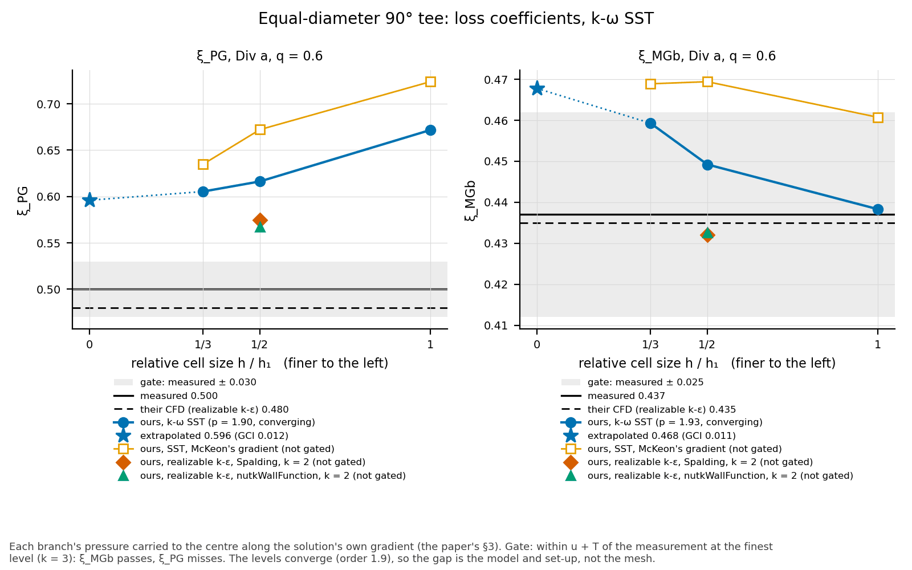

# Results: equal-diameter 90° tee, loss coefficients, k-ω SST

**Status: missed** (task 0162; decision 0012's note of 2026-11-18).  One
point run, Div a at q = 0.6, at three mesh levels.  ξ_MGb passes its
gate; ξ_PG misses it.  The mesh has converged, so the miss is the
model and set-up's: refining further won't close it.

- **Runs:** 2026-11-16 to 2026-11-18, with OpenFOAM v2406 (Docker
  `opencfd/openfoam-default:2406`) and gmsh 4.12.1, on 3 MPI processes;
  k = 3 and k-ε from a copy of hexmesh 972d9cb, k = 1 and 2 from the tree
  of 2026-11-16 (commit not recorded).
  Wall time 33 min (k = 1), about 4 h (k = 2), 14 h 11 min (k = 3);
  the k-ε run with `nutkWallFunction` 3 h 46 min, from hexmesh 1d5902c.
  Peak memory up to 1.9 GiB in the containers at k = 1 and 2; not
  logged at k = 3.
- **Reference:** Štigler, Klas & Šperka (2014), figures 5 and 6,
  digitised (`reference/stigler_2014.csv`): measured ξ_PG 0.50 and ξ_MGb
  0.437 (± 0.01 reading), their CFD 0.48 and 0.435.
- **Recheck:** `python3 -m validation.tools.recheck junction_loss`.

<!-- graphs:start -->
## Graphs

_Drawn from `results.json` by `python3 -m validation.tools.plots`; don't edit between the markers._

ξ_PG and ξ_MGb at Div a, q = 0.6, against cell size: the measurement, its gate, their CFD and ours.

<!-- graphs:end -->

## Gates

| quantity | value | gate | verdict |
|---|---|---|---|
| Div a xi_PG q 0.6 (k = 3) | 0.605 | within 0.030 of 0.500 | **missed** (by 0.105) |
| Div a xi_MGb q 0.6 (k = 3) | 0.459 | within 0.025 of 0.437 | pass |
| Div a q 0.6 xi_PG (k = 1, 2, 3) | order 1.90, extrapolated 0.596, GCI 0.012 | Richardson converging | pass |
| Div a q 0.6 xi_MGb (k = 1, 2, 3) | order 1.93, extrapolated 0.468, GCI 0.011 | Richardson converging | pass |

The gates apply to the finest level.  ξ_MGb's extrapolated value, 0.468,
lies 0.006 outside its gate's band: it passes at k = 3, narrowly, and
moves away from the measurement as the mesh is refined.

## What the miss means

- **Not the mesh.**  ξ_PG converges monotonically at order 1.9, and its
  GCI at k = 3 (0.012) is about a tenth of the gap to the measurement
  (0.096 extrapolated).
- **Not the pressure method alone.**  With McKeon's gradient in place
  of the solution's own, ξ_PG is higher still (0.635 at k = 3).  The two
  methods approach each other as the mesh is refined: the own slopes
  over McKeon's fall from 1.14, 1.09, 1.30 (a, b, c) at k = 2 to 1.08,
  0.99, 1.17 at k = 3.
- **The model and set-up.**  Realizable k-ε, the paper's model, gives
  ξ_PG 0.575 at k = 2, 0.04 below SST at the same level and still 0.075
  above the measurement.  With `nutkWallFunction`, the nearest v2406
  has to Fluent's non-equilibrium wall functions, in place of
  Spalding's, it gives 0.567: the wall treatment's share is 0.008, and
  the run is still 0.057 above the measurement, outside 0.45–0.51.  So
  neither the model nor the wall function brings our meshes to their
  CFD's 0.48.  What is left is what wasn't run: their transient solve
  and their 2.3 M-cell mesh (see *Not run*).

## Reported (not gated)

| Div a, q = 0.6 | cells | ξ_PG own gradient | ξ_PG McKeon | ξ_MGb own gradient | ξ_MGb McKeon |
|---|---|---|---|---|---|
| k = 1, SST | 65 792 | 0.672 | 0.724 ± 0.008 | 0.438 | 0.461 ± 0.004 |
| k = 2, SST | 526 336 | 0.616 | 0.672 ± 0.010 | 0.449 | 0.469 ± 0.008 |
| k = 3, SST | 1 776 384 | 0.605 | 0.635 ± 0.005 | 0.459 | 0.469 ± 0.002 |
| k = 2, realizable k-ε, Spalding | 526 336 | 0.575 | 0.667 | 0.432 | 0.472 |
| k = 2, realizable k-ε, `nutkWallFunction` | 526 336 | 0.567 | 0.650 | 0.433 | 0.468 |
| measured (their CFD) | | 0.50 (0.48) | | 0.437 (0.435) | |

± is the standard deviation of the 12 samples over the last 2400
iterations: SST's steady solve oscillates with a period of about 1200
iterations; k-ε's settles (its samples agree to 10⁻⁵).  The window
sampled the McKeon values only, so the own gradient's spread isn't
stored.  No level meets the solver's residual
tolerance (`converged` false); the coefficients are steady in the mean.

checkMesh passes at every level: at k = 3, non-orthogonality 50.3,
skewness 2.37, aspect ratio 86.5.

## Not run

The task's 20 points (Div a, Com a, Div c and Com c at q = 0.2 to 1.0),
the Com a convergence point and the Reynolds check (5 × 10⁴, 2 × 10⁵)
are not run.  At k = 2 they cost about 80 h on this machine.  With ξ_PG
off by about 0.1 at the point tried, they would show the curves' shape,
not change the verdict.  Task 0168 (a volunteer card for them) waits for
the user's say.

**A transient run like the paper's** (`run.py --transient`: realizable
k-ε, `pimpleFoam` from rest, `maxCo` 1, settle 20 s, average 12 s) was
set up and dropped.  At k = 2 on 3 processes a time step costs about
41 s (about 200 GAMG iterations on p) and the step settles near
0.4-0.5 ms, so the 32 s planned would take about 70 000 steps, about
800 h.  The steady k-ε run settles (its samples agree to 10⁻⁵), and a
RANS flow that settles has that steady state as its transient limit, so
the run would most likely have reproduced the steady value.  In its
place, the steady k-ε run was repeated with the transient set-up's wall
function (`nutkWallFunction`): ξ_PG 0.567 against 0.575 with Spalding's.
It settles as well (its samples agree to 10⁻⁵).
