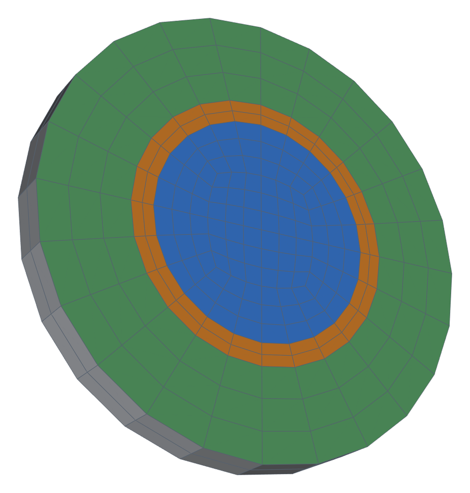
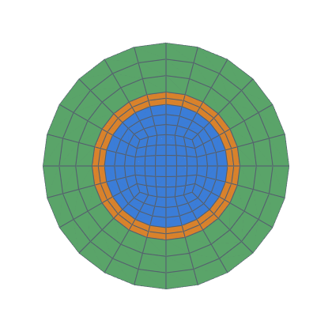
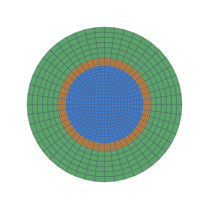
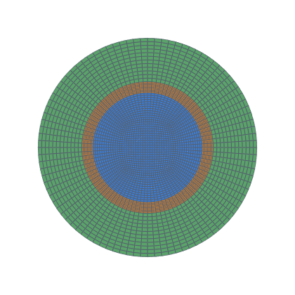

# Layered conduction validation

Steady conduction through a heated rod in a steel shell and an insulation
shell, three solid regions coupled at their interfaces, against the exact
solution (decision 0012, task 0034).  It checks hexmesh's multi-material
output in a coupled solve:
- the layer stack and exact layer thicknesses;
- material interfaces through `splitMeshRegions` → `mappedWall`;
- the role manifest.

It has no flow, so interface coupling is tested on its own.

```bash
python3 validation/layered_conduction/run.py                  # both variants, 3 levels (~45 min)
python3 validation/layered_conduction/run.py --levels 1       # coarsest level (~1 min per variant)
python3 validation/layered_conduction/run.py --json out.json  # results as JSON
python3 -m pytest -m openfoam tests/test_validation.py -k layered   # coarsest level
```

Needs OpenFOAM v1912 (`/usr/share/openfoam/etc/bashrc`).  Cases go to
`validation/layered_conduction/work/<variant>-<k>/` (git-ignored), or to
`--work DIR`.

## Case

| | |
|---|---|
| Geometry | rod r₁ = 10 mm, steel to r₂ = 12 mm, insulation to r₃ = 20 mm; length 4 mm, 2 axial layers (axially uniform) |
| Materials | k = 20 / 50 / 0.05 W/(m K): they differ strongly, so a coupling error shows |
| Source | q‴ = 10⁶ W/m³ in the rod (`fvOptions` `scalarSemiImplicitSource` on `h`, `volumeMode specific`) |
| Variants | *fixed*: outer surface at T₃ = 300 K; *convection*: h = 20 W/(m² K) to T∞ = 300 K (`externalWallHeatFluxTemperature`, `mode coefficient`) |
| Exact | q′ = q‴ π r₁²; shells T(r) = T_out,i + q′/(2π kᵢ) ln(r_out,i / r); core T(r) = T(r₁) + q‴ (r₁² − r²)/(4 k₁); convection T₃ = T∞ + q′/(2π r₃ h) |
| Levels | `nang` 6 / 12 / 24, every `nrad` scaled: the coarse stack (`nrad` 3 / 2 / 3) refined by `Assembly.refined(k)`, k = 1, 2, 4, with the axial count put back to 2 |
| Solver | `chtMultiRegionSimpleFoam`, three solid regions, no fluid; interfaces `compressible::turbulentTemperatureCoupledBaffleMixed` (`kappaMethod solidThermo`); ends zeroGradient |

The recipe and this build's quirks are in `docs/integrations/openfoam.md`:
- `constant/g` is needed;
- `residualControl` is ignored for solid regions;
- the coupling converges slowly.

So each level runs a fixed 75 000 · k iterations.  It counts as converged
when the largest initial residual of `h`, over the regions, is below
1e-10 at the last step.

<!-- mesh:start -->
## Mesh

_Generated by `python3 docs/gallery/build.py --validation layered_conduction`; don't edit between the markers._



<p>  </p>

Inlet cross-sections, left to right: k = 1: nang 6, nrad 3 / 2 / 3; k = 2: nang 12, nrad 6 / 4 / 6; k = 4: nang 24, nrad 12 / 8 / 12.

| Mesh | Cells | min SICN | min SJ (where) | max aspect |
|---|---|---|---|---|
| k1 | 456 | 0.666 | 0.793 (#0 Straight) | 3.0 |
| k2 | 1 824 | 0.505 | 0.752 (#0 Straight) | 4.0 |
| k4 | 7 296 | 0.271 | 0.730 (#0 Straight) | 8.0 |

<!-- mesh:end -->

## Post-processing (Python, from the ASCII case files; `hexmesh.study.openfoam`)

- **Interface and outer temperatures:** area-averaged face values of the
  `mappedWall` patches (`rod_to_steel`, `steel_to_insulation`) and of
  `insulation_wall`.
- **Centre temperature:** T = c₀ + c₂ r² fitted to the rod cells within
  r₁/3.
- **Energy balance:** the heat leaving the rod, the steel and the
  insulation through their outer patches, k (T_cell − T_face)/d · A,
  against q‴ · V_rod (meshed volume).
- **L2 error per region:** volume-weighted, relative to the total rise
  T₀ − 300 K.
- **mappedWall pairs:** face counts equal on both sides of each interface.
- **Richardson extrapolation** and observed orders
  [`celik_and_ghia_etal_2008`] (decision 0015).

Results: [RESULTS.md](RESULTS.md).
