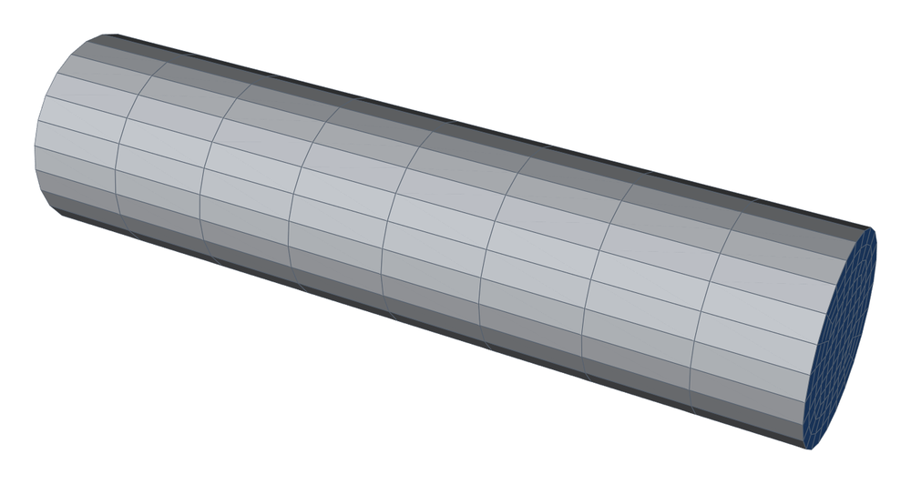
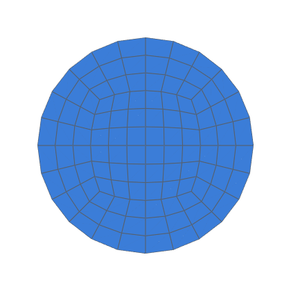
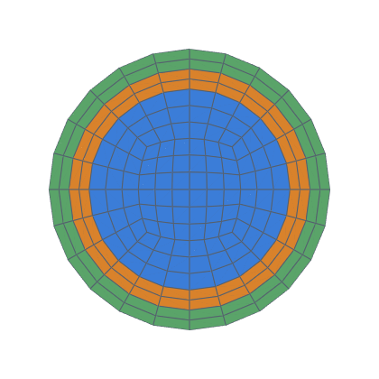
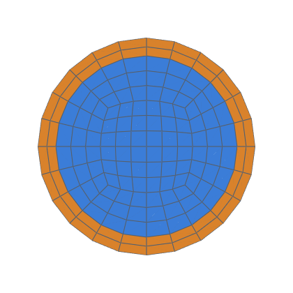
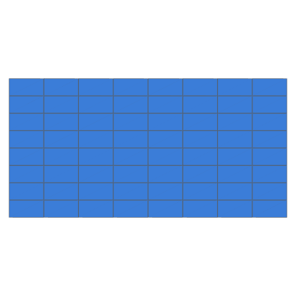
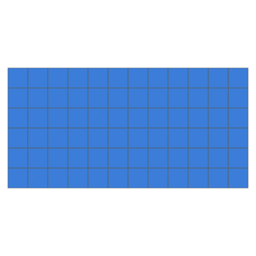

# Manufactured solutions: conduction on every fitting

Steady conduction with a manufactured exact field, on the mesh of each
fitting (decision 0012, V1; task 0074).  The harness has no physics to
model: it measures how the discretisation error falls on hexmesh's meshes,
fitting by fitting.

```bash
python3 validation/mms/run.py                          # 16 cases × k = 1, 2, 4
python3 validation/mms/run.py --cases tee bend --levels 1 2 --np 4
python3 -m validation.tools.recheck mms                # the table, from results.json
```

The runs need OpenFOAM v2406 (Docker `opencfd/openfoam-default:2406`, the
default runner; `--openfoam native` for a local v2406).  Case directories
go to `validation/mms/work/` (git-ignored), or to `--work DIR`.  Each is
deleted once its level's results are stored.

## Method

| | |
|---|---|
| Exact field | T_m = sin(a x + 0.3) sin(b y + 0.7) sin(c z + 1.1).  a, b, c give 1.5 wavelengths along each extent of the k = 1 mesh's bounding box, but no wavelength shorter than the main diameter |
| Equation | ∇·(D_T ∇T) + S = 0, D_T = 1, S = (a² + b² + c²) T_m |
| Source | `scalarSemiImplicitSource` with an `exprField` source (`constant/fvOptions`), evaluated at the cell centres |
| Boundaries | T = T_m on every patch (`uniformFixedValue` with an `expression` Function1, at face centres) |
| Layers | one conductivity everywhere: layers, shells and stack changes are mesh topology here |
| Solver | `laplacianFoam`, `steadyState`, `Gauss linear corrected`, 10 non-orthogonal correctors per step, `residualControl` T 1e-11 |
| Conversion | `gmshToFoam -keepOrientation` when every hex is right-handed (`docs/integrations/openfoam.md`) |
| Levels | `refined(k)`, k = 1, 2, 4 (8× the cells per level) |
| Error | T − T_m at the cell centres, recomputed as OpenFOAM does.  Volume-weighted L2 and max, overall, in the fitting under test (*focus*) and per fitting.  Cells are matched to fittings by the nearest gmsh hex centroid |

## Cases (`R` = 0.05 m)

`straight`, `bend` (3 R, 90°), `miter` (3 cuts), `spline` (3-D),
`reducer` (a cosine constriction to 0.6 R), `transition` (circle → 2.4 ×
1.6 R rectangle), `tee` and `tee_shells` (r/R 0.5; with two shells),
`stack_change` (a shell ending inside a straight), `wye60`, `wye90`,
`wye60_shell`, `wye90_shell`, `duct_tap_rect` and `duct_tap_round` (on a
4 R × 2 R duct), and `duct` (a straight duct).  The `*_lim` cases are a
diagnostic: the duct taps with `limited corrected 0.5`.

Results: [RESULTS.md](RESULTS.md).
<!-- mesh:start -->
## Mesh

_Generated by `python3 docs/gallery/build.py --validation mms`; don't edit between the markers._



<p>               </p>

Inlet cross-sections, left to right: straight, k = 1; bend, k = 1; miter, k = 1; spline, k = 1; reducer, k = 1; transition, k = 1; tee, k = 1; tee_shells, k = 1; stack_change, k = 1; wye60, k = 1; wye90, k = 1; wye60_shell, k = 1; wye90_shell, k = 1; duct_tap_rect, k = 1; duct_tap_round, k = 1; duct, k = 1.

| Mesh | Cells | min SICN | min SJ (where) | max aspect |
|---|---|---|---|---|
| straight | 864 | 0.238 | 0.793 (#0 Straight) | 7.5 |
| bend | 1 296 | 0.238 | 0.790 (#1 Bend) | 7.5 |
| miter | 1 728 | 0.238 | 0.766 (#1 MiterBend) | 7.5 |
| spline | 1 944 | 0.219 | 0.791 (#1 SplinePipe) | 8.3 |
| reducer | 1 296 | 0.096 | 0.751 (#1 Reducer) | 14.8 |
| transition | 1 044 | 0.238 | 0.577 (#1 Transition) | 7.5 |
| tee | 2 376 | 0.121 | 0.258 (#1 Tee) | 15.0 |
| tee_shells | 4 440 | 0.121 | 0.258 (#1 Tee) | 15.0 |
| stack_change | 1 440 | 0.238 | 0.793 (#0 Straight) | 10.0 |
| wye60 | 3 996 | 0.170 | 0.156 (#1 Wye) | 7.5 |
| wye90 | 4 428 | 0.195 | 0.164 (#1 Wye) | 7.5 |
| wye60_shell | 5 748 | 0.170 | 0.156 (#1 Wye) | 10.0 |
| wye90_shell | 6 372 | 0.195 | 0.164 (#1 Wye) | 10.0 |
| duct_tap_rect | 7 936 | 0.146 | 0.424 (#1 Tee) | 12.0 |
| duct_tap_round | 9 472 | 0.107 | 0.433 (#1 Tee) | 15.3 |
| duct | 576 | 0.623 | 1.000 (#0 Straight) | 3.0 |

<!-- mesh:end -->

