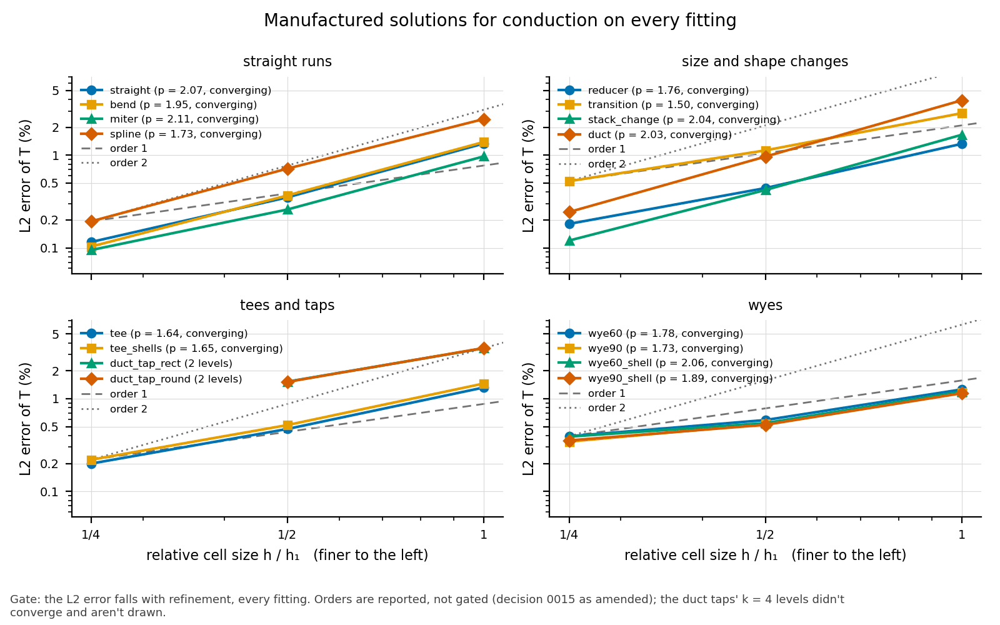

# Results: manufactured solutions for conduction on every fitting

**Status: accepted** on what is verified (task 0074; design answers
2026-11-07): the straight, bend, spline, stack change and rectangular
duct converge at the straight's order; the wyes outside their split
region.  The other fittings are reported, with the checks below.
Run on 2026-11-06 with OpenFOAM v2406 (Docker `opencfd/openfoam-default:2406`)
and gmsh 4.12.1, at hexmesh 42357ca with this task's uncommitted changes.
k = 4 ran on 4 MPI processes.  Error = T − T_m at the cell centres; the
field's amplitude is 1.  The numbers below are recomputed from
`results.json` by `python3 -m validation.tools.recheck mms`.

<!-- graphs:start -->
## Graphs

_Drawn from `results.json` by `python3 -m validation.tools.plots`; don't edit between the markers._

The L2 error of the manufactured solution on every fitting against cell size.

<!-- graphs:end -->

## Gate: the error falls with refinement

It falls in every case, over its converged levels.  For the duct taps,
those are k = 1 and 2 only (see below).

## Orders (reported, not gated; decision 0015 as amended)

"Fitting" means the cells of the fitting under test; the rest is the
straight run around it.  **Flag:** the fitting's last L2 order is more
than 0.3 below the straight's last order (1.60).

| case | k | cells (finest) | L2 | order L2 (all) | order L2 (fitting) | order max (fitting) | max error at | flag |
|---|---|---|---|---|---|---|---|---|
| straight | 1, 2, 4 | 55296 | 0.0134, 0.00351, 0.00116 | 1.93, 1.60 | 1.93, 1.60 | 1.19, 1.34 | Straight0 (boundary cell) |  |
| bend | 1, 2, 4 | 82944 | 0.0139, 0.00368, 0.00103 | 1.92, 1.83 | 2.06, 1.72 | 2.10, 0.99 | Straight0 (boundary cell) |  |
| miter | 1, 2, 4 | 110592 | 0.00971, 0.00259, 0.000948 | 1.90, 1.45 | 1.84, 1.14 | 1.33, 0.57 | MiterBend1 | **yes** |
| spline | 1, 2, 4 | 124416 | 0.0246, 0.00717, 0.00193 | 1.78, 1.89 | 1.77, 1.90 | 1.21, 1.49 | SplinePipe1 (boundary cell) |  |
| reducer | 1, 2, 4 | 82944 | 0.0133, 0.00442, 0.00181 | 1.59, 1.28 | 0.93, 0.95 | 0.71, 0.91 | Reducer1 (boundary cell) | **yes** |
| transition | 1, 2, 4 | 66816 | 0.0284, 0.0113, 0.00524 | 1.33, 1.11 | 0.97, 0.97 | 0.71, 0.50 | Transition1 | **yes** |
| tee | 1, 2, 4 | 152064 | 0.0132, 0.00471, 0.00199 | 1.49, 1.24 | 1.28, 1.03 | 0.72, 0.83 | Tee1 | **yes** |
| tee_shells | 1, 2, 4 | 284160 | 0.0146, 0.00519, 0.0022 | 1.49, 1.24 | 1.29, 1.04 | 0.57, 0.71 | Tee1 | **yes** |
| stack_change | 1, 2, 4 | 92160 | 0.0166, 0.00421, 0.0012 | 1.98, 1.81 | 1.98, 1.81 | 1.36, 1.37 | Straight0 (boundary cell) |  |
| wye60 | 1, 2, 4 | 193536 | 0.0126, 0.00588, 0.00393 | 1.10, 0.58 | 0.81, 0.46 | 0.69, −0.07 | Wye1 | **yes** |
| wye90 | 1, 2, 4 | 221184 | 0.0117, 0.00536, 0.00344 | 1.13, 0.64 | 0.80, 0.51 | 0.17, 0.24 | Wye1 | **yes** |
| wye60_shell | 1, 2, 4 | 278016 | 0.0119, 0.00545, 0.00389 | 1.13, 0.48 | 0.79, 0.34 | −0.10, −0.08 | Wye1 | **yes** |
| wye90_shell | 1, 2, 4 | 317952 | 0.0114, 0.00523, 0.00354 | 1.13, 0.56 | 0.76, 0.42 | −0.09, 0.01 | Wye1 | **yes** |
| duct_tap_rect | 1, 2 | 63488 | 0.0351, 0.0153 | 1.20 | 0.78 | 0.71 | Tee1 | **yes** |
| duct_tap_round | 1, 2 | 75776 | 0.0353, 0.0152 | 1.22 | 0.79 | 0.71 | Tee1 | **yes** |
| duct | 1, 2, 4 | 36864 | 0.0391, 0.00966, 0.00244 | 2.02, 1.99 | 2.02, 1.99 | 1.86, 1.67 | Straight0 (boundary cell) |  |

## Readings

- **The straight reproduces the heated rod (task 0033).**  At the same
  levels (nang 6, 12, 24) the rod's L2 orders are 1.77 and 1.57; here they
  are 1.93 and 1.60.  In both, the order falls with refinement and the
  max error sits in boundary cells.
- **Smooth sweeps converge like the straight.**  The bend, the spline,
  the stack change and the rectangular duct have fitting orders of
  1.7–2.0.
- **The wyes don't refine everywhere.**  `refined(k)` holds a wye's
  `n_split` at `WYE_N_SPLIT_MAX` = 6 at every k (task 0056).  So the
  split region gets no finer across its turning layers, and its error
  stalls: the max error doesn't fall at all.  The order is therefore the
  cap's, not the scheme's.  **Per case (design answer to Q3):** in
  wye60, wye90, wye60_shell and wye90_shell, `nang` and the axial counts
  are refined and the split region is not, so their error in the split
  region is not verified.
- **The tees, the transition and the reducer converge at about first
  order** (0.93–1.28).  Their fitting cells keep a constant worst scaled
  Jacobian under refinement (tee 0.258, transition 0.577).  Gauss-linear
  gradients on skewed faces are first order.
- **The duct taps don't converge at k = 3 or 4.**  `laplacianFoam`'s
  explicit non-orthogonal correction stops contracting: about 0.92 per
  corrector at k = 2, and 1.04 at k = 3, where the residual grows 1.43×
  per 10-corrector step.  The meshes pass `checkMesh` (non-orthogonality
  64°, worst scaled Jacobian 0.42).  The tap's 7552 hexes at k = 1 have
  edge ratios up to 13 (median 3; "12–13 throughout" in the first
  version of this file was the maximum), and 60°+ non-orthogonality.  The wyes,
  at 80° but with lower aspect, converge.  A pseudo-transient (Euler,
  Δt 1e-3) gives the same solution and barely damps the iteration.
  `limited corrected 0.5` (the `*_lim` levels in `results.json`) is
  worse at k = 1 (L2 0.0425 against 0.0351) and didn't converge at k = 2.

## The design answers' checks (2026-11-07)

Run on 2026-11-07 with the same toolchain, at hexmesh c8c7c76 plus this
task's driver changes, on 3 MPI processes beside the 0075 run.  The
levels are in `results.json` as diagnostic series:
- `<case>_loc`: the same scheme again.  It reproduces the stored levels
  to every printed digit;
- `<case>_lsq`: `gradSchemes` `pointCellsLeastSquares`;
- `<case>_skew`: `interpolationSchemes` `skewCorrected linear`;
- `straight_lsq`.

**Check 1: the geometry tightens.**  The wall's deviation from the exact
surface between neighbouring stations, per k:

| fitting | k = 1 | k = 2 | k = 4 | |
|---|---|---|---|---|
| reducer, chord gap / R (n_layers 8, 16, 32) | 0.0281 | 0.0075 | 0.0019 | second order |
| transition | 0 | 0 | 0 | exact: the node blend is linear in u, so the true wall is ruled like the slabs |

The reducer's stations are evenly spaced at every k (neighbour ratio
1.000).  Neither fitting has a geometry error that refinement leaves.

**Check 2: skewness and where the error sits.**
- `checkMesh` max skewness per k (from the first study):
  - reducer 0.54, 0.48, 0.51 (the same cells as the straight's);
  - miter 0.67 at every k;
  - transition 2.14 → 2.28;
  - tee 1.61 → 1.90;
  - tee_shells 2.59 → 2.94.
- **Block interfaces** (cells with a face between two gmsh volumes):
  - in the tee, the error in those cells converges at 0.84 (k 2 → 4)
    and in the rest at 1.04, so it isn't concentrated there;
  - the reducer and the miter are built as one volume per station slab,
    so every cell touches an interface, and in the transition 87 % do
    (42 092 of 48 384 at k = 4).  For these the split says nothing.

**Check 3: a skew-aware gradient.**  Fitting L2 order, k 2 → 4:

| fitting | Gauss linear | `skewCorrected` interpolation | `pointCellsLeastSquares` | below `straight_lsq` |
|---|---|---|---|---|
| straight | 1.60 | | 1.83 | — |
| miter | 1.14 | 1.14 | 1.67 | 0.16 |
| tee_shells | 1.04 | 1.04 | 1.49 | 0.34 |
| tee | 1.03 | 1.03 | 1.32 | 0.51 |
| transition | 0.97 | 0.97 | 1.24 | 0.59 |
| reducer | 0.95 | 0.95 | 0.97 | 0.86 |

- `skewCorrected` changes nothing, to 13 digits.  The `corrected` snGrad
  interpolates the gradient with a hard-coded `linear`
  (`docs/integrations/openfoam.md`).
- **The miter recovers:** its first order is the scheme on its kinked
  grid lines.
- **The rest don't.**  What they share is a boundary non-orthogonality
  that refinement doesn't shrink.  This is the angle between a wall
  face's normal and the vector from its cell's centre to the face
  centre.  `fixedValue`'s snGrad has no correction for it.  In the
  fitting's wall faces, k = 1 → 2 → 4:

  | fitting | median | max |
  |---|---|---|
  | straight | ≈ 0 | 1.7° at k = 4 |
  | bend | 1.3°, 1.2°, 1.3° | 1.9° → 1.7° |
  | reducer | 21°, 23°, 24° | 29° → 32° |
  | transition | 13°, 14°, 12° | 44° → 52° |
  | tee | 9.4°, 8.9°, 9.1° (p90 27°, 22°, 23°) | 61° → 67° |

- The wall is in the right place.  But on a sloped wall, or one that
  turns into the branch, the near-wall cells follow the axis, not the
  wall's normal.
- The reducer has no interior skew to speak of (its skewness is the
  straight's) and the most wall non-orthogonality.  It gains nothing
  from the better gradient.

**Q2: the duct taps' aspect doesn't grow with k.**  k = 1, 2, 3:

| | rect tap | round tap |
|---|---|---|
| hex edge ratio in the tap, max | 13.1, 12.5, 12.3 | 13.1, 12.5, 12.3 |
| … median | 3.1, 3.0, 3.0 | 3.2, 3.0, 3.0 |
| `checkMesh` max aspect, whole mesh | 12.0, 12.8, 13.7 | 22.2, 24.8, 25.8 |
| `checkMesh` max non-orthogonality | 61.9, 63.5, 64.0 | 61.3, 62.9, 63.4 |
| tap hexes / a neighbouring straight's (k = 1; both ×k³) | 7552 / 128 | 8960 / 128 |

- The round tap's whole-mesh aspect of 22–26 is in its branch straight
  (edge ratio 15.3 at every k), not in the tap.
- **What sets the tap's counts:**
  - across and deep: the main duct's `nang_w` and `nang_h` (8 and 8);
  - the O-grid's radial count: `n_wall`, from `DuctTap.wall_cells`.  It
    is a ceiling that makes cells about as long as the branch's along
    the main: 8 (rect) and 13 (round) at k = 1, scaled by `refined`;
  - axially: the Tee's `n_run` and `n_branch` (defaults);
  - the main's `nrad`.
- Refinement doesn't stretch the tap's cells, so by design's rule the
  stall at k ≥ 3 isn't a refinement defect of the fitting.  A stopgap
  for users is in `docs/integrations/openfoam.md`.

## gmshToFoam

Every level ran `gmshToFoam -keepOrientation`: every mesh's worst scaled
Jacobian is positive.  `gmshToFoam_would_invert` counts the hexes its own
orientation test would have turned inside out:
- 6 in wye90 at k = 4;
- 4 in wye60_shell at k = 4;
- 4 and 18 in wye90_shell at k = 2 and 4.

Without the option, those levels failed `checkMesh`.  See
`docs/integrations/openfoam.md`.
