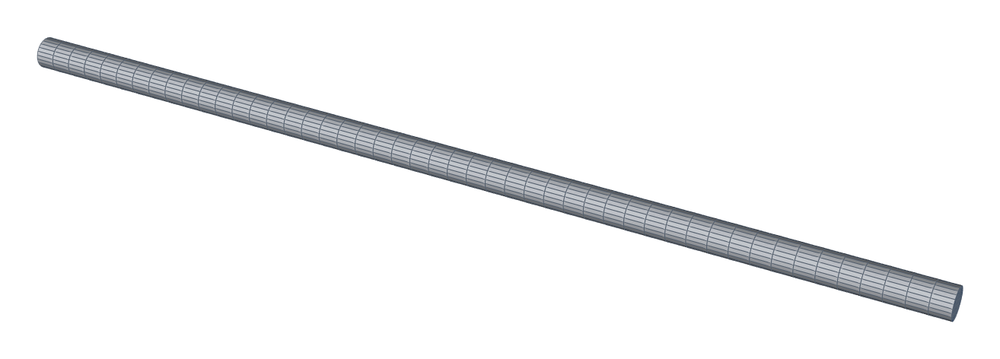
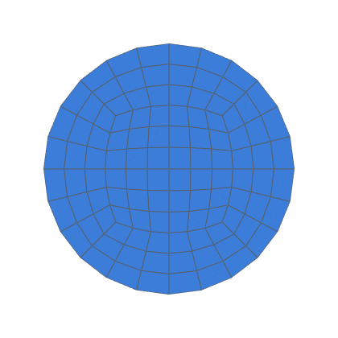
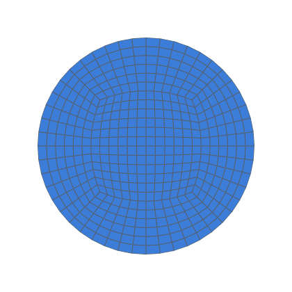

# Laminar Hagen–Poiseuille validation

Steady laminar flow in a straight pipe meshed by hexmesh, compared with the
exact solution at three refinement levels (decision 0012, task 0020).

```bash
python3 validation/poiseuille/run.py                       # all levels + nang sweep (~22 min)
python3 validation/poiseuille/run.py --levels coarse --no-trend   # one level (~5 s)
python3 validation/poiseuille/run.py --json out.json       # results as JSON
python3 -m pytest -m openfoam tests/test_validation.py     # acceptance checks
```

Needs OpenFOAM v1912 (`/usr/share/openfoam/etc/bashrc`).  Cases go to
`validation/poiseuille/work/<level>/` (git-ignored), or to `--work DIR`.

## Case

| | |
|---|---|
| Pipe | D = 0.02 m, length 30 D, inlet at x = 0, flow along +x |
| Fluid | ν = 1e-6 m²/s, Re = 100, Ū = 5e-3 m/s |
| Boundary conditions | inlet `fixedValue` U = Ū, p `zeroGradient`; outlet p = 0, U `zeroGradient`; wall `noSlip` |
| Mesh | three `Straight`s (15 D, 10 D, 5 D), so interfaces lie on the measurement planes at 15 D and 25 D; profile plane at 20 D |
| Levels | `nang` 6 / 12 / 24, `nrad` 3 / 6 / 12, axial layers 48 / 96 / 192: 8× cells per level |
| Solver | `simpleFoam`, laminar; pipeCyclic's schemes (`div(phi,U) bounded Gauss limitedLinearV 1`) and solvers; residual control p 1e-6, U 1e-7 |

<!-- mesh:start -->
## Mesh

_Generated by `python3 docs/gallery/build.py --validation poiseuille`; don't edit between the markers._



<p>  </p>

Inlet cross-sections, left to right: coarse: nang 6, nrad 3, 48 axial layers; medium: nang 12, nrad 6, 96 axial layers; fine: nang 24, nrad 12, 192 axial layers.

| Mesh | Cells | min SICN | min SJ (where) | max aspect |
|---|---|---|---|---|
| coarse | 5 184 | 0.192 | 0.793 (#0 Straight) | 9.4 |
| medium | 41 472 | 0.182 | 0.752 (#0 Straight) | 9.4 |
| fine | 331 776 | 0.177 | 0.730 (#2 Straight) | 9.4 |

<!-- mesh:end -->

## Pipeline

1. `Assembly.write_openfoam` → `gmshToFoam` → `apply_boundary_roles`
   (walls from the `.roles.json`) → `checkMesh`.
2. `topoSet` makes face zones at 15 D, 25 D and 20 D (`boxToFace` +
   `setToFaceZone`).
3. `simpleFoam` until converged.
4. **Post-processing in Python** from the ASCII case files.  OpenFOAM
   function objects abort on this install (`docs/integrations/openfoam.md`).
   - **Δp:** area-averaged `p` on the 15 D and 25 D zones.  Face values are
     ½(owner + neighbour), exact for the uniform axial spacing.
   - **Flow rates:** `phi` summed on the inlet and outlet patches.
   - **u_max:** u = c₀ − c₂ r² fitted to the 20 D faces within R/3, taking
     c₀.  No face centre lies on the axis; the nearest are 0.12 R off it at
     the coarse level, a 1.5 % offset in the exact profile.

5. **Errors, signed** (decision 0015), against two references:
   - **circle:** the exact solution below;
   - **mesh:** Poiseuille for the equivalent circle of the meshed section,
     Δp_ref = 8 π ν L Q / A² and u_max,ref = 2 Q / A.  A is the inlet
     patch's face area (the section is an inscribed polygon, about
     1.1 / 0.29 / 0.07 % short of πR²), and Q is the measured outlet
     flow.
6. **Richardson extrapolation** of the three levels
   (`celik_and_ghia_etal_2008`, ratio 2): observed order, extrapolated
   value and fine-level GCI for Δp and u_max.
7. **Non-orthogonality sweep** (skip with `--no-trend`): `checkMesh` only,
   on a 2 D pipe with the same cross-section at `nang` 6–96
   (`nrad` = `nang` / 2).

Exact values: Δp = 32 ν Ū L / D² = 8.0e-5 m²/s² over L = 10 D, and
u_max = 2 Ū = 1.0e-2 m/s.

**Acceptance** (`tests/test_validation.py`):
- extrapolated Δp and u_max within 0.1 % of exact;
- fine-level |error| below 1 % for both, decreasing at every level;
- u_max observed order ≥ 1.5.
- Δp's order is reported only, because the polygon's area error
  competes with it.

Results: [RESULTS.md](RESULTS.md).
