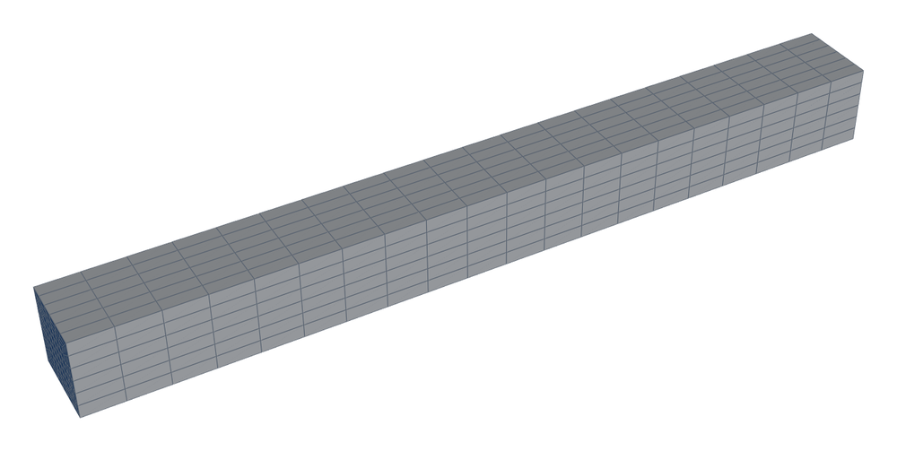
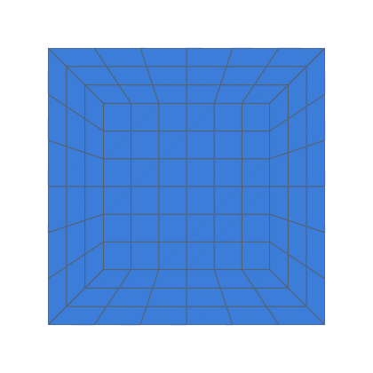
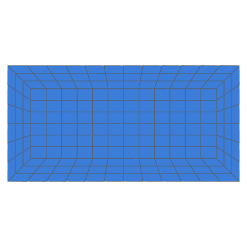
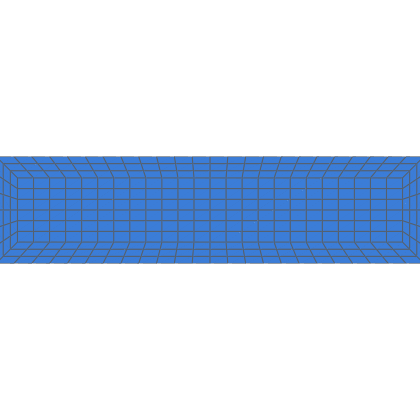
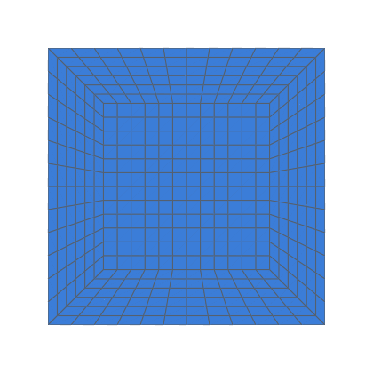
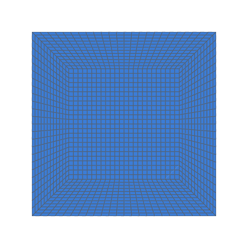

# Laminar flow in rectangular ducts

Fully developed laminar flow in straight rectangular ducts meshed by
hexmesh's rectangular O-H section, compared with the exact series
solution at three refinement levels, for aspect ratios 1, 2 and 4
(decision 0012, category V1; task 0071).  The same case on a uniform
Cartesian `blockMesh` grid is the control: the V1 gates apply to it, and
the O-H levels are reported against it (decision 0015 amendment 2).
hexmesh's H section (`layout="h"`, task 0084) with the control's counts
per section is gated like the control: it is the accepted hexmesh
result.

```bash
python3 validation/rect_duct/run.py --check-series          # the exact solution's checks (1 s)
python3 validation/rect_duct/run.py --json out.json         # 3 ratios × 3 levels × 3 meshes
python3 validation/rect_duct/run.py --ratios 1 --levels 1   # one case per mesh (~10 s)
python3 validation/rect_duct/run.py --meshes cartesian      # the control only
python3 validation/rect_duct/run.py --meshes h --np 2       # the H series, on 2 processes
python3 -m pytest -m openfoam tests/test_validation.py -k rect_duct
```

OpenFOAM v2406 in Docker by default (`--openfoam native` for a local
install).  Cases go to `validation/rect_duct/work/ar<a/b>_k<k>/`,
`cart_ar<a/b>_k<k>/` and `h_ar<a/b>_k<k>/` (git-ignored), or to `--work DIR`.  Levels already in `--json` are
reused.

## Exact solution

μ∇²u = dp/dx on |y| ≤ a, |z| ≤ b with u = 0 on the walls; a the half
width, b the half height, a ≥ b.  With G = −(dp/dx)/ρ:

u(y, z) = (G/2ν)(b² − z²)
  − (16 b² G / (ν π³)) Σ_{n odd} (−1)^((n−1)/2) / n³ · cosh(nπy/2b) / cosh(nπa/2b) · cos(nπz/2b)

Q = (4 a b³ G / 3ν) [1 − (192 b / (π⁵ a)) Σ_{n odd} tanh(nπa/2b) / n⁵]

This is the usual series [shah_and_london_1978; white_2006, ch. 3] with
its "1" term summed to the parallel-plate parabola.  The remaining
end-wall correction decays like exp(−nπ(a − |y|)/2b), so it converges
fast away from the walls.  The driver sums odd n up to 4001.  At twice
as many terms the values don't change at the sample points (relative
change 0 in double precision).

From these, f·Re = 2 D_h² G / (ν Ū) on the hydraulic diameter
D_h = 4ab/(a + b), with Darcy's f.  `--check-series` checks them:

| a/b | f·Re, series | Shah & London | u_c / Ū |
|---|---|---|---|
| 1 | 56.908 | 56.91 | 2.0963 |
| 2 | 62.192 | 62.19 | 1.9918 |
| 4 | 72.931 | 72.93 | 1.7737 |
| 1000 | 95.869 | 96 (plates, the limit) | 1.5009 |

The rectangle is meshed exactly: its walls are planes, so, unlike the
pipe's inscribed polygon, there is no geometric deficit.  The meshed
inlet area equals 4ab to round-off (reported per level), so the exact
solution is also the solution for the meshed geometry.

## Case

| | |
|---|---|
| Ducts | D_h = 0.02 m for every ratio: a/b = 1: 20 × 20 mm; 2: 30 × 15 mm; 4: 50 × 12.5 mm.  Length 10 D_h, flow along +x |
| Fluid | ν = 1e-6 m²/s, Re = 100 on D_h, Ū = 5e-3 m/s |
| Inlet | the exact developed profile, written once at the inlet face centres as a nonuniform `fixedValue`, scaled so the discrete flow rate is Ū·A.  The same profile is the initial field in every cell, so the duct is developed throughout and no development length is needed |
| Other boundaries | outlet p = 0, U `zeroGradient`; inlet p `zeroGradient`; walls `noSlip` |
| Planes | Δp between 3 D_h and 7 D_h; velocity field at 5 D_h.  Each lies on an interface between `Straight`s, so it's a plane of mesh faces |
| Mesh | `RectShape(a, b, nang_w, nang_h)` core: `nang_h` 6, `nang_w` 6·(a/b) (cells near square in the centre), `nrad` 3; axial cell D_h/2 |
| Levels | `Assembly.refined(k)`, k = 1, 2, 4: every count × k, k³ cells |
| Control | `blockMesh`, four blocks split at the three planes; uniform square cells, `nz` × `nz`·(a/b) per section with `nz` = round(√(O-H section cells / (a/b))): 10 × 10, 18 × 9, 36 × 9 (100, 162, 324 against the O-H's 108, 180, 324); the same axial cells and the same × k levels |
| Solver | `simpleFoam`, laminar; Poiseuille's schemes, solvers and residual control (p 1e-6, U 1e-7) |

<!-- mesh:start -->
## Mesh

_Generated by `python3 docs/gallery/build.py --validation rect_duct`; don't edit between the markers._



<p>    </p>

Inlet cross-sections, left to right: a/b = 1, k = 1: nang_w 6, nang_h 6, nrad 3; a/b = 2, k = 1: nang_w 12, nang_h 6, nrad 3; a/b = 4, k = 1: nang_w 24, nang_h 6, nrad 3; a/b = 1, k = 2: nang 12, nrad 6; a/b = 1, k = 4: nang 24, nrad 12.

| Mesh | Cells | min SICN | min SJ (where) | max aspect |
|---|---|---|---|---|
| ar1_k1 | 2 160 | 0.279 | 0.707 (#0 Straight) | 7.5 |
| ar2_k1 | 3 600 | 0.213 | 0.707 (#0 Straight) | 10.0 |
| ar4_k1 | 6 480 | 0.179 | 0.707 (#0 Straight) | 12.0 |
| ar1_k2 | 17 280 | 0.279 | 0.707 (#3 Straight) | 7.5 |
| ar1_k4 | 138 240 | 0.279 | 0.707 (#0 Straight) | 7.5 |

<!-- mesh:end -->

## Post-processing

In Python, from the ASCII case files (`hexmesh.study.openfoam`'s readers).

- **Δp:** the area-averaged `p` on the two planes.  Face values are
  ½(owner + neighbour), exact for the uniform axial spacing.
- **f·Re:** 2 D_h² (Δp/L) / (ν U_b), with U_b = Q_out / A from `phi`.
- **u_c:** u = c₀ + c₁y² + c₂z² + c₃y²z² fitted to the faces of the
  5 D_h plane within 0.4 of each half-side; u_c = c₀.  No face centre
  lies on the axis.  The same fit applied to the exact solution at the
  same faces (`u_c_sampling_err`) measures what the fit itself
  contributes.
- **Field:** max and area-weighted RMS of u − u_exact on the 5 D_h
  plane, as a fraction of the exact u_c.
- **Convergence:** three-level Richardson / GCI [celik_and_ghia_etal_2008]
  on f·Re and u_c, ratio 2, per mesh.
- **Against the control:** |O-H error| / |control error|, and H's, per
  ratio and level (`versus_control`).

## Results

See [RESULTS.md](RESULTS.md).
