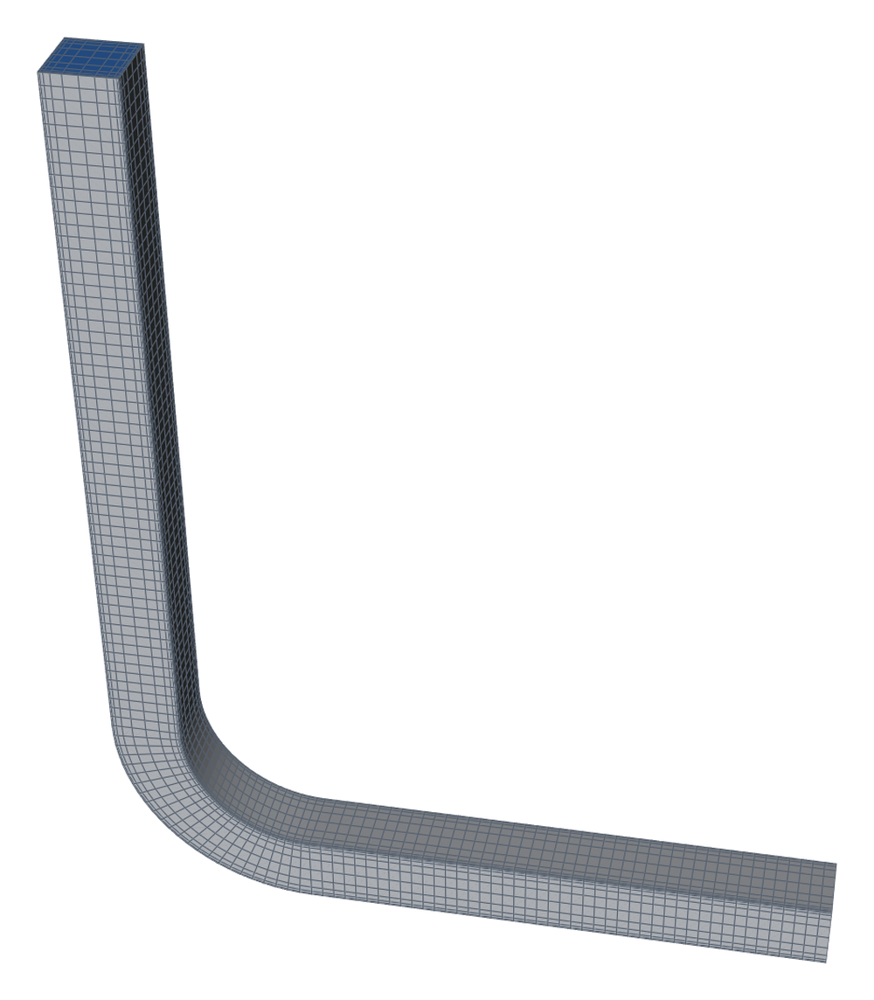
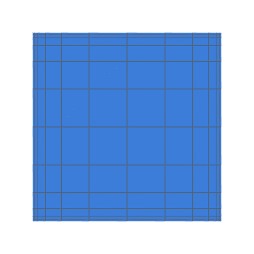
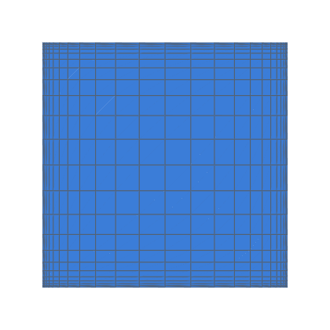

# Laminar 90° square-duct bend (Taylor, Whitelaw & Yianneskis, Re 790)

Developing laminar flow through a strongly curved bend of square section,
against LDV measurements (decision 0012, V3; task 0072).

```bash
python3 validation/square_bend/run.py --np 4             # inlet match, then both inlets at k = 1, 2, 3
python3 -m validation.tools.recheck square_bend           # gates, from results.json
```

The runs need OpenFOAM v2406 (Docker `opencfd/openfoam-default:2406` by
default).

## Case

| | |
|---|---|
| Duct | 40 × 40 mm (D_h = 40 mm), bend radii 72 / 112 mm (mean 92 mm, radius ratio 2.3), 90°, 10 D_h downstream to a zero-pressure outlet |
| Flow | V_c = 0.0198 m/s, Re = V_c D_h / ν = 790 (De 368), laminar steady `simpleFoam` (SIMPLEC, `linearUpwind`) |
| Inlets | **matched** (gated): a plug 12.6 D_h before the bend, the distance whose developing profile in a straight duct best matches X_H = −0.50 alone (`match_inlet`, k = 2), so X_H = −0.50 is its calibration station and isn't gated.  **rig** (a reported sensitivity): a plug at the contraction exit, 7.5 D_h before the bend.  `--inlets matched rig` |
| Mesh | hexmesh's H section (`layout="h"`, decision 0036), graded to every wall: `first_cell` D_h/120 at k = 1; 12 cells per side; k = 1, 2, 3 by `refined(k)` |
| Comparison | U/V_c (and V/V_c) at every point of Table I, interpolated linearly in the cell centres' Delaunay tetrahedra; RMS per station; the gapwise peak on the symmetry plane |

The station coordinates: g = (r − r_o)/(r_i − r_o) runs from the outer
wall (0) to the inner (1); z/z½ runs from the symmetry plane.  V is
positive toward the inner wall.

Data: [data/README.md](data/README.md).  Results: [RESULTS.md](RESULTS.md).
<!-- mesh:start -->
## Mesh

_Generated by `python3 docs/gallery/build.py --validation square_bend`; don't edit between the markers._



<p> </p>

Inlet cross-sections, left to right: k = 1: 12 cells per side; k = 2: 24 cells per side.

| Mesh | Cells | min SICN | min SJ (where) | max aspect |
|---|---|---|---|---|
| k1 | 18 576 | 0.091 | 0.999 (#1 Bend) | 24.2 |
| k2 | 148 608 | 0.071 | 1.000 (#1 Bend) | 31.7 |

<!-- mesh:end -->

