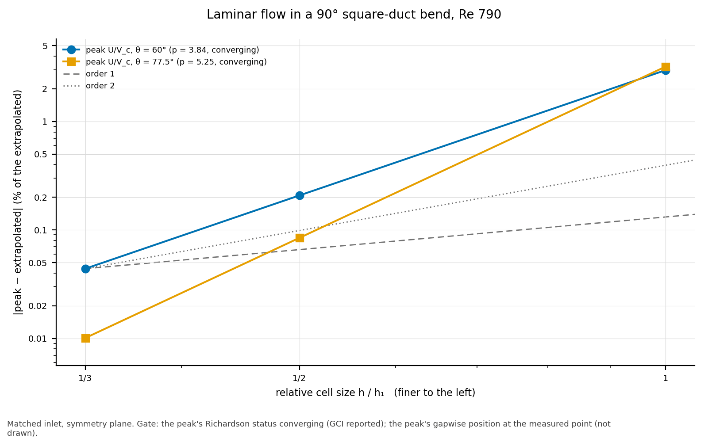

# Results: laminar flow in a 90° square-duct bend, Re 790

**Status: accepted** (task 0072; design answers 2026-11-06).  The case
is gated on what the mesh controls, on the matched inlet: the peak U's
convergence, and the peak's position through the bend.

- **Run:** 2026-11-06, with OpenFOAM v2406 (Docker
  `opencfd/openfoam-default:2406`) and gmsh 4.12.1, on 4 MPI processes.
- **Reference:** Taylor, Whitelaw & Yianneskis (1981), NASA CR-3367,
  Table I (`data/`).
- **Recheck:** `python3 -m validation.tools.recheck square_bend`.

<!-- graphs:start -->
## Graphs

_Drawn from `results.json` by `python3 -m validation.tools.plots`; don't edit between the markers._

The peak velocity at θ = 60° and 77.5° against cell size, from its extrapolated value.

<!-- graphs:end -->

## Inlets

- **Matched (gated):** a plug 12.6 D_h before the bend.  The length is
  fitted to the X_H = −0.50 profile alone: in a straight duct at k = 2,
  the developing profile there matches it best (RMS 0.048 V_c).  So
  X_H = −0.50 is the calibration station, reported and not gated.
- **Rig (a reported sensitivity):** a plug at the contraction exit,
  7.5 D_h before the bend, as in the experiment.  It gives 0.089 V_c at
  X_H = −0.50.

## Gates (matched inlet)

| quantity | value | gate | verdict |
|---|---|---|---|
| peak U/V_c on the symmetry plane, θ = 60°, k = 1, 2, 3 | 1.5720, 1.6168, 1.6195 | Richardson converging | pass (order 3.84, GCI 0.05 %) |
| the same, θ = 77.5° | 1.6250, 1.6774, 1.6786 | converging | pass (order 5.25, GCI 0.01 %) |
| peak position g, k = 3: X_H = −0.25 | 0.5 (measured 0.5) | at the measured point | pass |
| θ = 30° | 0.5 (0.5) | | pass |
| θ = 60° | 0.3 (0.3) | | pass |
| θ = 77.5° | 0.1 (0.1) | | pass |
| X_H = +0.25 | 0.1 (0.1) | | pass |
| X_H = +0.40 | 0.1 (0.1) | | pass |

The peak moves from mid-gap to the outer wall through the bend, as
measured.  At the calibration station (X_H = −0.50) it is at 0.5, as
measured.

## Reported: U/V_c RMS difference against the measurements (V_c)

The comparison is at 5 %, and its floor is the upstream mismatch.

| station | matched k = 1 | k = 2 | k = 3 | rig k = 1 | k = 2 | k = 3 |
|---|---|---|---|---|---|---|
| X_H = −0.50 (calibration) | 0.081 | 0.048 | 0.047 | 0.101 | 0.089 | 0.091 |
| X_H = −0.25 | 0.114 | 0.082 | 0.076 | 0.123 | 0.101 | 0.100 |
| θ = 30° | 0.098 | 0.050 | 0.048 | 0.118 | 0.081 | 0.079 |
| θ = 60° | 0.084 | 0.077 | 0.093 | 0.130 | 0.083 | 0.075 |
| θ = 77.5° | 0.168 | 0.109 | 0.098 | 0.186 | 0.114 | 0.085 |
| X_H = +0.25 | 0.203 | 0.114 | 0.082 | 0.215 | 0.137 | 0.101 |
| X_H = +0.40 | 0.197 | 0.109 | 0.081 | 0.206 | 0.126 | 0.086 |

- **Cells:** the matched mesh has 23 040, 184 320 and 622 080; the rig
  mesh has 18 576, 148 608 and 501 552.
- **The 5 % comparison is missed** at five of the seven stations on the
  matched inlet, and at every station on the rig inlet.
- **Measurement errors** (report §2.3): V_c ±0.8 %.  U/V_c has up to 3 %
  systematic error near velocity gradients, and under 1 % elsewhere.
- **The measured grid's flux:** by the trapezoid rule on the measured
  points, the measured values carry 0–3 % more flux than the computed
  field (matched inlet, k = 3).

## Rig inlet (sensitivity)

On the rig inlet, the same checks fail in part:
- **θ = 60°:** the peak U doesn't converge.  It reads 1.5123, 1.5220
  and 1.5358, and the fine-pair difference exceeds the coarse pair's.
- **θ = 77.5°:** it converges (GCI 0.08 %).
- **Peak position:** it misses at X_H = −0.50 and −0.25 (computed 0.7,
  measured 0.5) and at θ = 77.5° (0.3 against 0.1).

7.5 D_h from a plug at Re 790, the flow is still developing, with
off-centre maxima.  The measured profile is more developed.
