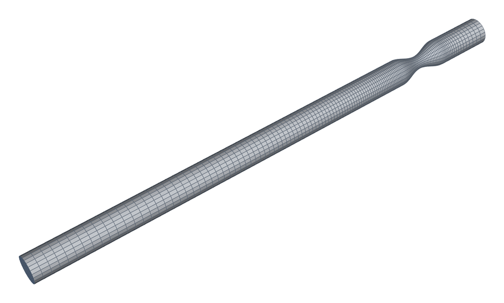
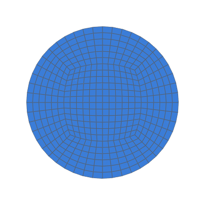
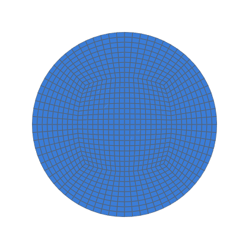

# Pulsatile flow through the cosine constriction (Varghese et al., Part 2)

Pulsatile laminar flow through a 75 % smooth cosine stenosis, against
the DNS of Varghese, Frankel & Fischer (2007), Part 2
([`varghese_and_frankel_etal_2007b`]; Purdue CFD Lab database)
(decision 0012, task 0068).  The first time-dependent validation with a
fitting, and the canonical vascular case (decision 0018).  It combines
the steady case's mesh (`validation/stenosis/`, task 0032) with the
Womersley inlet (`validation/womersley/`, task 0067).

```bash
python3 validation/stenosis_pulsatile/run.py --levels coarse --periods-max 1   # ~5 min
python3 validation/stenosis_pulsatile/run.py --levels coarse k2 k3 --dt-halved k2 \
    --np 4 --json out.json                                                     # ~1 day
python3 -m pytest -m openfoam tests/test_validation.py -k pulsatile            # one period
```

Needs Docker and the `opencfd/openfoam-default:2406` image
(`--openfoam`).  The database files carry no licence: they are
downloaded into `<work>/reference/` at run time (or `--reference DIR`),
never committed.  Cases go to `validation/stenosis_pulsatile/work/`
(git-ignored), or to `--work DIR`.

## Case

| | |
|---|---|
| Geometry | task 0032's: cosine stenosis s₀ = 0.25 (throat D/2), L = 2 D, 3 D upstream and 16 D downstream of the throat, D = 1 |
| Inlet | the paper's eq. 2.1 as stated, the Womersley profile u/u_c = (1 − r²) + A·Im{[1 − J₀(i^{3/2} α r)/J₀(i^{3/2} α)] e^{iωt}}: α = 7.5, A = 0.667, Re = 600 on the mean centreline velocity (u_c = 1, ν = 1/600, bulk Re 300), ω = 0.375, T = 16.755.  `timeVaryingMappedFixedValue`, `mapMethod nearest`, boundaryData written by Python every T/480 (0067's machinery) |
| Other boundaries | outlet p = 0, U zero gradient; wall no-slip |
| Start | from rest; periodic after 3 periods at every level |
| Levels | task 0032's `refined(k)`, k = 1 ("coarse"), 2, 3: 15 336 / 122 688 / 414 072 cells |
| Solver | `pimpleFoam` (v2406), laminar, `backward` in time, `limitedLinearV 1`; `adjustTimeStep` at Co 0.5; 3 pressure correctors, 1 non-orthogonal corrector |
| Periodic | the centreline velocity at every sampled phase changes by less than 0.5 % of its peak between periods |

## Phases

The paper gives t/T ≈ 0.09 + k/6 for the database's six files, read
from its fig. 1 (±0.01).  Each file's flow rate is conserved along the
straight pipe, so it fixes the file's phase on the inlet waveform more
precisely (the root nearer the nominal phase; the median over the
stations with |x| > 1 D, where the database's profiles keep the flow
rate to 0.3 %):

| file | nominal t/T | from flow rate |
|---|---|---|
| `vel_p1.dat` | 0.090 | 0.052 |
| `vel_p2.dat` (peak flow) | 0.257 | 0.263 |
| `vel_p3.dat` | 0.423 | 0.418 |
| `vel_p4.dat` | 0.590 | 0.563 |
| `vel_p5.dat` (minimum) | 0.757 | 0.755 |
| `vel_p6.dat` | 0.923 | 0.892 |

The run writes at both sets of phases.  The comparison uses the
flow-rate phases (design answer, task 0068): at the nominal ones p4 and
p6 differ from the DNS by up to 0.36 and 0.40 u_c, at the flow-rate
ones by up to 0.08 and 0.09 (k2).

## Measurement

Sampled by a `sets` function object at each target time (`cellPoint`
interpolation):
- **axis:** the centreline velocity along x (3 801 points);
- **probe:** the axial velocity at r = 0.48 D along x, the database's
  last point before the wall: reverse flow downstream (separation and
  its extent) and upstream (x in −2.5 … −1 D);
- **stations:** the axial velocity across the diameter at x/D = −2, 0,
  1, 2, 3, 4, 6, 10: RMS and max difference from the DNS on our points;
  the profile against its mirror image (axisymmetry); at −2 D, the
  departure from the exact Womersley profile.

Richardson extrapolation of the throat peak over the three levels
(ratios 2 and 3/2, the non-constant form of
[`celik_and_ghia_etal_2008`]).

## The database's inlet differs from eq. 2.1

The DNS's own x = −2 D profiles differ from the Womersley inlet by
0.03–0.145 u_c (max), at the phases their flow rates give; ours by 0.004–0.013
u_c at k3, falling with refinement.  At peak flow the DNS centreline
(1.696 u_c) exceeds the waveform's maximum at any phase (1.663), and the
paper's §3.1 reports upstream centreline velocities below 0.3 u_c at
minimum flow, below eq. 2.1's minimum of 0.337.  No single scale, A or α
fits the six files.  So the DNS's upstream flow swings wider than the
stated inlet; whether through an unstated inlet, upstream influence or a
database artefact isn't known.  Per design's answer the inlet stays eq.
2.1 as stated, and the station-by-station profile RMS is reported, not
gated (RESULTS.md).

<!-- mesh:start -->
## Mesh

_Generated by `python3 docs/gallery/build.py --validation stenosis_pulsatile`; don't edit between the markers._



<p>  </p>

Inlet cross-sections, left to right: coarse: nang 6, nrad 3, 142 axial layers; k2: nang 12, nrad 6, 284 axial layers; k3: nang 18, nrad 9, 426 axial layers.

| Mesh | Cells | min SICN | min SJ (where) | max aspect |
|---|---|---|---|---|
| coarse | 15 336 | 0.365 | 0.772 (#1 Reducer) | 4.7 |
| k2 | 122 688 | 0.345 | 0.732 (#1 Reducer) | 4.8 |
| k3 | 414 072 | 0.338 | 0.718 (#1 Reducer) | 4.8 |

<!-- mesh:end -->

## Results

See [RESULTS.md](RESULTS.md).
