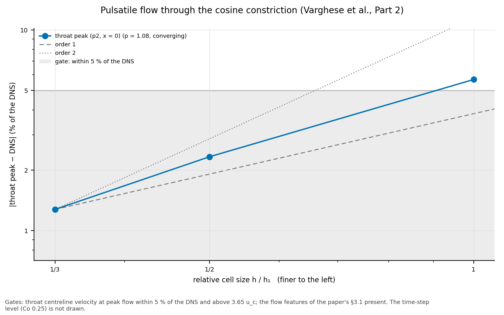
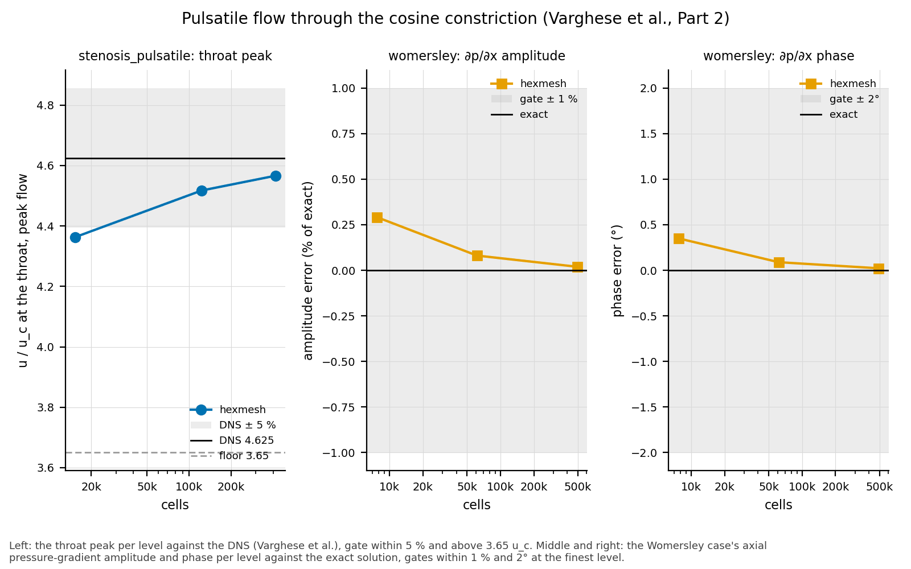

# Results: pulsatile flow through the cosine constriction (Varghese et al., Part 2)

**Status: accepted** (task 0068; gates as design set them, task 0068
Q2).  Every gate passes.  The station-by-station profiles are reported,
not gated: the database's upstream flow differs from the paper's stated
inlet (README.md).

Run 2026-10-31 to 11-02: hexmesh 2ca8836 plus the task's driver, gmsh
4.12.1, OpenFOAM v2406 (`opencfd/openfoam-default:2406` in Docker), 4
MPI processes (`decomposePar` method simple).  Reference: the DNS of
[`varghese_and_frankel_etal_2007b`], Purdue database `Axi_puls`
(downloaded 2026-10-31), velocities in u_c.

<!-- graphs:start -->
## Graphs

_Drawn from `results.json` by `python3 -m validation.tools.plots`; don't edit between the markers._



The throat peak's difference from the DNS against cell size.



The pulsatile throat peak, and Womersley's pressure-gradient amplitude and phase, per level against their references.

<!-- graphs:end -->

## Levels

| Level | Cells | min SJ | max non-orth. (°) | periods to periodic | last change | steps per period | wall time per period |
|---|---|---|---|---|---|---|---|
| coarse (k1) | 15 336 | 0.772 | 24.8 | 3 | 2.7e-04 | 1 730 | 2.5 min |
| k2 | 122 688 | 0.732 | 34.7 | 3 | 4.8e-05 | 3 980 | 48 min |
| k3 | 414 072 | 0.718 | 38.3 | 3 | 1.8e-04 | 6 120 | 6.8 h |
| k2, Δt halved (Co 0.25) | 122 688 | | | 2 (warm, from k2's periodic state) | 2.9e-03 | 8 160 | 95 min |

- **Mesh OK** at every level; cells predicted = cells in OpenFOAM.
- **Periodic:** the centreline velocity at every sampled phase changes
  by less than 0.5 % of its peak between periods; all levels start from
  rest and need 3 periods (the first change is 0.54–0.60).
- **Cost, for a surrogate study's budget:** 4 cores (Open MPI counts the
  4 physical cores).  k3 took 6.8 h per period, not the 3.6 h estimated
  from k2: about twice the steps per period at 3.4× the cells.  The
  coarse level's third period overlapped a full test-suite run (192 s
  against 134 and 159 s).

## Phases

Each database file's phase from its flow rate (README.md), with the
paper's nominal phase t/T ≈ 0.09 + k/6:

| file | nominal | from flow rate | Q (u_c D²) |
|---|---|---|---|
| p1 | 0.090 | 0.052 | 0.613 |
| p2 | 0.257 | 0.262 | 0.809 |
| p3 | 0.423 | 0.418 | 0.525 |
| p4 | 0.590 | 0.563 | 0.147 |
| p5 | 0.757 | 0.755 | −0.029 |
| p6 | 0.923 | 0.892 | 0.196 |

Everything below is at the flow-rate phases.  At the nominal ones p4 and
p6 differ from the DNS by up to 0.36 and 0.40 u_c (k2), at the flow-rate
ones by up to 0.08 and 0.09.

## Gate 1: the throat peak at peak flow

The centreline velocity at x = 0, p2:

| Level | u(0) / u_c | against the DNS (4.625) |
|---|---|---|
| coarse | 4.363 | −5.7 % |
| k2 | 4.517 | −2.3 % |
| k3 | 4.566 | **−1.3 %** |
| k2, Δt halved | 4.516 | −2.3 % (0.006 % from k2) |

- **The coarse level is outside the asymptotic range.**  The observed
  order over the three levels is 1.05 against the schemes' 2, and the
  coarse level lacks features the finer levels and the DNS share (no
  post-stenotic reverse flow at peak flow; at p3 a reverse-flow region
  4.1–11.2 D instead of 1–13.4 D).  So, as design asked, the
  convergence result is the **k2–k3 error band**: the k3 value 4.566 ±
  0.050 (1.1 %).  The formal three-level Richardson value, for the
  record, is 4.661 (+0.8 % from the DNS; GCI on k3 2.6 %).
- **Time step:** halving Δt at k2 changes the peak by 0.0003 u_c,
  0.5 % of the k2–k3 change.  The space error dominates.
- **Gate:** within 5 % of the DNS and above 3.65 u_c: k3 4.566, −1.3 %:
  **pass**.

## Gate 2: the flow features of the paper's §3.1

Reverse flow from the axial velocity at r = 0.48 D (the database's last
point before the wall); the DNS's extent from its stations, every 1 D.
k3, with k2 where it differs.

| Feature (paper) | Phase | Ours (k3) | DNS | |
|---|---|---|---|---|
| Jet and vortex ring in acceleration | p1 | jet 3.51 u_c at the throat; reverse flow 1.0–2.58 D | 3.55; reverse at the 2 D station, not at 3 D | **present** |
| | p2 | jet 4.57; reverse flow 1.0–8.23 D (k2 8.25) | 4.62; reverse at 2–7 D, not at 8 D | **present** |
| Separation over the whole post-stenotic section, late deceleration | p3 | reverse flow 1.0–13.37 D (k2 13.41) | 2–13 D, not at 14 D | **present** |
| | p4, p5 | reverse flow over the whole sampled length, 1–16 D | 2–15 D (every station) | **present** |
| Upstream separation at −1 D and −2 D, deceleration | p4, p5 | reverse flow −2.5 to −1.0 D: min −0.070 (p4), −0.058 (p5) | at −2 and −1 D: min −0.050, −0.038 | **present** |
| No permanent recirculation | p6 | no reverse flow anywhere | none | **present** (absent recirculation) |
| Laminar and axisymmetric | all | profile asymmetry ≤ 1.2e-3 u_c (k2 5.4e-3, coarse 1.7e-2); periodic to 1.8e-4 | laminar, axisymmetric | **present** |

- **The upstream reverse flow is the inlet's own.**  The Womersley
  profile at α 7.5, A 0.667 reverses near the wall in deceleration: at
  r = 0.48 D it gives −0.078 (p4) and −0.047 (p5) u_c.  Ours (−0.070,
  −0.058) follows it.  The DNS's is weaker (−0.050, −0.038), as its
  whole upstream flow departs from eq. 2.1 (below).  So the feature is
  present in both, but it doesn't test the stenosis's upstream influence.
- **The recirculation lengths converge:** k2 to k3 changes the end of
  the p2 region by 0.02 D and the p3 one by 0.04 D (0.2–0.3 %).  The DNS
  station spacing (1 D) doesn't resolve them better than that: ours ends
  0.2–1.2 D after the DNS's last reverse station at p2, and inside the
  DNS's interval at p1 and p3.  The DNS's regions start at its 2 D
  station; its 1 D station isn't reversed, ours is (from 1.0 D, where our
  probe starts).
- **Gate:** every feature present or absent as in the DNS: **pass**.

## Reported, not gated

### Upstream (x = −2 D) against the Womersley inlet

Max difference from eq. 2.1 (u_c):

| file | coarse | k2 | k3 | DNS |
|---|---|---|---|---|
| p1 | 0.100 | 0.028 | 0.013 | 0.145 |
| p2 | 0.060 | 0.015 | 0.007 | 0.034 |
| p3 | 0.052 | 0.019 | 0.009 | 0.078 |
| p4 | 0.083 | 0.023 | 0.011 | 0.117 |
| p5 | 0.039 | 0.009 | 0.004 | 0.083 |
| p6 | 0.057 | 0.021 | 0.010 | 0.027 |

Ours converges to the inlet: k2 to k3 (ratio 1.5) reduces it 2.1–2.3×,
order about 2.  The DNS's departs by 0.03–0.145 u_c and is the larger
part of every upstream mismatch.

### Profiles against the DNS, k3

RMS difference (u_c) by station x/D; the max in brackets at −2 and 0:

| file | −2 | 0 | 1 | 2 | 3 | 4 | 6 | 10 |
|---|---|---|---|---|---|---|---|---|
| p1 | 0.101 (0.148) | 0.288 (1.21) | 0.045 | 0.037 | 0.037 | 0.013 | 0.012 | 0.011 |
| p2 | 0.020 (0.035) | 0.397 (1.73) | 0.062 | 0.066 | 0.079 | 0.093 | 0.149 | 0.012 |
| p3 | 0.057 (0.078) | 0.243 (0.95) | 0.038 | 0.044 | 0.049 | 0.048 | 0.037 | 0.023 |
| p4 | 0.077 (0.118) | 0.061 (0.154) | 0.019 | 0.024 | 0.024 | 0.022 | 0.015 | 0.013 |
| p5 | 0.045 (0.082) | 0.027 (0.035) | 0.024 | 0.030 | 0.032 | 0.033 | 0.033 | 0.031 |
| p6 | 0.016 (0.025) | 0.080 (0.296) | 0.010 | 0.010 | 0.009 | 0.009 | 0.007 | 0.005 |

- Downstream of the throat (1–10 D) the RMS is 0.005–0.149 u_c.  It is
  below the task's original provisional 5 % of u_c at 37 of the 42
  station–phase pairs; the five over are all p2 (peak flow), at 1–6 D,
  where the jet's shear layer and vortex ring pass.
- **At p2, 3–6 D, refinement moves us away from the DNS:** k2 to k3 the
  RMS goes 0.053 → 0.079 (3 D), 0.053 → 0.093 (4 D), 0.103 → 0.149
  (6 D), while it falls at 1 D (0.163 → 0.062) and 2 D (0.085 → 0.066).
  Our jet decays more slowly than the DNS's: its centreline at 6 D is
  4.14 (k2) and 4.20 (k3) against 3.93, and k3's is faster than k2's at
  every station from 1 D on (less numerical diffusion).  The jet's
  strength depends on the upstream flow, which differs from the DNS's;
  whether that explains the slower decay isn't resolved here.  It is why
  the profiles aren't gated.
- **x = 0 is suspect on the DNS side:** the DNS's flow rate at the throat
  is 6 % off the pipe's at p2, and the large max differences there sit
  at the wall, where the throat profile is steepest.  The RMS there stays
  0.24–0.40 at k2 and k3.
- Upstream (−2 D) the RMS is the DNS's departure from the inlet above.

## Toolchain

- **v2406 in Docker**, as task 0067; one toolchain for the whole case.
- **The halved-Δt run** starts from k2's periodic state on a period
  boundary.  A first attempt started its periods at the restart time
  itself, which put its targets 0.04–0.07 T off their phases; found from
  its features (p6 separated), discarded, and the driver fixed
  (`run_level`).

## Reproduce

```bash
python3 validation/stenosis_pulsatile/run.py --levels coarse k2 k3 --dt-halved k2 \
    --np 4 --json out.json
```
