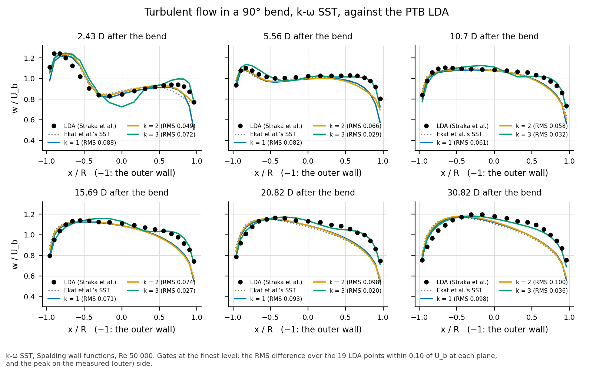

# Results: turbulent flow in a 90° bend

**Status: reported with two levels (task 0050, design answer Q6).**
- **The verdict's levels:** the wall cell fixed at 50 viscous units, solved
  time-accurately (pimpleFoam) to a steady state.  At level 2 (450 k
  cells) both gates pass at all six planes: the RMS difference from the
  LDA is 0.060 to 0.096 of U_b (gate 0.10), and every peak is on the
  outer wall, as measured.
- **Not the finest planned level.**  Level 3 (1.49 M cells) would take
  roughly 30-150 h this way on 4 processes; it was stopped.  It is open
  to volunteers (`validation/VOLUNTEERS.md`): the run solves level 2,
  maps it onto level 3 and runs there to the same convergence stop,
  saving its state every 50 steps.  With two levels there is no GCI.
- **K:** 0.2201 at level 1, 0.2623 at level 2; Ito (1960) gives 0.2626.
  Reported, not gated.  A third level is needed before the agreement at
  level 2 means anything.
- **Solver-side uncertainty:** on the level-1 mesh, four converged
  algorithms give K from 0.2201 to 0.2269 (below).

Run on 2026-11-21 and 22 with OpenFOAM v2406 (Docker) and gmsh 4.12.1,
at hexmesh 618e166.  The gate and K numbers below are recomputed from
`results.json` by `python3 -m validation.tools.recheck turbulent_bend`.

<!-- graphs:start -->
## Graphs

_Drawn from `results.json` by `python3 -m validation.tools.plots`; don't edit between the markers._

The axial velocity across the bend plane at the six LDA planes: the measurements, each level, and the paper's own k-ω SST.

<!-- graphs:end -->

## Gate: RMS of w/U_b against the LDA, per plane

Time-accurate, the wall cell fixed (`transient_fixed_k1`, `transient_fixed_k2`):

| plane | level 1 | **level 2** | Ekat et al.'s SST |
|---|---|---|---|
| 2.43 D | 0.0829 | **0.0727** | 0.0554 |
| 5.56 D | 0.0802 | **0.0738** | 0.0654 |
| 10.7 D | 0.0609 | **0.0598** | 0.0504 |
| 15.69 D | 0.0718 | **0.0705** | 0.0718 |
| 20.82 D | 0.0959 | **0.0906** | 0.1032 |
| 30.82 D | 0.1023 | **0.0958** | 0.1086 |

Ekat et al.'s SST (their mesh 3c, a half domain with a symmetry plane,
OpenFOAM v1812) is read from the same figure at the LDA points
(`reference/README.md`).  The full domain here showed none of the
asymmetry they report for SST on full domains.

## Gate: the side of the peak (x/R; negative is the outer wall)

| plane | LDA | level 1 | **level 2** |
|---|---|---|---|
| 2.43 D | −0.828 | −0.748 | **−0.748** |
| 5.56 D | −0.828 | −0.828 | **−0.828** |
| 10.7 D | −0.657 | −0.309 | **−0.309** |
| 15.69 D | −0.555 | −0.439 | **−0.439** |
| 20.82 D | −0.439 | −0.555 | **−0.439** |
| 30.82 D | −0.163 | −0.439 | **−0.439** |

## Reported: f, K and how each level converged

| level | cells | n_arc, n_radial, axial cell | f (precursor) vs McKeon | first-cell y⁺ | K | peak w/U_b at 2.43 D | at 10.7 D |
|---|---|---|---|---|---|---|---|
| 1 | 59 200 | 8, 8, D/4 | +0.55 % | 23.2 | 0.2201 | 1.220 | 1.084 |
| 2 | 449 920 | 16, 15, D/8 | +0.77 % | 23.3 | 0.2623 | 1.242 | 1.071 |

- **Ito (1960):** K = 0.2626 for this bend (r/D 1.425, Re 5 × 10⁴),
  from the correlation as Villegas-León et al. (2021) give it.
- **Two levels, so no Richardson or GCI.**  The levels don't nest: the
  wall cell is the same at both, so the ring's cells grow 1.127 per cell
  away from the wall at level 1 and shrink slightly (0.97 per cell) at
  level 2.
- **Convergence:** each level was run from the steady solver's state to
  a steady flow.  The stop: over the last flow-through (12.8 s), K moved
  by less than 1e-4 relative and w at every LDA point by less than
  0.001 U_b.  Level 1 stopped at 2.0 flow-throughs (bands 2.2e-6 and
  8.8e-4), level 2 at 2.5 (1.3e-7 and 2.0e-6).

## Solver-side uncertainty: one mesh, four algorithms

On the level-1 mesh every one of these converges, to a different K:

| algorithm | K | from the time-accurate | K, ddtCorr off |
|---|---|---|---|
| pimpleFoam, time-accurate, Co 1 (the verdict's) | 0.2201 | — | 0.2127 |
| simpleFoam, SIMPLE, bounded schemes (the first study) | 0.2223 | +1.0 % | (no ddtCorr) |
| pimpleFoam, local time-stepping (localEuler), Co 5 | 0.2257 | +2.5 % | 0.2225 |
| simpleFoam, SIMPLEC (consistent) | 0.2269 | +3.1 % | (no ddtCorr) |

- ddtCorr is pimpleFoam's `PIMPLE` switch, on by default; simpleFoam
  has none (`docs/integrations/openfoam.md`).
- **ddtCorr isn't the cause** (task 0190): with it off the spread is
  wider (0.2127-0.2269, 6.7 %).  On its own it moves the time-accurate K
  by 3.4 %.  The likely reading is that on this coarse mesh the face
  flux's momentum interpolation is a discretisation error of several
  percent in K, which should shrink with refinement.  Level 2 wasn't
  checked.
- On a coarse mesh this is about 3 % of K; level 2 wasn't checked for
  it.  The verdict uses one algorithm at every level, so the spread
  stays out of the comparison between levels.

## The studies, in order

1. **`refined(k)`** (levels `k1`-`k3`, 2026-11-19; the figure's first
   version).  The gates passed at k = 3 (RMS 0.020-0.072).  But
   `refined(k)` splits the wall cell, so first-cell y⁺ fell 23, 11.6,
   7.8 and the precursor's f drifted +0.6 %, +6.1 %, +9.0 % from McKeon:
   each level ran a different near-wall model.  K was 0.222, 0.261,
   0.254 (oscillatory).  This is why the verdict holds the wall cell
   fixed (Q2).
2. **The wall cell fixed at 50 viscous units, SIMPLE** (`fixed_k1`,
   `fixed_k2`).  f held (+0.55 %, +0.77 %).  But level 2 never met
   residualControl: its residuals sat on a plateau, and K wandered
   0.227-0.271 with the start and the relaxation.
3. **The wall cell at 25** (`fixed25_k2`, Q3's test).  The same
   plateau, and f +5.9 % (first-cell y⁺ 12.0): the buffer layer again.
4. **pimpleFoam, time-accurate** (Q4).  Level 2 settled to a steady state
   with K 0.26233 (`transient_window_fixed_k2`, stopped on running means).
   So the plateau was the steady solver's, not an unsteady flow.
5. **SIMPLEC** (`simplec_k2`, Q5's test): stalled too, K 0.2708 after
   6 000 steps.
6. **pimpleFoam, time-accurate, with the convergence stop** (Q5): levels
   1 and 2, the verdict above.  Level 2 matched step 4's K to five
   digits.  Level 3 ran 135 steps in 2.1 h (56 s per step at a 0.0026 s
   step) and was stopped: about 9 800 steps would be needed.
7. **Local time-stepping** (`lts_fixed_k1`, Q6's test).  It converged at
   level 1, but to K 0.2257 (+2.5 %), and was no cheaper (2 000
   iterations, 30 min, against 5.5 min).  So level 3 wasn't run this way.

The tables of the superseded studies are in `results.json` and task
0050's notes.

## Mesh

| level | min scaled Jacobian | min SICN | max non-orthogonality | max skewness | max aspect ratio |
|---|---|---|---|---|---|
| 1 | 0.770 | 0.051 | 28.1° | 0.61 | 49.7 |
| 2 | 0.740 | 0.061 | 36.0° | 0.98 | 51.6 |

`checkMesh` passes at both.  Level 2's ring has 15 cells over the same
wall cell, so it grows slightly inward (ratio 0.97 per cell); its skewness
is 0.98 where the first study's k = 2 had 0.56.

## Cost (4 processes)

| level | precursor and steady start | pimpleFoam to steady |
|---|---|---|
| 1 | 1 min | 5.5 min (1 535 steps) |
| 2 | 29 min | 4 h 51 min (5 929 steps) |
| 3 | not recorded | stopped after 135 steps in 2.1 h; estimated 40-150 h |
| 3, mapped from level 1 | 16 min (precursor and mapping) | 150 steps, 2.2 h: 67, 49 and 45 s per step by 50-step chunk |

Level 2's chunks of half a flow-through took 124, 62, 37, 34 and 34
min for about 1 190 steps each: the pressure solve's work falls as the
flow settles.  Level 3 started from a mapped solution falls the same way
at first.  The volunteer card puts the run at 30-150 h on 4 processes:
about 1.5-2.5 flow-throughs of 4 600 steps, at 15-45 s per step.
