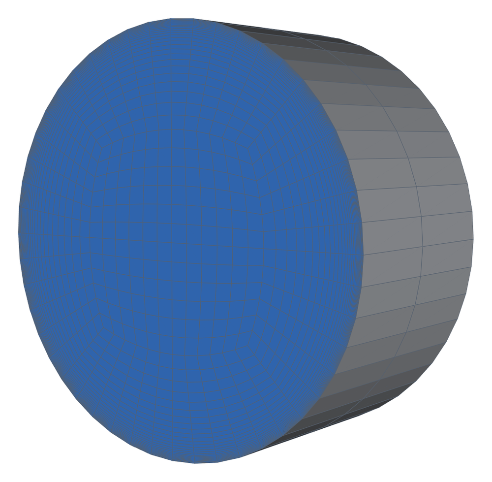
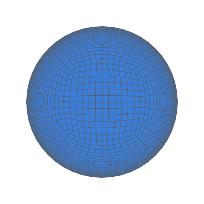
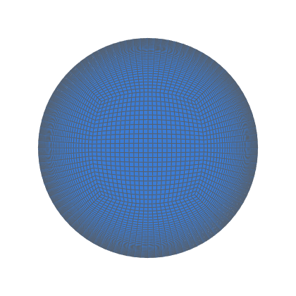
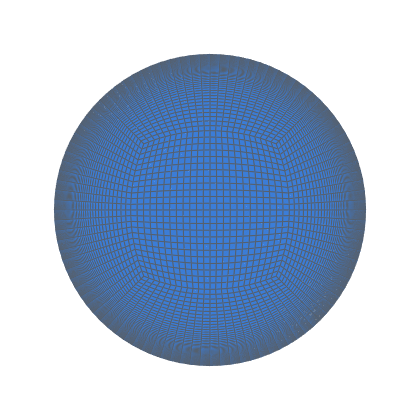
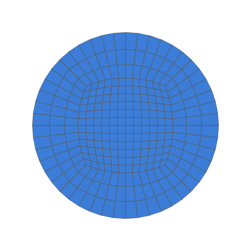
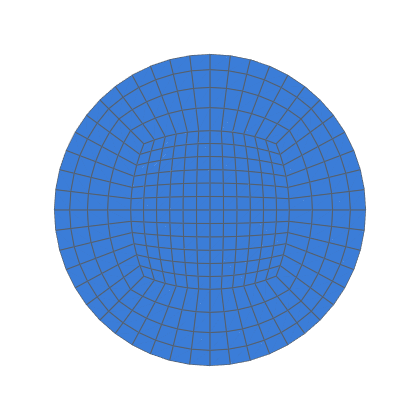
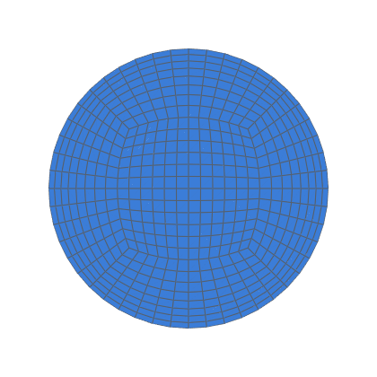

# Turbulent pipe flow (k-ω SST)

Fully developed turbulent flow in a smooth pipe, against DNS profiles
and the Superpipe friction factor (decision 0012, V2; task 0049).

```bash
python3 validation/turbulent_pipe/run.py --np 4         # every case
python3 validation/turbulent_pipe/run.py --cases lowre_550 --levels 1
python3 -m validation.tools.recheck turbulent_pipe       # gates, from results.json
```

The runs need OpenFOAM v2406 (Docker `opencfd/openfoam-default:2406` by
default).

## Case

| | |
|---|---|
| Domain | a periodic pipe, R = 0.05 m, length R.  hexmesh's open ends become a translational `cyclic` pair (`createPatch`) |
| Driving | `meanVelocityForce`, U_b = 1 m/s.  ν = U_b D / Re_b |
| Model | `kOmegaSST`, steady `simpleFoam`, `linearUpwind` |
| Wall-resolved (`lowre_*`) | the wall cell 1 viscous unit high at McKeon's u_τ (`first_cell`), radial growth ≤ 1.15.  Walls: k = 0, `omegaWallFunction`, `nutLowReWallFunction` |
| Wall functions (`wfs_*`, gated) | the wall cell 100 viscous units high, its centre near y⁺ 50.  `kqRWallFunction`, `omegaWallFunction`, `nutUSpaldingWallFunction` |
| Wall functions, reported (`wf_*`, `wfu_*`) | the same meshes with OpenFOAM's standard `nutkWallFunction`, and with `nutUWallFunction` |
| Re_b | 19 000 and 37 700 (the DNS at Re_τ 550 and 1000), and 10⁵ (f only) |
| Levels | lowre_550 at k = 1, 2, 4 (`refined`).  lowre_1000 and lowre_1e5 at k = 2.  The wall-function cases at k = 1 |

<!-- mesh:start -->
## Mesh

_Generated by `python3 docs/gallery/build.py --validation turbulent_pipe`; don't edit between the markers._



<p>           </p>

Inlet cross-sections, left to right: lowre_550, k = 1; lowre_1000, k = 2; lowre_1e5, k = 2; wf_550, k = 1; wf_1000, k = 1; wf_1e5, k = 1; wfu_550, k = 1; wfs_550, k = 1; wfu_1000, k = 1; wfs_1000, k = 1; wfu_1e5, k = 1; wfs_1e5, k = 1.

| Mesh | Cells | min SICN | min SJ (where) | max aspect |
|---|---|---|---|---|
| lowre_550 | 2 880 | 0.009 | 0.752 (#0 Straight) | 335.9 |
| lowre_1000 | 26 112 | 0.005 | 0.730 (#0 Straight) | 635.9 |
| lowre_1e5 | 31 488 | 0.002 | 0.730 (#0 Straight) | 1515.1 |
| wf_550 | 576 | 0.226 | 0.752 (#0 Straight) | 6.9 |
| wf_1000 | 672 | 0.226 | 0.752 (#0 Straight) | 6.9 |
| wf_1e5 | 1 056 | 0.190 | 0.752 (#0 Straight) | 14.6 |
| wfu_550 | 576 | 0.226 | 0.752 (#0 Straight) | 6.9 |
| wfs_550 | 576 | 0.226 | 0.752 (#0 Straight) | 6.9 |
| wfu_1000 | 672 | 0.226 | 0.752 (#0 Straight) | 6.9 |
| wfs_1000 | 672 | 0.226 | 0.752 (#0 Straight) | 6.9 |
| wfu_1e5 | 1 056 | 0.190 | 0.752 (#0 Straight) | 14.6 |
| wfs_1e5 | 1 056 | 0.190 | 0.752 (#0 Straight) | 14.6 |

<!-- mesh:end -->

## Post-processing (Python)

- **τ_w:** the momentum balance, (dp/dx) V / A_wall, using the pressure
  gradient `meanVelocityForce` applied.  This is exact for the mesh.
  f = 8 τ_w / U_b².
- **First-cell y⁺:** u_τ times the wall-normal distance of each wall
  cell's centre from its wall face.
- **u⁺(y⁺) and U_c:** interpolated from one cross-section's cell centres
  along the 45° radius, in (distance to the nearest wall face, angle).
  The meshed wall is faceted, so R − r would misplace the wall cells by
  about a viscous unit.
- **Pipeline check:** a laminar Re 100 on the same set-up gives f within
  0.1 % of 64/Re.

## Data

`data/`: the El Khoury et al. (2013) mean profiles, CC-BY-4.0; see
[data/README.md](data/README.md).  Results: [RESULTS.md](RESULTS.md).
