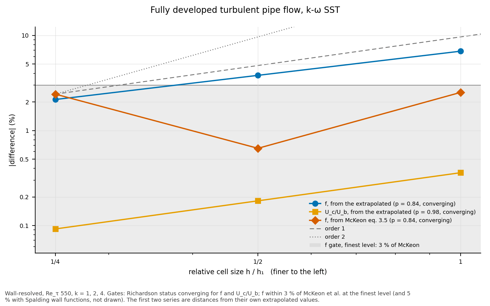

# Results: fully developed turbulent pipe flow, k-ω SST

**Status: accepted** (task 0049; design answers 2026-11-06).  The mesh's
part is gated: f, and mesh convergence.  The turbulence model's part is
reported: U_c/U_b and u⁺ against the DNS, and the standard wall
functions.

- **Run:** 2026-11-06, with OpenFOAM v2406 (Docker
  `opencfd/openfoam-default:2406`) and gmsh 4.12.1, at hexmesh 42357ca
  plus this task's uncommitted changes, on 4 MPI processes.
- **References:**
  - f: McKeon, Zagarola & Smits (2005), eq. 3.5.  It gives 0.02651,
    0.02249 and 0.01818 at Re_b 19 000, 37 700 and 10⁵.
  - U_c/U_b and u⁺: El Khoury et al. (2013), the DNS (`data/`).  At Re_τ
    550 and 1000 it gives f 0.02682 and 0.02247, and U_c/U_b 1.2620 and
    1.2417.
- **Recheck:** `python3 -m validation.tools.recheck turbulent_pipe`.

<!-- graphs:start -->
## Graphs

_Drawn from `results.json` by `python3 -m validation.tools.plots`; don't edit between the markers._

f and U_c/U_b at Re_τ 550 against cell size, from their extrapolated values and from McKeon et al.

<!-- graphs:end -->

## Gates

| quantity | value | gate | verdict |
|---|---|---|---|
| f, lowre_550 (k = 4, first-cell y⁺ 0.12) | +2.41 % | within 3 % of McKeon | pass |
| f, lowre_1000 (k = 2, y⁺ 0.24) | −0.55 % | within 3 % | pass |
| f, lowre_1e5 (k = 2, y⁺ 0.24) | −1.60 % | within 3 % | pass |
| f, wfs_550 / wfs_1000 / wfs_1e5 (Spalding, y⁺ ≈ 48) | −0.37 / −2.04 / −3.27 % | within 5 % | pass |
| f, lowre_550, k = 1, 2, 4 | order 0.84, GCI 2.7 % | Richardson converging | pass |
| U_c/U_b, lowre_550, k = 1, 2, 4 | order 0.98, GCI 0.1 % | Richardson converging | pass |

f **converges slowly**, from below: its extrapolation is +4.6 % from
McKeon (+3.4 % from the DNS's f).  The gate applies to the finest level,
as the task set it.

## Reported (not gated)

| quantity | value | note |
|---|---|---|
| U_c/U_b, lowre_550 (k = 4) | −3.98 % from the DNS | 3 % comparison **missed**: k-ω SST's weak outer wake, a model bias (mesh-converged, GCI 0.1 %) |
| U_c/U_b, lowre_1000 (k = 2) | −4.68 % | missed, as above |
| f, wf (nutkWallFunction), Re_b 19 000 / 37 700 / 10⁵ | −7.26 / −7.08 / −7.22 % | under-predicts by about 7 %: `docs/integrations/openfoam.md` |
| f, wfu (nutUWallFunction) | −5.34 / −6.53 / −7.29 % | |
| U_c/U_b, every wall-function variant | −6.4 to −7.6 % | |

Against the DNS's own f, lowre_550 at k = 4 is +1.22 % and lowre_1000 is
−0.48 %.

## Convergence (lowre_550; k = 1, 2, 4)

`refined(k)`: nang and nrad are ×k, the radial growth is its k-th root,
and the axial layers are ×k (irrelevant to an axially uniform flow).

| quantity | k = 1 | k = 2 | k = 4 | status | order | extrapolated | GCI (fine) |
|---|---|---|---|---|---|---|---|
| f | 0.02584 | 0.02668 | 0.02715 | converging | 0.84 | 0.02774 (+4.6 % McKeon, +3.4 % DNS) | 2.7 % |
| U_c/U_b | 1.2086 | 1.2107 | 1.2118 | converging | 0.98 | 1.2129 (−3.9 % DNS) | 0.1 % |

The U_c deficit is the model's, not the mesh's: its GCI is 0.1 %.
f converges slowly and from below.  Its extrapolation lies outside the
3 % gate, although the finest level is inside it.

## u⁺(y⁺) against the DNS (reported, no gate)

At the 45° radius of one cross-section, interpolated in (wall distance,
angle).

| case | y⁺ = 1 | 10 | 30 | 100 | centre |
|---|---|---|---|---|---|
| DNS, Re_τ 550 | 1.00 | 8.47 | 13.57 | 16.66 | 21.80 |
| lowre_550, k = 4 | 1.00 | 8.29 | 12.90 | 16.80 | 20.80 |
| wf_550 | — | — | — | 17.18 | 21.03 |
| DNS, Re_τ 1000 | 1.00 | 8.45 | 13.48 | 16.51 | 23.43 |
| lowre_1000, k = 2 | 1.00 | 8.37 | 12.97 | 16.80 | 22.39 |

The model's buffer layer is low (−0.6 at y⁺ 30), and its log layer is
slightly high at y⁺ 100.  The wake is weaker than the DNS's, by about
1 u⁺ at the centre.  That is the U_c deficit.  `results.json` holds the
full profiles.

## Wall functions

The meshes and the k and ω wall functions are the same for all three;
only the nut wall function changes.

| Re_b | nutkWallFunction | nutUWallFunction | nutUSpaldingWallFunction (gated) |
|---|---|---|---|
| 19 000 | −7.26 % | −5.34 % | −0.37 % |
| 37 700 | −7.08 % | −6.53 % | −2.04 % |
| 10⁵ | −7.22 % | −7.29 % | −3.27 % |

U_c/U_b is 6.4–7.6 % low with all three.  Neither nang 12–48 nor nrad
3–12 changed wf_550's f by more than 0.3 % (trials, task Agent notes).
