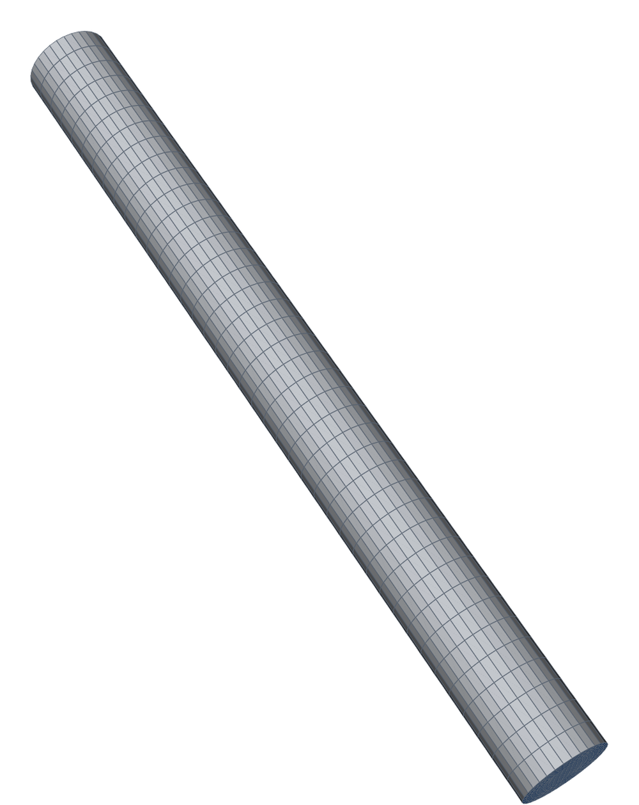
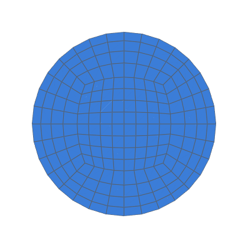
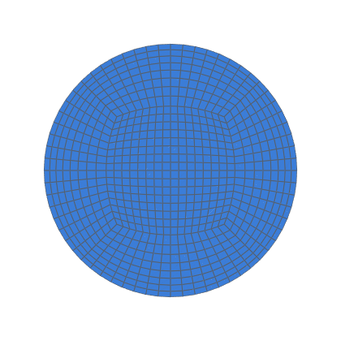
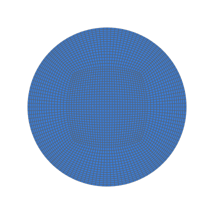

# Womersley flow (pulsatile laminar pipe flow)

Fully developed pulsatile flow in a straight pipe meshed by hexmesh,
against the exact solution (Womersley 1955), at three refinement levels
and one halved time step (decision 0012, task 0067).  The first
time-dependent case: it checks the transient solver path and the
time-varying, spatially varying inlet that the pulsatile stenosis (task
0068) needs.

```bash
python3 validation/womersley/run.py --levels k1               # coarsest level (~2 min)
python3 validation/womersley/run.py --np 4 --dt-halved k2 --json out.json  # all (~6 h)
python3 -m pytest -m openfoam tests/test_validation.py -k womersley       # coarsest level
```

Needs Docker and the `opencfd/openfoam-default:2406` image (decision
0012's toolchain; `--openfoam native` for a local installation).  Cases
go to `validation/womersley/work/<level>/` (git-ignored), or to
`--work DIR`.

## Case

| | |
|---|---|
| Pipe | D = 1, length 10 D, flow along +x; interfaces at 4 D, 5 D and 6 D, so the pressure planes (4 D, 6 D) and the profile plane (5 D) lie on mesh faces |
| Flow | the stenosis paper's inlet ([`varghese_and_frankel_etal_2007b`] eq. 2.1): u/u_c = (1 − (r/R)²) + A·Im{[1 − J₀(i^{3/2} α r/R)/J₀(i^{3/2} α)] e^{iωt}}, α = 7.5, A = 0.667, Re = u_c D/ν = 600 with u_c = 1, so ν = 1/600, ω = 0.375, T = 16.755 |
| Exact pressure gradient | −∂p/∂x = 4νu_c/R² + ω u_c A cos ωt (kinematic): the Poiseuille part, and from the momentum equation with u's oscillatory part u_c A Im{F(r) e^{iωt}}, Im{iω u_c A e^{iωt}} |
| Boundary conditions | inlet `timeVaryingMappedFixedValue`, `mapMethod nearest`, the exact profile at the inlet face centres written by Python into `constant/boundaryData/fluid_inlet/` at **every solver time step** (so the BC's linear time interpolation is exact at each step); p `zeroGradient`.  Outlet p = 0, U `zeroGradient`; wall `noSlip` |
| Initial state | the exact profile at t₀ = 0.09 T (the first phase) in every cell, p = 0 |
| Levels | `nang` 8 / 16 / 32, `nrad` 4 / 8 / 16 graded toward the wall (`mprg` 0.85^(1/k)), 40 / 80 / 160 axial layers (uniform); 240 / 480 / 960 time steps per period (Co ≈ 0.47); k2 also at 960 (Δt halved, warm-started from its periodic state) |
| Solver | `pimpleFoam`, laminar, `backward` (second order) in time, `Gauss limitedLinearV 1` for convection; 3 pressure correctors, 1 non-orthogonal corrector, no relaxation, absolute tolerances 1e-10 (p) and 1e-12 (U) |
| Periodicity | one period per run, restarted from the last; done when the centreline velocity and the pressure gradient at the six phases change by less than 0.1 % (of u_c, and of the gradient amplitude) between consecutive periods |

## Measurement

At each of 48 samples per period (fields written every T/48 from t₀, so
the six phases t/T = 0.09 + k/6 of the stenosis data are samples):

- **Profile** on the mid plane's faces (face value = mean of the two
  cells; the axial spacing is uniform): max and area-weighted RMS error
  against the exact profile at the face centres, as % of u_c.
- **Centreline velocity:** the mean of the four faces nearest the axis,
  against the exact profile at the same four points.
- **Pressure gradient:** the area-mean pressures of the 4 D and 6 D planes;
  over the last period, a least-squares fit c₀ + c₁ cos ωt + s₁ sin ωt
  gives its amplitude and phase against the exact ones.
- **Inlet check:** the applied inlet face values in every written field
  against the formula.

Peak and minimum are the samples of the last period with the largest and
smallest exact centreline velocity.  Richardson extrapolation (decision
0015, [`celik_and_ghia_etal_2008`]) over the three levels for the
centreline velocity at peak and the pressure-gradient amplitude.

<!-- mesh:start -->
## Mesh

_Generated by `python3 docs/gallery/build.py --validation womersley`; don't edit between the markers._



<p>  </p>

Inlet cross-sections, left to right: k1: nang 8, nrad 4, 40 axial layers; k2: nang 16, nrad 8, 80 axial layers; k4: nang 32, nrad 16, 160 axial layers.

| Mesh | Cells | min SICN | min SJ (where) | max aspect |
|---|---|---|---|---|
| k1 | 7 680 | 0.339 | 0.773 (#0 Straight) | 6.5 |
| k2 | 61 440 | 0.325 | 0.741 (#0 Straight) | 6.8 |
| k4 | 491 520 | 0.318 | 0.724 (#0 Straight) | 6.9 |

<!-- mesh:end -->

## Results

See [RESULTS.md](RESULTS.md).
